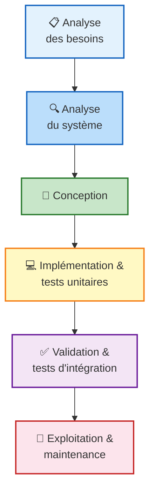
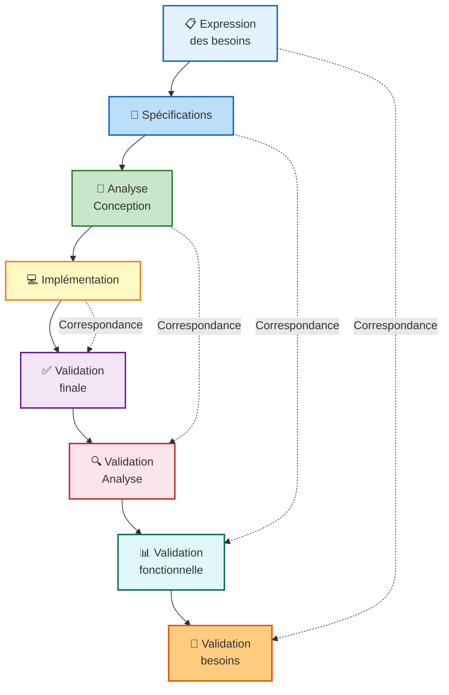
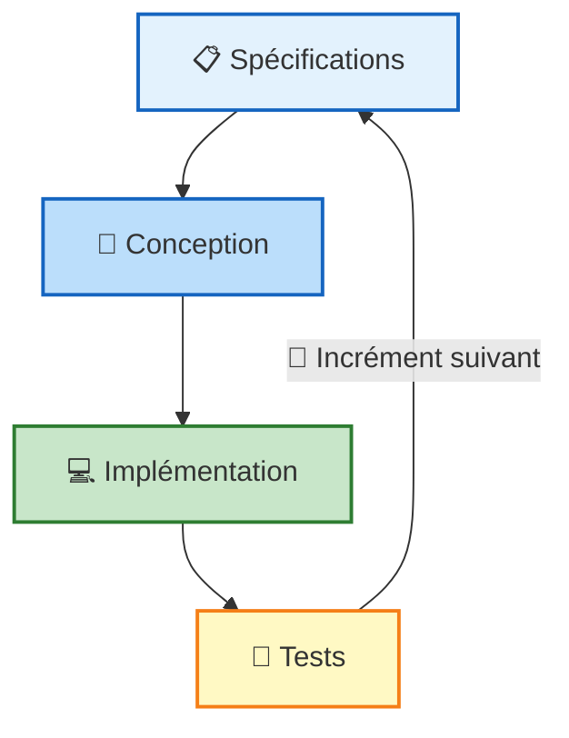
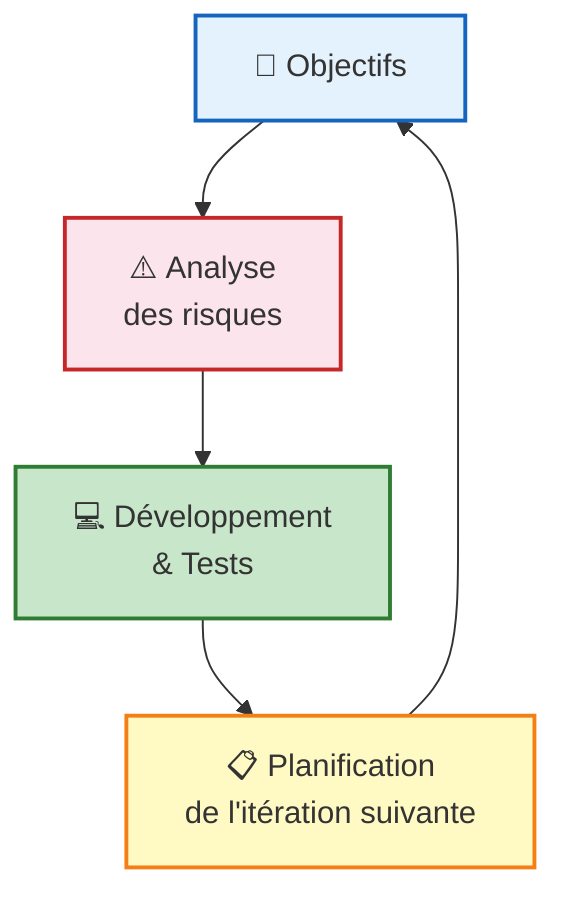
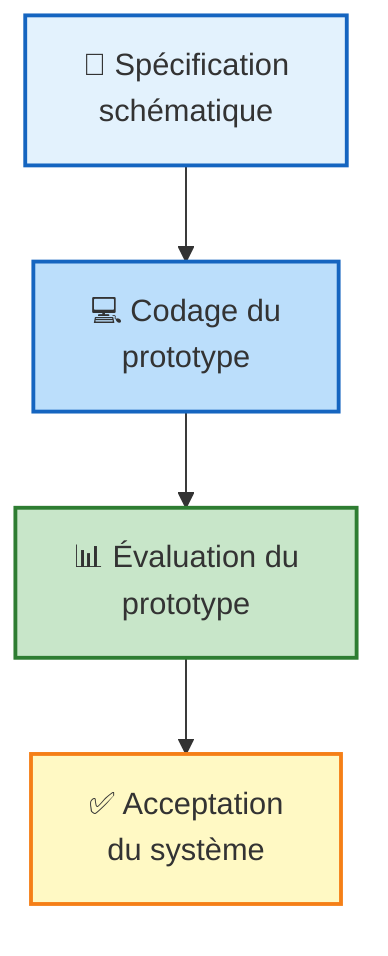
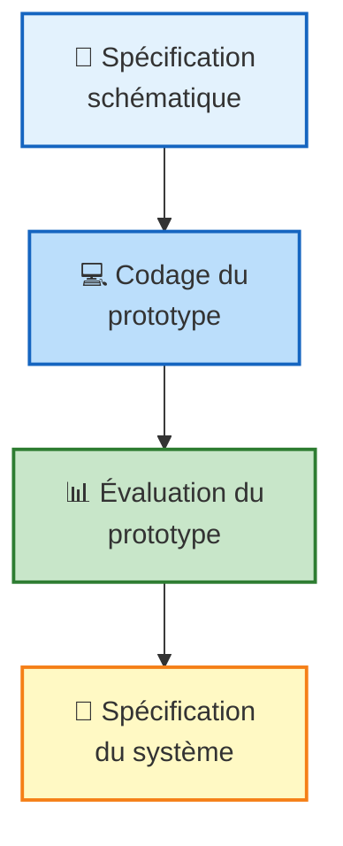

# Logiciel
> Un logiciel est un ensemble d'entites necessaire au fonctionnement d'un processus de traitement automatique d'informations.

# Processus
>Un ensemble d'activites qui conduisent a la production d'un logiciel.

**Étapes du processus : **
1. Analyse de besoin
2. Conception
3. Codage 
4. Tests
5. Maintenance
---
# Modèles linéaires

## 1. Modèle en cascade

>**Pas de validation intermédiaire. Haut risque : erreurs coûteuses !**

**Quand l'utiliser ?**
- Quand les besoins sont connus et stables
- Lors de la création d'une nouvelle version d'un produit existant
- Quand la technologie à utiliser est maîtrisée
- Lors du portage d'un produit sur une autre plateforme
## 2. Modèle en V

> Validations intermédiaires pour prévenir les erreurs tardives : meilleure planification et gestion.

**Quand l'utiliser ?**
- Quand les besoins sont connus à l'avance
- Les technologies à utiliser sont connues à l'avance
- Quand le produit à développer a de très hautes exigences de qualité
---
# Modèles itératifs
## 1. Modèle de développement incrémental

**Quand l'utiliser ?**
- Quand la plupart des spécifications sont connues à l'avance et vont être sujettes à de faibles évolutions.
- Quand on veut rapidement un produit fonctionnel.
- Pour des projets de longues durées.
- Pour des projets impliquant de nouvelles technologies.

## 2. Modèle de développement en spirale

## 3. Prototypage jetable
>**Idée :** fournir rapidement un prototype exécutable pour permettre une validation concrète (ici expérimentale) et non sur papier (document).

## 4. Prototypage évolutif

---
# Méthodes Agiles
