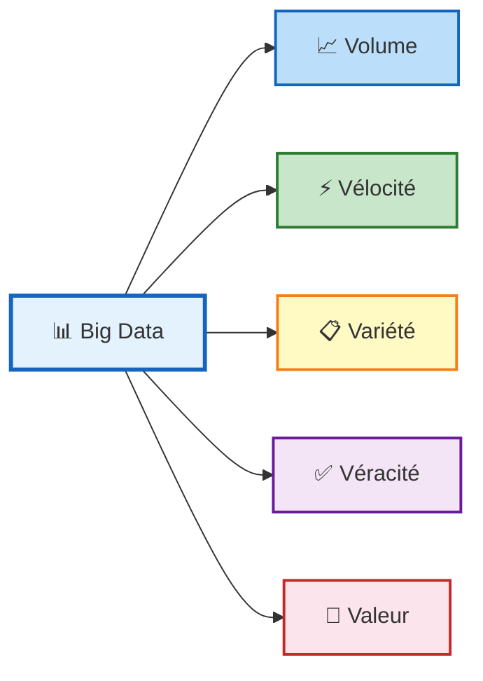
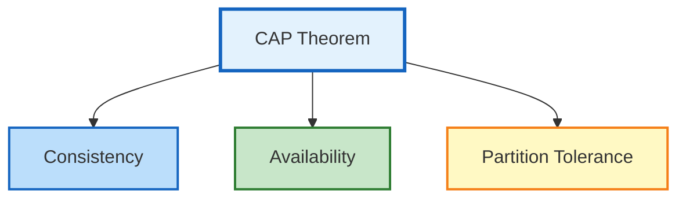
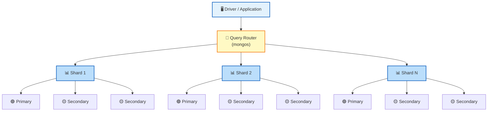
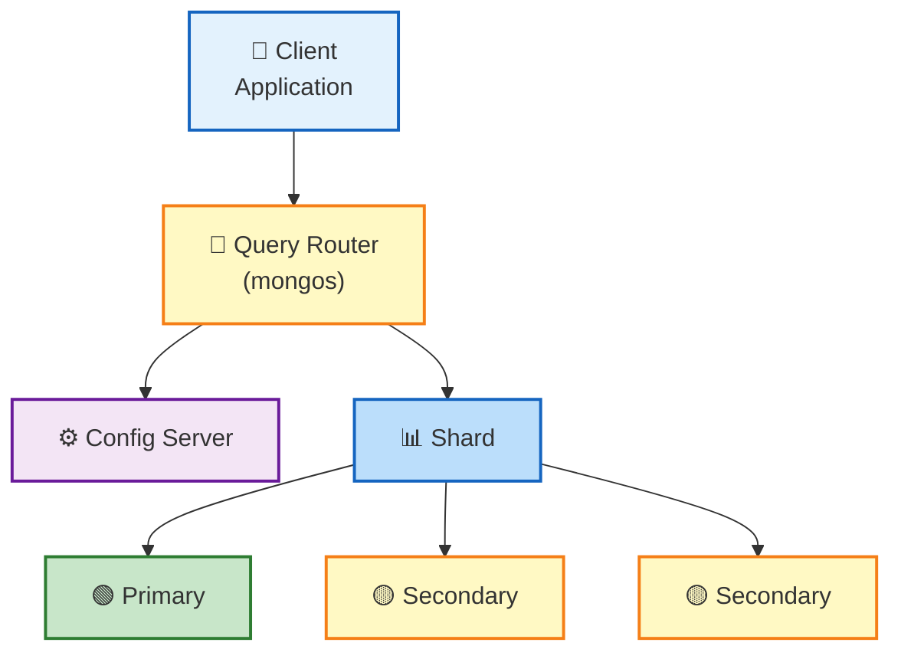

# BASES DE DONNÉES NOSQL

**Pr. ESSWIDI AYOUB**

---

## 00 — Rappel & Notions de base

---

### Le défi de la gestion des données

- **Explosion des données** : volume, variété, vélocité
- **Limites des SGBDR traditionnels**
  - Schéma rigide
  - Jointures coûteuses
  - Mise à l'échelle horizontale difficile
- **Besoin de modèles de données flexibles**
  - Gestion des données non structurées et semi-structurées
- **Bases de données NoSQL**
  - Adapté aux charges de travail modernes

> Les 3V : Volume, Variété, Vitesse

---

### Big Data

#### Les 5 V :



#### Les 10 V :

1. **Volume**
2. **Vélocité** (Vitesse)
3. **Variété**
4. **Véracité**
5. **Valeur**
6. Validité
7. Vulnérabilité
8. Variabilité
9. Volatilité
10. Visualisation

> Le Big Data n'a de sens que s'il apporte de la valeur ajoutée, i.e. répondre à des objectifs.

---

#### Volume

- Quantité massive de données générées (ex. téraoctets, pétaoctets, zettaoctets, yottaoctets)
- **Volume → Scalabilité**
  - **Scale-Up** (vertical) : ajouter du CPU, de la RAM
  - **Scale-Out** (horizontal) : ajouter des serveurs/commodités
- **Volume → Base de données Distribuées**

---

#### Vélocité (Velocity)

- L'arrivée continue et la vitesse des données
- Vitesse à laquelle les données sont générées et traitées (ex. données en temps réel)
- **Vélocité → Disponibilité (Availability)**
- Stocker d'abord, réfléchir ensuite
- **In-memory computing** : Apache Spark

---

#### Variété (Variety)

- Diversité des types de données (structurées, semi-structurées, non structurées)
- **Variété → Flexibilité**
  - Le type de données change avec le temps
- **Bases NoSQL adaptées** :
  - Documents : MongoDB
  - Colonnes : HBase
  - Clé-valeur : Redis
  - Graphe : Neo4j
- **Data Lakes** pour stocker les données brutes
- Outils d'intégration et ETL/ELT : Talend, Apache NiFi
- Formats flexibles : JSON, Avro, Parquet

---

#### Véracité (Veracity)

- Fiabilité et qualité des données
- **Véracité →**
  - Nettoyage et prétraitement des données
  - Validation et règles de gouvernance des données
  - Détection d'anomalies par des techniques de Machine Learning
  - Traçabilité

---

#### Valeur (Value)

- Transformer des données massives en informations utiles et exploitables pour la prise de décision
- **Analytique avancée** : ML, DL, Data Mining
- **Business Intelligence (BI)** : tableaux de bord (Power BI, Tableau)
- Cas d'usage métier clairement définis

---

### Big Data — Théorème CAP

> Dans un système d'information, il est impossible d'obtenir les 3 propriétés (Consistance, Disponibilité et Résistance au partitionnement) en même temps, il faut en choisir 2 parmi les 3.

- **Consistance** = Cohérence
- **Disponibilité** = Availability
- **Distribution** = Partition Tolerance



---

### L'écosystème de Big Data

- SQL
	- Traditional RDBMS
		- Oracle
		- MySQL
		- PostgreSQL
		- SQLite
		- SQL Server
		- IBM DB2
		- AWS RDS
	- "Modern" SQL DBs
		- CockroachDB
		- YugabyteDB
		- Timescale
		- PlanetScal
		- dolt
		- Neon
		- 8base
		- supabase
	- OLAP Database
		- ClickHouse
		- DuckDB
		- ROCKET
		- Doris
		- Druid
		- Amazon Redshift
		- Pinot
		- StarRocks
	- Data Warehouse
		- Snowflake
		- Google BigQuery
		- Oracle
		- Teradata
		- ClickHouse
		- Firebolt
		- IBM Db2
- NoSQL
	- Document
		- MongoDB
		- CouchDB
	- Graph
		- Neo4j
		- ArangoDB
	- Vector
		- Pinecone
		- Chroma
		- Weaviate
	- Time-Series
		- InfluxDB
		- Timescale
		- DolphinDB
	- Search
		- Elastic
		- Algolia
		- Meilisearch
		- Solr
	- Key-Value
		- Redis
		- DynamoDB
		- KeyDB
	- Multi-Model
		- ArangoDB
		- SurrealDB
		- FAUNA
		- TileDB
	- Wide Column
		- Cassandra
		- HBase
		- ScyllaDB
		- DataStax

```mermaid
flowchart TD
    subgraph Title["🗄️ SQL vs NoSQL"]
        A["⚖️ Comparaison"]
    end
    
    subgraph SQL["🗄️ SQL - Bases Relationnelles"]
        direction TB
        SQL1["Oracle, MySQL, PostgreSQL"]
        SQL2["SQLite, SQL Server, IBM DB2"]
        SQL3["AWS RDS"]
    end
    
    subgraph SQLModern["🚀 SQL Modernes"]
        direction TB
        M1["CockroachDB, YugabyteDB"]
        M2["Timescale, PlanetScale"]
        M3["dolt, Neon, 8base, supabase"]
    end
    
    subgraph OLAP["📊 OLAP / Data Warehouses"]
        direction TB
        O1["ClickHouse, DuckDB, ROCKET"]
        O2["Doris, Druid, Amazon Redshift"]
        O3["Pinot, StarRocks, Snowflake"]
        O4["Google BigQuery, Teradata"]
        O5["Firebolt, IBM Db2"]
    end
    
    subgraph NoSQL["📊 NoSQL"]
        direction TB
        N1["📄 Document: MongoDB, CouchDB"]
        N2["🔗 Graph: Neo4j, ArangoDB"]
        N3["🧠 Vector: Pinecone, Chroma, Weaviate"]
        N4["⏱️ Time-Series: InfluxDB, Timescale, DolphinDB"]
        N5["🔍 Search: Elastic, Algolia, Meilisearch, Solr"]
        N6["🔑 Key-Value: Redis, DynamoDB, KeyDB"]
        N7["📊 Wide Column: Cassandra, HBase, ScyllaDB, DataStax"]
        N8["🔀 Multi-Model: ArangoDB, SurrealDB, FAUNA, TileDB"]
    end
    
    subgraph Comparison["⚖️ Comparaison"]
        direction LR
        C1["📊 Structuré / Schéma fixe"]
        C2["📄 Non structuré / Schéma flexible"]
        C3["🔗 Relations / ACID"]
        C4["🔀 Non relationnel / BASE"]
        C5["📈 Scalabilité Verticale"]
        C6["📈 Scalabilité Horizontale"]
        C7["📝 Langage SQL"]
        C8["🔧 API / Requêtes spécifiques"]
    end
    
    A --> SQL
    A --> SQLModern
    A --> OLAP
    A --> NoSQL
    
    SQL --> Comparison
    SQLModern --> Comparison
    OLAP --> Comparison
    NoSQL --> Comparison
    
    style Title fill:#e3f2fd,stroke:#1565c0,stroke-width:3px
    style A fill:#e3f2fd,stroke:#1565c0,stroke-width:3px
    
    style SQL fill:#bbdefb,stroke:#1565c0,stroke-width:2px
    style SQL1 fill:#bbdefb,stroke:#1565c0,stroke-width:1px
    style SQL2 fill:#bbdefb,stroke:#1565c0,stroke-width:1px
    style SQL3 fill:#bbdefb,stroke:#1565c0,stroke-width:1px
    
    style SQLModern fill:#c8e6c9,stroke:#2e7d32,stroke-width:2px
    style M1 fill:#c8e6c9,stroke:#2e7d32,stroke-width:1px
    style M2 fill:#c8e6c9,stroke:#2e7d32,stroke-width:1px
    style M3 fill:#c8e6c9,stroke:#2e7d32,stroke-width:1px
    
    style OLAP fill:#fff3e0,stroke:#e65100,stroke-width:2px
    style O1 fill:#fff3e0,stroke:#e65100,stroke-width:1px
    style O2 fill:#fff3e0,stroke:#e65100,stroke-width:1px
    style O3 fill:#fff3e0,stroke:#e65100,stroke-width:1px
    style O4 fill:#fff3e0,stroke:#e65100,stroke-width:1px
    style O5 fill:#fff3e0,stroke:#e65100,stroke-width:1px
    
    style NoSQL fill:#fff9c4,stroke:#f57f17,stroke-width:2px
    style N1 fill:#fff9c4,stroke:#f57f17,stroke-width:1px
    style N2 fill:#fff9c4,stroke:#f57f17,stroke-width:1px
    style N3 fill:#fff9c4,stroke:#f57f17,stroke-width:1px
    style N4 fill:#fff9c4,stroke:#f57f17,stroke-width:1px
    style N5 fill:#fff9c4,stroke:#f57f17,stroke-width:1px
    style N6 fill:#fff9c4,stroke:#f57f17,stroke-width:1px
    style N7 fill:#fff9c4,stroke:#f57f17,stroke-width:1px
    style N8 fill:#fff9c4,stroke:#f57f17,stroke-width:1px
    
    style Comparison fill:#fce4ec,stroke:#c62828,stroke-width:2px
    style C1 fill:#fce4ec,stroke:#c62828,stroke-width:1px
    style C2 fill:#fce4ec,stroke:#c62828,stroke-width:1px
    style C3 fill:#fce4ec,stroke:#c62828,stroke-width:1px
    style C4 fill:#fce4ec,stroke:#c62828,stroke-width:1px
    style C5 fill:#fce4ec,stroke:#c62828,stroke-width:1px
    style C6 fill:#fce4ec,stroke:#c62828,stroke-width:1px
    style C7 fill:#fce4ec,stroke:#c62828,stroke-width:1px
    style C8 fill:#fce4ec,stroke:#c62828,stroke-width:1px
```



---

### Les familles de bases de données NoSQL

| Famille | Exemples | Caractéristiques |
|---------|----------|------------------|
| **Clé-valeur** | Redis, DynamoDB | Systèmes de mise en cache/recherche ultra-rapides et simples |
| **Documents** | MongoDB, CouchDB | Structures flexibles (Ex: type JSON), Optimisé pour les requêtes sur de grands volumes de données |
| **Colonnes (Wide-Column)** | Cassandra, HBase | Stockage distribué à haut débit |
| **Graphe (Graph)** | Neo4j | Utilisé pour des données hautement connectées, comme les réseaux sociaux |

---

### Base de données Clé-valeur

- Les données sont simplement représentées par un couple **clé-valeur**
- La valeur peut être : chaîne de caractères, Nombre, Boolean, Objet JSON, fichier binaire (image, vidéo, audio, PDF), etc.
- Exploitation basée sur 4 opérations (CRUD) :
  - **Create** : créer un nouvel objet avec sa clé → `create(key, value)`
  - **Read** : lit un objet à partir de sa clé → `read(key)`
  - **Update** : met à jour la valeur d'un objet à partir de sa clé → `update(key, value)`
  - **Delete** : supprime un objet à partir de sa clé → `delete(key)`

#### Cas d'Usage

- **Caching (Mise en cache)** : Stocker des résultats de requêtes coûteuses pour des accès ultérieurs rapides
  - Exemple : Utilisation de Redis pour mettre en cache des données de produits sur un site e-commerce
- **Gestion des Sessions Utilisateur** : Stocker des informations de session, comme les paniers d'achat ou les préférences utilisateur
- **Configurations et Paramètres** : Stocker des configurations dynamiques pour les applications
  - Exemple : Paramètres d'application comme `"theme": "dark"` ou `"language": "fr"`

#### Exemple avec Redis

```bash
# Ajouter un utilisateur
SET user:1001 "Mohamed"

# Lire un utilisateur
GET user:1001

# Modifier la valeur
SET user:1001 "Ali"

# Supprimer un utilisateur
DEL user:1001

# Connexion CLI
docker exec -it redis redis-cli
```

---

### Base de données Orientée colonnes

- Une base de données orientée colonnes stocke les données par **colonnes** et non par lignes
- **Idée principale** :
  - Colonne 1 : valeurs de tous les utilisateurs
  - Colonne 2 : valeurs de tous les âges
  - Colonne 3 : valeurs de toutes les villes
- Ce modèle est conçu pour être hautement scalable et flexible
- En organisant les données en **familles de colonnes** (column families), qui sont des groupes de colonnes partageant les mêmes caractéristiques

#### Structure (HBase / Cassandra)

- **Table** : contient column-families
- **Column family** : regroupement logique et physique de colonnes
- **Column** :
  - Existe seulement lorsqu'elle est insérée
  - Peut avoir plusieurs versions
  - Chaque ligne peut avoir un ensemble différent de colonnes
  - Chaque colonne identifiée par sa clé
- **Row key** :
  - Clé primaire implicite
  - Utilisée pour stocker des lignes ordonnées
  - Requêtes efficaces par row key

#### Exemple de données

**Modèle de données users**

- Row Key : `user1`
- Column Family: `info`
  - name → Ali
  - age → 25
- Column Family: `address`
  - city → Casablanca

**Écriture**
```bash
put 'users', 'user1', 'info:name', 'Ali'
put 'users', 'user1', 'info:age', '25'
put 'users', 'user1', 'address:city', 'Casablanca'
```

**Lecture**
```bash
get 'users', 'user1'
```

**Résultat**
```
info:name = Ali
info:age = 25
address:city = Casablanca
```

---

### Base de données Orientée Graphes

- Les bases de données orientées graphes sont conçues pour stocker et gérer des relations complexes organisées en réseaux (cartographie, réseaux sociaux, etc.)
- Elles utilisent :
  - **Des nœuds** → Représentent des entités
  - **Des relations** → Représentent les liens entre les entités
  - **Des propriétés** → Stockent des informations supplémentaires sur les nœuds et relations

---

### Base de données Orientée Document

- Elles stockent une collection de **documents**
- Elles sont basées sur le modèle « clé-valeur » mais la valeur est un document en format semi-structuré hiérarchique de type **JSON** ou **XML** (possible aussi de stocker n'importe quel objet, via une sérialisation)
- Les documents n'ont pas de schéma, mais une structure arborescente : ils contiennent une liste de champs, un champ a une valeur qui peut être une liste de champs

---

## 01 — Les bases de MongoDB

---

### Objectifs d'apprentissage

- Comprendre les principes et l'architecture de MongoDB
- Manipuler et interroger des données à l'aide des commandes MongoDB
- Appliquer l'agrégation et l'indexation à des fins d'analyse et d'optimisation
- Intégrer MongoDB dans un pipeline de Data

---

### Table des matières

1. Principes fondamentaux de MongoDB
2. Opérations CRUD
3. Agrégation et indexation
4. Sujets avancés et intégration

---

### Pourquoi MongoDB ?

**Une base de données moderne pour des données flexibles et évolutives**

- **Modèle de document (BSON)** : Stocke les données dans des structures de type JSON → naturel pour les applications modernes
  - Exemple : `{"name": "Alice", "age": 23}`
- **Schéma flexible** : Pas de structure de table rigide ; les champs peuvent s'adapter au fur et à mesure que les données évoluent
- **Évolutif et hautement disponible** : Partitionnement horizontal + ensembles de répliques
- **Conçu pour les charges de travail modernes** : Idéal pour les applications Web, les systèmes IoT et les pipelines de données

---

### Architecture de MongoDB

**Composants :**

- **Client / Application** : Envoie des requêtes et reçoit les résultats via des pilotes
- **Routeur Mongos (Mongos Router)** : Répartit les requêtes entre les shards ; point d'entrée pour les applications dans les configurations fragmentées
- **Serveur MongoDB (mongod)** : Processus principal de la base de données gérant les opérations CRUD, l'indexation et les requêtes
- **Serveurs de configuration** : Stocke les métadonnées et la configuration du cluster dans les clusters fragmentés
- **Ensemble de répliques (Replica Set)** : Groupe de processus mongod assurant la haute disponibilité (primaire + secondaires)
- **Shards** : Chaque partition = ensemble de répliques stockant une partie des données



---

### MongoDB dans le contexte du Big Data

- MongoDB complète Hadoop et Spark dans les architectures Big Data
- Utilisé pour le stockage de données en temps réel ou opérationnelles
- Spark peut lire et écrire dans MongoDB, ce qui permet la mise en place de pipelines de données unifiés
- Fait partie d'un écosystème d'analyse unifié :
  - Hadoop → stockage
  - Spark → traitement
  - MongoDB → couche de base de données flexible et sans schéma

---

### Architecture de MongoDB : comment ça marche

1. Les clients envoient des requêtes via des drivers
2. Dans un cluster fragmenté :
   - Les requêtes parviennent d'abord à Mongos → couche de routage
   - Mongos utilise les serveurs de configuration pour savoir où se trouvent les données
3. Les données sont réparties entre les shards à l'aide de la clé de partition
4. Chaque shard est un ensemble de répliques pour une haute disponibilité
5. Si le serveur principal tombe en panne, un serveur secondaire prend automatiquement le relais



---

### BSON et JSON

#### JSON
- Format de texte lisible et utilisable pour l'échange de données

#### BSON (JSON binaire)
- Format de stockage interne utilisé par MongoDB
- Plus rapide à analyser (binaire)
- Plus de types de données : Date, entiers 32/64 bits, Decimal128, ObjectId, Binary, etc.
- Optimisé pour la vitesse, l'indexation et l'efficacité du stockage

**Comment MongoDB stocke les données :**
- Chaque document est stocké en interne au format BSON
- Collections = groupes de documents BSON
- MongoDB alloue l'espace de stockage en « extensions/pages » et les gère via WiredTiger

```json
// JSON (Texte)
{
  "nom": "Hamza",
  "âge": 24,
  "compétences": ["Python", "IA"]
}

// BSON (vue conceptuelle)
// Représentation en bloc binaires:
// "nom" → string
// "age" → int32
// "skills" → tableau<string>
```

---

### Commandes de base de MongoDB

```javascript
// Afficher la liste des bases de données
show dbs
// Affiche toutes les bases de données existantes

// Changer de base de données / Créer une base de données
use school
// Crée la base « school » si elle n'existe pas et bascule vers celle-ci

// Créer une collection
db.createCollection("students")
// Crée une nouvelle collection dans la base de données actuelle

// Insérer un document
db.students.insertOne({...})
// Ajoute un document JSON/BSON

// Requête sur les données
db.students.find()
// Récupère tous les documents
```

---

### MongoDB en pratique — Présentation pratique

```javascript
use university;
// Insert multiple documents with slightly different structures
db.students.insertMany((
{ name: "Ali", age: 23, major: "CS", skills: ["Python", "Java"]}, { name: "Sara", age: 22, major: "Math", minor: "Physics" },
{ name: "Omar", major: "CS", enrolled: true }
1);
// Query documents with filter
db.students.find({ major: "CS" });
// Projection example: only show name and skills
db.students.find({ major: "CS" }, { name: 1, skills: 1});
```

#### Le schéma dynamique en action
- Chaque document étudiant peut comporter différents champs : skills, major, enrolled
- MongoDB s'adapte facilement à l'évolution des données

#### Aperçu CRUD simple
- `insertOne` / `insertMany` : créer
- `find` : lire
- MongoDB permet d'utiliser des champs différents pour différents documents
- Vous pouvez effectuer des requêtes à l'aide de filtres et récupérer uniquement les champs dont vous avez besoin
- Les collections sont flexibles : aucune définition de table n'est requise

---

### Modèle de données : intégration ou référence

#### Intégration (Embedded data)
- Stockage des données associées dans le même document
- Lectures rapides, moins de requêtes
- Idéal lorsque les données associées sont :
  - De petite taille
  - Consultées ensemble
  - Rarement mises à jour indépendamment

##### Exemple :
```javascript
{
	"_id": 1,
	"name": "Sara",
	"courses": [
		{"code": "BD101", "grade": 16),
		{"code": "ALG201", "grade": 14}
	]
}
```

#### Référencement (Referenced Data)
- Stockez les données associées dans des documents distincts reliés par des identifiants
- Réduit les doublons, ce qui est particulièrement adapté aux sous-documents volumineux ou fréquemment mis à jour
- Convient aux relations Many-to-Many ou aux grands ensembles (par exemple, des milliers d'éléments)

##### Exemple :
```javascript
{
	"_id": 1,
	"name": "Sara",
	"courses_ids": [101, 201]
}
```

```javascript
{
	"_id": 101,
	"code": "BD101",
	"grade": 16
}
```

**Point clé** : Le choix dépend de la taille des données, du type de relation et des modèles de lecture/écriture.

---

### Comparaison entre SGBDR et MongoDB

| SGBDR (Relationnel) | MongoDB (NoSQL) |
|---------------------|-----------------|
| Base de données | Base de données |
| Table | Collection |
| Ligne / Enregistrement | Document (BSON/JSON) |
| Colonne | Champ (Field) |
| Clé primaire | _id (ObjectId) |
| JOIN | Documents imbriqués / $lookup |
| Schéma fixe | Schéma flexible (schema-less) |

#### Comparaison des opérations

| Tâche         | SQL                | MongoDB       |
| ------------- | ------------------ | ------------- |
| Créer         | `INSERT INTO...`   | `insertOne()` |
| Lire          | `SELECT * FROM...` | `find()`      |
| Mettre à jour | `UPDATE ... SET`   | `updateOne()` |
| Supprimer     | `DELETE FROM`      | `deleteOne()` |

---

### Comparaison entre SQL et MongoDB

#### Flexibilité du schéma :
- SQL nécessite des schémas de tables prédéfinis
- MongoDB permet aux documents d'évoluer au fil du temps

#### Modèle de données :
- SQL utilise des relations et des jointures
- MongoDB privilégie l'intégration ou la référence au sein de documents de type JSON

#### Approche des requêtes :
- SQL utilise des instructions déclaratives (SELECT, INSERT, UPDATE, ...)
- MongoDB utilise des appels de fonction de type JavaScript/Python (find(), insertOne(), updateOne(), ...)

#### Philosophie de mise à l'échelle :
- SQL évolue traditionnellement en vertical
- MongoDB est conçu pour une évolutivité horizontale avec le sharding

---

## Modélisation d'une base de données

### Le scénario « TechStore »

**Pourquoi TechStore ?**
Pour découvrir MongoDB, nous allons développer le backend d'un site de vente en ligne :
- Réponse rapide : des milliers de commandes par minute
- Données variées : spécifications produit complexes
- Évolutivité : nécessité d'une croissance rapide

**Objectifs de modélisation**
Nous allons abandonner les tables SQL rigides au profit de documents JSON flexibles.

```javascript
// Notre objectif :
{
  group_related_data: true,
  optimize_for_read: true,
  avoid_joins: true
}
```

---

### Vue d'ensemble : présentation du schéma

- **Users**
  - Stocke les profils clients
  - Les adresses intégrées
  - Et les références aux documents sécurisés
- **Produits**
  - Le catalogue d'inventaire utilisant le modèle « One-to-Many » pour les spécifications
  - Ensemble de fournisseurs « Many to Many »
- **Commandes**
  - Enregistrements transactionnels utilisant la dénormalisation (instantanés) pour conserver l'historique

---

### Collection « Users » : relations 1:1

```javascript
{
  "_id": "user_101",
  "username": "mohamed",
  // Intégré 1:1
  "address": {
    "city": "Casa",
    "zip": "20650"
  },
  // Référencé 1:1
  "doc_id": "doc_555"
}
```

#### Décisions de conception

**Adresse intégrée :**
- Nous avons presque toujours besoin de l'adresse lors du chargement du profil
- L'intégration évite une jointure et améliore la vitesse de lecture

**Doc_id référencé :**
- Les documents sensibles sont volumineux et rarement consultés
- Il faut les stocker à part pour améliorer la sécurité et la performance

---

### Collection de produits : relations 1:N

```javascript
{
  "_id": "prod_500",
  "name": "Laptop Pro",
  // Intégré 1:N
  "specs": [
    {"k": "RAM", "v": "32Go"},
    {"k": "CPU", "v": "i9"}
  ],
  // Référencé N:M
  "supplier_ids": ["supp_01", "supp_02"]
}
```

#### Le modèle « One-to-Many »
- Un produit possède un ensemble fini de spécifications (~10-20)
- Il est beaucoup plus rapide de les lire directement dans le document que de les extraire d'une table « Attributs »

#### Référencement
- Les fournisseurs sont des entités distinctes
- Nous les référençons afin de maintenir la normalisation des données

---

### Fournisseurs : Many-to-Many

**Référencement bidirectionnel**

Dans la collection des fournisseurs, nous stockons également des références aux produits. Cela nous permet d'effectuer rapidement une requête : 
**« Donne-moi tous les produits vendus par TechDistro »** sans avoir à parcourir l'intégralité de la collection produits.

```javascript
{
  "_id": "supp_01",
  "company": "TechDistro",
  "supplied_product_ids": ["prod_500", "prod_501"]
}
```

---

### Commandes : le modèle « Snapshot »

Nous utilisons la dénormalisation pour préserver l'intégrité des données au fil du temps.

```javascript
{
  "items": [{
    "product_id": "prod_500",
    "name": "Laptop Pro",
    "prix": 2500.00  // FROZEN
  }]
}
```

**Logique critique :**
Nous intégrons les détails du produit tels qu'ils étaient au moment de l'achat. Si le prix du produit change la semaine suivante, cet enregistrement historique de la commande reste exact.

```javascript
{
  "items": [{
    "_id": 1001,
    "client_snapshot": {
      "id": 10,
      "nom": "Ali",
      "adresse": "Casa"
    },
    "produits_snapshot": [
      {"nom": "Laptop", "prix": 8000},
      {"nom": "Souris", "prix": 200}
    ],
    "date": "2026-05-18",
    "status": "PAYEE"
  }]
}
```

---

### Résumé des relations

| Type de relation | Mise en œuvre | Pourquoi ? |
|------------------|---------------|------------|
| One to One | Adresse de l'utilisateur (intégrée) | Vitesse (lecture conjointe) |
| One to One | Doc_id de l'utilisateur (référence) | Sécurité et performance |
| One to Many | Spécifications du produit (intégration) | Efficacité (petite liste statique) |
| One to Many | Commandes des utilisateurs (référence) | Évolutivité (croissance illimitée) |
| Many to Many | Articles de commande (référence) | Intégrité des données (instantané) |

---

## Opérations CRUD

### Penser en termes de dictionnaires

Nous interagissons avec MongoDB à l'aide de dictionnaires JavaScript/Python standard.

| Opération | SQL (relationnel) | Python (PyMongo) |
|-----------|-------------------|------------------|
| Créer | `INSERT INTO...` | `db.users.insert_one({...})` |
| Lire | `SELECT * FROM...` | `db.users.find({...})` |
| Mettre à jour | `UPDATE... SET` | `db.users.update_one({...})` |
| Syntaxe | Syntaxe SQL | Dictionnaires JavaScript / Python |

---

### Créer : base de données et Collection

```javascript
// Afficher les bases de données
show dbs

// Créer / switcher une base de données
use school

// Créer collection
db.createCollection("students")

// Afficher les collections
show collections// Utiliser collection
db.students.operation
```

---

### Créer : schéma flexible

```javascript
db.students.insertMany([
  {nom: "Alice", age: 30},
  {nom: "Bob", email: "bob@ex.com", roles: ["admin"]},
  {nom: "Carol", age: 20, notes: {DB: 16, Math: 15}}
])
// Tous acceptés sans erreur
```

---

### Créer : créer une collection avec schéma fixe

```javascript
db.createCollection("etudiants", {
  validator: {
    $jsonSchema: {
      bsonType: "object",
      required: ["nom", "age"],
      properties: {
        nom: {
          bsonType: "string",
          description: "Le nom doit être une chaîne"
        },
        age: {
          bsonType: "int",
          minimum: 18,
          maximum: 30,
          description: "Age valide requis"
        },
        email: {
          bsonType: "string",
          pattern: "^.+@.+$"
        }
      }
    }
  },
  validationLevel: "strict",
  validationAction: "error"
})
```

**validationLevel :**
- `strict` → vérifie tous les documents
- `moderate` → vérifie seulement les nouveaux documents

**validationAction :**
- `error` → bloque l'opération
- `warn` → accepte mais affiche un avertissement

---

### Lire : Champs imbriqués

```javascript
// Rechercher par nom
db.users.find({"name": "Mohamed"})

// Rechercher les utilisateurs résidant à Casa
db.users.find({"address.city": "Casa"})

// Rechercher les produits présentant des caractéristiques spécifiques
// Aucune jointure nécessaire !
db.products.find({
  "specifications.key": "RAM",
  "specifications.value": "32GB"
})
```

**NOTATION PAR POINTS**

Même en Python, lorsqu'on effectue une recherche dans un dictionnaire ou un tableau, il faut utiliser la syntaxe « point-chaîne ».

**Itération**
La méthode `find()` renvoie un Cursor, et non une liste. Pour voir les résultats, il faut parcourir le Cursor en boucle ou utiliser `list()`.

---

### Lire : Filtrage de données

#### Comparaison et logique

Nous utilisons les opérateurs MongoDB (commençant par `$`) dans notre dictionnaire de requête.

```javascript
// Trouver des ordinateurs portables de jeu haut de gamme
db.products.find({
  $and: [
    {price: {$gt: 2000}},
    {tags: "gaming"}
  ]
})

// Rechercher les clients de Tanger, Casa et Rabat
db.clients.find({
  city: {$in: ["tanger", "Casa", "Rabat"]}
})
```

---

### Opérateurs de filtrage

| Opérateur | Signification |
|-----------|---------------|
| `$eq` | equal (égal) |
| `$ne` | not equal (non égal) |
| `$gt` | greater than (supérieur à) |
| `$gte` | greater or equal (supérieur ou égal) |
| `$lt` | less than (inférieur à) |
| `$lte` | less or equal (inférieur ou égal) |
| `$in` | value in list (dans la liste) |

| Opérateur | Signification |
|-----------|---------------|
| `$and` | ET logique |
| `$or` | OU logique |
| `$not` | NON logique |
| `$in` | Dans la liste |
| `$inc` | Incrément |

---

### Mise à jour

```javascript
// 1. Mettre à jour le prix (Set)
// 2. Marquer comme « on sale » (Set)
// 3. Réduire le stock par 1 (Increment)

db.products.update_one(
  {_id: "prod_500"},  // Filtre
  {
    $set: {
      "price": 2200.00,
      "on_sale": true
    },
    $inc: {"stock_count": -1}
  }
)
```

**Mises à jour de Précision**

Avertissement : utilisez toujours des opérateurs tels que `$set`.
- `update_one` : Prend deux arguments : le filtre et le dictionnaire de mise à jour

---

### Mise à jour : Gestion des tableaux

La gestion des listes dans MongoDB via Python est très puissante. Il n'est pas nécessaire d'extraire les données, de modifier la liste dans Python, puis de la réinsérer.

```javascript
// Ajouter un nouveau fournisseur à la liste
db.products.update_one(
  {_id: "prod_500"},
  {$push: {supplier_ids: "supp_99"}}
)

// Ajouter le tag « gaming » UNIQUEMENT s'il n'existe pas encore
db.products.update_one(
  {"_id": "prod_500"},
  {$addToSet: {tags: "gaming"}}
)
```

- `$push` : ajoute l'élément à la fin
- `$addToSet` : fonctionne comme un ensemble Python (pas de doublons)

---

### Supprimer : suppression des données

**Suppression ciblée**

Méthodes standard : `delete_one` et `delete_many`

Attention : `delete_many({})` effacera l'intégralité de la collection !

```javascript
// Supprimer une commande spécifique
db.orders.delete_one({_id: "ord_999"})

// Supprimer toutes les commandes « Annulées » datant de plus d'un an
db.orders.delete_many({
  status: "cancelled",
  order_date: {"$lt": "2025-01-01"}
})
```

---

### 03 — Agrégation et indexation

---

### Le défi de l'analyse

**Pourquoi find() ne suffit-il pas ?**

Le CRUD standard est destiné aux données transactionnelles (récupération d'un profil, création d'une commande, etc.).

Les questions analytiques nécessitent une transformation des données :
- « Quel est le chiffre d'affaires mensuel ? »
- « Qui sont mes 10 meilleurs clients en termes de dépenses ? »
- « Quelle est la taille moyenne des commandes par catégorie ? »

---

### Le framework Pipeline

L'agrégation fonctionne comme un pipe Unix (|). Les documents d'entrée sont traités d'une étape, puis transmis à la suivante.

```
Entrée → $match Filtre → $group Agrégation → $project Reshaping → Sortie
```

En Python, cela est défini comme une liste de dictionnaires d'étapes.

**Syntaxe :**
```javascript
db.collection.aggregate([pipeline])
```

---

### Le framework Pipeline

| Étape | Description |
|-------|-------------|
| `$match` | Filtre les documents (comme find()) |
| `$group` | Regroupe et accumule les valeurs |
| `$project` | Sélectionne/transforme les champs |
| `$sort` | Trie les résultats (1 asc, -1 desc) |
| `$lookup` | Jointure avec une autre collection |
| `$unwind` | Décompose document avec un tableau en plusieurs docs |

---

### Étape 1 : $match (Filtre)

**La première règle de l'agrégation**

**Filtrez toujours dès le début.**

L'utilisation de $match au début de votre pipeline réduit le nombre de documents que les étapes suivantes doivent traiter.

```javascript
pipeline = [
  // Ne conserver que les commandes « Terminées » de 2024
  {
    "$match": {
      "status": "termine",
      "order_date": {"$gte": "2024-01-01"}
    }
  }
  // ... étapes suivantes ...
]
```

---

### Étape 2 : $project (Reshape)

**Bien plus qu'une simple sélection**

$project (ou $addFields) vous permet de :
- Sélectionnez les champs souhaités (1 pour les conserver, 0 pour les masquer).
- Renommer les champs pour plus de lisibilité.
- Calculez de nouvelles valeurs (arithmétique, manipulation de chaînes).

```javascript
{
  "$project": {
    "user_id": 1,
    "_id": 0,
    # Renommer un champ
    "final_cost": "$total_amount",
    # Calculer un nouveau champ (Taxe 20 %)
    "tax_amount": {
      "$multiply": ["$total_amount", 0.2]
    }
  }
}
```

---

### Étape 3 : $group (Accumuler)

**Le tableau croisé dynamique**

Regroupe plusieurs documents en un seul
- `_id` : le « champ » sur quoi effectuons-nous le regroupement ?
- Accumulateurs : Comment résumer les données de ce compartiment ?

Accumulateurs courants : `$sum`, `$avg`, `$min`, `$max`, `$push` (créer un tableau).

```javascript
{
  "$group": {
    # Compartiment : Regrouper par client
    "_id": "$user_id",
    # Indicateur : Total dépensé
    "total_revenue": {
      "$sum": "$total_amount"
    },
    # Indicateur : valeur moyenne des commandes
    "avg_revenue": {
      "$avg": "$total_amount"
    }
  }
}
```

---

### Étape 4 : $unwind (Explosion)

**Pourquoi est-ce nécessaire ?**

Dans TechStore, « items » est un tableau contenu dans « orders ». Si nous voulons calculer le « chiffre d'affaires total par produit », nous ne pouvons pas regrouper les données en fonction de ce tableau lui-même.

Nous devons d'abord « décomposer » le tableau afin que chaque produit devienne son propre document, puis nous pouvons regrouper par produit.

```javascript
// Document 1 (Avant)
{"order": 1, "items": ["Ordinateur portable", "Souris"] }

# Étape :
{"$unwind": "$items" }

# Résultat (Donne 2 documents)
{"order": 1, "items": "Ordinateur portable" }
{"order": 1, "items": "Souris" }
```

---

### Étape 5 : $lookup (Jointures)

**Jointure externe gauche**

Même en NoSQL, il arrive parfois que l'on ait besoin de joindre des données. $lookup extrait des données d'une autre collection.

**Scénario :** nous disposons d'une agrégation des « meilleurs dépensiers » (identifiants utilisateur), mais nous avons besoin de leurs noms réels et de leurs adresses e-mail provenant de la collection des utilisateurs.

```javascript
{
  "$lookup": {
    "from": "users",        # Collection cible
    "localField": "_id",    # Champ dans l'entrée (ID utilisateur)
    "foreignField": "_id",  # Champ dans la cible
    "as": "user_details"    # Champ du tableau de sortie
  }
}
```

---

### Exemple :

```javascript
db.commandes.aggregate([
  // 1. Joindre avec la collection clients
  {
    $lookup: {
      from: "clients",           // collection cible
      localField: "clientId",    // champ dans commandes
      foreignField: "_id",       // champ dans clients
      as: "infoClient"           // nom du tableau résultat
    }
  },
  // 2. Aplatir le tableau infoClient en objet simple
  { $unwind: "$infoClient" },
  // 3. Garder uniquement les champs utiles
  {
    $project: {
      _id: 0,
      client_id: 1,
      montant: 1,
      nomClient: "$infoClient.nom",
      villeClient: "$infoClient.ville"
    }
  },
  // 4. Trier par montant décroissant
  { $sort: { montant: -1 } }
])
```

---

### Avancé : Analyse des dates

En analyse, on regroupe rarement les données par horodatage exact. On les regroupe par jour, mois ou année.

```javascript
{
  "$group": {
    "_id": {
      # Extraire le formatage à la volée
      "month": {"$month": "$order_date" },
      "year": {"$year": "$order_date" }
    },
    "monthly_sales": {"$sum": "$total_amount" }
  }
}
```

---

### Pipeline complet : Chiffre d'affaires mensuel

```javascript
pipeline = [
  # 1. Correspondance : commandes terminées uniquement
  { "$match": {"status": "completed"} },

  # 2. Regroupement : par année-mois
  {
    "$group": {
      "_id": {
        "month": {
          "format": {"$dateToString": {"format": "dd-mm-yyyy", "date": "$order_date" }}
        }
      },
      "total": {"$sum": "$total_amount" }
    }
  },

  # 3. Tri : du plus ancien au plus récent
  { "$sort": {"_id.format": 1}},

  # 4. Sortie : Enregistrer dans une nouvelle collection (facultatif)
  { "$out": "monthly_reports" }
]
```

---

### Pipeline complet : Chiffre d'affaires mensuel

```javascript
db.orders.aggregate([
  { $match: { status: "completed" } },          // 1. Filtrer les commandes terminées

  { $group: {
      _id: "$category",                         // 2. Regrouper par catégorie
      totalRevenue: { $sum: "$amount" },
      avgRevenue: { $avg: "$amount" },
      count: { $sum: 1 }
  }},
  { $sort: { totalRevenue: -1 } },             // 3. Trier par totalRevenue décroissant
  { $limit: 5 }                                 // 4. Top 5 seulement
])
```

---

### Modèle : Modèle de sous-ensemble

**Problème**
Un produit compte 1 000 avis. L'intégration complète du tout rend le document colossal (gaspillage de RAM), mais le fait de les référencer nécessite des requêtes additionnelles.

**Solution ?**
Intégrer le sous-ensemble (les 5 meilleurs avis) pour un affichage rapide et référencer le reste.

```javascript
{
  "product": "Laptop",
  # Uniquement les 5 plus récents
  "reviews_subset": [
    {"utilisateur": "A", "note": 5 },
    {"utilisateur": "B", "note": 4 }
  ],
  # Lien vers la collection complète
  "reviews_ref": "prod_101_reviews"
}
```

---

### Motif : Motif généré par ordinateur

**Problème**
- Le calcul du « montant total des dépenses » d'un utilisateur nécessite de totaliser toutes ses commandes à chaque fois (ce qui sollicite fortement le processeur).

**Solution ?**
- Calculez la valeur lors de l'écriture et enregistrez-la dans le document utilisateur.

```javascript
# Document utilisateur
{
  "_id": "user_101",
  "username": "ahmed",
  # Champ précalculé !
  # Mis à jour à chaque fois qu'une
  # nouvelle commande est passée.
  "total_spend": 5400.00,
  "nombre_de_commandes": 12
}
```