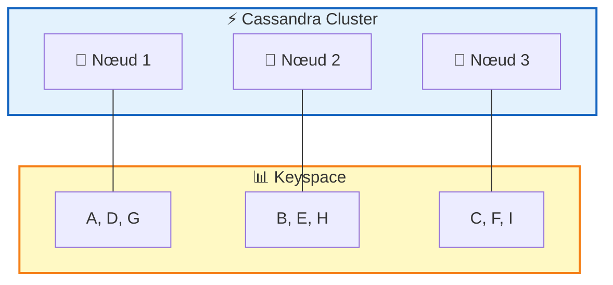
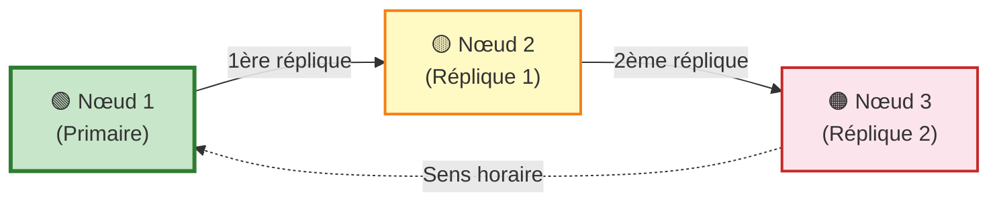
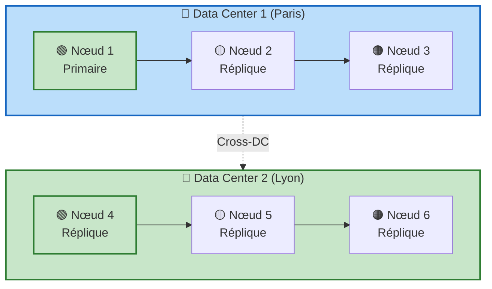
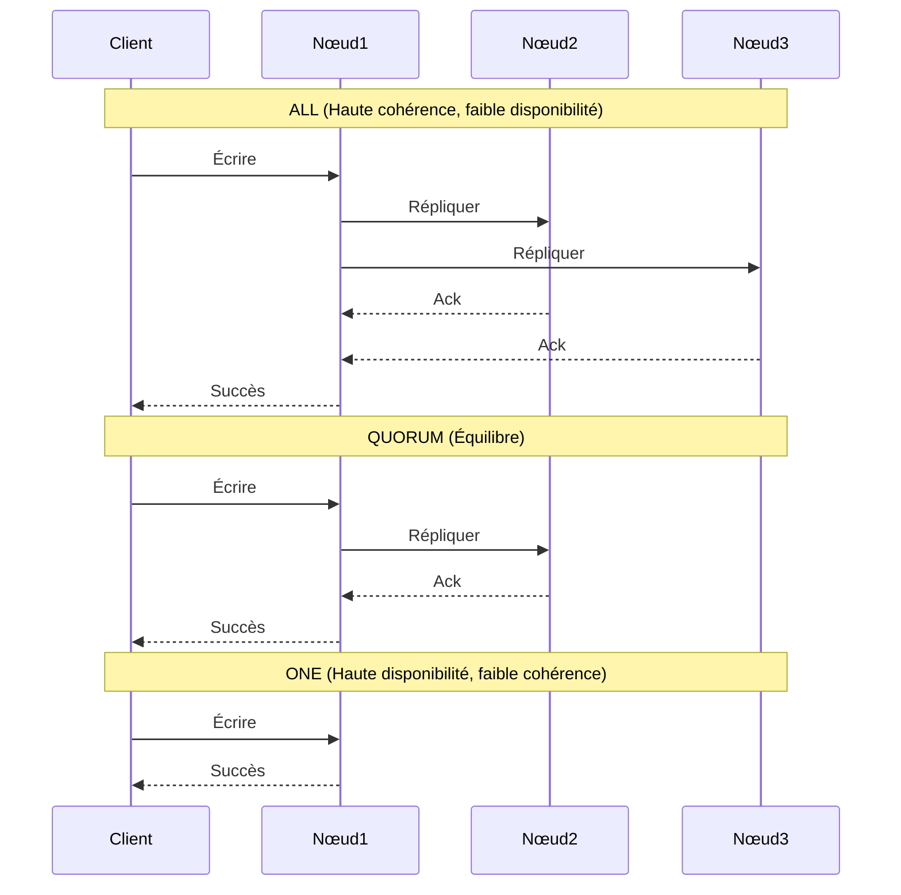
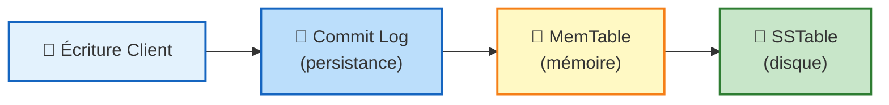

# BASES DE DONNÉES NOSQL — CASSANDRA

**Pr. ESSWIDI AYOUB**  
A.U. 2025-2026

---

## Table des matières

1. [Introduction à Cassandra](#1-introduction-à-cassandra)
2. [Architecture du système](#2-architecture-du-système)
3. [Partitionnement des données](#3-partitionnement-des-données)
4. [Réplication des données](#4-réplication-des-données)
5. [Gestion de la consistance](#5-gestion-de-la-consistance)
6. [Mécanismes d'écriture](#6-mécanismes-décriture)
7. [Mécanismes de lecture](#7-mécanismes-de-lecture)
8. [Interfaces de gestion](#8-interfaces-de-gestion)
9. [Avantages et caractéristiques](#9-avantages-et-caractéristiques)
10. [Mise en œuvre pratique](#10-mise-en-œuvre-pratique)
11. [Exemples d'utilisation](#11-exemples-dutilisation)

---

## 1. Introduction à Cassandra

### 1.1 Présentation générale

Apache Cassandra est une base de données NoSQL distribuée présentant les caractéristiques suivantes :

| Caractéristique          | Description                                                 |
| ------------------------ | ----------------------------------------------------------- |
| **Distribution**         | Architecture décentralisée sans point unique de défaillance |
| **Performance**          | Haute performance en lecture et écriture                    |
| **Évolutivité**          | Scalabilité horizontale extrême                             |
| **Tolérance aux fautes** | Résilience face aux pannes de nœuds                         |
| **Non-relationnelle**    | Structure orientée colonnes                                 |

### 1.2 Origines et inspirations

Cassandra est issue de la combinaison de deux technologies majeures :

- **BigTable** (Google) — pour le modèle de données orienté colonnes
- **DynamoDB** (Amazon) — pour l'architecture distribuée

Développée initialement chez Facebook, elle est désormais un projet open-source hébergé par la Fondation Apache.

### 1.3 Cas d'usage

Cassandra peut être utilisée dans deux contextes principaux :

1. **Base de données temps réel** — pour des applications nécessitant des accès à faible latence
2. **Base de données décisionnelle** — pour des systèmes à lecture intensive (analyse de données, reporting)

---

## 2. Architecture du système

### 2.1 Principes fondamentaux

| Principe                        | Description                                                       |
| ------------------------------- | ----------------------------------------------------------------- |
| **Système décentralisé**        | Ensemble de nœuds identiques sans hiérarchie (pas de nœud maître) |
| **Partitionnement automatique** | Répartition des données sur tous les nœuds du cluster             |
| **Réplication intégrée**        | Copie des données pour garantir la tolérance aux pannes           |
| **Accès universel**             | Lecture/écriture possible depuis n'importe quel nœud              |

### 2.2 Communication inter-nœuds

**Protocole Gossip** : Protocole de communication peer-to-peer permettant :
- L'échange d'informations d'état entre les nœuds
- Une synchronisation toutes les secondes
- La détection automatique des pannes
- La propagation des modifications de topologie

### 2.3 Vocabulaire spécifique

| Terme Cassandra | Équivalent traditionnel | Description |
|-----------------|------------------------|-------------|
| **Keyspace** | Base de données | Conteneur regroupant les données |
| **Column Family** / **Table** | Table | Structure de données (schéma flexible en CQL) |
| **Colonne** | Enregistrement | Unité de donnée indexée par une clé |
| **Index secondaire** | Index | Indexation à la demande sur d'autres champs |

---

## 3. Partitionnement des données

### 3.1 Principe général

Le partitionnement consiste à distribuer les données sur l'ensemble des nœuds du cluster :



- Chaque nœud est responsable d'une partie des données
- Les données sont placées selon la clé de partition (partition key)
- Le partitionnement est transparent pour l'utilisateur

### 3.2 Stratégies de partitionnement

#### Stratégie aléatoire (recommandée)

| Aspect | Description |
|--------|-------------|
| **Mécanisme** | Hachage MD5 ou Murmur3 appliqué à la clé de partition |
| **Avantage** | Distribution équitable des données |
| **Cas d'usage** | Configuration par défaut, recommandée pour la plupart des cas |

#### Stratégie ordonnée

| Aspect | Description |
|--------|-------------|
| **Mécanisme** | Conservation de l'ordre des clés sur les nœuds |
| **Inconvénient** | Risque de déséquilibre de charge (certains nœuds plus sollicités) |
| **Cas d'usage** | Nécessite une configuration spécifique dans le fichier de configuration |

---

## 4. Réplication des données

### 4.1 Objectifs

La réplication permet de :

- **Assurer la tolérance aux fautes** : éviter le SPOF (Single Point of Failure)
- **Garantir la disponibilité** : maintenir l'accès aux données en cas de panne
- **Améliorer les performances** : lecture depuis le réplica le plus proche

Le **facteur de réplication** est défini par l'utilisateur lors de la création du keyspace.

### 4.2 Stratégies de réplication

#### Stratégie Simple



| Aspect          | Description                                                           |
| --------------- | --------------------------------------------------------------------- |
| **Mécanisme**   | Répliques placées sur les nœuds suivants dans l'anneau (sens horaire) |
| **Limitation**  | Aucune prise en compte de la topologie réseau                         |
| **Cas d'usage** | Déploiements sur un seul datacenter                                   |

#### Stratégie par topologie réseau (Network Topology Strategy)



| Aspect | Description |
|--------|-------------|
| **Mécanisme** | Placement intelligent des répliques en fonction de la topologie |
| **Critères** | Data center, baie (rack) |
| **Règle** | Priorité aux nœuds dans des baies différentes |

### 4.3 Mécanisme de réplication avec SNITCH

**SNITCH** : Composant définissant le regroupement des nœuds dans le réseau

| Type de SNITCH | Description | Recommandation |
|----------------|-------------|----------------|
| **Simple SNITCH** | Utilise la stratégie simple | Développement |
| **Rack-Inferring SNITCH** | Détecte la topologie via adresses IP (2e octet = DC, 3e = baie) | Test |
| **Property File SNITCH** | Configuration manuelle par fichier | Environnement contrôlé |
| **Gossiping Property File SNITCH** | Détection automatique et mise à jour via Gossip | **Production** (recommandé) |

---

## 5. Gestion de la consistance

### 5.1 Principe "Read and Write Anywhere"

L'architecture Cassandra permet :
- La connexion à n'importe quel nœud
- L'accès aux données depuis n'importe quel datacenter
- Le partitionnement et réplication automatiques

### 5.2 Consistance ajustable (Tunable Consistency)

Cassandra étend le concept de **consistance éventuelle** vers une **consistance ajustable** :

- Choix entre consistance **forte** ou **éventuelle** par opération
- Configuration non globale mais par requête
- Adaptabilité aux besoins spécifiques de chaque opération

**Exemple de configuration par requête :**
```sql
SELECT * FROM users
USING CONSISTENCY QUORUM
WHERE state='TX';
```

### 5.3 Niveaux de consistance

| Niveau     | Disponibilité | Cohérence      | Latence       | Cas d'usage                       |
| ---------- | ------------- | -------------- | ------------- | --------------------------------- |
| **ALL**    | 🔴 Faible     | 🟢 Forte       | ⏱️ Lente      | Transactions critiques (bancaire) |
| **QUORUM** | 🟡 Moyenne    | 🟡 Équilibrée  | ⏱️ Moyenne    | Cas général                       |
| **ONE**    | 🟢 Haute      | 🔴 Faible      | ⚡ Rapide      | Logs, analytique temps réel       |
| **ANY**    | 🟢 Très haute | 🔴 Très faible | ⚡ Très rapide | Données non critiques             |



---

## 6. Mécanismes d'écriture

### 6.1 Processus d'écriture



| Étape | Composant | Description |
|-------|-----------|-------------|
| **1** | Commit Log | Journalisation des écritures pour durabilité |
| **2** | MemTable | Écriture en mémoire pour performance |
| **3** | SSTable | Sauvegarde sur disque (Sorted Strings Table) |

### 6.2 Atomicité

- Les transactions ACID complètes (commit/rollback) **ne sont pas supportées**
- Les écritures sont **atomiques au niveau des colonnes**
- Garantie : soit toutes les colonnes d'une ligne sont modifiées, soit aucune

### 6.3 Niveaux de consistance pour l'écriture

| Niveau | Exigences | Cas d'usage |
|--------|-----------|-------------|
| **ANY** | Écriture réussie sur au moins un nœud | Haute disponibilité |
| **ONE** (défaut) | Écriture sur le commit log et memTable d'au moins 1 réplique | Équilibre |
| **QUORUM** | (RF/2 + 1) répliques | Meilleur compromis |
| **LOCAL_QUORUM** | Quorum dans le même datacenter | Évite latence inter-DC |
| **EACH_QUORUM** | Quorum dans tous les datacenters | Tolérance multi-DC |
| **ALL** | Toutes les répliques | Haute consistance |

### 6.4 Hinted Handoff (Remise différée)

**Principe** : Mécanisme assurant la résilience en cas d'indisponibilité de nœuds


- Les hints sont conservés sur un nœud réplique actif
- Lorsque le nœud défaillant revient, les données sont mises à jour
- Avec la stratégie **ANY**, le nœud coordinateur peut stocker l'hint si aucun réplica n'est disponible

---

## 7. Mécanismes de lecture

### 7.1 Processus de lecture

Cassandra vérifie le nombre de répliques requis pour obtenir la donnée la plus récente (basée sur l'horodatage).

### 7.2 Niveaux de consistance pour la lecture

| Niveau | Exigences | Cas d'usage |
|--------|-----------|-------------|
| **ONE** (défaut) | Réponse du réplica le plus proche | Haute disponibilité |
| **QUORUM** | (RF/2 + 1) répliques | Meilleur compromis |
| **LOCAL_QUORUM** | Quorum dans le même datacenter | Performances locales |
| **EACH_QUORUM** | Quorum dans tous les datacenters | Cohérence globale |
| **ALL** | Toutes les répliques | Haute consistance |

### 7.3 Read Repair (Réparation à la lecture)

**Objectif** : Maintenir la cohérence des données fréquemment consultées

**Fonctionnement** :
1. Lors d'une lecture, le coordinateur compare les répliques en arrière-plan
2. Si des incohérences sont détectées, les répliques sont mises à jour
3. La version la plus récente est affichée à l'utilisateur

La réparation à la lecture peut être configurée par famille de colonnes.

---

## 8. Interfaces de gestion

### 8.1 Deux interfaces principales

| Interface | Description | Usage |
|-----------|-------------|-------|
| **Cassandra CLI** | Interface en ligne de commande | Gestion basique des objets et données |
| **CQL** (Cassandra Query Language) | Langage proche du SQL | Interface principale recommandée |

### 8.2 Fonctionnalités CQL

| Opération       | Commandes                    | Restrictions                                                             |
| --------------- | ---------------------------- | ------------------------------------------------------------------------ |
| **DDL**         | `CREATE`, `ALTER`, `DROP`    | Gestion des keyspaces et tables                                          |
| **DML**         | `INSERT`, `UPDATE`, `DELETE` | Manipulation des données                                                 |
| **Requêtes**    | `SELECT`                     | Support limité (pas de GROUP BY, ORDER BY uniquement sur clé secondaire) |
| **Consistance** | `USING CONSISTENCY`          | Configuration par opération                                              |

---

## 9. Avantages et caractéristiques

### 9.1 Principaux atouts

| Domaine | Avantage | Description |
|---------|----------|-------------|
| **Scalabilité** | Volume énorme | Gestion de données de l'ordre du Go/Pétaoctet |
| **Performance** | Gain linéaire | Ajout de nœuds → performance augmentée |
| **Haute disponibilité** | Pas de SPOF | Architecture décentralisée |
| **Distribution** | Multi-DC | Réplication et distribution facilitées |
| **Cache** | Intégré | Utilisation des mémoires vives des nœuds |

### 9.2 Flexibilité

| Caractéristique | Bénéfice |
|-----------------|----------|
| **Consistance ajustable** | Choix forte/éventuelle par opération |
| **Schéma flexible** | Adaptation aux évolutions des données |
| **Compression** | Algorithme Snappy de Google (sans pénalité de performance) |

### 9.3 Support et écosystème

- Langage **CQL** proche du SQL → Courbe d'apprentissage réduite
- Support des **langages et plateformes clés**
- **Pas de matériel ou logiciel spécifique** requis

---

## 10. Mise en œuvre pratique

### 10.1 Création d'un mini-cluster avec Docker

#### Étape 1 : Télécharger l'image Cassandra
```bash
docker pull cassandra
```

#### Étape 2 : Créer un réseau Docker
```bash
docker network create cassandra-net
```

#### Étape 3 : Démarrer un conteneur
```bash
docker run --name cassandra-node -d -p 9042:9042 cassandra
```

#### Étape 4 : Démarrer l'anneau de nœuds

| Nœud | Commande |
|------|----------|
| **cassandra1** | `docker run -d --name cassandra1 --network cassandra-net cassandra` |
| **cassandra2** | `docker run -d --name cassandra2 --network cassandra-net -e CASSANDRA_SEEDS=cassandra1 cassandra` |
| **cassandra3** | `docker run -d --name cassandra3 --network cassandra-net -e CASSANDRA_SEEDS=cassandra1 cassandra` |

#### Étape 5 : Vérification
```bash
docker exec -it cassandra1 nodetool status
```

### 10.2 Création d'un keyspace distribué

```bash
docker exec -it cassandra1 cqlsh
```

```sql
CREATE KEYSPACE university
WITH replication = {
  'class': 'SimpleStrategy',
  'replication_factor': 3
};
```

### 10.3 Création d'une table distribuée

```sql
USE university;

CREATE TABLE students (
  id UUID PRIMARY KEY,
  name TEXT,
  age INT
);
```

### 10.4 Manipulation des données

```sql
-- Insertion
INSERT INTO students (id, name, age)
VALUES (uuid(), 'Ayoub', 25);

-- Consultation
SELECT * FROM university.students;

-- Mise à jour
UPDATE students SET age = 26
WHERE id = <uuid>;

-- Suppression
DELETE FROM students WHERE id = <uuid>;
```

### 10.5 Test de tolérance aux pannes

```bash
# Arrêt d'un nœud
docker stop cassandra2

# Vérification du cluster
docker exec -it cassandra1 nodetool status
```

**Résultat attendu :**
```
UN cassandra1
DN cassandra2  ← Down (indisponible)
UN cassandra3
```

**Observation importante :** Les données restent accessibles malgré la panne.

---

## 11. Exemples d'utilisation

### 11.1 Cas d'usage IoT : Capteurs de température

**Problématique** : Stocker les mesures de capteurs avec recherche par capteur et par période.

#### Modèle de données

| capteur | temps | température |
|---------|-------|-------------|
| C1 | 10:00 | 24.5 |
| C1 | 10:01 | 24.7 |
| C1 | 10:02 | 24.8 |
| C1 | 10:03 | 24.9 |

#### Modèle Cassandra

```sql
CREATE TABLE mesures (
  capteur TEXT,
  temps TIMESTAMP,
  temperature DOUBLE,
  PRIMARY KEY (capteur, temps)
);
```

**Organisation des données :**

```
Partition : C1 (clé de partition)
┌─────────────────────────────────────┐
│  temps    | temperature              │
│  ─────────|─────────────────────────│
│  10:00    | 24.5                    │
│  10:01    | 24.7                    │
│  10:02    | 24.8                    │
│  10:03    | 24.9                    │
└─────────────────────────────────────┘
```

**Clé primaire composite :** `(capteur, temps)`
- **Clé de partition** : `capteur` → regroupe toutes les mesures d'un capteur
- **Clé de clustering** : `temps` → ordonne les mesures chronologiquement

### 11.2 Analogie avec un dictionnaire Python

```python
notes = {
  1: {                    # ← Clé de partition
    "Java": 18,           # ← Colonnes
    "BD": 16,             # ← Colonnes
    "Python": 19          # ← Colonnes
  },
  2: {                    # ← Clé de partition
    "Java": 14,           # ← Colonnes
    "BD": 15              # ← Colonnes
  }
}
```

| Élément Python | Élément Cassandra |
|----------------|-------------------|
| Clé de premier niveau (1, 2) | Clé de partition |
| Clé de second niveau ("Java", "BD") | Noms de colonnes |
| Valeurs (18, 16, 19) | Données |

---

## Annexe : Commandes essentielles

| Objectif | Commande |
|----------|----------|
| Se connecter à CQLSH | `docker exec -it cassandra1 cqlsh` |
| Créer un keyspace | `CREATE KEYSPACE ... WITH replication = ...` |
| Utiliser un keyspace | `USE nom_keyspace` |
| Créer une table | `CREATE TABLE ... ( ... PRIMARY KEY (...))` |
| Insérer des données | `INSERT INTO ... VALUES (...)` |
| Lire des données | `SELECT ... FROM ... WHERE ...` |
| Mettre à jour | `UPDATE ... SET ... WHERE ...` |
| Supprimer | `DELETE FROM ... WHERE ...` |
| Voir l'état du cluster | `nodetool status` |

---

*Document réalisé dans le cadre du cours **data engineering** — Cassandra*  
*Pr. ESSWIDI AYOUB — Année Universitaire 2025-2026*