# Business Intelligence (Informatique Décisionnelle)

---

## Table des Matières Générale

### Partie 1 : Introduction au Data Warehouse

1. [[#Hiérarchie de la prise de décision]]
2. [[#Problématique des données dans un système décisionnel]]
3. [[#Charge du Serveur de Données]]
4. [[#Comparaison des environnements du Processing]]
5. [[#OLTP vs OLAP]]
6. [[#Technologies — Structure d'un Business Intelligence]]
7. [[#Structures de Stockage de Données dans un BI]]

---

### Partie 2 : Data Warehouses / Entrepôts de données

8. [[#Pourquoi ne pas utiliser un SGBD ?]]
9. [[#Objectifs du Data Warehouse]]
10. [[#Définition de Bill Inmon (1996)]]
11. [[#Caractéristiques du Data Warehouse]]
12. [[#Approches académiques]]
13. [[#Choix d'architecture]]
14. [[#ETL Process]]
15. [[#Référentiel : Métabase de Données]]
16. [[#Architecture ELT]]
17. [[#Outils d'intégration de données]]
18. [[#Intégration de données]]
19. [[#Infrastructure du data warehouse]]
20. [[#Structure du Data Warehouse]]

---

### Partie 3 : Modélisation Multidimensionnelle

21. [[#Objectif de la modélisation multidimensionnelle]]
22. [[#Définition de la modélisation multidimensionnelle]]
23. [[#Cinq axes de qualification d'un modèle multidimensionnel]]
24. [[#Concepts fondamentaux]]
25. [[#Typologie des faits]]
26. [[#Table des Faits]]
27. [[#Granularité de la table de faits]]
28. [[#Table des Dimensions]]
29. [[#Attributs ou Faits]]
30. [[#Clé de substitution / Surrogate Key]]
31. [[#Granularité d'une dimension]]
32. [[#Dimension conforme (Conformed dimension)]]
33. [[#Faits conformes]]
34. [[#Table de faits sans faits (Factless fact table)]]
35. [[#Dimension dégénérée (Degenerate dimension)]]
36. [[#Dimension à évolution lente (Slowly Changing Dimension — SCD)]]
37. [[#Dimension à évolution rapide (Rapid Changing Dimension)]]
38. [[#Caractéristiques générales de la modélisation]]
39. [[#Avantages et Inconvénients de la modélisation multidimensionnelle]]
40. [[#Règles de Normalisation Dimensionnelle]]
41. [[#Forme Dimensionnelle Normale]]
42. [[#Modèles d'un Data Warehouse]]
43. [[#Stockage OLAP]]
44. [[#Méthodologie de conception]]
---

# Partie 1 : Introduction au Data Warehouse

---

## Hiérarchie de la prise de décision

### Niveau Opérationnel (Lower / Operational)

| **Aspect** | **Description** |
|---|---|
| **Acteurs** | Exécutants (Chefs de services, chefs d'atelier…) |
| **Fréquence** | Décisions fréquentes, très prévisibles |
| **Exemples** | • Résoudre les retards de commande<br>• Planifier les employés<br>• Achat de fournitures de bureau<br>• Organisation des horaires de travail |

---

### Niveau Tactique (Middle / Tactical)

| **Aspect** | **Description** |
|---|---|
| **Acteurs** | Encadrements supérieurs (Directions fonctionnelles) |
| **Fréquence** | Décisions peu fréquentes, peu prévisibles |
| **Exemples** | • Choisir des fournisseurs<br>• Prévoir les ventes<br>• Lancement d'une campagne publicitaire<br>• Acquisition de matériel de production<br>• Recrutement d'un cadre dirigeant |

---

### Niveau Stratégique (Top / Strategic)

| **Aspect** | **Description** |
|---|---|
| **Acteurs** | Plus haut niveau hiérarchique (Direction Générale ou l'État) |
| **Fréquence** | Décisions uniques, occasionnelles |
| **Exemples** | • Identifier de nouveaux marchés<br>• Choisir des magasins<br>• Lancement d'un nouveau produit<br>• Abandon d'une activité<br>• Fusion avec une autre entreprise |

---

## Problématique des données dans un système décisionnel

### Systèmes Opérationnels vs Systèmes Décisionnels

| **Critère**  | **Systèmes Opérationnels**                                     | **Systèmes Décisionnels**                                    |
| ------------ | -------------------------------------------------------------- | ------------------------------------------------------------ |
| **Nom**      | OLTP (On-Line Transaction Processing)                          | OLAP (On-Line Analytical Processing)                         |
| **Type**     | Traitement transactionnel en ligne                             | Traitement analytique en ligne                               |
| **Objectif** | Assister les métiers dans leurs tâches de gestion quotidiennes | Aider au pilotage de l'activité pour une vision transversale |
| **Outils**   | ERP (ou PGI)                                                   | Data Warehouses (Entrepôts de données)                       |

---

### Données Opérationnelles vs Données Décisionnelles

| **Données Opérationnelles** | **Données Décisionnelles** |
|---|---|
| Données détaillées | Données agrégées et globalisées |
| Données courantes et récentes | Données historiques et historisées |
| Structure optimisée pour l'informaticien | Structure compréhensible par le décideur |
| Données réparties et non homogènes | Données centralisées, intégrées |
| Utilisateurs nombreux et concurrents | Utilisateurs peu nombreux et non concurrents |

---

## Charge du Serveur de Données

**Question centrale :**

> Comment organiser ces différentes données dans un ensemble cohérent afin de procéder à toutes les analyses nécessaires pour construire les indicateurs indispensables au pilotage de l'entreprise ?

---

### Solutions

#### 1. Stockage de données : Data Warehouse

- Base de données unique - vocabulaire unique
- Contenu adapté aux besoins des décideurs
- Structure multidimensionnelle spéciale
- Niveau de détail bien étudié
- Données historiques

#### 2. Interrogation des données

- Outil interactif, convivial
- Fonctions d'analyse :
  - Tri des données
  - Roll-up, Drill-down
  - Calcul et comparaison
  - Analyse des tendances, relations et exceptions
  - Simulation

---

## Comparaison des environnements du Processing

### Processing Transactionnel

| **Aspect** | **Description** |
|---|---|
| **Données** | Données primaires des transactions |
| **Opérations** | Opérations quotidiennes |
| **Décisions** | Détails sur produits, clients, livraisons, fabrication |
| **Horizon** | Court terme |

### Processing du Business Intelligence

| **Aspect** | **Description** |
|---|---|
| **Données** | Données secondaires transformées |
| **Opérations** | Vision large des clients, produits, production, marketing |
| **Décisions** | Planification de capacité, emplacements de magasins, nouveaux secteurs |
| **Horizon** | Moyen et long terme |

---

## OLTP vs OLAP

### Définitions

**OLTP (OnLine Transaction Processing)**

- Traitements transactionnels pour les opérations quotidiennes
- Stockage et gestion des données opérationnelles
- Accès interactif rapide et simple aux données

**OLAP (OnLine Analytical Processing)**

- Analyse des données et aide à la décision
- Accès rapide, consistant et interactif à une large variété d'informations
- Analyse des ventes, détection des fraudes, prospection clients

---

### Exemples

| **OLTP** | **OLAP** |
|---|---|
| Le 15/01/2019 à 14h30min, le client X a retiré 1000DH du compte Y | Quel est le volume des ventes par produit et par région durant le deuxième trimestre de 2019 ? |

---

### Tableau comparatif OLTP vs OLAP

| **Critère** | **OLTP** | **OLAP** |
|---|---|---|
| **Conception** | Orientée application, Orienté transaction, Structure statique (E/R) | Orientée sujet, Orienté analyse, Structure évolutive (étoile, flocon) |
| **Données** | Détaillées, isolées, non agrégées, Courantes, récentes, mises à jour, Normalisées | Résumées, consolidées, historisées, Dénormalisées |
| **Vue** | Relationnelle | Multidimensionnelle |
| **Enregistrements accédés** | Dizaines | Millions |
| **Requêtes** | Simples, nombreuses, prévisibles, répétitives, Temps : court (ms) | Complexes, peu nombreuses, ad-hoc, Temps : long (s-min-h) |
| **Fonction** | Opérations quotidiennes | Aide à la décision |
| **Utilisateurs** | Agents opérationnels, nombreux, concurrents | Managers / Analystes, peu nombreux, non concurrents |
| **Accès** | Lecture / Écriture | Lecture |
| **Taille** | 100 MB à 1 GB | 100 GB à 1 TB (voire pétaoctet) |

---

## Technologies — Structure d'un Business Intelligence

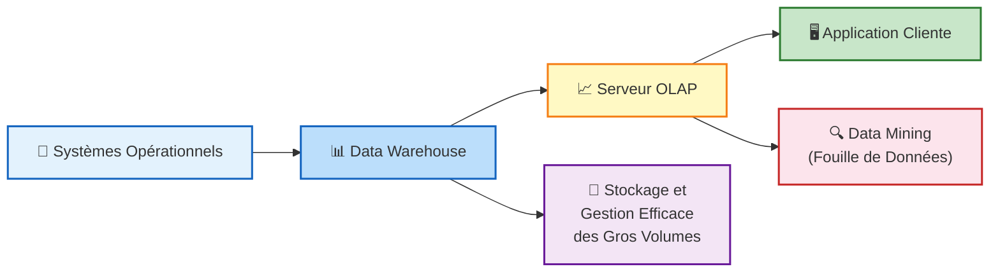

---

## Structures de Stockage de Données dans un BI

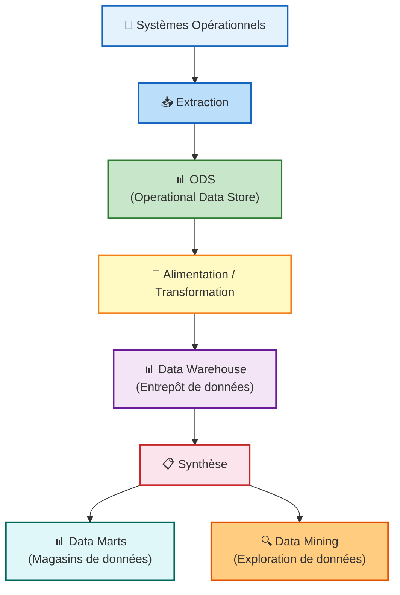

---

### ODS : Operational Data Store

**Définition :**

- Collection de données orientées sujet, volatiles, organisées pour le support d'un processus de décision ponctuel
- Donne la vision immédiate et intégrée de l'état d'un ou plusieurs systèmes opérants
- Contient des données de niveau fin (prix, montant d'une vente)
- **Rôle :** Traiter les données en vue d'une intégration dans un Data Warehouse

---

### Data Warehouse

**Définition (Bill Inmon, 1996) :**

> "Collection de données orientées sujet, intégrées, non volatiles et historisées, organisées pour le support d'un processus d'aide à la décision."

- Entrepôt de données spécifique au monde décisionnel
- Destiné à analyser les leviers business potentiels

---

### Data Mart

**Définition :**

- Magasin de données orienté sujet, non volatile
- Contexte décisionnel décentralisé, ciblé pour un usage particulier
- Sous-ensemble d'un entrepôt de données
- Point de vue spécifique selon des critères métiers

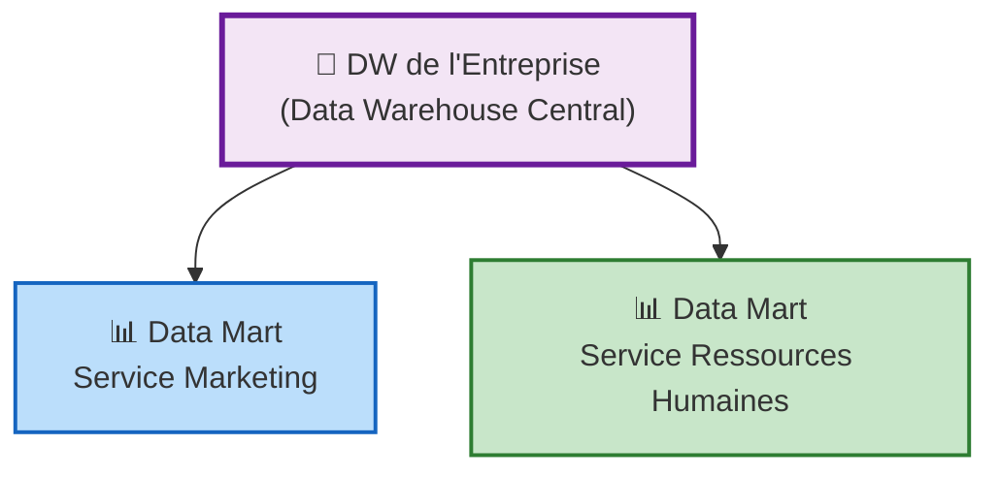

---

### Data Mining

**Définition :**

- Ensemble d'outils, méthodes et technologies d'analyse
- Objectifs : définir des tendances, segmenter l'information, établir des corrélations entre les données

---

## Data Warehouse vs ODS

| | **DW** | **ODS** |
|---|---|---|
| **Intégration** | Intégration des données hors ligne | Intégration des données en ligne |
| **Sauvegarde** | Sauvegarde des données récentes | Rassemblement de données dispersées |

**Exemple :**
- Vue unique sur un patient modifiable en ligne
- Données dispersées dans plusieurs bases (hospitalisations, diagnostics, achats pharmaceutiques)
- ODS extrait et affiche ces données

---

## Data Warehouse vs Data Mart

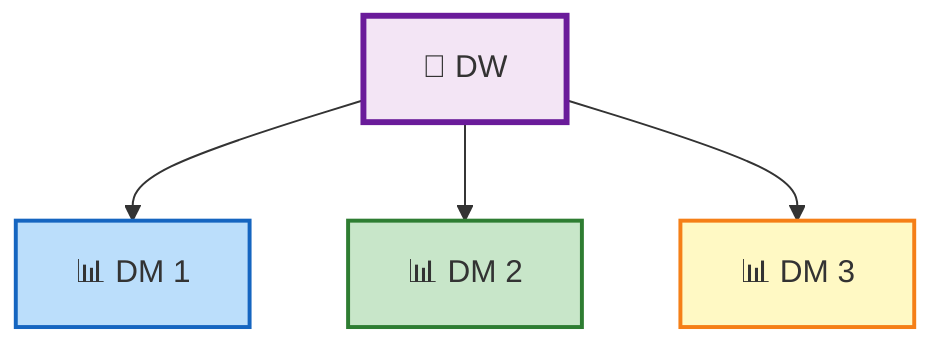

| | **DW (Data Warehouse)** | **DM (Data Mart)** |
|---|---|---|
| **Système** | Système centralisé | Système décentralisé |
| **Niveau** | Dépôt de données au niveau entreprise | Ensemble de dimensions et mesures limitées |
| **Composition** | Combinaison de plusieurs Data Marts | Thèmes métier spécifiques |
| **Dimensions** | Toutes les mesures et dimensions nécessaires | Construites à partir des DW |
| **Orientation** | Orienté données | Orienté projet |
| **Taille** | > 100 Go | < 100 Go |
| **Mise en œuvre** | Plusieurs mois à plusieurs années | Quelques mois |
| **Quantité** | Un seul DW par entreprise | Plusieurs DMs (Finance, Vente, Achats) |

---

# Partie 2 : Data Warehouses / Entrepôts de données

---

## Pourquoi ne pas utiliser un SGBD ?

### Fonctions d'un SGBD (OLTP)
- Systèmes transactionnels
- Insertion, modification, interrogation rapide des données
- Sélection, ajout, mise à jour, suppression de tuples
- Réponse à de nombreux utilisateurs simultanés

### Fonctions d'un DW (OLAP)
- Systèmes pour l'aide à la prise de décision
- Regroupement et organisation d'informations provenant de sources diverses
- Intégration et stockage pour une vue orientée métier
- Recherche et analyse rapide de l'information

---

### Comparaison des données

| **Caractéristiques** | **BD Opérationnelle** | **Data Warehouse** |
|---|---|---|
| **Âge des données** | Actuel | Historique |
| **Niveau des détails** | Individuel | Individuel et résumé |
| **Orientation** | Processus | Sujet |
| **Records per request** | Peu | Milliers |
| **Niveau de normalisation** | Généralement normalisé | Normalisation détendue |
| **Mise à jour** | Très volatil | Principalement rafraîchi |
| **Modèle de données** | Relationnel | Relationnel (étoile) et multidimensionnel (cubes) |

---

## Objectifs du Data Warehouse

- Regrouper et organiser des informations provenant de sources diverses
- Intégrer et stocker les données pour une vue orientée métier
- Retrouver et analyser l'information selon plusieurs critères
- Transformer un SI de production en SI décisionnel
- Contenir des informations cohérentes
- Permettre la séparation et la combinaison des données selon toutes les mesures possibles
- Inclure des outils de requêtage, d'analyse et de reporting

**Rôle essentiel :**

- Dépôt logiquement centralisé pour la prise de décision
- Peuplement à partir des bases opérationnelles et de sources externes
- Données intégrées et transformées
- Optimisé pour le reporting et l'intégration périodique

---

## Définition de Bill Inmon (1996)

> "Subject oriented, integrated, non-volatile, time-variant collection of data in support of management decisions"

**Traduction :** Collection de données orientées sujet, intégrées, non volatiles et historisées, organisées pour le support d'un processus d'aide à la décision.

> « Un Data Warehouse ne s'achète pas, il se construit… » (Bill Inmon)

---

## Caractéristiques du Data Warehouse

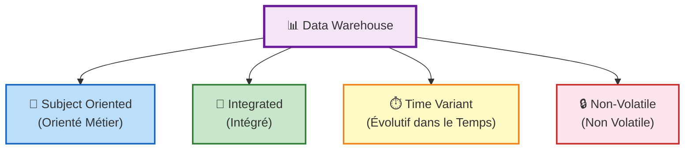

---

### Données Orientées Sujet (Subject-oriented)

- Données collectées orientées métier, triées par thème
- Analyse et modélisation pour l'aide à la décision (pas pour les transactions)
- Vue synthétique selon les sujets intéressant les décideurs
- Données organisées par sujet ou faits (clients, produits, ventes)
- Regroupement des données propres à un thème provenant des bases OLTP
- Organisation selon des dimensions

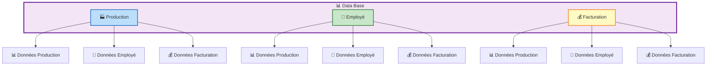

---

### Données Intégrées (Integrated)

- Nettoyage préalable des données (rationalisation et normalisation)
- Consolidation et intégration des données provenant de sources hétérogènes

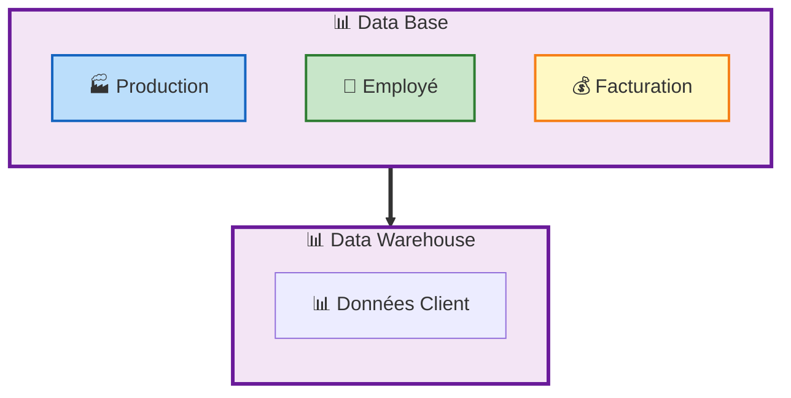

---

### Données Non Volatiles (Non-volatile)

- Une donnée entrée dans l'entrepôt l'est pour de bon (Read-Only)
- Stockage indépendant des BD opérationnelles
- Pas de modification ni de suppression des données
- Conservation pour des analyses futures

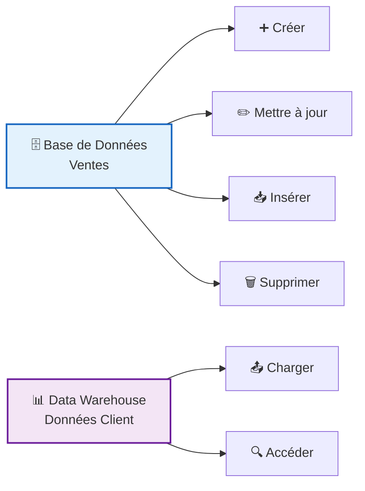

---

### Données Historisées (Time-variant)

- Stockage de l'historique des données
- Composante temporelle (date et heure d'une transaction)
- Référentiel temps associé aux données
- Données datées


---

## Approches académiques

| | **R. Kimball** | **B. Inmon** |
|---|---|---|
| **Processus** | Bottom-Up | Top-Down |
| **Organisation** | Data Marts | Data Warehouse |
| **Schématisation** | Étoile | Flocon |
| **Site** | www.kimballgroup.com | www.inmoncif.com |

---

## Choix d'architecture

### Top Down (Approche Inmon)

- Approche Data warehouse
- Entrepôt de données d'entreprise (EDW)
- Niveaux d'intégration plus élevés
- Logiquement centralisé
- Portée plus grande du projet
- Un seul Data warehouse pour toute l'entreprise

### Bottom Up (Approche Kimball)

- Approche Data mart
- Data marts indépendants
- Niveaux d'intégration inférieurs
- Logiquement décentralisé
- Portée plus petite du projet

---

### Architecture Top-Down

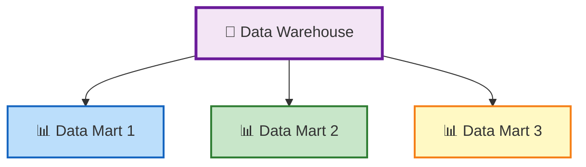

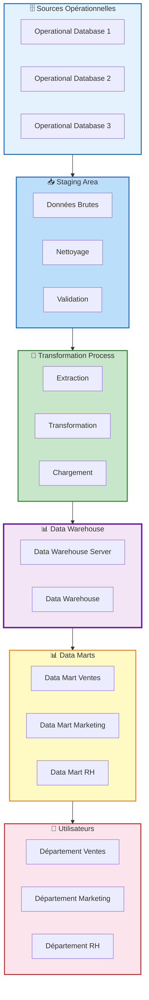

---

### Architecture Bottom-up

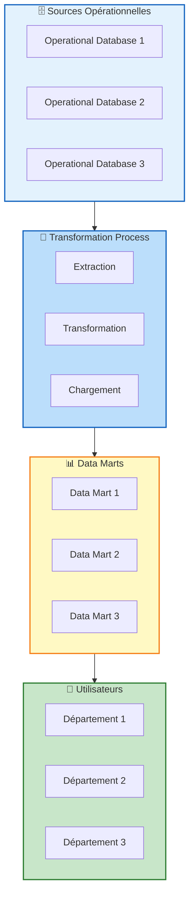

---

## ETL Process

Outils d'alimentation pour **E**xtraire, **T**ransformer et **C**harger dans un Data warehouse les données sources

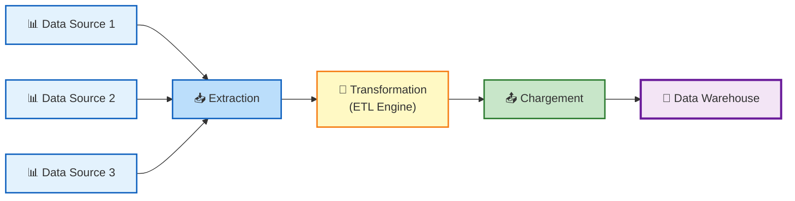

---

### ETL : Extraction

- Extraction des données de leur environnement d'origine (BDRs, fichiers plats, ERP, CRM)
- Besoin d'outils spécifiques pour accéder aux bases de données de production
- Technique appropriée pour n'extraire que les données nécessaires
- **Attention :** L'extraction ne doit pas perturber l'activité de production

---

### ETL : Transformation

- Intégration des données
  - Homogénéisation du vocabulaire, structures, valeurs
  - Suppression et fusion des redondances
  - Épuration des données incohérentes
  - Transformation dans un format cible
  - Nettoyage (valeurs manquantes, aberrantes)

**Exemple de nettoyage :**

| **Source** | **Problème** | **Solution** |
|---|---|---|
| BD Facturation | Personne 1 (Marrakchi) | Intégrer (Marrakchi) |
| BD Personnel | Personne 2 (Marrakchi) | |
| Format date | Jan.22, 2019 / 22/01/2019 / 22/01/19 / 01/22/2019 | Standardisation |
| Unité | cm / inches / yards | Conversion |

---

### ETL : Chargement

- Chargement des données nettoyées et préparées dans le Data warehouse
- Opérations de calcul et d'agrégation des données
- Mise en place de procédures de chargement et de restauration
- Prise en compte de la notion de granularité
  - Conservation des données détaillées
  - Possibilité d'agrégation pour la synthèse

---

## Référentiel : Métabase de Données

- Catalogue de métadonnées contenant des données sur les données du DW
- Lieu de stockage unique des informations qui pilotent les processus
- Détails sur :
  - Les données entreposées (format, signification, degré d'exactitude)
  - Les processus de récupération/extraction
  - La date du dernier chargement
  - L'historique des données sources et du DW

---

## Architecture ELT

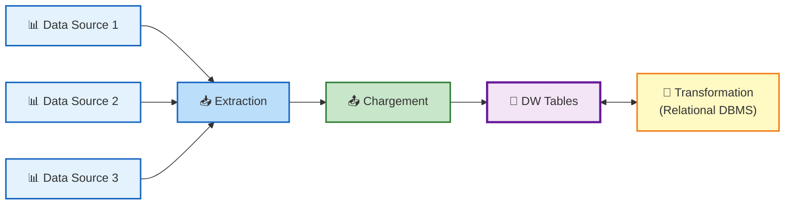

### Évaluation d'architecture

| **ETL** | **ELT** |
|---|---|
| Indépendance du SGBD | Optimisation supérieure dans le SGBD |
| Opérations plus complexes | Moins de bande passante réseau |
| | Combinaison d'architectures possible |

---

## Outils d'intégration de données

### Vendeurs traditionnels

- Fournisseurs de BDs : Oracle, IBM, Microsoft, Amazon
- Autres : SAP, Informatica, SAS, Information Builders

### Open source

- Pentaho Data Integration
- Talend Open Studio for Data Integration
- CloverETL
- JasperSoft ETL

---

## Intégration de données

Trois façons de rapatrier les données :

| **Méthode** | **Description** |
|---|---|
| **Push** | La logique de chargement est dans le système de production |
| **Pull** | Le Pull tire les données de la source vers le Staging Area |
| **Push-Pull** | La source prépare les données et prévient le Staging Area qui va les récupérer |

---

## Infrastructure du data warehouse : Chargement complet ou incrémental

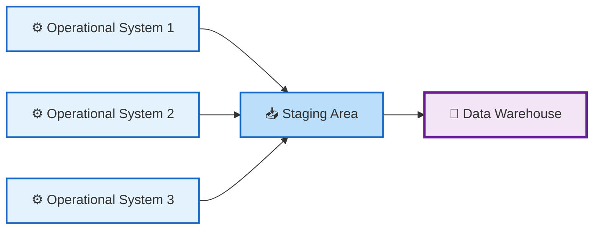

| **Type** | **Description** |
|---|---|
| **Full Load** | Chargement initial ou complet (première fois) |
| **Delta Load / Incremental Load** | Chargement incrémental à intervalles réguliers (flux ou lots) |

---

## Structure du Data Warehouse

### 1. Structure directe simple

- Mises à jour avec des laps de temps importants

### 2. Structure de cumul simple

- Stockage des données de chaque mise à jour
- Mises à jour fréquentes (ex : tous les jours)
- Espace occupé important, mais pas de perte d'information

### 3. Structure par résumé déroulant

- Stockage des données détaillées à chaque mise à jour
- Synthèse des anciennes données en fonction de leur âge
- Plus une donnée est vieille, moins elle est détaillée

---

# Partie 3 : Modélisation Multidimensionnelle

---

## Objectif de la modélisation multidimensionnelle

- Proposer un accès aux données intuitif et très rapide
- Considérer un sujet analysé comme un point dans un espace à plusieurs dimensions
- Organiser les données pour mettre en évidence le sujet et les perspectives d'analyse
- Organiser les données autour des **faits** (avec **mesures** numériques et additives)
- Décrire les faits par des axes d'analyse (**dimensions**)

---

### Exemple

| **Élément** | **Description** |
|---|---|
| **Faits** | Ventes |
| **Mesures** | Quantité commandée, prix correspondant |
| **Dimensions** | Clients, produits concernés, dates |

Pour un client donné, un produit et une date, on dispose de la quantité commandée et du prix.

---

## Définition de la modélisation multidimensionnelle

> Transformation des données sources en structures logiques décisionnelles finalisées.

- Modèle utilisant des dimensions et mesures, basé sur les requêtes analytiques
- Redondance possible voir désirée
- Seule technique fiable pour fournir des données aux utilisateurs finaux en décisionnel

### Comparaison avec le modèle relationnel

| | **Modélisation E/R (BD opérationnelles)** | **Modélisation DW** |
|---|---|---|
| **Objectif** | Systèmes transactionnels | Analyse |
| **Approche** | Élimination des redondances | Redondance possible et désirée |
| **Schéma** | 3FN | Étoile / flocon |
| **Conception** | Indépendante des requêtes | Basée sur les requêtes analytiques |

---

## Cinq axes de qualification d'un modèle multidimensionnel

### 1. Lisibilité pour l'utilisateur final

- L'analyste doit pouvoir facilement manipuler les données
- Données simples à comprendre, permettant plusieurs analyses selon différentes dimensions

### 2. Performance au chargement des données

- Grosses quantités de données, sources hétérogènes
- Structure simple facilitant le chargement
- Transformation/filtrage souvent nécessaire

### 3. Performance à l'exécution des requêtes

- Requêtes rapides pour les analystes (maximum 30 secondes)
- Création d'agrégations et/ou redondances nécessaire

### 4. L'administration des données

- Administration fondamentale du système
- Difficulté : faire vivre le DW, pas seulement le construire
- Maîtrise et industrialisation de l'extraction des données

### 5. L'évolutivité du modèle

- Développement incrémental plutôt qu'itératif
- Chaque projet doit s'intégrer dans un modèle d'information global

---

## Concepts fondamentaux

| **Modélisation BDR** | **Modélisation DW** |
|---|---|
| Entité et relation | Dimension et mesure |

### Les mesures
- Valeurs numériques que l'on compare (montant_ventes, qte_vendue)
- Résultat d'une opération d'agrégation des données

### Les dimensions
- Points de vue depuis lesquels les mesures peuvent être observées
- Exemples : date, client, produit, localisation
- Stockées dans les tables de dimensions

---

### Les Dimensions

- Thème ou axe (attributs) selon lequel les données sont analysées
- Exemples : Temps, Géographie, Produits
- Membres organisés en hiérarchie (ex: année → semestre → mois → jour)

**Caractéristiques :**
- Axe d'analyse (Client, produit, période de temps)
- Contient un grand nombre de colonnes
- Informations descriptives des faits
- Plusieurs colonnes, peu de lignes
- Moins d'enregistrements qu'une table de faits

---

### Les Mesures

- Élément de données sur lequel portent les analyses
- Indicateur d'analyse de type numérique et additive
- **Exemples :** Prix, quantité, remise, coût des travaux, ventes, nombre d'accidents

---

### Les Faits

- Valeur d'une mesure selon un membre de chacune des dimensions
- Ce que l'on souhaite mesurer
- Sujet d'analyse
- Grain de mesure de l'activité
- Résultat d'une opération d'agrégation des données
- Stockés dans la table des faits

**Exemples :**
- Chiffre d'affaires
- Quantités vendues
- Montant des ventes
- Nombre de transactions
- Coût des travaux
- Nombre d'accidents

**En général : une valeur numérique**

**Exemple :**

> 50 000 DHs est un fait qui exprime la valeur de la mesure « coût des travaux » pour le membre « 2021 » de la dimension « Temps » et le membre « Marrakech » de la dimension « Géographie ».

---

## Typologie des faits

| **Type** | **Description** | **Exemple** |
|---|---|---|
| **Additif** | Additionnable suivant toutes les dimensions | Quantités vendues, chiffre d'affaire |
| **Semi-additif** | Additionnable suivant certaines dimensions | Solde d'un compte bancaire |
| **Non-additif** | Non additionnable quelle que soit la dimension | Prix unitaire |

---

## Table des Faits

- Table contenant les données à analyser
- Clé composite référençant les clés primaires des tables de dimensions
- Contient les mesures et les clés vers les tables de dimensions
- Relation (n,m) entre les dimensions
- Reconnaissable par sa taille centrale
- Contient un grand nombre de clés étrangères
- Plusieurs tables de fait dans un DW
- Faits les plus utiles : numériques et additifs

**Structure :**

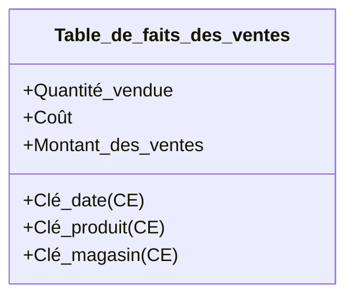

---

## Granularité de la table de faits

- Indique le niveau de détail stocké dans la table
- Découle du niveau de détail de ses dimensions connexes
- Toutes les lignes doivent avoir le même grain

**Exemple :**
Si Temps = jour, Produit = produit, Magasin = branche → grain = ventes par produit par jour et par magasin

**Question clé :** Que représente un enregistrement de la table de faits ?

---

## Table des Dimensions

- Tables entourant la table de faits
- Axe d'analyse selon lequel sont visualisées les mesures
- Attributs souvent de type texte
- Source de contraintes et d'en-têtes de lignes

**Exemples :**
- Clients
- Produits
- Périodes (exercice financier)
- Activités

---

## Attributs ou Faits

| | **Attributs** | **Faits** |
|---|---|---|
| Type numérique | | X |
| Type caractère | X | |
| Valeur discrète | X | |
| Variation continue | | X |

---

## Clé de substitution / Surrogate Key

- Clé non intelligente substituant la clé naturelle (business key)
- Clé naturelle souvent composée de plusieurs colonnes
- Ne pas confondre avec la clé artificielle des systèmes opérationnels
- Utilisée dans le DW pour rendre un élément unique

**Exemple : Dimension Produit**

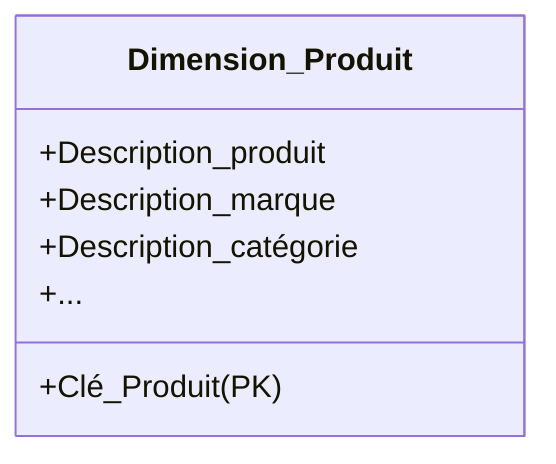

**Exemple : Dimension Temps**

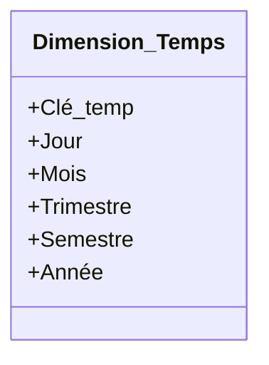

---

## Granularité d'une dimension

- Membres organisés en hiérarchie
- Chaque membre appartient à un niveau hiérarchique (niveau de granularité)
- Granularité = nombre de niveaux

**Hiérarchies :**

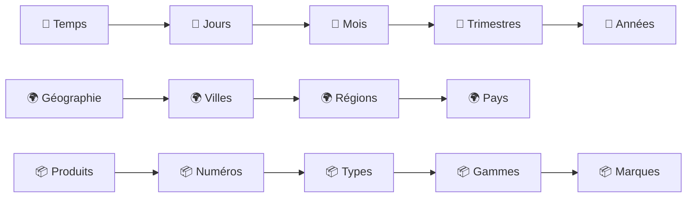

---

## Dimension conforme (Conformed dimension)

- Dimension ayant la même signification dans toutes les tables de faits
- Utilisée par les faits de plus d'un data mart

**Exemples :**
- Dimension « Produit » utilisée par les data marts Finance, Marketing
- Clients, lieux, promotions

---

## Faits conformes

- Identification en même temps que les dimensions
- Permettent d'employer la même terminologie dans tous les data marts

**Exemples :** Recettes, bénéfices, prix

---

## Table de faits sans faits (Factless fact table)

- Capture les relations plusieurs-à-plusieurs entre dimensions
- Ne contient aucun fait numérique ou textuel
- L'enregistrement est le fait

**Exemples :**
- Promotions sur les produits
- Assiduité des étudiants
- Accidents pour les assurances
- Bâtiments et installations

---

## Dimension dégénérée (Degenerate dimension)

- Clé de dimension dans la table des faits
- Sans attribut, non associée à une table de dimension

**Exemples :**
- No de bon de commande
- No d'interruption de service
- No de transaction

**Explication :** Évite de créer une table de dimension pour une seule clé

---

## Dimension à évolution lente (Slowly Changing Dimension — SCD)

- Dimension pouvant subir des changements de description des attributs

**Exemples :**
- Adresse/statut d'un client
- Changement de dénomination d'une région
- Catégorie d'un produit
- Changement de nom (Raider → Twix)

| **Type** | **Description** |
|---|---|
| **SCD 1** | Écrasement de l'ancienne valeur |
| **SCD 2** | Ajouter une nouvelle ligne |
| **SCD 3** | Ajouter une nouvelle colonne |
| **SCD 4** | Valeur d'origine / valeur courante |
| **SCD 6** | Hybrid |

---

## Dimension à évolution rapide (Rapid Changing Dimension)

- Changements très fréquents des attributs dont on veut préserver l'historique

**Exemples :**
- Salaire
- Poste des collaborateurs

> Exemple : 70% de la population déménage une fois par an → dimension Client devient à évolution rapide

---

## Caractéristiques générales de la modélisation

- Lisibilité
- Performances (chargement / exécution)
- Évolutivité
- Redondances envisageables
- Pas de mise à jour en ligne (chargement uniquement)
- Pas de problème d'intégrité (contrôles à l'acquisition)
- Privilégier l'accessibilité plutôt que la normalisation
- Requêtes ensemblistes sur de gros volumes
- Projections, restrictions, regroupements, agrégations
- Adaptation pour des requêtes ad-hoc
- Optimisation basée sur les chemins d'accès
- Pré-calcul de certains agrégats / dé-normalisation

---

## Avantages et Inconvénients de la modélisation multidimensionnelle

### Avantages

- Structure prévisible et standardisée
- Diminution du nombre de tables et de jointures
- Modèle évolutif :
  - Ajout de nouveaux faits
  - Ajout de nouvelles dimensions
  - Ajout d'attributs dimensionnels
  - Changement de granularité

> Les modèles dimensionnels peuvent être modifiés sans difficulté

### Inconvénients

- Tables plus volumineuses
- Fréquence d'accès très variable

---

## Règles de Normalisation Dimensionnelle

### Règle 1
Il ne doit pas y avoir de dépendance fonctionnelle entre deux entités de dimensions différentes d'un même contexte.
**Conséquence :** Regroupement des entités dépendantes dans une même dimension

### Règle 2
Tous les faits d'un contexte doivent être définis de manière cohérente pour toutes les combinaisons dimensionnelles.
**Conséquence :** Éclatement du contexte pour les faits non valables pour certaines dimensions

### Règle 3
Tous les faits d'un contexte doivent être définis pour le grain de ce contexte.
**Définition :** Grain = combinaison des grains de toutes les dimensions

### Règle 4
Le graphe de chaque dimension doit être acyclique.
**Conséquence :** Rompre les cycles

---

## Forme Dimensionnelle Normale

- Domaine présenté sous forme de constellation ou galaxie
- Chaque étoile correspond à un contexte
- Une même entité/fait peut appartenir à plusieurs contextes (définition identique)
- Préférable de représenter les contextes sous forme normalisée

---

## Modèles d'un Data Warehouse

### Les trois modèles principaux

1. Modèle en étoile
2. Modèle en flocon (de neige)
3. Modèle en constellation

---

### Modèle en Étoile

- Une table de fait centrale et des dimensions
- Tables de dimension dé-normalisées
- Pas de liens entre les dimensions
- Chaque ligne de la table de faits est liée à toutes les dimensions
- Relations (1,n)

**Avantages :**
- Facilité de navigation
- Lisibilité et performance des requêtes
- Nombre de jointures limité

**Inconvénients :**
- Redondances dans les dimensions
- Alimentation

**Exemple :**


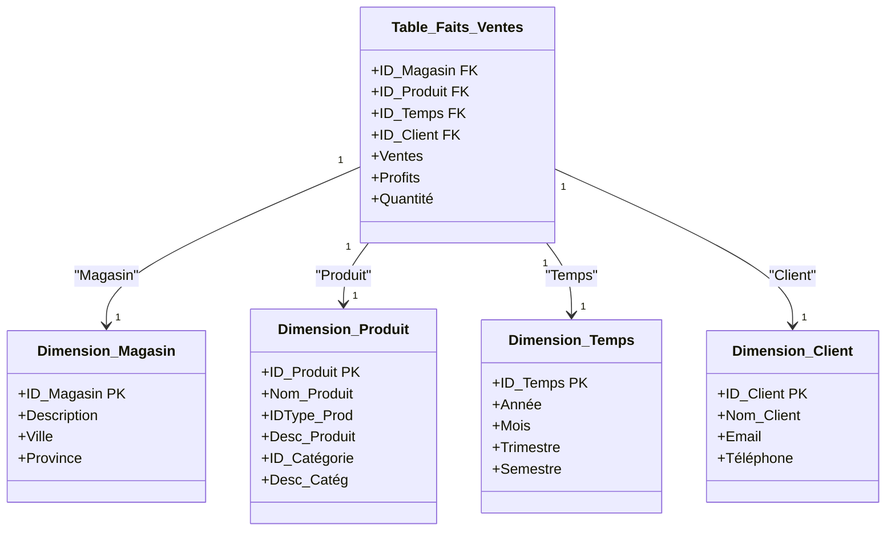
**En conclusion :** Table de Faits + Tables de Dimension (1 niveau hiérarchique)

---

### Modèle en Flocon de Neige

- Variante du schéma en étoile
- Tables de dimensions normalisées
- Table des faits inchangée
- Décomposition des dimensions selon leurs hiérarchies
- Un seul niveau hiérarchique par table de dimension
- Niveau le plus bas relié à la table des faits (granularité la plus fine)
- Utilisé pour les tables très volumineuses

**Avantages :**
- Réduction du volume
- Économie d'espace disque
- Analyses par pallier (drill down)
- Performance des updates
- Normalisation des dimensions

**Inconvénients :**
- Navigation difficile
- Nombreuses jointures
- Modèle plus complexe
- Requêtes moins performantes

**Exemple :**

```mermaid
classDiagram
    class Dimension_Marque {
        +Code_marque PK
        +Nom
        +Description
        +Créateur
    }

    class Dimension_Produit {
        +Code_produit PK
        +Description
        +Couleur
        +Code_marque FK
    }

    class Dimension_Période {
        +Code_période PK
        +Année
        +Trimestre
        +Mois
        +Jour
    }

    class Dimension_Magasin {
        +Code_magasin PK
        +Nom_mag
        +Ville
        +Téléphone
        +Manager
    }

    class Table_Faits_Ventes {
        +Code_produit FK
        +Code_période FK
        +Code_magasin FK
        +Unités_vendues
        +Montant_ventes
        +Montant_coût
    }

    Dimension_Produit "1" --> "1" Dimension_Marque : "appartient à"
    Table_Faits_Ventes "1" --> "1" Dimension_Produit : "réfère"
    Table_Faits_Ventes "1" --> "1" Dimension_Période : "réfère"
    Table_Faits_Ventes "1" --> "1" Dimension_Magasin : "réfère"
```

**En conclusion :** Table de Fait + Plusieurs niveaux de Tables de Dimension  
**Formule :** Flocon = Étoile + Normalisation des dimensions

---

### Modèle en Constellation

- Fusion de plusieurs modèles en étoile avec des dimensions communes
- Plusieurs tables de faits
- Tables de dimensions communes ou non

**Exemple :**

```mermaid
classDiagram
    class Dimension_Fournisseur {
        +Code_fournisseur PK
        +Nom
        +Adresse
        +Catégorie
    }

    class Dimension_Produit {
        +Code_produit PK
        +Description
        +Couleur
        +Marque
        +Créateur
    }

    class Dimension_Période {
        +Code_période PK
        +Année
        +Trimestre
        +Mois
        +Jour
    }

    class Dimension_Magasin {
        +Code_magasin PK
        +Nom_mag
        +Ville
        +Téléphone
        +Manager
    }

    class Table_Faits_Achats {
        +Code_produit FK
        +Code_période FK
        +Code_fournisseur FK
        +Unités_achetées
        +Montant_achats
        +Montant_remises
    }

    class Table_Faits_Ventes {
        +Code_produit FK
        +Code_période FK
        +Code_magasin FK
        +Unités_vendues
        +Montant_ventes
        +Montant_coût
    }

    Table_Faits_Achats "1" --> "1" Dimension_Fournisseur : "achète à"
    Table_Faits_Achats "1" --> "1" Dimension_Produit : "réfère"
    Table_Faits_Achats "1" --> "1" Dimension_Période : "réfère"
    Table_Faits_Ventes "1" --> "1" Dimension_Produit : "réfère"
    Table_Faits_Ventes "1" --> "1" Dimension_Période : "réfère"
    Table_Faits_Ventes "1" --> "1" Dimension_Magasin : "vend à"
```

---

### Synthèse des modèles

| | **Modèle en étoile** | **Modèle en flocon de neige** |
|---|---|---|
| **Taille** | Taille de dimension plus grosse | Jointures pour reconstruire |
| **Préférence** | Modèle en étoile >> Modèle en flocon | |
| **Raison** | Tables de dimension << tables de fait | |

---

## Stockage OLAP

| **Type** | **Description** |
|---|---|
| **ROLAP** | Relational OLAP |
| **MOLAP** | Multidimensional OLAP |
| **HOLAP** | Hybrid OLAP |
| **OOLAP** | Object OLAP |
| **DOLAP** | Desktop OLAP |

---

## Méthodologie de conception

### 9 étapes de R. Kimball

1. Choisir le sujet
2. Choisir la granularité des faits
3. Identifier et adapter les dimensions
4. Choisir les faits
5. Stocker les pré-calculs
6. Établir les tables de dimensions
7. Choisir la durée de la base
8. Suivre les dimensions lentement évolutives
9. Décider des requêtes prioritaires

---

### Conception d'un Data Warehouse — Étapes

#### Étape 1 : Choisir le sujet
- Choisir le processus à modéliser

#### Étape 2 : Choisir la granularité des faits
- Décider ce que représente une ligne de la table de faits
- Niveau de détail : transactions individuelles, récapitulatifs journaliers, mensuels

#### Étape 3 : Identifier et adapter les dimensions
- Identifier les dimensions applicables aux lignes de la table des faits
- Typiquement : temps, client, produit, magasin, agence, compte

#### Étape 4 : Choisir les faits
- Identifier les mesures de fait
- De préférence : quantités numériques additives

---

### Exemple : La Distribution

#### Processus
Comprendre les achats des clients saisis aux Terminaux Points de Vente (TPV)

#### Étape 1 : Le premier modèle dimensionnel
- Répondre aux questions les plus pressantes
- Quels produits se vendent dans quel magasin, à quel prix, quand, dans quelles conditions de promotion ?

#### Étape 2 : Quel niveau de détail ?
- Principe : données les plus fines possibles
- **Donnée atomique** : ligne individuelle de transaction TPV

#### Étape 3 : Choix des dimensions
- Le grain détermine les dimensions principales
- Dimensions supplémentaires : valeur unique pour chaque combinaison

**Dimensions principales :** Temps, Produit, Magasin, Promotion

```mermaid
classDiagram
    class Dimension_Date {
        +Clé_Date PK
        +Date
        +Jour
        +Mois
        +Année
    }

    class Dimension_Produit {
        +Clé_Produit PK
        +Nom_Produit
        +Catégorie
        +Marque
        +Prix_Unitaire
    }

    class Dimension_Magasin {
        +Clé_Magasin PK
        +Nom_Magasin
        +Ville
        +Région
        +Manager
    }

    class Dimension_Promotion {
        +Clé_Promotion PK
        +Nom_Promotion
        +Type
        +Taux_Remise
        +Date_Début
        +Date_Fin
    }

    class Table_Faits_TPV {
        +Clé_Date FK
        +Clé_Produit FK
        +Clé_Magasin FK
        +Clé_Promotion FK
        +Montant
        +Quantité
        +Remise
    }

    Table_Faits_TPV "1" --> "1" Dimension_Date : "se produit le"
    Table_Faits_TPV "1" --> "1" Dimension_Produit : "concerne"
    Table_Faits_TPV "1" --> "1" Dimension_Magasin : "se fait dans"
    Table_Faits_TPV "1" --> "1" Dimension_Promotion : "utilise"
```

#### Étape 3 (Suite) : Dimension Produit

```mermaid
classDiagram
    class Dimension_Produit {
        +Clé_Produit PK
        +Description_produit
        +Description_marque
        +Description_catégorie
        +Description_type_emballage
        +Taille_emballage
        +Poids
        +...
    }
```

#### Étape 4 : Identifier les faits

**Faits identifiés :**
- Quantité vendue
- Montant de la vente en dirhams
- Coût standard en DH

**Principe :** Pourcentage et ratios sont non-additifs → Ne pas les stocker, stocker le numérateur et dénominateur

```mermaid
classDiagram
    class Dimension_Date {
        +Clé_Date PK
        +Date
        +Jour
        +Mois
        +Année
    }

    class Dimension_Produit {
        +Clé_Produit PK
        +Nom_Produit
        +Catégorie
        +Marque
        +Prix_Unitaire
    }

    class Dimension_Magasin {
        +Clé_Magasin PK
        +Nom_Magasin
        +Ville
        +Région
        +Manager
    }

    class Dimension_Promotion {
        +Clé_Promotion PK
        +Nom_Promotion
        +Type
        +Taux_Remise
        +Date_Début
        +Date_Fin
    }

    class Table_Faits_TPV {
        +Clé_Date FK
        +Clé_Produit FK
        +Clé_Magasin FK
        +Clé_Promotion FK
        +Montant
        +Quantité
        +Remise
    }

    Table_Faits_TPV "1" --> "1" Dimension_Date : "se produit le"
    Table_Faits_TPV "1" --> "1" Dimension_Produit : "concerne"
    Table_Faits_TPV "1" --> "1" Dimension_Magasin : "se fait dans"
    Table_Faits_TPV "1" --> "1" Dimension_Promotion : "utilise"
```

---

## Synthèse générale

| **Concept** | **Définition** |
|---|---|
| **DW** | Entrepôt de données central, orienté sujet, intégré, non volatil, historisé |
| **DM** | Data Mart, sous-ensemble du DW pour un usage métier spécifique |
| **ODS** | Données opérationnelles intégrées en vue du DW |
| **ETL** | Extraction, Transformation, Chargement des données |
| **OLTP** | Systèmes transactionnels (opérations quotidiennes) |
| **OLAP** | Systèmes analytiques (aide à la décision) |
| **Étoile** | Modèle avec table de faits et dimensions dé-normalisées |
| **Flocon** | Modèle avec dimensions normalisées |
| **Constellation** | Plusieurs tables de faits partageant des dimensions communes |