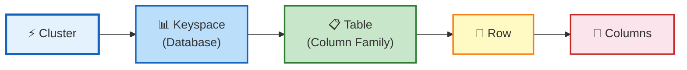
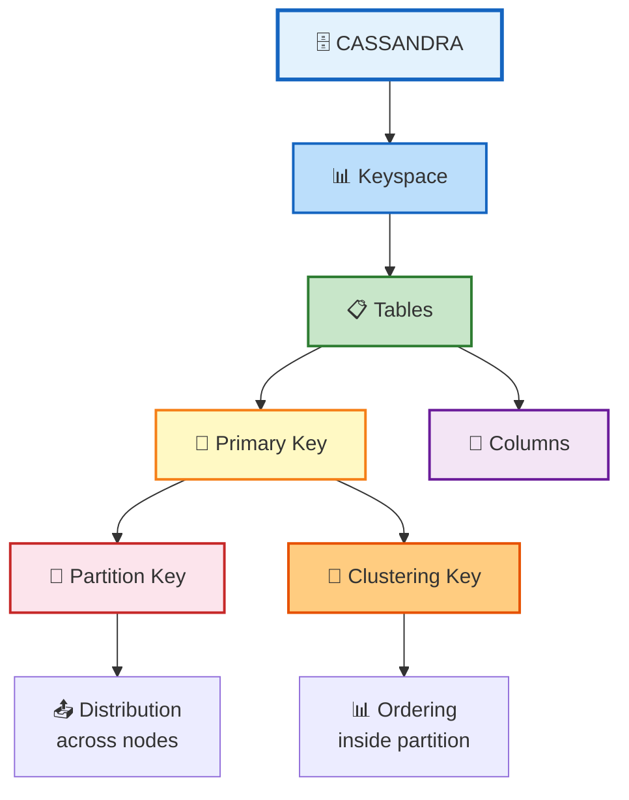

**Cassandra** is a distributed NoSQL database that combines:
- **BigTable** (from Google) - for data storage model
- **DynamoDB** (from Amazon) - for distribution and replication
## Architecture & Components

### Gossip Protocol
A peer-to-peer communication protocol used for cluster management:
- **Synchronization**: Every second
- **Failure detection**: Nodes detect when other nodes are down
- **Cluster state management**: Maintains information about all nodes

### Data Model Hierarchy





<h1 style="text-align:center;background:white;color:black">Keyspaces</h1>

## Read

```CQL
DESCRIBE KEYSPACES;
```
## Create
```cql
CREATE KEYSPACE university --Creates the keyspace
WITH replication = {
    'class': 'SimpleStrategy', --Defines the replication strategy
    'replication_factor': 3 --3 replicas of the data
};
```
## Select

```cql
USE keyspace_name;
```

## Delete

```cql
DROP KEYSPACE keyspace_name;
```
---
<h1 style="text-align:center;background:white;color:black">Tables</h1>

## Read

```cql
DESCRIBE TABLES;
```
## Create

```cql
CREATE TABLE table_name(
	id UUID PRIMARY KEY,
	column datatype, --name TEXT, age INT, ...
	...
)
```

##  Delete

```cql
DROP TABLE table_name;
```

---
<h1 style="text-align:center;background:white;color:black">Columns</h1>
Guarantee: either all columns in a row are modified, or none
## Add a column
		
```cql
ALTER TABLE table_name
ADD column datatype;
```
## Add multiple columns

```cql
ALTER TABLE table_name
ADD ( 
    column1 datatype,
    column2 datatype
);
```
## Change column type

```cql
ALTER TABLE table_name
ALTER column TYPE datatype;
```
## Drop a column

```cql
ALTER TABLE table_name
DROP column;
```
## Rename a column

```cql
ALTER TABLE table_name
RENAME old_column_name TO new_column_name;

```

---
<h1 style="text-align:center;background:white;color:black">Data</h1>
## Data Types

| CQL type    | Example                                |
| ----------- | -------------------------------------- |
| `TEXT`      | `'Hamza'`                              |
| `INT`       | `23`                                   |
| `BIGINT`    | `10000000000`                          |
| `DOUBLE`    | `24.5`                                 |
| `BOOLEAN`   | `true`                                 |
| `UUID`      | `550e8400-e29b-41d4-a716-446655440000` |
| `TIMESTAMP` | `2026-08-15 10:00:00`                  |
| `DATE`      | `2026-08-15`                           |
## Primary Kay 
- Simple Primary Key 
```cql
  id UUID PRIMARY KEY,
```
  - Composite Primary Key
```cql
PRIMARY KEY (col1, col2)
```

---
## INSERT

**No many columns in the same time**
```cql
INSERT INTO tbale_name(id, col1, col2)
VALUES (uuid(), val1, val2);
```

## SELECT

### Select all columns
```cql
SELECT * FROM table_name;
```

### Select a specific columns
```cql
SELECT col1, col2
FROM table_name;
```

### Select with filter
```cql
SELECT col1, col2
FROM table_name
WHERE condition; --age=25, name='hamza'
```

## UPDATE

```cql
UPDATE table_name
SET column = value
WHERE id = <uuid>;
```

## DELETE

### Delete a Row
```cql
DELETE FROM column_name
WHERE id = <uuid>;
```

### Delete a Specific Column
```cql
DELETE column
FROM table_name
WHERE id = <uuid>;
```

---

<h1 style="text-align:center;background:white;color:black">Consistency</h1>

```cql
CONSISTENCY QUORUM;
```

| Level          | Idea                         |
| -------------- | ---------------------------- |
| `ONE`          | One replica                  |
| `QUORUM`       | Majority of replicas         |
| `ALL`          | All replicas                 |
| `LOCAL_QUORUM` | Quorum in local DC           |
| `EACH_QUORUM`  | Quorum in every DC           |
| `ANY`          | Write availability mechanism |




