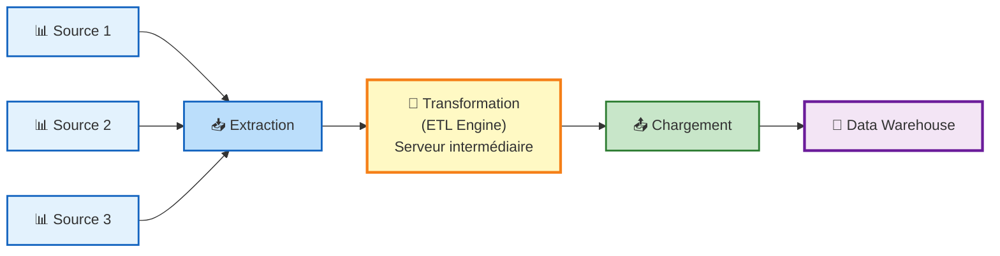
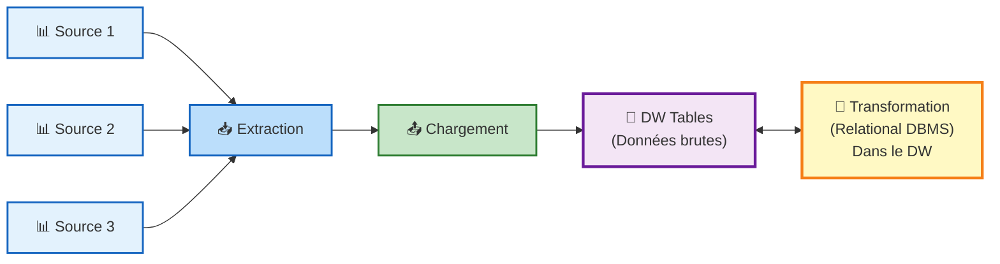

Systèmes opérationnels → ODS → Data Warehouse → Data Mart → Data Mining

# ODS
>Collection de données orientées sujet, **volatiles**, organisées pour un processus de décision ponctuel, en support d'une activité opérationnelle.

# Data Warehouse 
>Collection de données **orientées sujet, intégrées, non volatiles et <u><b>historisées</b></u>**, organisées pour le support d'un processus d'aide à la décision.
- Orientées sujet
- Intégrées
- Non volatiles
- Historisées
# Data Mart
>Sous-ensemble d'un DW, orienté sujet, non volatile, ciblé pour un usage particulier (ex. Finance, Ventes).

# Data Mining
>Ensemble d'outils/méthodes pour dégager des tendances, segmenter l'information ou établir des corrélations.

# ETL — Extract, Transform, Load

# ELT — Extract, Load, Transform

# DBMS (Database Management System)
>Un SGBD est un logiciel qui permet de stocker, organiser, gérer et manipuler des données dans une base de données.

---
# La modélisation multidimensionnelle
>La modélisation multidimensionnelle est une technique de conception qui transforme les données sources en structures logiques décisionnelles finalisées, organisées autour de faits (mesures) et de dimensions (axes d'analyse).

 - **Lisibilité** pour l'utilisateur final
 - **Performance au chargement**
 - **Performance à l'exécution des requêtes** (~30s max)
 - **Administration des données** (industrialisation de l'extraction), 
 - **Evolutivité du modèle**.

| **Concept**   | **Définition**                                                     | **Nature**                 | DB      |
| ------------- | ------------------------------------------------------------------ | -------------------------- | ------- |
| **Dimension** | **Axe d'analyse** selon lequel on observe les mesures              | Contexte (texte, date)     | Tables  |
| **Mesure**    | Indicateur **numérique** que l'on souhaite analyser                | Valeur (chiffre)           | Colones |
| **Fait**      | **Valeur d'une mesure** pour une combinaison précise de dimensions | Événement / enregistrement | Valeurs |

**Analogie simple :**
- **Mesure** = _Ce que je mesure_ (ex : le montant)
- **Fait** = _La valeur mesurée à un moment précis_ (ex : 500 DH le 01/01/2021 chez le client X)
- **Dimension** = _Le contexte de la mesure_ (ex : Qui ? Quand ? Où ? Quoi ?)

