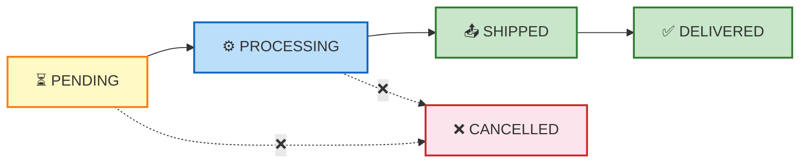

# Cassandra CQL Exercises

- [x] [[#Exercise 1: Keyspace Operations]]
- [x] [[#Exercise 2: Table Creation]]
- [x] [[#Exercise 3: Column Operations]]
- [x] [[#Exercise 4: Data Insertion]]
- [x] [[#Exercise 5: Data Querying (SELECT)]]
- [ ] [[#Exercise 6: Data Updates]]
- [ ] [[#Exercise 7: Data Deletion]]
- [ ] [[#Exercise 8: Table and Keyspace Cleanup]]
- [ ] [[#Exercise 9: Consistency Level Practice]]
- [ ] [[#Exercise 10: Complex Scenario]]

## Exercise 1: Keyspace Operations

**Task:** Create and manage a keyspace for an e-commerce platform.

1. Create a keyspace called `ecommerce` with:
   - SimpleStrategy replication
   - Replication factor of 3

2. List all keyspaces in your cluster

3. Switch to use the `ecommerce` keyspace

4. Create a keyspace called `ecommerce_backup` with NetworkTopologyStrategy (just for practice)

5. Delete the `ecommerce_backup` keyspace

---

## Exercise 2: Table Creation

**Task:** Create tables for the e-commerce platform.

1. Create a `customers` table with:
   - `customer_id` as UUID (PRIMARY KEY)
   - `first_name` as TEXT
   - `last_name` as TEXT
   - `email` as TEXT
   - `age` as INT
   - `is_active` as BOOLEAN
   - `created_at` as TIMESTAMP

2. Create an `orders` table with composite primary key:
   - `order_id` as UUID
   - `customer_id` as UUID
   - `order_date` as DATE
   - `total_amount` as DOUBLE
   - `status` as TEXT
   - **Primary Key**: (`order_id`, `customer_id`)

1. List all tables in the `ecommerce` keyspace

2. Create a `products` table with your choice of columns and appropriate primary key

---

## Exercise 3: Column Operations

**Task:** Modify the table structures.

1. Add a `phone_number` column (TEXT) to the `customers` table

2. Add multiple columns to the `orders` table:
   - `shipping_address` (TEXT)
   - `payment_method` (TEXT)

3. Change the `age` column in `customers` from INT to BIGINT

4. Drop the `is_active` column from `customers` table

5. Rename the `total_amount` column in `orders` to `order_total`

---
## Exercise 4: Data Insertion

**Task:** Insert sample data into your tables.

1. Insert 3 customers into the `customers` table using UUID generation

2. Insert 5 orders for different customers into the `orders` table

3. Try to insert a customer with missing required columns (what happens?)

4. Insert a product into your `products` table

5. Insert multiple rows (if possible) - note Cassandra's limitation

---

## Exercise 5: Data Querying (SELECT)

**Task:** Practice different SELECT operations.

1. Select all columns from the `customers` table

2. Select only `first_name` and `email` from the `customers` table

3. Select all orders with total amount greater than 100.00

4. Select customers with age greater than 25

5. Select orders for a specific customer (using customer_id filter)

6. Try to SELECT with a WHERE clause on a non-primary key column (what happens?)

---

## Exercise 6: Data Updates

**Task:** Practice UPDATE operations.

1. Update a customer's email address (specify by customer_id)

2. Update an order's status to 'SHIPPED' (specify by order_id and customer_id)

3. Update multiple columns in a single UPDATE statement

4. Try to update a row without specifying the primary key (what happens?)

---

## Exercise 7: Data Deletion

**Task:** Practice DELETE operations.

1. Delete a specific customer (delete entire row) by customer_id

2. Delete only the `phone_number` column from a specific customer

3. Delete an order (entire row) by order_id and customer_id

4. Try to delete a column from a non-existent row (what happens?)

---

## Exercise 8: Table and Keyspace Cleanup

**Task:** Practice dropping operations.

1. Drop the `products` table

2. Drop the entire `ecommerce` keyspace

3. Verify the keyspace and tables are removed

---

## Exercise 9: Consistency Level Practice

**Task:** Work with consistency levels.

1. Set consistency level to QUORUM before performing a SELECT

2. Set consistency level to ONE before inserting a new customer

3. Set consistency level to ALL before updating an order (observe behavior)

4. Explain the difference between QUORUM and LOCAL_QUORUM

---

## Exercise 10: Complex Scenario

**Task:** Build a complete application schema.

Create a blogging platform with the following requirements:

1. **Users table**:
   - user_id (UUID, PRIMARY KEY)
   - username (TEXT)
   - email (TEXT)
   - registration_date (TIMESTAMP)

2. **Posts table**:
   - post_id (UUID)
   - user_id (UUID)
   - title (TEXT)
   - content (TEXT)
   - publish_date (TIMESTAMP)
   - views (BIGINT)
   - Design appropriate primary key

3. **Comments table**:
   - comment_id (UUID)
   - post_id (UUID)
   - user_id (UUID)
   - comment_text (TEXT)
   - comment_date (TIMESTAMP)
   - Design appropriate primary key

4. Perform operations:
   - Insert 2 users
   - Insert 3 posts for different users
   - Insert 5 comments across different posts
   - Query all posts by a specific user
   - Query all comments for a specific post
   - Update the views count for a specific post
   - Delete a specific comment

---

## Bonus Challenge: Data Modeling

**Task:** Design a schema for a library management system.

Requirements:
- Books with ISBN, title, author, publication_year, genre
- Members with member_id, name, email, join_date
- Loans tracking which member borrowed which book and when
- Each book can have multiple copies
- Track if books are available or borrowed

Design the tables with appropriate primary keys and explain your choices for partition keys and clustering keys.

---

**Note:** For all exercises, remember to:
- Use appropriate consistency levels
- Handle errors gracefully
- Verify your operations with SELECT statements
- Consider the distributed nature of Cassandra when designing queries