# INTRODUCTION TO ML

**Pr. BEN LAHMAR El Habib**

---
## What is machine learning?
- Algorithms types
- Learning techniques: an overview
- Data Preparation (Data pre-processing)

---
## The Four Paradigms of Scientific Discovery

Scientific discovery has evolved through four major paradigms over time:

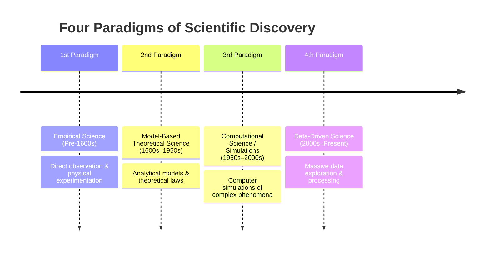

### The Data Lifecycle
The lifecycle surrounding data-driven science consists of:

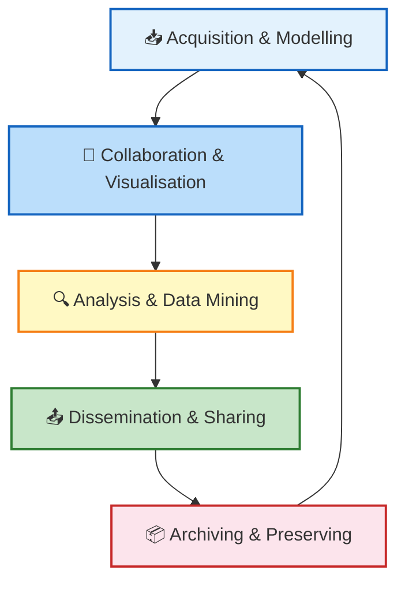
---

## What We Talk About When We Talk About "Learning"

* **Core Definition:** Learning general models from data consisting of particular examples.
* **Data Context:** Data is cheap and abundant (data warehouses, data marts); knowledge is expensive and scarce.
* **Retail Example:** Translating customer transactions into consumer behavior patterns:
  * *"People who bought 'Da Vinci Code' also bought 'The Five People You Meet in Heaven'"* (e.g., Amazon recommendation systems).
* **Objective:** Build a model that is a good and useful approximation of reality.

---
  
## What is Machine Learning?

### Context within Artificial Intelligence

* **Artificial Intelligence (AI):** The overarching field encompassing logical systems and knowledge-based systems.
- **Logical Systems:** Propositional & predicate logic (e.g., $A \lor B = \neg(\neg A \land \neg B)$, $A \implies B = \neg A \lor B$).
  * *Knowledge-Based Systems:* Expert systems and rule networks.
* **Machine Learning (ML):** A branch of artificial intelligence concerned with the design and development of algorithms that allow computers to evolve behaviors based on empirical data.
  * Because intelligence requires knowledge, it is necessary for computers to acquire knowledge automatically.
* **Deep Learning (DL):** A subfield nested within Machine Learning utilizing deep multi-layered neural networks.

### Traditional Programming vs. Machine Learning

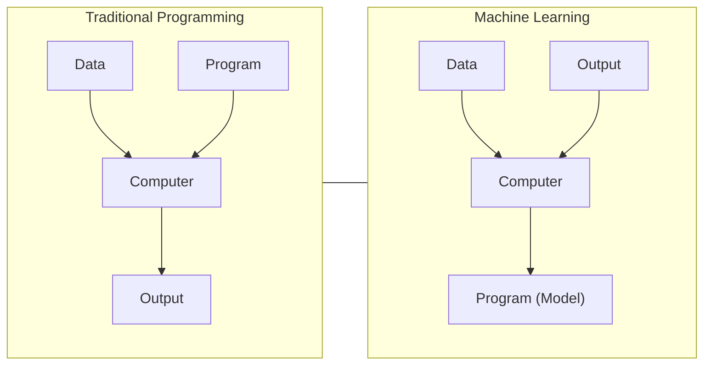


### Definition and Foundations

> **Machine Learning:** The study of algorithms that improve their performance at some task with experience.

* **Goal:** Optimize a performance criterion using example data or past experience.
* **Role of Statistics:** Inference from a sample.
* **Role of Computer Science:** 
  * Efficient algorithms to solve the optimization problem.
  * Representing and evaluating the model for inference.

---

## Machine Learning System Architecture & Pipeline

### Learning System Model

**Training Phase:**  
`Input Samples` → `System` → `Learning Method` → `Trained System`

**Testing Phase:**  
`Input Samples` → `Trained Learning Method` → `Predictions / Outputs`

### Standard Machine Learning Pipeline

# A Standard Machine Learning Pipeline

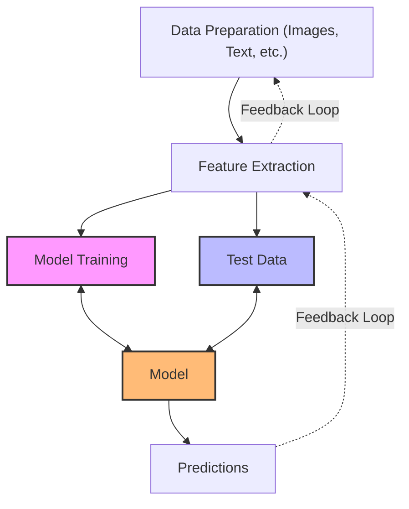

   
* **Note:** Feature extraction is a critical step in traditional machine learning pipelines.

---
## Training and Testing Dynamics

### Data Split Relationships
- **Data Acquisition:** Sampling from the *Universal Set* (unobserved).
- **Training Set:** Observed data used to train the system.
- **Testing Set:** Unobserved data reserved for practical evaluation.

### Fundamentals
- **Training Process:** The mechanism enabling the system to learn patterns from data.
- **No Free Lunch Theorem:** 
  - Training set and testing set are assumed to come from the same probability distribution.
  - All learning algorithms must make prior assumptions or biases to generalize beyond the training data.

### Data Flow 

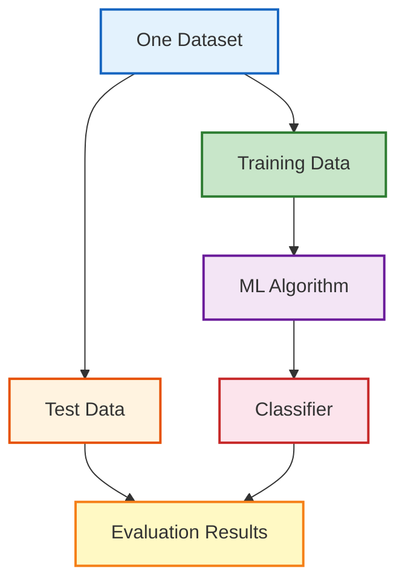


---

## Factors Affecting Performance

Several factors impact model performance:
* Types of training data provided
* The form and extent of initial background knowledge
* The type of feedback provided
* The learning algorithms used

### Core Pillars
1. **Modeling:** Formulation of hypotheses and representation.
2. **Optimization:** Search and parameter fitting.
3. **Algorithms:**
   * Success depends heavily on algorithm design.
   * Algorithms control the search strategy to discover and construct knowledge structures.
   * Algorithms must extract useful and generalizable information from training examples.

---

## Taxonomy of Machine Learning Algorithms

### 1. Supervised Learning
* **Data Format:** Given dataset $\{(x_n \in \mathbb{R}^d, y_n \in \mathbb{R})\}_{n=1}^N$.
* **Characteristics:** Training data includes desired target outputs (labels).
* **Tasks:**
  * **Classification:** Predicting discrete labels/categories.
  * **Regression:** Predicting continuous real values.

### 2. Unsupervised Learning
* **Data Format:** Given dataset $\{x_n \in \mathbb{R}^d\}_{n=1}^N$.
* **Characteristics:** Training data does **not** include target outputs/labels.
* **Tasks:**
  * Clustering
  * Probability distribution estimation
  * Finding associations in features
  * Dimensionality reduction

### 3. Semi-Supervised Learning
* **Characteristics:** Training dataset contains a large amount of unlabeled data and a small amount of labeled data.

### 4. Reinforcement Learning
* **Characteristics:** Decision-making agent interacting with an environment to maximize cumulative reward over time.
* **Tasks:** Autonomous control, games (chess, Go), robotics.

---

## Structural Workflow of Learning Types

### Supervised Learning Workflow
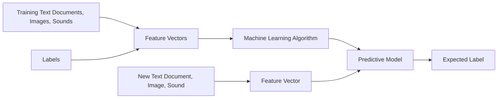

### Unsupervised Learning Workflow
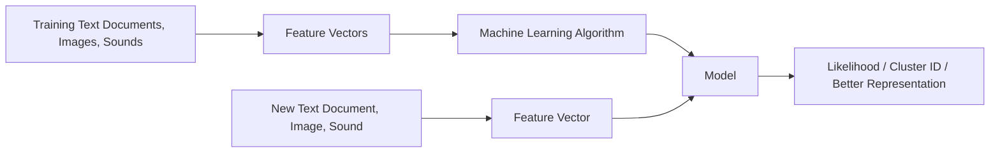

---

## Optimization Objectives & Error Measurement

### Supervised Learning

- **Objective:** Minimize out-of-sample error ($E_{\text{out}}$) or maximize probabilistic likelihood.

- **In-Sample Classification Error:**
  $$
  \text{error} = \frac{1}{N} \sum_{n=1}^{N} \left[ y_n \neq g(x_n) \right]
  $$

- **Generalization Bound (VC Theory):**
  $$
  E_{\text{out}}(g) \le E_{\text{in}}(g) + O\left(\sqrt{\frac{d_{\text{VC}}}{N} \ln N}\right)
  $$

  - $E_{\text{in}}$: Error on training set.
  - $E_{\text{out}}$: Error on testing set.
  - $d_{\text{VC}}$: Vapnik-Chervonenkis dimension (model complexity).

---

### Unsupervised Learning

- **Objectives:**
  - Minimum quantization error
  - Minimum distance
  - Maximum A Posteriori (MAP)
  - Maximum Likelihood Estimation (MLE)


### Underfitting vs. Overfitting (Fixed Sample Size $N$)

```
  Error
    ▲
    │      \                 /  E_out (Testing Error)
    │       \   Optimal     /
    │        \  Capacity   /
    │─────────\───│───────/──────────────
    │          \  │      /  High Variance
    │ High Bias \ │     /   (Overfitting)
    │(Underfitting\   /
    │             \│/
    │───────────────*────────────────── E_in (Training Error)
    └─────────────────────────────────────►
                               d_VC (Model Complexity)
```


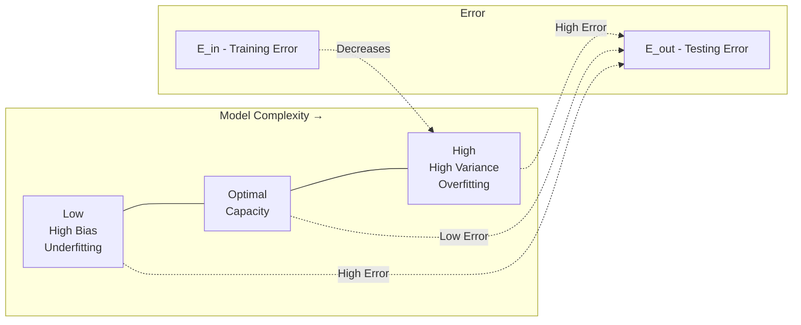
---

## Learning Techniques Overview

### Supervised Learning Categories & Algorithms
* **Linear Classifiers / Numerical Functions:** 
	* Logistic Regression
	* Linear SVM, Perceptron.
* **Parametric / Probabilistic Functions:**
	* Naïve Bayes
	* Gaussian Discriminant Analysis (GDA)
	  * Hidden Markov Models (HMM)
	  * Probabilistic Graphical Models
* **Non-parametric / Instance-Based Functions:**
	  * K-Nearest Neighbors ($k$-NN)
	  * Kernel Regression
	  * Kernel Density Estimation
	  * Local Regression
* **Non-Metric / Symbolic Functions:**
  * Decision Trees
  * Classification and Regression Trees (CART)
* **Aggregation / Ensemble Methods:**
  * Bagging (Bootstrap Aggregation)
  * AdaBoost
  * Random Forest

### Unsupervised Learning Categories & Algorithms
* **Clustering:**
  * K-Means Clustering
  * Spectral Clustering
  * Hierarchical Clustering
  * DBSCAN
* **Density Estimation:**
  * Gaussian Mixture Models (GMM)
  * Graphical Models
* **Dimensionality Reduction:**
  * Principal Component Analysis (PCA)
  * Factor Analysis
  * Singular Value Decomposition (SVD)
  * Isomap / LLE

### Reinforcement Learning
* **Core Concepts:**
  * **Policies:** Action selection rules mapping situations to actions.
  * **Utility / Value Estimation:** Quantifying state/action desirability.
  * **Feedback:** Delayed reward signals (no instant correct label).
  * **Credit Assignment Problem:** Determining which past action contributed to success/failure.
* **Applications:** Game playing (e.g., Chess, Go), robotics navigation in a maze, multi-agent control under partial observability.

---

## Machine Learning in a Nutshell

Every machine learning algorithm consists of **three core components**:

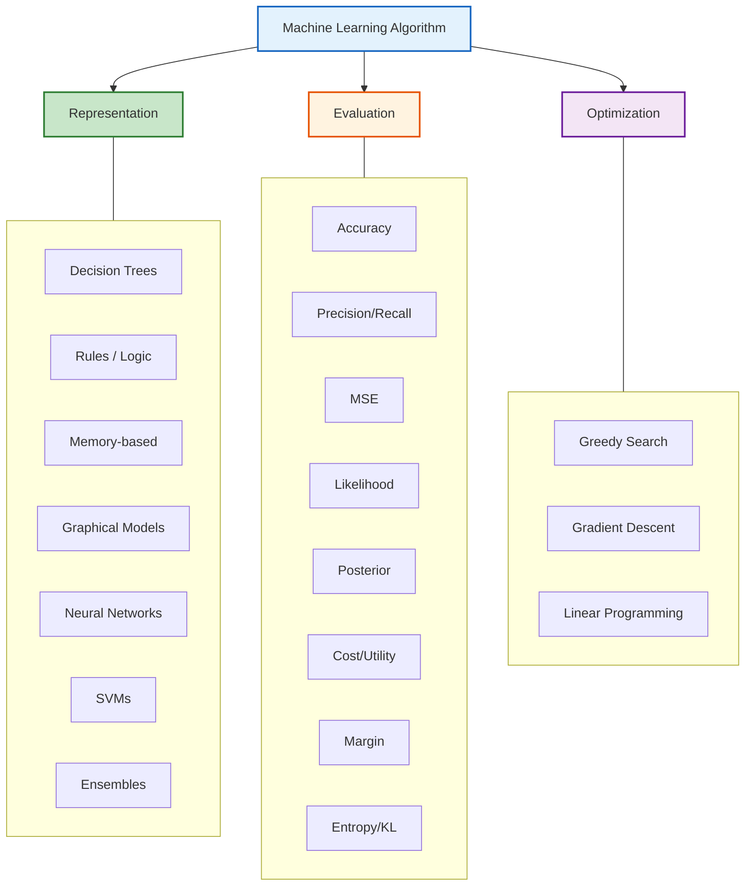


---

## Summary Hierarchy of ML Types & Applications

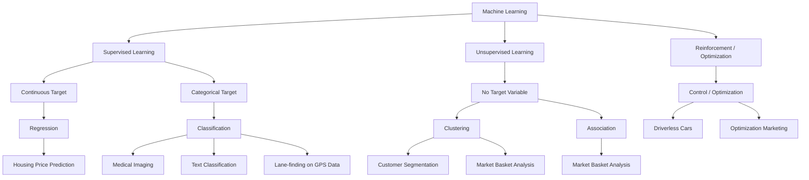

---

## Steps in Developing a Machine Learning Application

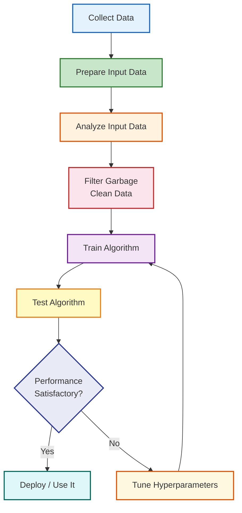

---

## Algorithm Selection Guides

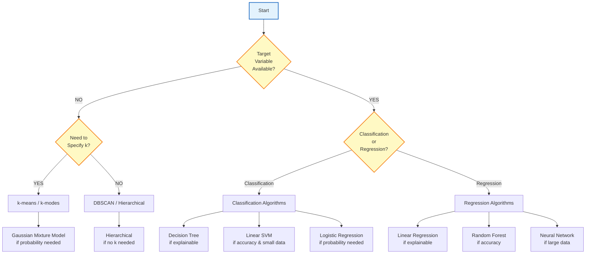

---

## Industry Insights: State of Data Science & Machine Learning

*(Based on the 2018 Kaggle Survey)*

### Top Designations Across Countries
Primary job titles reported across major global regions:
1. Data Scientist
2. Software Engineer
3. Data Analyst
4. Research Scientist
5. Consultant / Research Assistant / Data Engineer

### Education Levels
Across most surveyed countries (US, India, European Union, China, etc.):
* **Master's Degree** represents the highest proportion of practitioners (~40–55%).
* **Bachelor's Degree** follows as the second largest group (~30–45%).
* **Doctoral Degree (PhD)** comprises ~10–25% (higher in research-centric regions).

---

## Data Preparation and Pre-processing

### The Process for Data Preparation & Feature Engineering

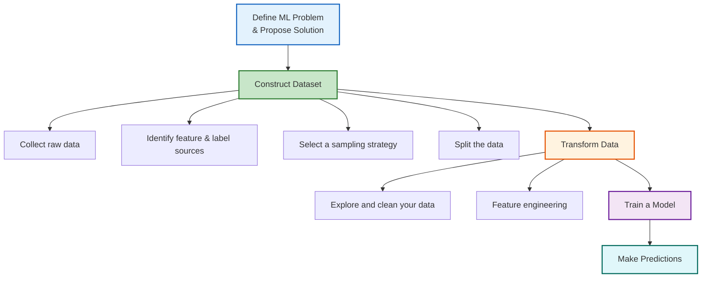

---

## Constructing Your Dataset

### Self-Check Concept 1: Feature Selection Strategy
* **Question:** You're on a brand-new ML project, about to select your first features. How many features should you pick?
* **Analysis of Options:**
  1. *Pick as many features as you can:* Incorrect. Leads to the **Curse of Dimensionality**—as dimensionality increases, volume grows exponentially, making available data sparse and hindering the learning of true relationships.
  2. *Pick 4–6 features:* Sub-optimal for a baseline start.
  3. **Best Practice:** **Start small with 1–3 features** that seem to have strong predictive power. Starting with minimal features verifies that the ML pipeline functions as intended and establishes a solid baseline without unnecessary complications.

### Self-Check Concept 2: Correlation vs. Causation
* **Scenario:** A positive correlation exists between app downloads and app review impressions. Does seeing the review *cause* downloads?
* **Key Takeaway:** You cannot determine causation solely from observational data.
* **Solution:** Conduct an A/B test or controlled experiment comparing user behavior between groups exposed and not exposed to the review.

---

## Data Set Size and Quality

> **"Garbage in, garbage out"** — A machine learning model is strictly bounded by the quality and representativeness of its data.

### Data Set Size Examples

| Application / Dataset | Size (Number of Examples) |
| :--- | :--- |
| **Iris Flower Dataset** | 150 (total set) |
| **MovieLens (20M set)** | 20,000,263 |
| **Google Gmail SmartReply** | 238,000,000 (training set) |
| **Google Books Ngram** | 468,000,000,000 |
| **Google Translate** | Trillions of tokens |

* *Rule of Thumb:* A model should ideally train on **at least an order of magnitude more examples than trainable parameters**. Simple models trained on large datasets generally outperform complex models trained on small datasets.

---

## Measuring Data Quality

Quality in ML is empirical: **A quality dataset is one that enables success on the target business problem.**

### Core Pillars of Data Quality
1. **Reliability**
2. **Feature Representation**
3. **Minimizing Skew**

---

## 1. Reliability
Reliability is the degree of trust in data integrity.

### Measurement Questions
1. **How common are label errors?** (Human labeling errors).
2. **Are features noisy?** (e.g., GPS fluctuations).
3. **Is data properly filtered for the problem domain?** (e.g., removing web bot traffic unless training a bot/spam detector).

### Factors Causing Unreliability
* **Omitted Values:** Missing fields (e.g., unentered house age).
* **Duplicate Examples:** Server log duplicates.
* **Bad Labels:** Human mistagging (e.g., mistaking an oak tree for a maple).
* **Bad Feature Values:** Data entry errors (extra digits) or faulty sensor readings (thermometer placed in direct sunlight).

---

## 2. Feature Representation
Representation is the mapping of raw data into numeric, expressive features.

* Key Considerations:
  * How is data presented to the model?
  * Should numeric values be normalized / standardized?
  * How are extreme outliers handled?

---

## 3. Training vs. Serving Skew
* **Definition:** Divergence in model performance between offline training time and live serving time.
* **Causes:** Subtle discrepancies in feature calculations, data leakage, or unrepresentative training traffic.
* **Prevention:** Use only features available at actual prediction time during training.

---

## Identifying Labels and Label Sources

### Direct vs. Derived Labels
* **Direct Label:** Directly measures the target attribute (e.g., *"User is a Taylor Swift fan"*).
* **Derived Label:** Measures a proxy event (e.g., *"User watched a Taylor Swift video on YouTube"*).
* *Caution:* Model efficacy is directly constrained by how closely the derived proxy correlates with the true underlying state.

### Types of Label Sources
* **Events:** e.g., *"Did the user click the top search result?"*
* **Attributes:** e.g., *"Will the advertiser spend more than \$X next week?"*

### Human-Labeled Data Trade-offs

| Advantages (+) | Disadvantages (-) |
| :--- | :--- |
| Can handle complex, subjective tasks | Expensive and time-consuming |
| Forces clear problem definition | Requires multiple annotation iterations |

---

## Sampling and Splitting Data

### Sampling Granularity
When downsampling massive datasets (e.g., search logs):
* **Query Level:** Random query sampling.
* **Session Level:** Preserves sequential query context (required for features like *"previous query"*).
* **User Level:** Preserves cross-day user history (required for features like *"user behavior over past week"*).

---

## Imbalanced Data

An **imbalanced dataset** occurs when target classes possess significantly unequal proportions.

### Degrees of Imbalance

| Degree of Imbalance | Minority Class Proportion |
| :--- | :--- |
| **Mild** | 20% – 40% of dataset |
| **Moderate** | 1% – 20% of dataset |
| **Extreme** | < 1% of dataset |

### Risks of Imbalanced Data
* In extreme cases (e.g., 1 positive in 200 fraud cases, or 0.5%), a model can achieve 99.5% accuracy simply by predicting the majority class ("not fraud") for every sample.
* Gradient updates become dominated by majority class samples, leading to poor learning on minority class signals.

---

## Downsampling and Upweighting Strategy

To correct class imbalance during training:

1. **Step 1: Downsample the Majority Class**
   * Train on a smaller subset of majority class examples.
   * *Example:* Reduce negative samples by a factor of 20 (taking $1/10$ or $1/20$ of negative samples), bringing the positive ratio to ~10%.

2. **Step 2: Upweight the Downsampled Class**
   * Apply an example weight to the downsampled class equal to the downsampling factor.
   * $$	ext{Example Weight} = 	ext{Original Weight} 	imes 	ext{Downsampling Factor}$$
   * An example weight of 20 treats that single instance as 20 identical instances when computing loss.

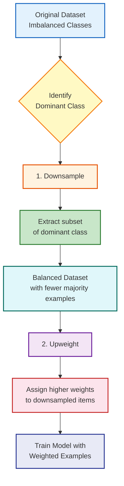

### Benefits of Downsampling + Upweighting
* **Faster Convergence:** The model sees minority samples more frequently per epoch.
* **Disk Space Efficiency:** Consolidates majority instances, leaving storage space to collect richer minority samples.
* **Model Calibration:** Upweighting preserves probabilistic output calibration matching true distributions.

---

## Data Splitting and Cluster Skew

### When Random Splitting Fails
* **Cluster Skew:** When dataset examples naturally cluster (e.g., multiple news stories covering the same event), a standard **random split** places elements of the same cluster into both training and test sets, causing data leakage and overly optimistic test scores.
* **Time-Based Splitting:** Split data chronologically (e.g., train on past data, test on future data) to evaluate true predictive capabilities on unseen temporal data.

---

## Model Generalization: Overfitting & Underfitting

```
   Underfitted            Good Fit / Robust          Overfitted
   (High Bias)                 (Ideal)            (High Variance)
 ┌──────────────┐          ┌──────────────┐       ┌──────────────┐
 │  ▲           │          │  ▲           │       │  ▲  /\       │
 │  │ \         │          │  │  \───┐    │       │  │ /  \/\    │
 │  │  \        │          │  │       \   │       │  │/      \   │
 │  └─────────► │          │  └─────────► │       │  └─────────► │
 └──────────────┘          └──────────────┘       └──────────────┘
```

### Summary of Model States

| Property | Underfitting | Overfitting |
| :--- | :--- | :--- |
| **Training Performance** | Poor | Very High |
| **Testing Performance** | Poor | Poor |
| **Bias / Variance** | High Bias, Low Variance | Low Bias, High Variance |
| **Cause** | Model is too simple to capture patterns | Model memorizes noise and training specifics |

### Strategies to Limit Overfitting
1. **Resampling Techniques:** Use $K$-Fold Cross-Validation.
2. **Validation Holdout:** Reserve an independent validation dataset for hyperparameter tuning.
3. **Regularization:** Penalize model complexity.
4. **Simplification:** Reduce feature space and tree depth.

---

## Summary of Data Science Building Blocks

* **Overfitting:** Excessive reliance on training data; fails to generalize to unseen data.
* **Underfitting:** Failure to capture underlying structures in training data.
* **High Variance:** Model predictions fluctuate drastically based on training data variations.
* **High Bias:** Oversimplified assumptions cause the model to ignore training data signals.
* **Validation Set:** Essential for model tuning without contaminating the test set evaluation.

---

## Web Scraping Tools Overview

Techniques for automated web data extraction during ML dataset creation:
* **APIs:** Standardized interfaces for structured data retrieval.
* **Beautiful Soup:** Python library designed for quick extraction and parsing of data from HTML/XML documents.
* **Scrapy:** Full-fledged open-source web crawling and scraping framework for large-scale data extraction.


# [[00 - Table des Matières]]