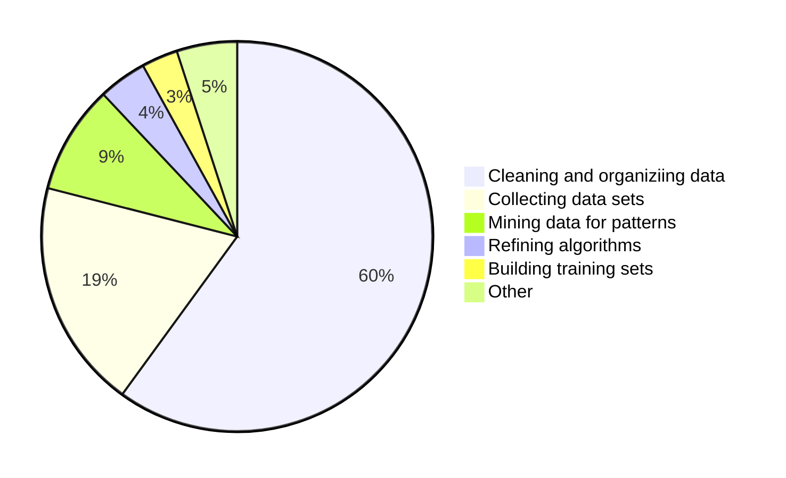
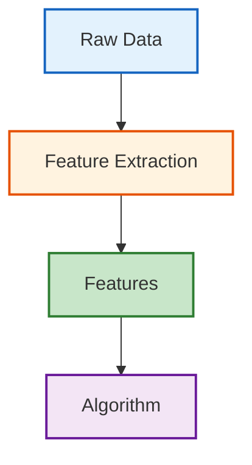
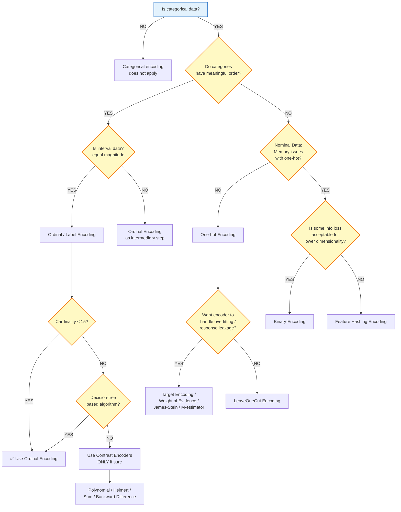
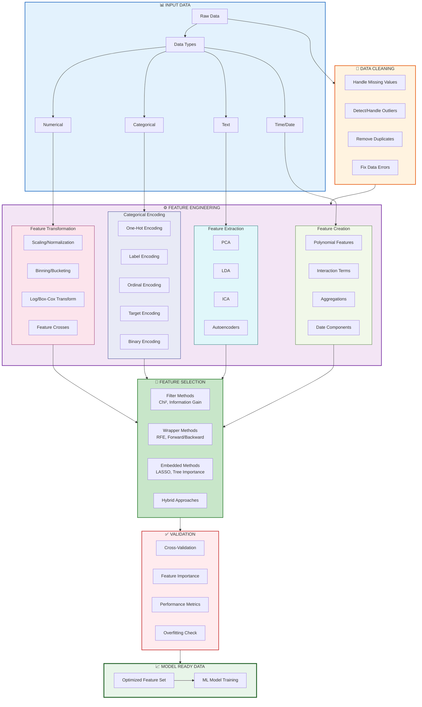

# Feature Engineering 

---

## The Process for Data Preparation and Feature Engineering

Data preparation and feature engineering form a critical part of the machine learning pipeline.

### What Data Scientists Spend Most Time Doing


---
 
## What is Feature Engineering?

- Simply put, it is the art/science of representing data in the best way possible.
- Good Feature Engineering involves an elegant blend of domain knowledge and data science expertise.



### Key Concept

The way you present your data to your algorithm should denote the pertinent structures/properties of the underlying information in the most effective way possible. When you do feature engineering, you are essentially converting your data **attributes** into data **features**.

### Attributes vs. Features

- **Attributes** are basically all the dimensions present in your data.
- Not all attributes, in their raw format, represent the underlying trends you want to learn in the best way possible.

### The Goal

Feature engineering is the process of pre-processing your data so that your model/learning algorithm has to spend minimum effort on wading through **noise**.

> **Noise** is any information that is not relevant to learning/predicting your ultimate goal.

Good features can even let you use considerably simpler models.

### Important Note

> Always use **validation** to make sure that the new features you introduce really do improve your predictions, instead of adding unnecessary complexity to your pipeline.

---

## Feature Engineering Techniques

### Representing Timestamps

- Time-stamp attributes are usually denoted by the **EPOCH time** or split up into multiple dimensions such as:
  - Year
  - Month
  - Date
  - Hours
  - Minutes
  - Seconds

#### Consideration

In many applications, a lot of that information is unnecessary.

#### Example: Traffic Prediction

For a supervised system that tries to predict traffic levels in a city as a function of Location + Time:
- Trying to learn trends that vary by seconds would mostly be misleading.
- The year wouldn't add much value to the model.

**Recommendations:**
- Hours, day, and month are probably the only dimensions you need.
- Ensure your model actually requires all the numbers you are providing.
- If data sources come from different geographical sources, normalize by time-zones if needed.

---

### Decomposing Categorical Attributes

In many practical data science activities, the data set will contain categorical variables. These variables are typically stored as text values. Since machine learning is based on mathematical equations, it would cause a problem when we keep categorical variables as is.

#### Encoding Methodologies

**Nominal Encoding** (Order of data does not matter):
- One Hot Encoding
- One Hot Encoding With Many Categories
- Mean Encoding

**Ordinal Encoding** (Order of data matters):
- Label Encoding
- Target Guided Ordinal Encoding

#### Examples

**Nominal variables:**
- Colors: Red, Yellow, Pink, Blue
- Countries: Singapore, Japan, USA, India, Korea
- Animals: Cow, Dog, Cat, Snake

**Ordinal variables:**
- High, Medium, Low
- "Strongly Agree", "Agree", "Neutral", "Disagree", "Strongly Disagree"
- Excellent, Okay, Bad

#### Encoding Techniques List

1. One Hot Encoding
2. Label Encoding
3. Ordinal Encoding
4. Helmert Encoding
5. Binary Encoding
6. Frequency Encoding
7. Mean Encoding
8. Weight of Evidence Encoding
9. Probability Ratio Encoding
10. Hashing Encoding
11. Backward Difference Encoding
12. Leave One Out Encoding
13. James-Stein Encoding
14. M-estimator Encoding

#### Example Dataset

| No | Section | Semester | Target |
|----|---------|----------|--------|
| 0  | Smi     | S6       | 1      |
| 1  | Sma     | S5       | 0      |
| 2  | Msdbd   | S2       | 1      |
| 3  | Smi     | S5       | 1      |
| 4  | Sma     | S4       | 1      |
| 5  | Smp     | S6       | 0      |
| 6  | Smi     | S4       | 0      |
| 7  | Smp     | S6       | 1      |
| 8  | Msdbd   | S1       | 1      |
| 9  | Smp     | S5       | 0      |

#### One Hot Encoding

In this method, we map each category to a vector that contains 1 and 0 denoting the presence or absence of the feature.

- The number of vectors depends on the number of categories for features.
- This method produces a lot of columns that slows down the learning significantly if the number of categories is very high.

#### Label Encoding

1. Each category is assigned a value from 1 through N (where N is the number of categories for the feature).
2. **Major issue:** There is no relation or order between these classes, but the algorithm might consider them as some order or relationship.

#### Ordinal Encoding

We do Ordinal encoding to ensure the encoding of variables retains the ordinal nature of the variable.

#### Encoding Methods Cheat-Sheet

---

### Binning/Bucketing

Sometimes, it makes more sense to represent a numerical attribute as a categorical one.

#### Example: Age Groups

Consider the problem of predicting whether a person owns a certain item of clothing or not. Age might be a factor, but what is actually more pertinent is the **Age Group**.

Ranges such as:
- 1-10
- 11-18
- 19-25
- 26-40
- etc.

#### What is Binning?

Binning or grouping data (sometimes called quantization) is an important tool in preparing numerical data for machine learning.

**Benefits:**
- Reduces the effect of tiny errors by "rounding off" a given value to the nearest representative.
- Reduces overfitting in certain applications.

**When NOT to use binning:**
- If the number of your ranges is comparable to the total possible values.
- If precision is very important to you.

Bucketing makes sense when the domain of your attribute can be divided into neat ranges, where all numbers falling in a range imply a common characteristic.

---

### Feature Crosses

Feature crosses are a unique way to combine two or more categorical attributes into a single one.

This is extremely useful when certain features together denote a property better than individually by themselves.

> Mathematically speaking, you are doing a **cross product** between all possible values of the categorical features.

#### Example

Consider a feature **A** with two possible values {A₁, A₂}. Let **B** be a feature with possibilities {B₁, B₂}. Then, a feature-cross between A & B (let's call it AB) would take one of the following values:

- (A₁, B₁)
- (A₁, B₂)
- (A₂, B₁)
- (A₂, B₂)

#### Practical Example: Quadrant Classification

**Problem:** Classify points into Red or Blue classes based on their X, Y coordinates.

**Step 1:** Binning X, Y values into:
- {X < 0, X >= 0} = {Xn, Xp}
- {Y < 0, Y >= 0} = {Yn, Yp}

Quadrants I & III correspond to class Red, and Quadrants II & IV correspond to class Blue.

**Step 2:** Define modified features:
```
X_sign = x/|x|
Y_sign = y/|y|
```

**Step 3:** Define new feature:
```
Quadrant_odd = X_sign * Y_sign
```

**Result:** If Quadrant_odd = 1, the class is Red. Else, Blue!

---

### Feature Selection

Feature selection is the process of selecting a subset of relevant features for use in model construction.

> Feature selection is another key part of the applied machine learning process, like model selection.

#### Important Considerations

- Consider feature selection a part of the model selection process.
- If you do not, you may inadvertently introduce bias into your models which can result in overfitting.

#### Feature Selection vs. Dimensionality Reduction

| Feature Selection | Dimensionality Reduction |
|-------------------|--------------------------|
| Includes and excludes attributes present in the data without changing them | Creates new combinations of attributes |
| Prunes features to reduce noise/redundancy | Transforms data into new feature space |

#### Objectives of Variable Selection

1. Improving the prediction performance of the predictors
2. Providing faster and more cost-effective predictors
3. Providing a better understanding of the underlying process that generated the data

> **Reference:** http://jmlr.csail.mit.edu/papers/volume3/guyon03a/guyon03a.pdf

---

### Feature Selection Algorithms

There are three general classes of feature selection algorithms:

1. **Filter methods**
2. **Wrapper methods**
3. **Embedded methods**

---

#### Filter Methods

Filter feature selection methods apply a statistical measure to assign a scoring to each feature.

- Features are ranked by the score and either selected to be kept or removed from the dataset.
- Methods are often **univariate** and consider the feature independently, or with regard to the dependent variable.

**Examples of filter methods:**
- Chi-squared test
- Information gain
- Correlation coefficient scores

**Mathematical Framework:**
Consider a set of m examples {xₖ, yₖ} (k = 1,...m) consisting of n input variables xₖ,ᵢ (i = 1,...n) and one output variable yₖ. Variable ranking makes use of a scoring function S(i) computed from the values xₖ,ᵢ and yₖ, k = 1,...m.

**Common Scoring Functions:**
1. Correlation
2. Fisher
3. Information Theoretic Ranking
4. CRITICAL
5. SNR (Signal-to-Noise Ratio)
6. Coefficient

> **Reference:** Golub et al. (1999). "Molecular classification of cancer: class discovery and class prediction by gene expression monitoring." Science, 286:531-537.

---

#### Wrapper Methods

Wrapper methods consider the selection of a set of features as a search problem, where different combinations are prepared, evaluated and compared to other combinations.

- A predictive model is used to evaluate a combination of features and assign a score based on model accuracy.
- The search process may be:
  - **Methodical** (e.g., best-first search)
  - **Stochastic** (e.g., random hill-climbing algorithm)
  - **Heuristic** (e.g., forward and backward passes to add and remove features)

**Example:** Recursive Feature Elimination (RFE) algorithm.

---

#### Embedded Methods

Embedded methods learn which features best contribute to the accuracy of the model while the model is being created.

The most common type of embedded feature selection methods are **regularization methods**.

Regularization methods (also called penalization methods) introduce additional constraints into the optimization of a predictive algorithm that bias the model toward lower complexity (fewer coefficients).

**Examples of regularization algorithms:**
- LASSO
- Elastic Net
- Ridge Regression

---

### Feature Selection Decision Flow

1. **Do you have domain knowledge?** If yes, construct a better set of "ad hoc" features.

2. **Are your features commensurate?** If no, consider normalizing them.

3. **Do you suspect interdependence of features?** If yes, expand your feature set by constructing conjunctive features or products of features, as much as your computer resources allow.

4. **Do you need to prune the input variables?** (e.g., for cost, speed or data understanding reasons). If no, construct disjunctive features or weighted sums of features.

5. **Do you need to assess features individually?** (e.g., to understand their influence on the system or because their number is so large that you need to do a first filtering). If yes, use a variable ranking method; else, do it.

6. **Do you suspect your data is "dirty"?** (has a few meaningless input patterns and/or noisy outputs or wrong class labels). If yes, detect the outlier examples using the top ranking variables obtained in step 5 as representation; check and/or discard them.

7. **Do you know what to try first?** If no, use a linear predictor. Use a forward selection method with the "probe" method as a stopping criterion or use the 0-norm embedded method for comparison. Following the ranking of step 5, construct a sequence of predictors of same nature using increasing subsets of features. Can you match or improve performance with a smaller subset? If yes, try a non-linear predictor with that subset.

8. **Do you have new ideas, time, computational resources, and enough examples?** If yes, compare several feature selection methods, including your new idea, correlation coefficients, backward selection and embedded methods. Use linear and non-linear predictors. Select the best approach with model selection.

9. **Do you want a stable solution?** (to improve performance and/or understanding). If yes, subsample your data and redo your analysis for several "bootstrap."

---

### Implementation with scikit-learn

The `sklearn.feature_selection` module implements feature selection algorithms, including:
- Univariate filter selection methods
- Recursive Feature Elimination algorithm

#### Available Classes and Functions

| Class/Function | Description |
|----------------|-------------|
| `feature_selection.GenericUnivariateSelect(…)` | Univariate feature selector with configurable strategy |
| `feature_selection.SelectPercentile(…)` | Select features according to a percentile of the highest scores |
| `feature_selection.SelectKBest([score_func, k])` | Select features according to the k highest scores |
| `feature_selection.SelectFpr([score_func, alpha])` | Filter: Select the p-values below alpha based on a FPR test |
| `feature_selection.SelectFdr([score_func, alpha])` | Filter: Select the p-values for an estimated false discovery rate |
| `feature_selection.SelectFromModel(estimator)` | Meta-Transformer for selecting features based on importance weights |
| `feature_selection.SelectFwe([score_func, alpha])` | Filter: Select the p-values corresponding to Family-wise error rate |
| `feature_selection.RFEC(estimator, …)` | Feature ranking with recursive feature elimination |
| `feature_selection.RFECV(estimator, step, …)` | Feature ranking with recursive feature elimination and cross-validated selection |
| `feature_selection.VarianceThreshold([threshold])` | Feature selector that removes all low-variance features |
| `feature_selection.chi2(X, y)` | Compute chi-squared stats between each non-negative feature and class |
| `feature_selection.f_classif(X, y)` | Compute the ANOVA F-value for the provided sample |
| `feature_selection.f_regression(X, y[, center])` | Univariate linear regression tests |
| `feature_selection.mutual_info_classif(X, y)` | Estimate mutual information for a discrete target variable |
| `feature_selection.mutual_info_regression(X, y)` | Estimate mutual information for a continuous target variable |

---

### Removing Features with Low Variance

`VarianceThreshold` is a simple baseline approach to feature selection. It removes all features whose variance doesn't meet some threshold.

- By default, it removes all **zero-variance** features (features that have the same value in all samples).

#### Example: Boolean Features

Suppose we have a dataset with boolean features, and we want to remove all features that are either 1 or 0 (on or off) in more than 80% of the samples.

For Bernoulli random variables:
```
Var[X] = p(1 - p)
```

Threshold = 0.8 × (1 - 0.8)

#### Example Code

```python
from sklearn.feature_selection import VarianceThreshold

X = [[0, 0, 1], 
     [0, 1, 0], 
     [1, 0, 0], 
     [0, 1, 1], 
     [0, 1, 0], 
     [0, 1, 1]]

sel = VarianceThreshold(threshold=(0.8 * (1 - 0.8)))
sel.fit_transform(X)
```

**Output:**
```python
array([[0, 1],
       [1, 0],
       [0, 0],
       [1, 1],
       [1, 0],
       [1, 1]])
```

As expected, VarianceThreshold has removed the first column, which has a probability p = 5/6 > 0.8 of containing a zero.

---

### Recursive Feature Elimination (RFE)

The Recursive Feature Elimination method works by:
1. Recursively removing attributes
2. Building a model on those attributes that remain
3. Using model accuracy to identify which attributes (and combinations of attributes) contribute the most to predicting the target attribute

#### Example: RFE on Iris Dataset

```python
from sklearn import datasets
from sklearn.feature_selection import RFE
from sklearn.linear_model import LogisticRegression

# Load the iris datasets
dataset = datasets.load_iris()

# Create a base classifier used to evaluate a subset of attributes
model = LogisticRegression()

# Create the RFE model and select 3 attributes
rfe = RFE(model, 3)
rfe = rfe.fit(dataset.data, dataset.target)

# Summarize the selection of the attributes
print(rfe.support_)
print(rfe.ranking_)
```

---

### Feature Importance

Methods that use ensembles of decision trees (like Random Forest or Extra Trees) can compute the relative importance of each attribute. These importance values can be used to inform a feature selection process.

#### Example: Extra Trees Classifier on Iris Dataset

```python
from sklearn import datasets
from sklearn import metrics
from sklearn.ensemble import ExtraTreesClassifier

# Load the iris datasets
dataset = datasets.load_iris()

# Fit an Extra Trees model to the data
model = ExtraTreesClassifier()
model.fit(dataset.data, dataset.target)

# Display the relative importance of each attribute
print(model.feature_importances_)
```

#### Visualizing Feature Importance

```python
import numpy as np
import matplotlib.pyplot as plt

importances = model.feature_importances_
std = np.std([model.feature_importances_ for tree in model.estimators_], axis=0)
indices = np.argsort(importances)[::-1]

# Print the feature ranking
print("Feature ranking:")
X = dataset.data
for f in range(X.shape[1]):
    print("%d. feature %d (%f)" % (f + 1, indices[f], importances[indices[f]]))

# Plot the feature importances of the forest
plt.figure()
plt.title("Feature importances")
plt.bar(range(X.shape[1]), importances[indices], color="r", yerr=std[indices], align="center")
plt.xticks(range(X.shape[1]), indices)
plt.xlim([-1, X.shape[1]])
plt.show()
```

---

### Feature Scaling (Data Normalization)

Feature scaling is a method used to standardize the range of independent variables or features of data. In data processing, it is also known as data normalization and is generally performed during the data preprocessing step.

#### Standardization (Z-score Normalization)

The result of standardization is that the features will be rescaled so that they'll have the properties of a standard normal distribution with μ = 0 and σ = 1.

```
z = (x - μ) / σ
```

Where μ is the mean (average) and σ is the standard deviation from the mean.

#### Why Standardize?

Standardizing features so that they are centered around 0 with a standard deviation of 1 is:
- Important when comparing measurements that have different units
- A general requirement for many machine learning algorithms

**With features on different scales:**
- Certain weights may update faster than others
- Feature values xⱼ play a role in the weight updates

```
Δwⱼ = -η * ∂J/∂wⱼ = η * Σᵢ(tⁱ - oⁱ) * xⱼⁱ
wⱼ := wⱼ + Δwⱼ
```

Where η is the learning rate, t the target class label, and o the actual output.

#### Algorithms Where Feature Scaling Matters

- **k-nearest neighbors** (with Euclidean distance measure, want all features to contribute equally)
- **k-means** (see k-nearest neighbors)
- **Logistic regression, SVMs, perceptrons, neural networks** (if using gradient descent/ascent-based optimization, otherwise some weights will update much faster than others)
- **Linear discriminant analysis, PCA, kernel PCA** (want to find directions of maximizing the variance)

#### Min-Max Scaling

In this approach, the data is scaled to a fixed range - usually 0 to 1.

```
X_norm = (X - X_min) / (X_max - X_min)
```

**Cost:** Having this bounded range (in contrast to standardization) will result in smaller standard deviations, which can suppress the effect of outliers.

#### Example: Weight Data

Suppose that we have the students' weight data, and the students' weights span [160 pounds, 200 pounds]. To rescale this data:
- Subtract 160 from each student's weight
- Divide the result by 40 (the difference between the maximum and minimum weights)

#### Mean Normalization

```
x' = (x - average(x)) / (max(x) - min(x))
```

#### Standardization or Min-Max Scaling?

**There is no obvious answer** - it really depends on the application.

- In clustering analyses, standardization may be especially crucial in order to compare similarities between features based on certain distance measures.
- A typical neural network algorithm requires data that is on a 0-1 scale.

#### Implementation with scikit-learn

Refer to the tutorial: `Tuto Scaling.py`

---

### Feature Extraction

#### What is Feature Extraction?

Feature extraction is a process of **dimensionality reduction** by which an initial set of raw data is reduced to more manageable groups for processing.

- A characteristic of large data sets is a large number of variables that require a lot of computing resources to process.
- Feature extraction combines variables into features, effectively reducing the amount of data that must be processed, while still accurately and completely describing the original data set.

#### Dimension Reduction

Dimension Reduction refers to the process of converting a set of data having vast dimensions into data with lesser dimensions while ensuring it conveys similar information concisely.

> These techniques are typically used while solving machine learning problems to obtain better features for a classification or regression task.

**Why Dimension Reduction?**
> With more variables, comes more trouble! And to avoid this trouble, dimension reduction techniques come to the rescue.

#### Why is Feature Extraction Useful?

- **Reduces resources needed** for processing without losing important or relevant information.
- **Reduces redundant data** for a given analysis.
- **Facilitates** learning and generalization steps in the machine learning process.

#### General Dimensionality Reduction Techniques

- Independent Component Analysis
- Isomap
- Kernel PCA
- Latent Semantic Analysis
- Partial Least Squares
- Multifactor Dimensionality Reduction
- Nonlinear Dimensionality Reduction
- Multilinear Principal Component Analysis
- Multilinear Subspace Learning

---

## Missing Data Handling

Missing data in the training data set can:
- Reduce the power/fit of a model
- Lead to a biased model because we have not analyzed the behavior and relationship with other variables correctly
- Lead to wrong prediction or classification

### Approach

When exploring data and encountering missing values:
1. **Identify the reason** for missing values
2. **Impute missing values** or **drop variables** using appropriate methods

**Question:** If we have too many missing values, should we impute missing values or drop the variables?

---

## Low Variance Considerations

**Scenario:** A constant variable (all observations have same value, e.g., 5) in our data set.

**Question:** Can it improve the power of the model?

**Answer:** Of course NOT, because it has zero variance.

**Recommendation:** In case of high number of dimensions, drop variables having low variance compared to others because these variables will not explain the variation in target variables.

---

## High Correlation Considerations

**Problem:** Dimensions exhibiting higher correlation can lower down the performance of model. It is not good to have multiple variables of similar information or variation (also known as **Multicollinearity**).

### Solution

- Use **Pearson** (continuous variables) or **Polychoric** (discrete variables) correlation matrix to identify variables with high correlation.
- Select one of them using **VIF (Variance Inflation Factor)**.
- Variables having higher value (VIF > 5) can be dropped.

---

## Feature Selection Methods

### Backward Feature Elimination

1. Start with all n dimensions.
2. Compute the sum of square of error (SSR) after eliminating each variable (n times).
3. Identify variables whose removal has produced the smallest increase in the SSR.
4. Remove it, leaving us with n-1 input features.
5. Repeat this process until no other variables can be dropped.

### Forward Feature Selection

1. Select one variable.
2. Analyze the performance of the model by adding another variable.
3. Selection of variable is based on higher improvement in model performance.

---

## Factor Analysis

When some variables are highly correlated, they can be grouped by their correlations:
- All variables in a particular group can be highly correlated among themselves
- Have low correlation with variables of other group(s)

Each group represents a single underlying construct or factor. These factors are small in number compared to the large number of dimensions, but are difficult to observe.

### Two Methods of Factor Analysis

1. **EFA (Exploratory Factor Analysis)**
2. **CFA (Confirmatory Factor Analysis)**

---

## Principal Component Analysis (PCA)

In this technique, variables are transformed into a new set of variables that are linear combinations of the original variables.

These new set of variables are known as **principal components**.

### Properties

- The first principal component accounts for most of the possible variation of original data.
- Each succeeding component has the highest possible variance.
- The second principal component must be **orthogonal** to the first principal component.
- It does its best to capture the variance in the data that is not captured by the first principal component.

### Important Considerations

- Principal components are sensitive to the scale of measurement.
- **Always standardize variables before applying PCA.**
- If interpretability of the results is important for your analysis, PCA is not the right technique.

---

## Tutorials

Refer to the following tutorial files:
- `Tuto Scaling.py`
- Wine Dataset tutorial (from UCI Machine Learning Repository)

### Wine Dataset Information

**Dataset Characteristics:** Multivariate
**Number of Instances:** 178
**Area:** Physical
**Attribute Characteristics:** Integer, Real
**Number of Attributes:** 13
**Date Donated:** 1991-07-01
**Associated Tasks:** Classification
**Missing Values:** No

**Source:** 
http://archive.ics.uci.edu/ml/datasets/Wine

**Original Owners:** 
Forina, M. et al, PARVUS - An Extendible Package for Data Exploration, Classification and Correlation. Institute of Pharmaceutical and Food Analysis and Technologies, Via Brigata Salerno, 16147 Genoa, Italy.

**Donor:** 
Stefan Aeberhard, email: stefan@coral.cs.jcu.edu.au

---




# [[00 - Table des Matières]]