# Supervised Learning

**Pr. BEN LAHMAR EL Habib**

---
# Table of Contents

- [x] [[#Introduction]]
- [x] [[#Regression]]
	- [x] [[#Linear Regression]]
	- [x] [[#Linear Regression (Case Study)]]
- [x] [[#Classification]]
	- [x] [[#Logistic Regression]]
	- [x] [[#K-Nearest Neighbors (KNN)]]
	- [x] [[#Support Vector Machines (SVM)]]
	- [x] [[#Decision Trees (Arbres de Décision)]]
	- [x] [[#Naive Bayes]]

---

# Introduction

## Traditional Programming vs. Machine Learning Model

**Basic Paradigm:**
1. Observe set of examples: **training data**
2. Infer something about process that generated that data
3. Use inference to make predictions about previously unseen data: **test data**

## Procedures

1. Representation of the features
2. Distance metric for feature vectors
3. Objective function and constraints
4. Optimization method for learning the model
5. Evaluation method

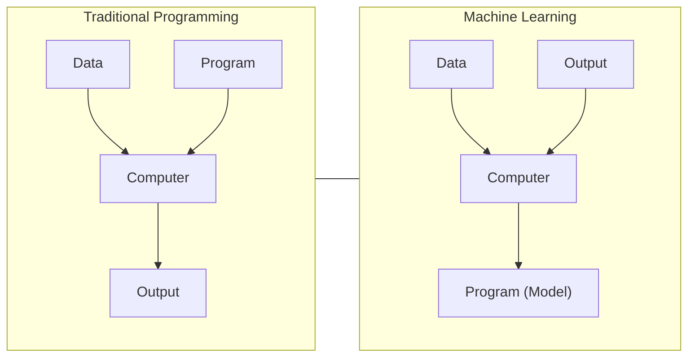

## What's the best machine learning algorithm to use?

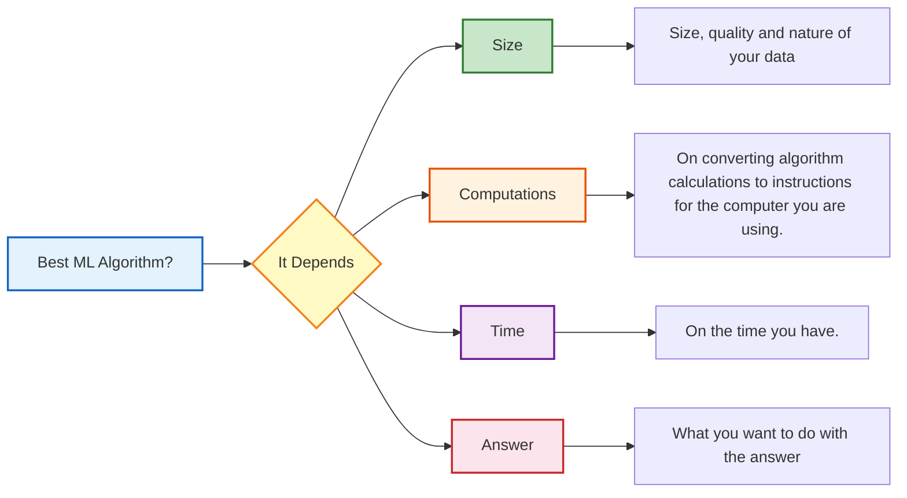

---

# Regression

## Linear Regression

### Overview

Linear regression is used to estimate real values (cost of houses, number of calls, total sales, etc.) based on continuous variable(s).

Linear regression is used for finding linear relationship between target and one or more predictors.

**Core idea:** Obtain a line that best fits the data.

The best fit line is the one for which total prediction error (all data points) are as small as possible. Error is the distance between the point to the regression line.

### Linear Equation

Establish relationship between independent and dependent variables by fitting a best line. This best fit line is known as **regression line** and represented by a linear equation:

```
Y = a * X + b
```

or

```
Y' = A + B * X
```

### Types of Linear Regression

1. **Simple Linear Regression**
2. **Multiple Linear Regression**

---

### Simple Linear Regression

Single dimension linear regression has pairs of x and y values as input training samples. It uses these training samples to derive a line that predicts values of y.

The training samples are used to derive the values of **a** and **b** that minimise the error between actual and predicted values of y:
- **a** is the slope
- **b** is the y-intercept

#### Principle

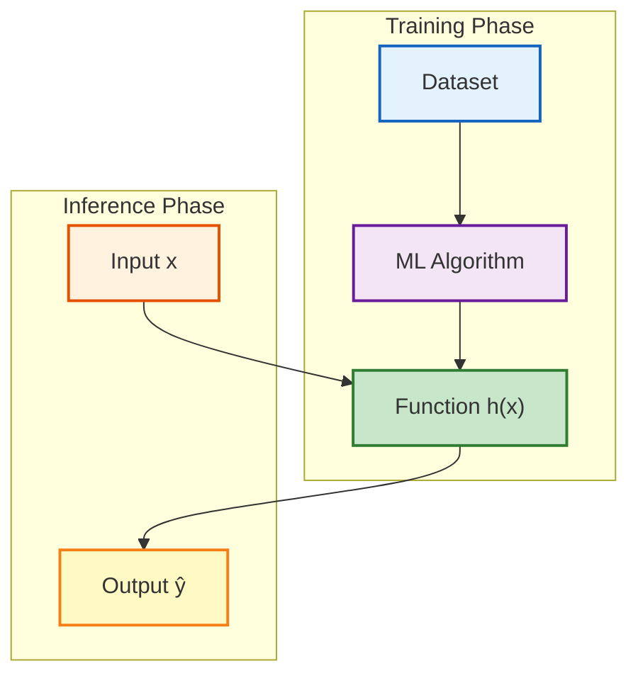

#### Example Dataset

| X | Y |
|---|---|
| 4 | 1 |
| 2 | 2 |
| 8 | 4.5 |
| 13 | 5 |
| 14 | 6 |
| 14.5 | 6.5 |
| 16 | 7 |

We want a line that minimises the error between the Y values in training samples and the values that the line passes through.

> Choose h(x) so that it is close to y for training dataset

So we define the error function for our algorithm so we can minimise that error.

---

### Cost Function

The cost function helps us to figure out the best possible values for **a** and **b** which would provide the best fit line for the data points.

Since we want the best values for **a** and **b**, we convert this search problem into a minimization problem where we would like to minimize the error between the predicted value and the actual value.

$$
\text{minimize} \quad \frac{1}{n} \sum_{i=1}^{n} (\hat{y}_i  - y_i)^2
$$

$$
J = \frac{1}{n} \sum_{i=1}^{n} (\hat{y}_i  - y_i)^2
$$

The values **a** and **b** must be chosen so that they minimize the error. If sum of squared error is taken as a metric to evaluate the model, then goal is to obtain a line that best reduces the error.

---

### Error Metrics

| Metric | Description |
|--------|-------------|
| **Mean Absolute Error (MAE)** | Mean of the absolute value of the errors |
| **Mean Squared Error (MSE)** | Mean of the squared errors |
| **Mean Absolute Percentage Error (MAPE)** | Mean of absolute percentage errors |
| **Mean Percentage Error (MPE)** | Mean of percentage errors |

#### Mean Squared Error (MSE)

We square the error difference and sum over all data points and divide that value by the total number of data points. This provides the average squared error over all the data points.

$$
MSE = \frac{1}{N} \sum_{i=1}^{N} (f_i - y_i)^2
$$

Where:
- $N$ = number of data points
- $f_i$ = value returned by the model (prediction)
- $y_i$ = actual value for data point $i$

#### Root Mean Squared Error (RMSE)

We take the square root of the MSE. This brings the error metric back to the same scale as the target variable, making it more interpretable.

$$
RMSE = \sqrt{MSE} = \sqrt{\frac{1}{N} \sum_{i=1}^{N} (f_i - y_i)^2}
$$

Where:
- $N$ = number of data points
- $f_i$ = value returned by the model (prediction)
- $y_i$ = actual value for data point $i$

---

### Gradient Descent

Gradient descent is used to **minimize the cost function** by iteratively updating the model parameters in the direction of the steepest descent.

#### Update Rule

Repeat until convergence:

$$
\theta_j := \theta_j - \alpha \frac{\partial}{\partial \theta_j} J(\theta_0, \theta_1)
$$

Where:
- $\alpha$ = Learning rate
- $\frac{\partial}{\partial \theta_j}$ = Partial derivative with respect to $\theta_j$

#### Derivative Intuition

> The derivative of a function of a real variable measures the **sensitivity to change** of the function value (output value) with respect to a change in its argument (input value).

#### Learning Rate Considerations

| Learning Rate | Effect |
|---------------|--------|
| **α too small** | Slow convergence (takes many iterations) |
| **α too large** | May overshoot the minimum and fail to converge |
| **α just right** | Converges efficiently to the minimum |


#### Partial Derivatives for Linear Regression

For the linear regression cost function:

$$
\frac{\partial}{\partial \theta_0} J(\theta_0, \theta_1) = \frac{1}{m} \sum_{i=1}^{m} (h(x_i) - y_i)
$$

$$
\frac{\partial}{\partial \theta_1} J(\theta_0, \theta_1) = \frac{1}{m} \sum_{i=1}^{m} (h(x_i) - y_i) \cdot x_i
$$

#### Update Equations

$$
\theta_0 := \theta_0 - \alpha \cdot \frac{1}{m} \sum_{i=1}^{m} (h(x_i) - y_i)
$$

$$
\theta_1 := \theta_1 - \alpha \cdot \frac{1}{m} \sum_{i=1}^{m} (h(x_i) - y_i) \cdot x_i
$$

#### Gradient Descent Algorithm Flow

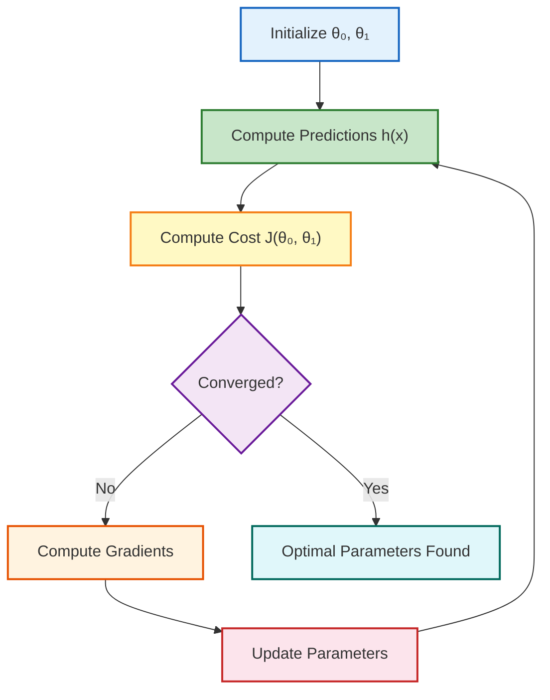

---

### Multiple Linear Regression

Each training sample has an input $\mathbf{x}$ made up of **multiple input values** and a corresponding output $y$ with a single value.

#### Matrix Representation

Inputs can be represented as an **$\mathbf{X}$ matrix** where each row is a sample and each column is a dimension:

$$
\mathbf{X} = \begin{bmatrix}
x_{1,1} & x_{1,2} & \dots & x_{1,d} \\
x_{2,1} & x_{2,2} & \dots & x_{2,d} \\
\vdots & \vdots & \ddots & \vdots \\
x_{n,1} & x_{n,2} & \dots & x_{n,d}
\end{bmatrix}
$$

Where $x_{i,j}$ → sample$_i$, dimension$_j$

Outputs can be represented as a **$\mathbf{y}$ vector** where each entry corresponds to a sample:

$$
\mathbf{y} = \begin{bmatrix}
y_1 \\
y_2 \\
\vdots \\
y_n
\end{bmatrix}
$$

#### Hypothesis Function

The predicted $y$ values are calculated by multiplying the $\mathbf{X}$ matrix by a matrix of parameters, $\boldsymbol{\Theta}$:

$$
h(\mathbf{x}) = \theta_0 + \theta_1 x_1 + \theta_2 x_2 + \dots + \theta_d x_d
$$

Or in matrix form:

$$
\mathbf{h} = \mathbf{X} \boldsymbol{\Theta}
$$

#### Geometric Interpretation

| Number of Features | Geometric Shape |
|-------------------|-----------------|
| **1 dimension** | Line |
| **2 dimensions** | Plane |
| **3+ dimensions** | Hyper-plane |

#### Visual Comparison: Simple vs Multiple Linear Regression

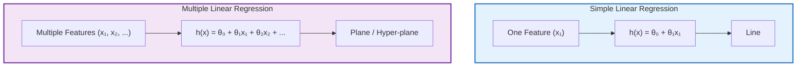

#### Matrix Notation Summary

| Notation | Shape | Description |
|----------|-------|-------------|
| $\mathbf{X}$ | $n \times d$ | Feature matrix ($n$ samples, $d$ features) |
| $\mathbf{y}$ | $n \times 1$ | Target vector |
| $\boldsymbol{\Theta}$ | $d \times 1$ | Parameter vector |
| $\mathbf{h}$ | $n \times 1$ | Predicted values vector |

#### Implementation with scikit-learn

```python
# Import Library
# Import other necessary libraries like pandas, numpy...
from sklearn import linear_model

# Load Train and Test datasets
# Identify feature and response variable(s) and values must be numeric and numpy arrays
x_train = input_variables_values_training_datasets
y_train = target_variables_values_training_datasets
x_test = input_variables_values_test_datasets

# Create linear regression object
linear = linear_model.LinearRegression()

# Train the model using the training sets and check score
linear.fit(x_train, y_train)
linear.score(x_train, y_train)

# Equation coefficient and Intercept
print('Coefficient: \n', linear.coef_)
print('Intercept: \n', linear.intercept_)

# Predict Output
predicted = linear.predict(x_test)
```

---

### Linear Regression (Case Study)

*To be added*

---

# Classification

### Definition of Classification

Classification is a process that consists of:

- Discovering **rules or patterns** to organize data into **predefined classes**
- These classes represent a **group of homogeneous individuals**
- Allowing **classification of new arrivals**

#### Process

Classification consists of:
- Building a **model** on data whose **class is known** (training data set)
- Using this model to predict the class of new data

---

### Applications of Classification

#### Marketing

- Understanding the predominant criteria in product purchase
- Automatic customer segmentation for direct marketing

#### Maintenance

- Assisting and guiding a customer following observed defects

#### Insurance

- Risk analysis

#### Medicine

- Isolating at-risk populations

---

## Logistic Regression

### Overview

- In a lot of ways, linear regression and logistic regression are similar. But, the biggest difference lies in what they are used for.
- Linear regression algorithms are used to predict/forecast values but logistic regression is used for **classification** tasks.

### Key Points

1. It is a **classification** not a regression algorithm.
2. It is used to estimate discrete values (Binary values like 0/1, yes/no, true/false) based on given set of independent variable(s).

### Linear Regression vs. Logistic Regression

| Linear Regression | Logistic Regression |
| ----------------- | ------------------- |
| Used for prediction/forecasting | Used for classification |
| Continuous output | Discrete output |
| No activation function | Uses sigmoid activation function |

---

### When to Use Logistic Regression

Logistic Regression is used when the dependent variable (target) is categorical.

**Examples:**
- To predict whether an email is spam (1) or not (0)
- Whether a tumor is malignant (1) or not (0)
- Whether a website is fraudulent (1) or not (0)

### The Problem

The logistic regression algorithm also uses a linear equation with independent predictors to predict a value. The predicted value can be anywhere between negative infinity to positive infinity.

We need the output of the algorithm to be a class variable, i.e., 0 = no, 1 = yes.

**Solution:** Squash the output of the linear equation into a range of [0,1]. To do this, we use the **sigmoid function**.

---

### Sigmoid Function

#### Hypothesis

$$
Z = WX + B
$$

$$
h_\Theta(x) = \text{sigmoid}(Z)
$$

- If $Z \to +\infty$, predicted $Y \to 1$
- If $Z \to -\infty$, predicted $Y \to 0$

#### Mathematical Definition

**Linear Equation**

$$
z = \theta_0 + \theta_1 x_1 + \theta_2 x_2 + \dots
$$

**Sigmoid Function**

$$
g(x) = \frac{1}{1 + e^{-x}}
$$

**Combined Hypothesis**

$$
h = g(z) = \frac{1}{1 + e^{-z}}
$$

#### Probability Interpretation

$$
h_\Theta(x) = P(Y = 1 \mid X; \Theta)
$$

This represents the **probability** that $Y = 1$ given $X$, parameterized by $\Theta$.

**Properties**

$$
P(Y = 1 \mid X; \Theta) + P(Y = 0 \mid X; \Theta) = 1
$$

$$
P(Y = 0 \mid X; \Theta) = 1 - P(Y = 1 \mid X; \Theta)
$$

#### Sigmoid Function Visualization

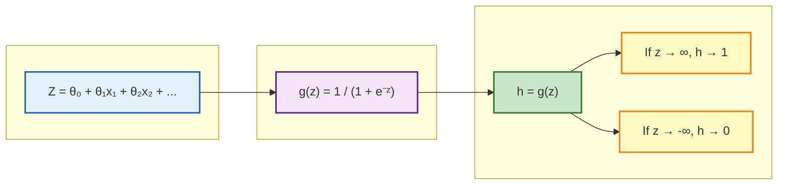

---

### Types of Logistic Regression

| Type | Description | Example |
| ---- | ----------- | ------- |
| **Binary Logistic Regression** | Categorical response has only 2 possible outcomes | Spam or Not Spam |
| **Multinomial Logistic Regression** | Three or more categories without ordering | Predicting food preference (Veg, Non-Veg, Vegan) |
| **Ordinal Logistic Regression** | Three or more categories with ordering | Movie rating from 1 to 5 |

---

### Cost Function

Since we are trying to predict class values, we cannot use the same cost function used in linear regression. Therefore, we use a **logarithmic loss function** to calculate the cost for misclassification.

#### Cost Function Definition

$$
\text{Cost}(h_\Theta(x), y) =
\begin{cases}
-\log(h_\Theta(x)) & \text{if } y = 1 \\
-\log(1 - h_\Theta(x)) & \text{if } y = 0
\end{cases}
$$

#### Simplified Cost Function

The above cost function can be rewritten as:

$$
J(\Theta) = -\frac{1}{m} \sum_{i=1}^{m} \left[ y^{(i)} \cdot \log(h_\Theta(x^{(i)})) + (1 - y^{(i)}) \cdot \log(1 - h_\Theta(x^{(i)})) \right]
$$

---

### Gradients

#### Cost Function

$$
J = -\frac{1}{m} \sum_{i=1}^{m} \left[ y_i \cdot \log(h_i) + (1 - y_i) \cdot \log(1 - h_i) \right]
$$

#### Partial Derivatives

Starting with the full derivative:

$$
\frac{\partial J}{\partial \theta_n} = -\frac{1}{m} \sum_{i=1}^{m} \left[ \frac{y_i}{h_i} \cdot h_i^2 \cdot x_n \cdot \frac{1 - h_i}{h_i} + \frac{1 - y_i}{1 - h_i} \cdot (-h_i^2) \cdot x_n \cdot \frac{1 - h_i}{h_i} \right]
$$

After simplification:

$$
\frac{\partial J}{\partial \theta_n} = -\frac{1}{m} \sum_{i=1}^{m} \left[ x_n \cdot (1 - h_i) \cdot y_i - x_n \cdot h_i \cdot (1 - y_i) \right]
$$

#### Final Gradient

$$
\frac{\partial J}{\partial \theta_n} = \frac{1}{m} \cdot x_i \cdot \sum_{i=1}^{m} (h_i - y_i)
$$

---

### Gradient Descent Update Rule

For logistic regression, the update rule takes the same form as linear regression:

$$
\theta_j := \theta_j - \alpha \cdot \frac{\partial J}{\partial \theta_j}
$$

Substituting the gradient:

$$
\theta_j := \theta_j - \alpha \cdot \frac{1}{m} \sum_{i=1}^{m} (h_\theta(x^{(i)}) - y^{(i)}) \cdot x_j^{(i)}
$$

---

### Logistic Regression Flowchart

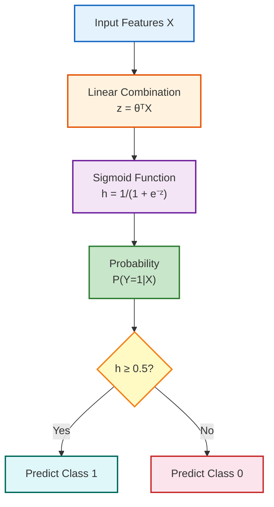

---

### Implementation with scikit-learn

```python
# Import Library
from sklearn.linear_model import LogisticRegression

# Assumed you have, X (predictor) and Y (target) for training data set and x_test(predictor) of test_dataset

# Create logistic regression object
model = LogisticRegression()

# Train the model using the training sets and check score
model.fit(X, y)
model.score(X, y)

# Equation coefficient and Intercept
print('Coefficient: \n', model.coef_)
print('Intercept: \n', model.intercept_)

# Predict Output
predicted = model.predict(x_test)
```

---

## Logistic Regression (Case Study)

### Linear Regression vs Logistic Regression

#### Linear Regression

- This method focuses on cases where the values of a variable to be predicted are **continuous**.
- The values to be predicted can be represented by a linear function, i.e., a straight line.

#### Logistic Regression

- This method focuses on situations where the values of a variable to be predicted are **binary** (0 or 1).
- **Example:** A boolean variable.
- Instead of predicting the value of a variable, we predict the **probability** of the variable being equal to 0 or 1.
- The probabilities describe a **sigmoid** (S-shaped curve) between 0 and 1.

---

### Case Study: Telephone Company

#### Problem Statement

**Context:** Adoption of a new telephone service (voicemail, Internet access, etc.) based on:
- Education
- Residence stability
- Salary

**Data:** 10,524 people responded to a questionnaire on this topic conducted by a telephone company.

**Question:** How to predict the adoption of a new telephone service based on a person's education, residence stability, and salary?

#### Survey Responses

| | High School or below | | Some College or above | |
|---|---|---|---|---|
| | No Change in Residence | Change in Residence | No Change in Residence | Change in Residence |
| **Low Income** | 153/2160 = 0.071 | 147/1363 = 0.108 | 61/886 = 0.069 | 233/1091 = 0.214 |
| **High Income** | 226/1137 = 0.199 | 139/547 = 0.254 | 287/1925 = 0.149 | 382/1415 = 0.270 |

**Interpretation:**
- There are 2,160 people who responded to the questionnaire who have:
  - An education level of high school or below
  - A low salary
  - Have not changed residence in the last 5 years
- There are 153 people (out of these 2,160 people) who adopted a new telephone service

**Overall adoption probability:** 1628/10524 = 0.155

---

### The Logistic Regression Model

#### Model Formulation

Predict the probability of the value of Y from independent variables x₁, x₂, ..., xₖ.

- **Y = 1:** Choosing an option
- **Y = 0:** Not choosing an option

The probability that Y = 1 given variables x₁, x₂, ..., xₖ is given by:

$$
P(Y = 1 | x₁, x₂, ..., xₖ) = \frac{\exp(β₀ + β₁·x₁ + ... + βₖ·xₖ)}{1 + \exp(β₀ + β₁·x₁ + ... + βₖ·xₖ)}
$$

The $β_i$ are unknown constants to be determined. They are calculated/estimated by programs.

**Examples of estimation methods:**
- Maximum Likelihood Estimates
- Newton-Raphson

#### Interpretation of Coefficients

| Value of β₁ | Effect on chance of success |
|--------------|-------------------------------|
| β₁ = 0 | The factor β₁ has no effect |
| β₁ > 0 | The factor β₁ increases the chance of success |
| β₁ < 0 | The factor β₁ decreases the chance of success |

---

### Application to the Case Study

**Variables:**

Let Y be the variable representing the adoption of a new telephone service:
- Y = 1 if a new service is adopted
- Y = 0 otherwise

**Independent Variables:**

| Variable | Definition |
|----------|------------|
| x₁ | Education: 1 = education level of college or above, 0 otherwise |
| x₂ | Residence stability: 1 = change of residence in the last 5 years, 0 otherwise |
| x₃ | Salary: 1 = high salary, 0 = low salary |

**Model:**

$$
Prob(Y = 1 | x₁, x₂, x₃) = \frac{\exp(β₀ + β₁·x₁ + β₂·x₂ + β₃·x₃)}{1 + \exp(β₀ + β₁·x₁ + β₂·x₂ + β₃·x₃)}
$$

#### Sample Data

| x₁ | x₂ | x₃ | # in sample | # adopters | # Non-adopters | Fraction adopters |
|----|----|----|-------------|------------|----------------|-------------------|
| 0  | 0  | 0  | 2160        | 153        | 2007           | 0.071             |
| 0  | 0  | 1  | 1363        | 147        | 1216           | 0.108             |
| 0  | 1  | 0  | 1137        | 226        | 911            | 0.199             |
| 0  | 1  | 1  | 547         | 139        | 408            | 0.254             |
| 1  | 0  | 0  | 886         | 61         | 825            | 0.069             |
| 1  | 0  | 1  | 1091        | 233        | 858            | 0.214             |
| 1  | 1  | 0  | 1925        | 287        | 1638           | 0.149             |
| 1  | 1  | 1  | 1415        | 382        | 1033           | 0.270             |
|    |    |    | **10524**   | **1628**   | **8896**       | **1.000**         |

---

### Coefficient Calculation

#### Regression Results

| Variable | Coeff. | Std. Error | p-Value | Odds | 95% Conf. Intvl. for odds |
|----------|--------|------------|---------|------|---------------------------|
| Constant | -2.500 | 0.058 | 0.000 | 0.082 | 0.071 - 0.095 |
| x₁ | 0.161 | 0.058 | 0.006 | 1.175 | 1.048 - 1.316 |
| x₂ | 0.990 | 0.056 | 0.000 | 2.698 | 2.416 - 3.013 |
| x₃ | 0.444 | 0.058 | 0.000 | 1.560 | 1.393 - 1.746 |

#### Final Model

$$
P(Y = 1 \mid x_1, x_2, x_3) = 
\frac{\exp(-2.500 + 0.161 \cdot x_1 + 0.992 \cdot x_2 + 0.444 \cdot x_3)}
{1 + \exp(-2.500 + 0.161 \cdot x_1 + 0.992 \cdot x_2 + 0.444 \cdot x_3)}
$$

#### Comparison of Results

| x₁ | x₂ | x₃ | # in sample | # adopters | Estimated (# adopters) | Fraction Adopters | Estimated Prob(Y=1) |
|----|----|----|-------------|------------|------------------------|-------------------|---------------------|
| 0  | 0  | 0  | 2160        | 153        | 164                    | 0.071             | 0.076               |
| 0  | 0  | 1  | 1363        | 147        | 155                    | 0.108             | 0.113               |
| 0  | 1  | 0  | 1137        | 226        | 206                    | 0.199             | 0.181               |
| 0  | 1  | 1  | 547         | 139        | 140                    | 0.254             | 0.257               |
| 1  | 0  | 0  | 886         | 61         | 78                     | 0.069             | 0.088               |
| 1  | 0  | 1  | 1091        | 233        | 225                    | 0.214             | 0.206               |
| 1  | 1  | 0  | 1925        | 287        | 252                    | 0.149             | 0.131               |
| 1  | 1  | 1  | 1415        | 382        | 408                    | 0.270             | 0.289               |

**Calculation example:**
- Estimated number of people who may adopt a new telephone service for the first category:
  - 2160 × 0.076 = 164 people

---

### Model Validation

#### New Validation Sample

598 new people were surveyed.

| x₁ | x₂ | x₃ | # in validation sample | # adopters in validation sample | Estimated (# adopters) | Error (Estimate - Actual) | Absolute Value of Error |
|----|----|----|------------------------|--------------------------------|------------------------|---------------------------|------------------------|
| 0  | 0  | 0  | 29                     | 3                              | 2.200                  | -0.800                    | 0.800                   |
| 0  | 0  | 1  | 23                     | 7                              | 2.610                  | -4.390                    | 4.390                   |
| 0  | 1  | 0  | 112                    | 25                             | 20.302                 | -4.698                    | 4.698                   |
| 0  | 1  | 1  | 43                     | 27                             | 36.705                 | 9.705                     | 9.705                   |
| 1  | 0  | 0  | 27                     | 2                              | 2.374                  | 0.374                     | 0.374                   |
| 1  | 0  | 1  | 54                     | 11                             | 11.145                 | -0.855                    | 0.855                   |
| 1  | 1  | 0  | 112                    | 51                             | 16.338                 | 3.338                     | 3.338                   |
| 1  | 1  | 1  | 185                    | 30                             | 24.528                 | -5.472                    | 5.472                   |
|    |    |    | **598**                | **119**                        | **116.202**            |                           |                        |

#### Validation Errors

- **Total error:** -2.8 (or 2.8/119 = **2.3%**)
- **Mean absolute error:** (sum of absolute errors / 119) = **24.9%**

---

### Contingency Table

#### Confusion Matrix

[Kohavi, Provost, 1998]

|              | Observed Adopter | Observed Non-Adopter | Total |
|--------------|------------------|----------------------|-------|
| **Predicted Adopter** | 103 (TP) | 13 (FP) | 116 |
| **Predicted Non-Adopter** | 16 (FN) | 466 (TN) | 482 |
| **Total** | 119 | 479 | 598 |

**Legend:**
- **TP:** True Positives
- **TN:** True Negatives
- **FP:** False Positives
- **FN:** False Negatives

---

### Evaluation Metrics

#### Calculated Metrics

| Metric | Calculation | Result |
|----------|--------|----------|
| **True Positives** | TP / Total Positives | 103/119 = **86.5%** |
| **False Positives** | FP / Total Negatives | 13/479 = **2.7%** |
| **Accuracy** | (TP + TN) / Total | (103+466)/598 = **95.15%** |
| **Precision** | TP / (TP + FP) | 103/(103+13) = **88.8%** |
| **Errors** | (FP + FN) / Total | (13+16)/598 = **4.85%** |

#### Definitions

- **True Positives:** Correctly predicted positive cases
- **False Positives:** Incorrectly predicted as positive cases
- **Accuracy:** Total number of correct predictions
- **Precision:** Proportion of correct positive predictions
- **Errors:** Proportion of incorrect predictions

---

### Model Comparison

#### Example: Credit Offer

**True:** Offer credit
**False:** Do not offer credit

##### Model 1

| | Predicted True | Predicted False |
|---|-------------|-------------|
| **Observed True** | TP = 600 | FN = 25 |
| **Observed False** | FP = 75 | TN = 300 |

##### Model 2

| | Predicted True | Predicted False |
|---|-------------|-------------|
| **Observed True** | TP = 600 | FN = 75 |
| **Observed False** | FP = 25 | TN = 300 |

---

### Advantages and Disadvantages

#### Advantages

- ✅ Easy to understand method
- ✅ Efficient method
- ✅ Predictions are easy to make

#### Disadvantages

- ❌ Noise can have a significant effect on the method
- ❌ Need for multiple measures to evaluate the method

---

## K-Nearest Neighbors (KNN)

### Principle of the KNN Algorithm

The principle of this classification algorithm is very simple. We provide it with:

- A training dataset **D**
- A distance function **d**
- An integer **k**

For any new test point **x**, for which it must make a decision, the algorithm:

1. Searches in **D** for the **k points closest to x** according to the distance **d**
2. Assigns **x** to the class that is the **most frequent** among these k neighbors

---

### General Information

- The k-nearest neighbors method is a **supervised learning** method
- Dedicated to **classification**
- Abbreviated as **k-NN** or **KNN**
- The KNN algorithm is among the **simplest artificial learning algorithms**
- The goal of the algorithm is to classify **unlabeled** examples based on their similarity to examples in the training database

#### Application Areas

The kNN algorithm is used in many fields:

- **Pattern recognition**
- Searching for new **biomarkers** for diagnosis
- **Compression** algorithms
- **Satellite image analysis**
- **Targeted marketing**

---

### Example

In the following example, there are 3 classes and the goal is to find the class value of the unknown example **x**.

- We take the **Euclidean distance** and **k = 5** neighbors
- Of the 5 nearest neighbors:
  - 4 belong to **ω₁**
  - 1 belongs to **ω₃**
- So **x** is assigned to **ω₁**, the majority class

---

### Choosing the Parameter k

#### k = 1
- Very complex class boundaries
- Very sensitive to data fluctuations (high variance)
- Risk of **overfitting**
- Poor resistance to noisy data

#### k = n
- Less sensitive to noise
- The larger the value of k, the better the assignment result

---

### Distance Measures

Measures often used for the distance dist(xᵢ, xⱼ):

#### Euclidean Distance

Calculates the square root of the sum of squared differences between the coordinates of two points:

```
d(x, y) = √(Σ(xᵢ - yᵢ)²)
```

#### Manhattan Distance

Calculates the sum of the absolute values of the differences between the coordinates:

```
d(x, y) = Σ|xᵢ - yᵢ|
```

---

### Advantages and Disadvantages

#### Advantages

- ✅ **Fast learning**
- ✅ **Easy to understand method**
- ✅ Suitable for domains where:
  - Each class is represented by several prototypes
  - The boundaries are irregular
  - Examples: Handwritten digit recognition or satellite image recognition

#### Disadvantages

- ❌ **Slow prediction** because all examples must be reviewed each time
- ❌ **Memory-intensive** method
- ❌ Sensitive to **irrelevant and correlated attributes**
- ❌ Particularly vulnerable to the **curse of dimensionality**

---

## Support Vector Machines (SVM)

### History

- The SVM classifier became popular when it achieved performance comparable to neural networks for handwritten digit recognition using pixel-based images.

### Related to:
- Large margin separators
- Kernel methods
- Radial basis function networks

---

### Two-Class Problem (Linearly Separable)

Several decision surfaces exist to separate classes; which one to choose?

#### Examples of Poor Choices

To minimize sensitivity to noise, the decision surface must be **as far as possible** from the closest data points of each class.

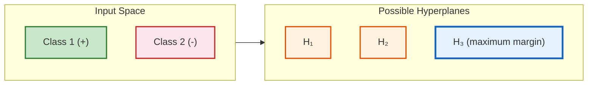

---

### Maximum Margin Hyperplane

Let $\{x\} = \{x_1, \dots, x_n\}$ be the set of data points and $y_i \in \{1, -1\}$ the class of each.

**Classification constraint:**

$$
y_i(w^T x_i + b) \geq 1, \quad \forall i
$$

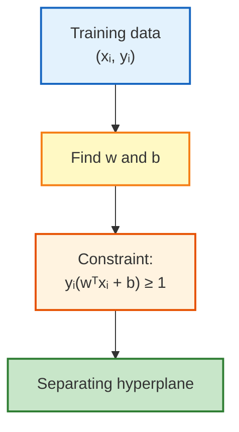

---

### Margin Optimization

#### Distance from a Point to the Hyperplane

$$
D(x) = \frac{|w^T x + b|}{\|w\|}
$$

#### Maximum Margin

- The margin between the boundaries of the two classes is: $m = \frac{2}{\|w\|}$
- Maximizing $m$ is equivalent to **minimizing $\|w\|$** while preserving classification power

#### Optimization Problem

Find $w$ and $b$ such that:

$$
\text{Minimize: } \frac{1}{2} \|w\|^2
$$

$$
\text{Subject to: } y_i(w^T x_i + b) \geq 1, \quad i = 1 \dots n
$$

- If $d$ is the dimension of $x$, this amounts to adjusting $d+1$ parameters (the elements of $w$, plus $b$)
- Can be solved using classical optimization methods

---

### Maximum Margin Visualization

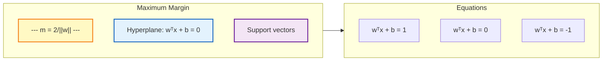

---

### Lagrange Multipliers Method

#### Principle

- Problem: Maximize or minimize $f(x)$ subject to constraint $g(x) = 0$
- The Lagrange multipliers method combines the function to optimize and the constraint into a single function

#### Multi-dimensional Case

Minimize (or maximize) $f(x)$ subject to constraints $g_i(x) = 0$, $i = 1 \dots n$

**Extremum condition:**

$$
\nabla f(x) - \sum_i \alpha_i \nabla g_i(x) = 0
$$

**Lagrangian:**

$$
\Lambda(x, \alpha) = f(x) - \sum_i \alpha_i g_i(x)
$$

**Solution:**

$$
\nabla_x \Lambda(x, \alpha) = \nabla f(x) - \sum_i \lambda_i \nabla g_i(x)
$$

$$
\nabla_{\alpha_i} \Lambda(x, \alpha) = g_i(x)
$$

---

### Dual Form of the Optimization Problem

#### Primal Formulation

The desired minimum is given by the solution of:

$$
\nabla_{w,b} \Lambda(w, b, \alpha) = 0
$$

#### Dual Formulation

$$
\Lambda(w, b, \alpha) = \frac{1}{2} \|w\|^2 - \sum_i \alpha_i [y_i(w^T x_i + b) - 1]
$$

Subject to: $\alpha_i \geq 0$

#### Advantages of the Dual Form

- Complexity becomes proportional to $n$ (number of training pairs) and not to $d$ (dimension of each $x$)
- Possible to obtain solutions for problems involving $\approx 10^5$ examples
- The global maximum of $\alpha$ can always be found

#### Final Dual Formulation

$$
\text{Maximize: } W(\alpha) = \sum_i \alpha_i - \frac{1}{2} \sum_i \sum_j \alpha_i \alpha_j y_i y_j x_i^T x_j
$$

**Subject to:**

$$
\alpha_i \geq 0
$$

$$
\sum_i \alpha_i y_i = 0
$$

**Results:**

$$
w = \sum_i \alpha_i y_i x_i
$$

$$
\sum_i \alpha_i y_i = 0
$$

---

### Primal → Dual Transition Diagram

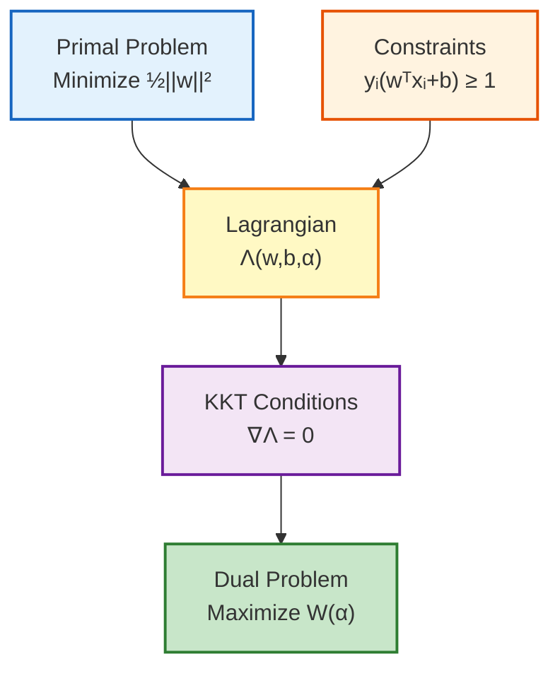

---

### Support Vectors

#### Definition

Data points $x_i$ with $\alpha_i \neq 0$ are called **support vectors**. They correspond to the points closest to the separating surface.

#### Characteristics

- Since many $\alpha_i$ are zero, $w$ is a linear combination of a small number of data points
- The decision surface is uniquely determined by the $n_s$ support vectors found

#### Calculation of $w$ and $b$

$$
\hat{w} = \sum_{i=1}^{n_s} \hat{\alpha}_i y_i x_i
$$

$$
\hat{b} = y_s - \sum_{i=1}^{n_s} \hat{\alpha}_i y_i (x_i^T x_s)
$$

#### Classifying a New Data Point

To classify a new data point $z$:

1. Compute $f(z) = \hat{w}^T z + \hat{b}$
2. Classify $z$ in class 1 if the result is positive, class 2 if negative

#### Theoretical Limits

- Larger margin → smaller error bound
- Smaller number of SV → smaller error bound

---

### Soft Margin Hyperplane (Non-Linearly Separable Case)

#### Introduction of Error Margin

We can introduce an error margin $\xi_i$ for classification.

#### Slack Variables $\xi_i$

- $\xi_i = 0$ if there is no error for $x_i$
- $\xi_i$ are variables that give "slack" to the optimal margins

#### Optimization Problem with Soft Margin

Minimize:

$$
\frac{1}{2} \|w\|^2 + C \sum_i \xi_i
$$

Subject to:

$$
y_i(w^T x_i + b) \geq 1 - \xi_i, \quad \forall i
$$

$$
\xi_i \geq 0
$$

- $C$: trade-off parameter between error and margin

#### Dual Form with Soft Margin

$$
\text{Maximize: } W(\alpha) = \sum_i \alpha_i - \frac{1}{2} \sum_i \sum_j \alpha_i \alpha_j y_i y_j x_i^T x_j
$$

**Subject to:**

$$
C \geq \alpha_i \geq 0
$$

$$
\sum_i \alpha_i y_i = 0
$$

**Difference from linearly separable case:** There is an upper bound $C$ on the $\alpha_i$.

---

### Soft Margin Visualization

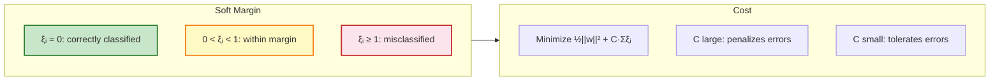

---

### Extension to Non-Linear Decision Surface

#### Principle

"Simplify things" by projecting $x_i$ into a **new space** where they are linearly separable.

$$
\text{Input space} \xrightarrow{\Phi} \text{Feature space}
$$

#### Modification Due to Transformation

**Original problem:**

$$
\text{Maximize: } W(\alpha) = \sum_i \alpha_i - \frac{1}{2} \sum_i \sum_j \alpha_i \alpha_j y_i y_j x_i^T x_j
$$

**After transformation:**

$$
\text{Maximize: } W(\alpha) = \sum_i \alpha_i - \frac{1}{2} \sum_i \sum_j \alpha_i \alpha_j y_i y_j \Phi(x_i) \cdot \Phi(x_j)
$$

**Problems:**
- Finding $\Phi()$ is not trivial
- Potentially heavy computational cost (dimension explodes!)

---

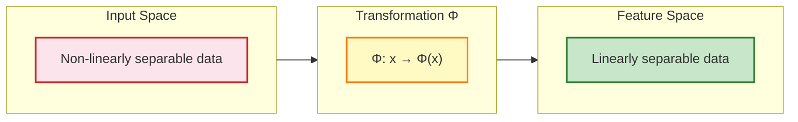

---

### Kernel Functions

#### Kernel SVM Solution

Kernel SVMs solve both problems:
1. **Computational efficiency**
2. The desired data transformation is done **implicitly**

#### Principle

Knowledge of $K()$ allows computing a dot product involving $\Phi()$ indirectly, without knowing the expression of $\Phi()$.

$$
K(x, y) = \Phi(x) \cdot \Phi(y)
$$

#### Advantages

- Only dot products appear in the solution of the optimization problem
- $K()$ intuitively represents the similarity between $x$ and $y$, obtained from prior knowledge

---

### Kernel Diagram

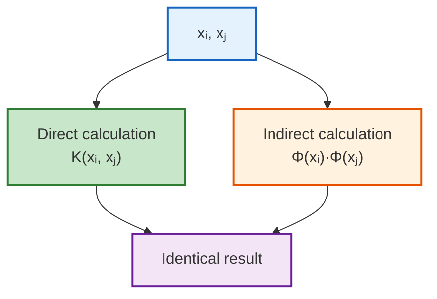

---

### Mercer's Conditions

#### Existence Condition

For a symmetric function $K$, there exists a function $\Phi$ such that:

$$
K(x, x') = \Phi(x) \cdot \Phi(x') = \sum_i g_i(x) \cdot g_i(x')
$$

iff, for any function $f$ such that $\int f(x)^2 dx$ is finite, we have:

$$
\int \int K(x, x') f(x) f(x') dx dx' \geq 0
$$

#### Remark

- If this condition is satisfied, the kernel function can be applied in SVM
- BUT this does not tell us how to construct $\Phi$

#### Kernel Example

Consider a transformation $\Phi$ that takes a 2-dimensional vector and projects it into a 6-dimensional space:

$$
\Phi(x) = (1, \sqrt{2}x_1, \sqrt{2}x_2, x_1^2, x_2^2, \sqrt{2}x_1x_2)
$$

By computing:

$$
\langle \Phi(x), \Phi(y) \rangle = (1 + x_1 y_1 + x_2 y_2)^2
$$

We can obtain the result **without going through the transformed space**.

---

### Illustration: The XOR Case

#### The XOR Problem

All 4 XOR data points are support vectors, since no $\alpha$ value found is zero.

#### Solution

The optimal value of the Lagrange multipliers is:

$$
\hat{\alpha}_1 = \hat{\alpha}_2 = \hat{\alpha}_3 = \hat{\alpha}_4 = \frac{1}{8}
$$

#### In the Feature Space

$$
\hat{w} = \frac{1}{8} \times [-\Phi(x_1) + \Phi(x_2) + \Phi(x_3) - \Phi(x_4)]
$$

$$
\hat{w} = -\frac{1}{\sqrt{2}}
$$

$$
\|\hat{w}\|^2 = \frac{1}{2}
$$

**Discriminant function:**

$$
D(x) = -x_1 x_2
$$

#### Result

- Separator in the input space: $D(x) = -x_1 x_2$
- Separator in the transformed space: $\Phi(x_1 x_2) = 0$

---

### XOR Diagram

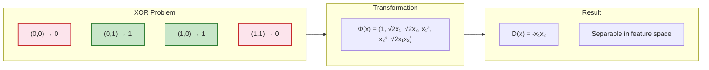

---

### Examples

#### Example with Polynomial Kernel of Degree 2

**Data:** 5 numbers $x_1=1, x_2=2, x_3=4, x_4=5, x_5=6$

- 1, 2, 6 ∈ class 1 ($y=1$)
- 4, 5 ∈ class 2 ($y=-1$)

**Thus:** $\{(x, y)\} = \{(1,1), (2,1), (4,-1), (5,-1), (6,1)\}$

**Kernel:** $K(x,y) = (1 + x^T y)^2$
**C = 100**

### Optimization Problem

$$
\text{Maximize: } \sum_i \alpha_i - \frac{1}{2} \sum_i \sum_j \alpha_i \alpha_j y_i y_j (x_i x_j + 1)^2
$$

$$
\text{Subject to: } 100 \geq \alpha_i \geq 0, \quad \sum_i \alpha_i y_i = 0
$$

---

### Common Kernel Functions

| Kernel | Formula | Use |
|-------|---------|-----|
| **Polynomial of degree $d$** | $K(x, y) = (x^T y + 1)^d$ | Polynomial classification |
| **Gaussian (RBF)** | $K(x, y) = \exp\left(-\frac{\|x-y\|^2}{2\sigma^2}\right)$ | Close to RBF neural networks |
| **Sigmoid** | $K(x, y) = \tanh(\kappa x^T y + \theta)$ | Does not always satisfy Mercer |
| **Linear** | $K(x, y) = x^T y$ | Linearly separable case |

> Research on other kernel functions for various applications is very active!

---

### Multi-class Classification

#### Principle

SVM is fundamentally a binary classifier. We can modify the formulation to allow multi-class classification.

#### Approaches

| Approach | Description | Advantage |
|----------|-------------|-----------|
| **One-vs-Rest (OvR)** | One SVM per class against all others | Simple, fast |
| **One-vs-One (OvO)** | One SVM per pair of classes | More accurate for some data |

Multi-class classification is accomplished by combining the outputs of all SVMs.

---

### Multi-class Diagram

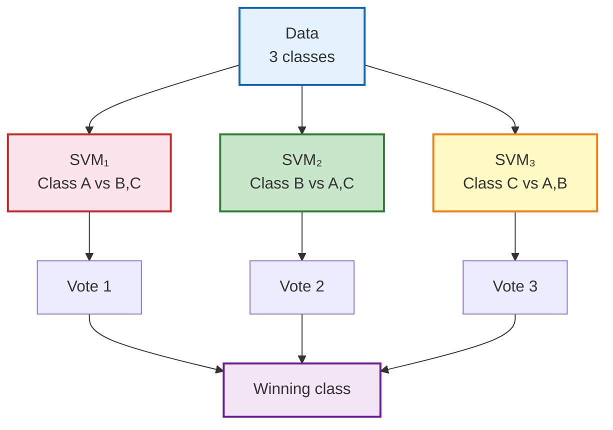

---

### Control Parameters

#### Effect of Parameters

**Checkerboard data learning:** SVM with Gaussian kernel

#### Effect of $\sigma$ (Gaussian Kernel)

| $\sigma$ | Effect |
|----------|-------|
| **Small value** | More complex decision boundary, risk of overfitting |
| **Large value** | Smoother decision boundary, better generalization |

#### Parameters to Choose

1. The kernel function to use
2. The kernel function parameters
3. The value of $C$ (error/margin trade-off)

---

### Parameter Effect Visualization

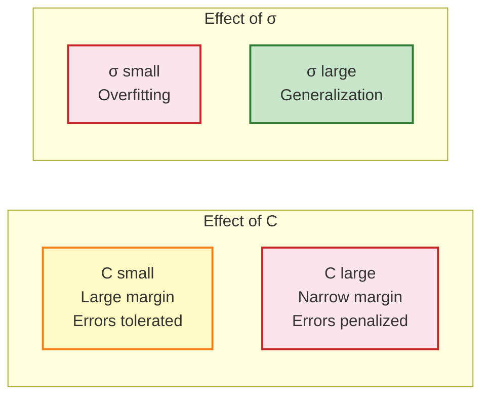

---

### Summary: SVM Classification Steps

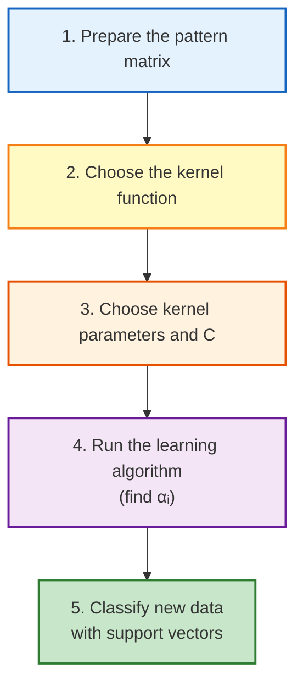

---

### Extensions

#### Key Lesson from SVM

> A linear algorithm in the feature space can replace a non-linear algorithm in the input space.

**Generalization:** Classical linear algorithms can be generalized to non-linear versions by going to the feature space:

| Algorithm | Kernel Version |
|------------|---------------|
| PCA | Kernel PCA |
| k-means | Kernel k-means |
| Regression | Kernel regression |
| Detection | Novelty detection |

---

### Support Vector Regression (ε-SVR)

#### ε-Insensitive Loss Function

$$
|y - f(x)|_\varepsilon = \max\{0, |y - f(x)| - \varepsilon\}
$$

#### Linear Regression

$$
f(x) := (w \cdot x) + w_0
$$

#### Minimization

$$
\text{Minimize: } \frac{1}{2} \|w\|^2 + C \sum_i |y_i - f(x_i)|_\varepsilon
$$

#### Kernel Generalization

$$
f(x) = \sum_i (\alpha_i^* - \alpha_i) K(x_i, x) + w_0
$$

#### ε-SVR Formulation

$$
\text{Minimize: } \frac{1}{2} \|w\|^2 + C \sum_i (\xi_i + \xi_i^*)
$$

**Subject to:**

$$
u_i - w^T x_i - b \leq \varepsilon + \xi_i
$$

$$
w^T x_i + b - u_i \leq \varepsilon + \xi_i^*
$$

$$
\xi_i \geq 0, \quad \xi_i^* \geq 0
$$

**Advantage:** Formulation similar to SVM, so it can be solved as a QP problem.

---

### Novelty Detection

- **Approach:** Separate the data cloud from the origin as much as possible
- **Application:** Unsupervised learning

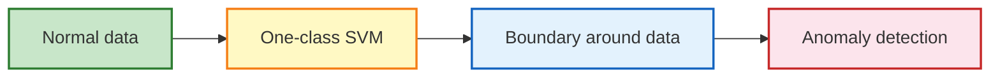

---

### Why Does It Work?

#### Margin is Related to Generalization Capacity

Normally, the class of hyperplanes in $\mathbb{R}^d$ has $d_H = d + 1$.

But the class of margin hyperplanes is bounded by:

$$
d_H \leq \min(R^2 c, d) + 1
$$

With: $\|w\|^2 \leq c$, where $R$ is the radius of the smallest sphere enclosing the training sample $S$.

**Conclusion:** Can be much smaller than the dimension $d$ of the input space $X$.

---

### SVM Strengths and Weaknesses

#### Strengths

| ✅ | Advantage |
|----|-----------|
| ✅ | Learning is relatively easy |
| ✅ | No local minima, unlike neural networks |
| ✅ | The algorithm is robust to scale changes |
| ✅ | The trade-off between complexity and error can be managed explicitly |
| ✅ | General method: non-conventional data (strings, trees) can be used as inputs |
| ✅ | Results generally equivalent and often better |

#### Weaknesses

| ❌ | Disadvantage |
|----|--------------|
| ❌ | Need to find the "right" kernel function |
| ❌ | i.i.d. problems (independent and identically distributed data) |
| ❌ | Two classes at a time (multi-class extension needed) |

---

### Global Synthesis

```mermaid
flowchart TD
    A["SVM"] --> B["Linear case"]
    A --> C["Non-linear case"]
    
    B -->B1["Separable"]
    B1 --> |Yes| B11["Hard margin"]
    B1 --> |No| B12["Soft margin"]
    
    C --> C1["Kernel functions"]
    C1 --> C2["Polynomial"]
    C1 --> C3["Gaussian (RBF)"]
    C1 --> C4["Sigmoid"]
    
    B11 --> D["Support vectors"]
    B12 --> D
    C2 --> D
    C3 --> D
    C4 --> D
    
    D --> E["Classification"]
    
    style A fill:#e3f2fd,stroke:#1565c0,stroke-width:2px
    style B fill:#c8e6c9,stroke:#2e7d32,stroke-width:2px
    style C fill:#f3e5f5,stroke:#6a1b9a,stroke-width:2px
    style D fill:#fff9c4,stroke:#f57f17,stroke-width:2px
    style E fill:#e0f7fa,stroke:#00695c,stroke-width:2px
```

---

## Decision Trees (Arbres de Décision)

### Definition

Decision trees are structures that classify records through **hierarchical divisions** into subclasses.

### Structure

- A **node** represents an increasingly fine class from the root
- An **edge** represents a partitioning predicate of the source class
- One attribute serves as the class label (target attribute to predict), other attributes are used for classification

---

### Tree Generation

```mermaid
flowchart TD
    R["🧠 Root<br>Question / Condition"] -->|Yes| N1["Internal Node<br>Sub-condition"]
    R -->|No| N2["Internal Node<br>Sub-condition"]
    
    N1 -->|Yes| F1["🍃 Leaf<br>Class 1"]
    N1 -->|No| F2["🍃 Leaf<br>Class 2"]
    
    N2 -->|Yes| F3["🍃 Leaf<br>Class 1"]
    N2 -->|No| F4["🍃 Leaf<br>Class 2"]
    
    style R fill:#e3f2fd,stroke:#1565c0,stroke-width:2px
    style N1 fill:#fff3e0,stroke:#e65100,stroke-width:2px
    style N2 fill:#fff3e0,stroke:#e65100,stroke-width:2px
    style F1 fill:#c8e6c9,stroke:#2e7d32,stroke-width:2px
    style F2 fill:#fce4ec,stroke:#c62828,stroke-width:2px
    style F3 fill:#c8e6c9,stroke:#2e7d32,stroke-width:2px
    style F4 fill:#fce4ec,stroke:#c62828,stroke-width:2px
```

### Objectives

- Obtain **homogeneous classes**
- **Cover the data** as well as possible

### Key Questions

- How to choose attributes (Aᵢ)?
- How to isolate discriminating values (vⱼ)?

### Recursive Algorithm

1. The tree starts at a node representing all data
2. If all objects belong to the same class, the node becomes a **leaf** labeled with the class name
3. Otherwise, select the attribute that best separates objects into homogeneous classes (quality function)
4. Recursion stops when:
   - Objects are assigned to a homogeneous class
   - No more attributes to split on
   - No objects with the attribute value

### Partitioning Procedure

```mermaid
flowchart TD
    A["Start: Partition(P)"] --> B{"All elements<br>in the same class?"}
    B -->|Yes| C["Return (Leaf)"]
    B -->|No| D["For each attribute A<br>evaluate partitioning quality"]
    D --> E["Select the best attribute"]
    E --> F["Split P into P₁, P₂, ..., Pₙ"]
    F --> G["For i = 1 to n"]
    G --> H["Partition(Pᵢ)"]
    H --> I["Return (Tree built)"]
    
    style A fill:#e3f2fd,stroke:#1565c0,stroke-width:2px
    style B fill:#fff9c4,stroke:#f57f17,stroke-width:2px
    style C fill:#c8e6c9,stroke:#2e7d32,stroke-width:2px
    style D fill:#fff3e0,stroke:#e65100,stroke-width:2px
    style E fill:#f3e5f5,stroke:#6a1b9a,stroke-width:2px
    style F fill:#fff3e0,stroke:#e65100,stroke-width:2px
    style G fill:#e3f2fd,stroke:#1565c0,stroke-width:2px
    style H fill:#fce4ec,stroke:#c62828,stroke-width:2px
    style I fill:#e0f7fa,stroke:#00695c,stroke-width:2px
```

---

## Tree = Set of Rules

A decision tree can be represented as a set of rules:

```
(A₁ = v₁) & (A₂ = v'₁) → C₁
(A₁ = v₁) & (A₂ = v'₂) → C₂
(A₁ = v₁) & (A₂ = v'₃) → C₃
...
(A₁ = v₃) & (A₂ = v'₁) → C₇
(A₁ = v₃) & (A₂ = v'₂) → C₈
(A₁ = v₃) & (A₂ = v'₃) → C₉
```

```mermaid
flowchart TD
    A["A₁ ?"] -->|v₁| B["A₂ ?"]
    A -->|v₂| C["A₂ ?"]
    A -->|v₃| D["A₂ ?"]
    
    B -->|v'₁| C1["C₁"]
    B -->|v'₂| C2["C₂"]
    B -->|v'₃| C3["C₃"]
    
    C -->|v'₁| C4["C₄"]
    C -->|v'₂| C5["C₅"]
    C -->|v'₃| C6["C₆"]
    
    D -->|v'₁| C7["C₇"]
    D -->|v'₂| C8["C₈"]
    D -->|v'₃| C9["C₉"]
    
    style A fill:#e3f2fd,stroke:#1565c0,stroke-width:2px
    style B fill:#fff3e0,stroke:#e65100,stroke-width:2px
    style C fill:#fff3e0,stroke:#e65100,stroke-width:2px
    style D fill:#fff3e0,stroke:#e65100,stroke-width:2px
    style C1 fill:#c8e6c9,stroke:#2e7d32,stroke-width:2px
    style C2 fill:#c8e6c9,stroke:#2e7d32,stroke-width:2px
    style C3 fill:#c8e6c9,stroke:#2e7d32,stroke-width:2px
    style C4 fill:#c8e6c9,stroke:#2e7d32,stroke-width:2px
    style C5 fill:#c8e6c9,stroke:#2e7d32,stroke-width:2px
    style C6 fill:#c8e6c9,stroke:#2e7d32,stroke-width:2px
    style C7 fill:#c8e6c9,stroke:#2e7d32,stroke-width:2px
    style C8 fill:#c8e6c9,stroke:#2e7d32,stroke-width:2px
    style C9 fill:#c8e6c9,stroke:#2e7d32,stroke-width:2px
```

---

## Example

### Training Set

| rid | Age | Car Type | Risk |
|-----|-----|----------|------|
| 0   | 23  | family   | High |
| 1   | 17  | sports   | High |
| 2   | 43  | sports   | High |
| 3   | 68  | family   | Low  |
| 4   | 32  | truck    | Low  |
| 5   | 20  | family   | High |

```mermaid
flowchart TD
    A["Car Type ?"] -->|family| B{"Age > 30 ?"}
    A -->|sports| C["High Risk"]
    A -->|truck| D["Low Risk"]
    
    B -->|Yes| E["Low Risk"]
    B -->|No| F["High Risk"]
    
    style A fill:#e3f2fd,stroke:#1565c0,stroke-width:2px
    style B fill:#fff9c4,stroke:#f57f17,stroke-width:2px
    style C fill:#fce4ec,stroke:#c62828,stroke-width:2px
    style D fill:#c8e6c9,stroke:#2e7d32,stroke-width:2px
    style E fill:#c8e6c9,stroke:#2e7d32,stroke-width:2px
    style F fill:#fce4ec,stroke:#c62828,stroke-width:2px
```

**Question:** Should we send you a tax auditor?

### Weather Dataset Example

| Outlook  | Temperature | Humidity | Windy | Class |
| -------- | ----------- | -------- | ----- | ----- |
| sunny    | hot         | high     | false | N     |
| sunny    | hot         | high     | true  | N     |
| overcast | hot         | high     | false | P     |
| rain     | mild        | high     | false | P     |
| rain     | cool        | normal   | false | P     |
| rain     | cool        | normal   | true  | N     |
| overcast | cool        | normal   | true  | P     |
| sunny    | mild        | high     | false | N     |
| sunny    | cool        | normal   | false | P     |
| rain     | mild        | normal   | false | P     |
| sunny    | mild        | normal   | true  | P     |
| overcast | mild        | high     | true  | P     |
| overcast | hot         | normal   | false | P     |
| rain     | mild        | high     | true  | N     |

```mermaid
flowchart TD
    A["Outlook ?"] -->|sunny| B["Humidity ?"]
    A -->|overcast| C["P"]
    A -->|rain| D["Windy ?"]
    
    B -->|high| E["N"]
    B -->|normal| F["P"]
    
    D -->|false| G["P"]
    D -->|true| H["N"]
    
    style A fill:#e3f2fd,stroke:#1565c0,stroke-width:2px
    style B fill:#fff3e0,stroke:#e65100,stroke-width:2px
    style C fill:#c8e6c9,stroke:#2e7d32,stroke-width:2px
    style D fill:#fff3e0,stroke:#e65100,stroke-width:2px
    style E fill:#fce4ec,stroke:#c62828,stroke-width:2px
    style F fill:#c8e6c9,stroke:#2e7d32,stroke-width:2px
    style G fill:#c8e6c9,stroke:#2e7d32,stroke-width:2px
    style H fill:#fce4ec,stroke:#c62828,stroke-width:2px
```

---

## Choosing the Splitting Attribute

### Considerations

- Different measures introduced to **order the disorder**
- Indicators based on **information theory**
- Choice of **best attributes and values**
- Possibility of **backtracking** (pruning)
- Review certain partitions (zoom, reduce)

---

## Quality Measures

The measure is called the **Goodness Function**.

### By Algorithm

| Algorithm | Measure |
|-----------|---------|
| **ID3/C4.5** | Information gain (nominal/discrete attributes, extensible to continuous attributes) |
| **CART** | Gini index (continuous attributes, extensible to nominal attributes) |

### Class Mixture Measure

**Impurity of node N:**

$$
i(N) = \sum_{i} \sum_{j} p_i \times p_j \quad \text{with } i \neq j
$$

Where pᵢ is the proportion of individuals of class i in N.

### 1. Impurity Reduction

The impurity reduction of each split of node $N$ by variable $x_j$ is expressed as:

$$
\Delta N = i(N) - \left( \frac{|N_1|}{|N|} \cdot i(N_1) + \frac{|N_2|}{|N|} \cdot i(N_2) + \dots + \frac{|N_k|}{|N|} \cdot i(N_k) \right)
$$

Where:
- $i(N)$ = impurity of the parent node
- $|N_j|$ = number of examples in child $j$
- $|N|$ = total number of examples in the parent node
- $i(N_j)$ = impurity of child node $j$

**Principle:** Among all $n$ variables, the split of node $t$ is performed using the variable that ensures the **maximum reduction** of impurity.

---

### 2. Entropy and Information Gain [Quinlan]

#### Entropy of a Segment

$$
E(N) = -\sum_{i} p_i \times \log_2(p_i)
$$

Where $p_i$ = relative frequency of class $i$ in node $N$ (% of elements of class $i$ in $N$)

#### Minimization of Remaining Disorder

$$
\Delta N = E(N) - \sum_{j} P_j \times E(N_j)
$$

Where $P_j = \frac{|N_j|}{|N|}$ is the proportion of individuals of the node in child $j$.

---

### 3. Gini Index

If a dataset $T$ contains elements from $C$ classes:

$$
\text{Gini}(T) = 1 - \sum_{i=1}^{C} p_i^2
$$

Where $p_i$ is the relative frequency of class $i$ in $T$.

#### Gini Properties

| Value | Interpretation |
|-------|----------------|
| **Gini = 0** | Pure node (all elements are in a single class) |
| **Gini = 1 - 1/C** | Perfectly impure node (classes uniformly distributed) |

---

### 4. Twoing Index

$$
G(t_g, t_d) = \left[ \frac{(n_g/n) \times (n_d/n)}{4} \right] \times \left[ \sum_{i=1}^{m} \left| \frac{n_{ig}}{n_g} - \frac{n_{id}}{n_g} \right| \right]^2
$$

Where:
- $t_g$: Left child of $t$
- $t_d$: Right child of $t$
- $n_d$ (resp. $n_g$) = cardinality $\{t_d\}$ (resp. cardinality $\{t_g\}$)
- $n$: Size of the training sample
- $m$: Number of classes
- $n_{id}$ (resp. $n_{ig}$): count of class $c_i$ in $t_d$ (resp. $t_g$)

---

## Partition Examples

### Ball Partitions (1)

**Partition according to A₁ (density)**

|             | Proportion |       |      |       |
| ----------- | ---------- | ----- | ---- | ----- |
|             | C₁         | C₂    | C₃   | Sigma |
| Blue        | 0.67       | 0.25  | 0.00 |       |
| Green       | 0.33       | 0.50  | 0.00 |       |
| Red         | 0.00       | 0.25  | 1.00 |       |
| Entropy     | 0.92       | 1.00  | 0.00 | 0.75  |
| N₂ log₂(N₂) | -0.39      | -0.50 | 0.00 |       |
| N₃ log₂(N₃) | -0.53      | -0.50 | 0.00 |       |
| N₄ log₂(N₄) | 0.00       | 0.00  | 0.00 |       |
| Impurity    | 0.444      | 0.625 | 0.00 | 0.43  |

---

### Ball Partitions (2)

**Partition according to A₂ (position and at most 4 per partition)**

|               | Proportion |       |      |       |
| ------------- | ---------- | ----- | ---- | ----- |
|               | C₁         | C₂    | C₃   | Sigma |
| Green         | 0.75       | 0.00  | 0.00 |       |
| Blue          | 0.25       | 0.67  | 0.00 |       |
| Red           | 0.00       | 0.33  | 1.00 |       |
| Entropy       | 0.81       | 0.39  | 0.00 | 0.49  |
| $N₂ log₂(N₂)$ | -0.31      | 0.00  | 0.00 |       |
| $N₃ log₂(N₃)$ | -0.50      | -0.39 | 0.00 |       |
| $N₄ log₂(N₄)$ | 0.00       | 0.00  | 0.00 |       |
| Impurity      | 0.375      | 0.444 | 0.00 | 0.31  |

---

### Ball Partitions (3)

**Partition according to A₃ (weight)**

|               | Proportion |       |       |
| ------------- | ---------- | ----- | ----- |
|               | C₁         | C₂    | Sigma |
| Green         | 0.60       | 0.00  |       |
| Blue          | 0.40       | 0.25  |       |
| Red           | 0.00       | 0.75  |       |
| Entropy       | 0.97       | 0.50  | 0.76  |
| $N₂ log₂(N₂)$ | -0.44      | 0.00  |       |
| $N₃ log₂(N₃)$ | -0.53      | -0.50 |       |
| $N₄ log₂(N₄)$ | 0.00       | 0.00  |       |
| Impurity      | 0.48       | 0.375 | 0.43  |

---

### Table Partitions (1)

Information gain calculation for each attribute:

```
Gain(Outlook)     = 0.246
Gain(Temperature) = 0.029
Gain(Humidity)    = 0.151
Gain(Windy)       = 0.048
```

**Outlook** is the attribute with the highest information gain, so it is chosen as the root.

---

### Table Partitions (2) - Node "Outlook = sunny"

| Outlook | Temperature | Humidity | Windy | Class |
|---------|-------------|----------|-------|-------|
| sunny   | hot         | high     | false | N     |
| sunny   | hot         | high     | true  | N     |
| sunny   | mild        | high     | false | N     |
| sunny   | cool        | normal   | false | P     |
| sunny   | mild        | normal   | true  | P     |

---

### Table Partitions (3) - Node "Outlook = overcast"

| Outlook | Temperature | Humidity | Windy | Class |
|---------|-------------|----------|-------|-------|
| overcast| hot         | high     | false | P     |
| overcast| cool        | normal   | true  | P     |
| overcast| mild        | high     | true  | P     |
| overcast| hot         | normal   | false | P     |

---

### Table Partitions (4) - Node "Outlook = rain"

| Outlook | Temperature | Humidity | Windy | Class |
|---------|-------------|----------|-------|-------|
| rain    | mild        | high     | false | P     |
| rain    | cool        | normal   | false | P     |
| rain    | cool        | normal   | true  | N     |
| rain    | mild        | normal   | false | P     |
| rain    | mild        | high     | true  | N     |

---

## Tree Types

| Description | Split Criterion | Segmentation |
|-------------|-----------------|--------------|
| **ID3** | n-ary | Information gain via Shannon entropy |
| **C4.5** | n-ary (derived from ID3 + pruning, simplified rules, missing data...) | Information gain ratio |
| **CART** | binary (regression + pruning) | Gini index (if 2 output values) / Twoing index (otherwise) |

### Characteristics

- Binary or n-ary
- More or less wide and deep
- Nominal variable: one predicate per value or per list of values?
- Choice by level or by class
- Balanced or unbalanced trees
- Elimination of empty or under-represented classes

---

## Continuous Attributes

Some attributes are continuous (e.g., salary).

### Approaches

- Cut into ordered subsets (e.g., deciles)
- Division into segments [a₀, a₁[, [a₁, a₂[, ..., [aₙ₋₁, aₙ]
- Use mean, median, etc. to represent
- Minimize variance, a dispersion measure, etc.
- Investigate different cases and keep the best
- Example: 2, 4, 8, etc. by cutting intervals in 2 successively

### Regression Line Partitioning

- Each node is represented by a regression formula
- Data separation = non-linearity point
- 1 or more regressors

**Example:**
```
salary = a + b × age_range
```

---

## Pruning

### Objective

- Overgrown trees are useless
- Interest in recursive pruning from the leaves
- Based on a **cost-utility model**
- Possibility to apply on:
  - All data
  - A subset reserved for validation

### Example of Pruning Criterion

Trees are viewed as tuple encoding. A partition is useful if the gain exceeds a threshold.

**Cost of a partition:**
- CP bits to encode partition predicates
- Entropy_After bits to encode each tuple

**Suppress partitioning if:**
```
Gain = n × Entropy_After + CP - n × Entropy_Before < threshold
```

---

## Main Algorithms

### ID3 and C4.5

#### ID3
- Discriminative power (or **information gain**) of a variable = variation of **Shannon entropy** during the partition of S

#### C4.5 (ID3++)
- Support for continuous variables
- Introduces a **"Gain ratio"** factor aimed at penalizing node proliferation

#### Stop Criteria
- Information gain thresholds
- Node size threshold
- Statistical test of variable independence (χ²)

### CART (Classification And Regression Trees)

#### Principles
- If **2-class** problem: seeks the bipartition minimizing the **Gini** impurity index
- If **N-class** problem: seeks the one maximizing the information gain given by the **Twoing** index

#### Stop Criteria
- Information gain threshold
- Node size threshold
- Pruning procedure

---

## Algorithms for Large Databases

Most basic algorithms assume that data fits in memory. Database research has proposed methods for handling large databases.

### Main Methods

- **SLIQ** (EDBT'96 - Mehta et al.'96)
- **SPRINT** (VLDB'96 - J. Shafer et al.'96)
- **RainForest** (VLDB'98 - J. Hekankho et al.'98)
- **PUBLIC** (VLDB'98 - R. Rastogi et al.'98)

---

### SLIQ (Supervised Learning In Quest)

**Problem with CART and C4.5:**
- Develop the tree depth-first
- Sort data repeatedly at each node

**SLIQ Solutions:**
- Replaces repeated sorting with **1 single sort per attribute**
- Uses a new data structure (**class-list**)
- Applies to numeric or nominal attributes

**Indicator:** Maximize Gini(T) = Σ [nᵢ/n] × Gini(Tᵢ)

**Operation:**
- SLIQ does not split attribute lists during the split
- Identifies the node with a pointer in the class-list

**Advantages:**
- No copying of attribute lists during split
- Item reallocation by pointer movement

**Disadvantage:**
- The class-list (size = number of items) must fit in memory

---

### SPRINT (Scalable PaRallelizable INduction of decision Tree)

**Problem with SLIQ:**
- SLIQ requires keeping the class-list in memory

**SPRINT Solutions:**
- Does not require a memory-resident structure
- Scalable parallel version
- SPRINT can be easily parallelized
- No shared memory structures

---

## Algorithm Comparison

| Algorithm | Characteristics | Advantages |
|-----------|------------------|------------|
| **SLIQ** | Uses an in-memory class-list | Single sort per attribute |
| **SPRINT** | No resident structure | Parallelizable, scalable |
| **RainForest** | Scalable algorithm | Handles large databases |
| **PUBLIC** | Scalable algorithm | Handles large databases |

---

---

## Bayes Theorem

### Formula

$$
\Pr[H \mid E] = \frac{\Pr[E \mid H] \times \Pr[H]}{\Pr[E]}
$$

Where:
- **H**: The hypothesis to test
- **E**: The evidence associated with the hypothesis
- $\Pr(E \mid H)$ and $\Pr(H)$ are easily computable
- $\Pr(H)$ is a **prior probability**: the probability of H before the presentation of evidence
- $\Pr(E)$: It is not necessary to compute it (normalization factor)

### Classification Procedure

1. An evidence **E** is given
2. Compute $\Pr(H \mid E)$ for all values of H
3. If $\Pr(H = h \mid E)$ is maximum, then choose: $H = h$

---

### Bayes Theorem Diagram

```mermaid
flowchart TD
    A["Evidence E"] --> B["Compute Pr(H|E) for all hypotheses H"]
    B --> C["Select H maximizing Pr(H|E)"]
    C --> D["Decision: H = h"]
    
    style A fill:#e3f2fd,stroke:#1565c0,stroke-width:2px
    style B fill:#fff9c4,stroke:#f57f17,stroke-width:2px
    style C fill:#f3e5f5,stroke:#6a1b9a,stroke-width:2px
    style D fill:#c8e6c9,stroke:#2e7d32,stroke-width:2px
```

---

## Case Study: Weather and Football Match

### Data

| Outlook | Temperature | Humidity | Windy | Play |
|---------|-------------|----------|-------|------|
| Sunny   | Hot         | High     | False | No   |
| Sunny   | Hot         | High     | True  | No   |
| Overcast| Hot         | High     | False | Yes  |
| Rainy   | Mild        | High     | False | Yes  |
| Rainy   | Cool        | Normal   | False | Yes  |
| Rainy   | Cool        | Normal   | True  | No   |
| Overcast| Cool        | Normal   | True  | Yes  |
| Sunny   | Mild        | High     | False | No   |
| Sunny   | Cool        | Normal   | False | Yes  |
| Rainy   | Mild        | Normal   | False | Yes  |
| Sunny   | Mild        | Normal   | True  | Yes  |
| Overcast| Mild        | High     | True  | Yes  |
| Overcast| Hot         | Normal   | False | Yes  |
| Rainy   | Mild        | High     | True  | No   |

---

### Computing $\Pr[\text{Yes} \mid E]$

For a new instance $E$ with:
- Outlook = Sunny
- Temperature = Cool
- Humidity = High
- Windy = True

$$
\Pr[\text{Yes} \mid E] = \Pr[\text{Outlook} = \text{Sunny} \mid \text{Yes}] \times
$$

$$
\Pr[\text{Temperature} = \text{Cool} \mid \text{Yes}] \times
$$

$$
\Pr[\text{Humidity} = \text{High} \mid \text{Yes}] \times
$$

$$
\Pr[\text{Windy} = \text{True} \mid \text{Yes}] \times \frac{\Pr[\text{Yes}]}{\Pr[E]}
$$

$$
= \left(\frac{2}{9} \times \frac{3}{9} \times \frac{3}{9} \times \frac{3}{9} \times \frac{9}{14}\right) / \Pr[E]
$$

$$
= \frac{0.0053}{\Pr[E]}
$$

---

### Computing $\Pr[\text{No} \mid E]$

$$
\Pr[\text{No} \mid E] = \Pr[\text{Outlook} = \text{Sunny} \mid \text{No}] \times
$$

$$
\Pr[\text{Temperature} = \text{Cool} \mid \text{No}] \times
$$

$$
\Pr[\text{Humidity} = \text{High} \mid \text{No}] \times
$$

$$
\Pr[\text{Windy} = \text{True} \mid \text{No}] \times \frac{\Pr[\text{No}]}{\Pr[E]}
$$

$$
= \left(\frac{3}{5} \times \frac{1}{5} \times \frac{4}{5} \times \frac{3}{5} \times \frac{5}{14}\right) / \Pr[E]
$$

$$
= \frac{0.0205}{\Pr[E]}
$$

---

### Conclusion

Probability comparison:

- $\Pr[\text{Yes} \mid E] = 0.0053 / \Pr[E]$
- $\Pr[\text{No} \mid E] = 0.0205 / \Pr[E]$

**Result:** The match will not take place, because $0.0205 > 0.0053$

---

### Decision Process Diagram

```mermaid
flowchart TD
    A["New Instance E"] --> B["Compute Pr(Yes|E)"]
    A --> C["Compute Pr(No|E)"]
    B --> D{"Compare<br>Pr(Yes|E) vs Pr(No|E)"}
    C --> D
    D -->|"Pr(No|E) > Pr(Yes|E)"| E["🔴 Prediction: No"]
    D -->|"Pr(Yes|E) > Pr(No|E)"| F["🟢 Prediction: Yes"]
    
    style A fill:#e3f2fd,stroke:#1565c0,stroke-width:2px
    style B fill:#fff9c4,stroke:#f57f17,stroke-width:2px
    style C fill:#fff9c4,stroke:#f57f17,stroke-width:2px
    style D fill:#f3e5f5,stroke:#6a1b9a,stroke-width:2px
    style E fill:#fce4ec,stroke:#c62828,stroke-width:2px
    style F fill:#c8e6c9,stroke:#2e7d32,stroke-width:2px
```

---

## Laplace Smoothing

### Problem

To avoid having a numerator equal to 0 (zero probability) in the case where the number of attributes having a certain value would be 0.

### Solution

Add a constant $k$ to each value in the numerator and denominator.

$$
\frac{n}{d} \rightarrow \frac{n + k \times p}{d + k}
$$

Where:
- $p$ is a fraction of the total number of possible values of the attribute
- $k$ is between 0 and 1
- **Laplace estimation: $k = 1$**

### Example with Smoothing

$$
\Pr[\text{No} \mid E] = \frac{3 + 1/3}{5 + 1} \times \frac{1 + 1/3}{5 + 1} \times \frac{4 + 1/2}{5 + 1} \times \frac{3 + 1/2}{5 + 1} \times \frac{5}{14} / \Pr[E]
$$

$$
= \frac{0.7539}{\Pr[E]}
$$

---

## Missing Data

Missing data are handled satisfactorily by the Bayes method.

**Principle:** Missing values are ignored, and a probability of 1 is considered.

### Example

For an instance with a missing Outlook value:

$$
\text{Likelihood of "yes"} = \frac{3}{9} \times \frac{3}{9} \times \frac{3}{9} \times \frac{9}{14} = 0.0238
$$

$$
\text{Likelihood of "no"} = \frac{1}{5} \times \frac{4}{5} \times \frac{3}{5} \times \frac{5}{14} = 0.0343
$$

$$
P(\text{"yes"}) = \frac{0.0238}{0.0238 + 0.0343} = 41\%
$$

$$
P(\text{"no"}) = \frac{0.0343}{0.0238 + 0.0343} = 59\%
$$

---

## Numerical Data

### Probability Density Function

A probability density function $f(x)$ represents the normal distribution of the numerical attribute $x$ data as a function of a mean $\mu$ and standard deviation $\sigma$.

**Mean:**

$$
\mu = \frac{1}{n} \sum_{i=1}^{n} x_i
$$

**Variance:**

$$
\sigma^2 = \frac{1}{n-1} \sum_{i=1}^{n} (x_i - \mu)^2
$$

**Probability density:**

$$
f(x) = \frac{1}{\sqrt{2\pi\sigma^2}} \cdot e^{-\frac{(x-\mu)^2}{2\sigma^2}}
$$

> Missing values are not included in the mean and standard deviation calculations.

---

### Calculation Example

**Data:**
- Temperature: $x = 66$, $\mu = 73$, $\sigma = 6.2$ for class "yes"

**Calculation:**

$$
f(\text{temperature} = 66 \mid \text{yes}) = \frac{1}{\sqrt{2\pi \times 6.2}} \times e^{-\frac{(66-73)^2}{2 \times 6.2^2}}
$$

$$
= 0.0340
$$

---

### Classification Example with Mixed Attributes

**Instance to classify:**

| Outlook | Temperature | Humidity | Windy | Play |
|---------|-------------|----------|-------|------|
| Sunny   | 66          | 90       | true  | ?    |

**Likelihood calculations:**

$$
\text{Likelihood of "yes"} = \frac{2}{9} \times 0.0340 \times 0.0221 \times \frac{3}{9} \times \frac{9}{14} = 0.000036
$$

$$
\text{Likelihood of "no"} = \frac{3}{5} \times 0.0291 \times 0.0380 \times \frac{3}{5} \times \frac{5}{14} = 0.000136
$$

$$
P(\text{"yes"}) = \frac{0.000036}{0.000036 + 0.000136} = 20.9\%
$$

$$
P(\text{"no"}) = \frac{0.000136}{0.000036 + 0.000136} = 79.1\%
$$

**Conclusion:** The match will not take place.

---

### Gaussian Distribution Visualization

```mermaid
flowchart LR
    subgraph Gauss["Normal Distribution"]
        G1["μ = 73, σ = 6.2"] --> G2["f(66) = 0.0340"]
    end
    
    subgraph Compare["Comparison"]
        C1["Yes: 0.000036"] --> C2["20.9%"]
        C3["No: 0.000136"] --> C4["79.1%"]
    end
    
    Gauss --> Compare
    
    style Gauss fill:#e3f2fd,stroke:#1565c0,stroke-width:2px
    style Compare fill:#f3e5f5,stroke:#6a1b9a,stroke-width:2px
```

---

## Density vs. Probability Relationships

### Approximation for a Narrow Interval

$$
\Pr\left[c - \frac{\varepsilon}{2} < x < c + \frac{\varepsilon}{2}\right] \approx \varepsilon \times f(c)
$$

### Probability over an Interval

$$
\Pr[a \leq x \leq b] = \int_a^b f(t) \, dt
$$

### Remarks

- Classification does not require exact probability estimates, only that the maximum probability is assigned to the correct class
- Numerical data are not always normally distributed
- Alternative: **Kernel density estimator**

---

## Bayesian Classifiers

### Foundations

- Based on **conditional probabilities**
- **Predicting the future from the past**
- Assumes **attribute independence** (in the naive case)

### Bayes Theorem (General Form)

$$
P(C_i \mid X) = \frac{P(X \mid C_i) \times P(C_i)}{\sum_{j} P(X \mid C_j) \times P(C_j)}
$$

More simply, if $E$ is the event:

$$
P(E \mid X) = \frac{P(X \mid E) \times P(E)}{P(X)}
$$

---

## Naive Bayes

#### Principle

- $X = (x_1, x_2, \dots, x_n)$ on $R(A_1, A_2, \dots, A_n)$
- Classify $X$ among $m$ classes $C_1, \dots, C_m$
- The event $C_i$ is membership in class $C_i$

#### Assigning the Most Probable Class

- The one maximizing $P(C_i \mid X) = \frac{P(X \mid C_i) \times P(C_i)}{P(X)}$
- $P(X)$ is assumed constant (equal probability of tuples)
- Find the class maximizing: $P(X \mid C_i) \times P(C_i)$ for $i = 1$ to $m$

#### Computing $P(X \mid C_i)$

$P(C_i)$ is derived from the sample:

$$
P(C_i) = \frac{\text{Size}(C_i)}{\text{Size}(\text{Sample})}
$$

$P(X \mid C_i)$ is approximated as follows (attribute independence):

$$
P(X \mid C_i) = \prod_{k} P(x_k \mid C_i)
$$

$P(x_k \mid C_i)$ is estimated as:
- **Nominal variable**: $\frac{\text{Size}(t = x_k)}{\text{Size}(C_i)}$
- **Continuous variable**: Gaussian distribution

---

### Naive Bayes Diagram

```mermaid
flowchart TD
    A["Instance X = (x₁, x₂, ..., xₙ)"] --> B["Compute P(Cᵢ|X) for each class"]
    
    B --> C1["P(C₁|X) ∝ P(X|C₁) × P(C₁)"]
    B --> C2["P(C₂|X) ∝ P(X|C₂) × P(C₂)"]
    B --> C3["..."]
    B --> Cm["P(Cₘ|X) ∝ P(X|Cₘ) × P(Cₘ)"]
    
    C1 --> D["Select the class<br>with maximum probability"]
    C2 --> D
    C3 --> D
    Cm --> D
    
    D --> E["Predicted Class"]
    
    style A fill:#e3f2fd,stroke:#1565c0,stroke-width:2px
    style B fill:#fff9c4,stroke:#f57f17,stroke-width:2px
    style D fill:#f3e5f5,stroke:#6a1b9a,stroke-width:2px
    style E fill:#c8e6c9,stroke:#2e7d32,stroke-width:2px
```

---
## Bayes Theorem

### Formula

$$
\Pr[H \mid E] = \frac{\Pr[E \mid H] \times \Pr[H]}{\Pr[E]}
$$

Where:
- **H**: The hypothesis to test
- **E**: The evidence associated with the hypothesis
- $\Pr(E \mid H)$ and $\Pr(H)$ are easily computable
- $\Pr(H)$ is a **prior probability**: the probability of H before the presentation of evidence
- $\Pr(E)$: It is not necessary to compute it (normalization factor)

### Classification Procedure

1. An evidence **E** is given
2. Compute $\Pr(H \mid E)$ for all values of H
3. If $\Pr(H = h \mid E)$ is maximum, then choose: $H = h$

---

### Bayes Theorem Diagram

```mermaid
flowchart TD
    A["Evidence E"] --> B["Compute Pr(H|E) for all hypotheses H"]
    B --> C["Select H maximizing Pr(H|E)"]
    C --> D["Decision: H = h"]
    
    style A fill:#e3f2fd,stroke:#1565c0,stroke-width:2px
    style B fill:#fff9c4,stroke:#f57f17,stroke-width:2px
    style C fill:#f3e5f5,stroke:#6a1b9a,stroke-width:2px
    style D fill:#c8e6c9,stroke:#2e7d32,stroke-width:2px
```

---

## Case Study: Weather and Football Match

### Data

| Outlook | Temperature | Humidity | Windy | Play |
|---------|-------------|----------|-------|------|
| Sunny   | Hot         | High     | False | No   |
| Sunny   | Hot         | High     | True  | No   |
| Overcast| Hot         | High     | False | Yes  |
| Rainy   | Mild        | High     | False | Yes  |
| Rainy   | Cool        | Normal   | False | Yes  |
| Rainy   | Cool        | Normal   | True  | No   |
| Overcast| Cool        | Normal   | True  | Yes  |
| Sunny   | Mild        | High     | False | No   |
| Sunny   | Cool        | Normal   | False | Yes  |
| Rainy   | Mild        | Normal   | False | Yes  |
| Sunny   | Mild        | Normal   | True  | Yes  |
| Overcast| Mild        | High     | True  | Yes  |
| Overcast| Hot         | Normal   | False | Yes  |
| Rainy   | Mild        | High     | True  | No   |

---

### Computing $\Pr[\text{Yes} \mid E]$

For a new instance $E$ with:
- Outlook = Sunny
- Temperature = Cool
- Humidity = High
- Windy = True

$$
\Pr[\text{Yes} \mid E] = \Pr[\text{Outlook} = \text{Sunny} \mid \text{Yes}] \times
$$

$$
\Pr[\text{Temperature} = \text{Cool} \mid \text{Yes}] \times
$$

$$
\Pr[\text{Humidity} = \text{High} \mid \text{Yes}] \times
$$

$$
\Pr[\text{Windy} = \text{True} \mid \text{Yes}] \times \frac{\Pr[\text{Yes}]}{\Pr[E]}
$$

$$
= \left(\frac{2}{9} \times \frac{3}{9} \times \frac{3}{9} \times \frac{3}{9} \times \frac{9}{14}\right) / \Pr[E]
$$

$$
= \frac{0.0053}{\Pr[E]}
$$

---

### Computing $\Pr[\text{No} \mid E]$

$$
\Pr[\text{No} \mid E] = \Pr[\text{Outlook} = \text{Sunny} \mid \text{No}] \times
$$

$$
\Pr[\text{Temperature} = \text{Cool} \mid \text{No}] \times
$$

$$
\Pr[\text{Humidity} = \text{High} \mid \text{No}] \times
$$

$$
\Pr[\text{Windy} = \text{True} \mid \text{No}] \times \frac{\Pr[\text{No}]}{\Pr[E]}
$$

$$
= \left(\frac{3}{5} \times \frac{1}{5} \times \frac{4}{5} \times \frac{3}{5} \times \frac{5}{14}\right) / \Pr[E]
$$

$$
= \frac{0.0205}{\Pr[E]}
$$

---

### Conclusion

Probability comparison:

- $\Pr[\text{Yes} \mid E] = 0.0053 / \Pr[E]$
- $\Pr[\text{No} \mid E] = 0.0205 / \Pr[E]$

**Result:** The match will not take place, because $0.0205 > 0.0053$

---

### Decision Process Diagram

```mermaid
flowchart TD
    A["New Instance E"] --> B["Compute Pr(Yes|E)"]
    A --> C["Compute Pr(No|E)"]
    B --> D{"Compare<br>Pr(Yes|E) vs Pr(No|E)"}
    C --> D
    D -->|"Pr(No|E) > Pr(Yes|E)"| E["🔴 Prediction: No"]
    D -->|"Pr(Yes|E) > Pr(No|E)"| F["🟢 Prediction: Yes"]
    
    style A fill:#e3f2fd,stroke:#1565c0,stroke-width:2px
    style B fill:#fff9c4,stroke:#f57f17,stroke-width:2px
    style C fill:#fff9c4,stroke:#f57f17,stroke-width:2px
    style D fill:#f3e5f5,stroke:#6a1b9a,stroke-width:2px
    style E fill:#fce4ec,stroke:#c62828,stroke-width:2px
    style F fill:#c8e6c9,stroke:#2e7d32,stroke-width:2px
```

---

## Laplace Smoothing

### Problem

To avoid having a numerator equal to 0 (zero probability) in the case where the number of attributes having a certain value would be 0.

### Solution

Add a constant $k$ to each value in the numerator and denominator.

$$
\frac{n}{d} \rightarrow \frac{n + k \times p}{d + k}
$$

Where:
- $p$ is a fraction of the total number of possible values of the attribute
- $k$ is between 0 and 1
- **Laplace estimation: $k = 1$**

### Example with Smoothing

$$
\Pr[\text{No} \mid E] = \frac{3 + 1/3}{5 + 1} \times \frac{1 + 1/3}{5 + 1} \times \frac{4 + 1/2}{5 + 1} \times \frac{3 + 1/2}{5 + 1} \times \frac{5}{14} / \Pr[E]
$$

$$
= \frac{0.7539}{\Pr[E]}
$$

---

## Handling Missing Data

Missing data are handled satisfactorily by the Bayes method.

**Principle:** Missing values are ignored, and a probability of 1 is considered.

### Example

For an instance with a missing Outlook value:

$$
\text{Likelihood of "yes"} = \frac{3}{9} \times \frac{3}{9} \times \frac{3}{9} \times \frac{9}{14} = 0.0238
$$

$$
\text{Likelihood of "no"} = \frac{1}{5} \times \frac{4}{5} \times \frac{3}{5} \times \frac{5}{14} = 0.0343
$$

$$
P(\text{"yes"}) = \frac{0.0238}{0.0238 + 0.0343} = 41\%
$$

$$
P(\text{"no"}) = \frac{0.0343}{0.0238 + 0.0343} = 59\%
$$

---

## Numerical Data

### Probability Density Function

A probability density function $f(x)$ represents the normal distribution of the numerical attribute $x$ data as a function of a mean $\mu$ and standard deviation $\sigma$.

**Mean:**

$$
\mu = \frac{1}{n} \sum_{i=1}^{n} x_i
$$

**Variance:**

$$
\sigma^2 = \frac{1}{n-1} \sum_{i=1}^{n} (x_i - \mu)^2
$$

**Probability density:**

$$
f(x) = \frac{1}{\sqrt{2\pi\sigma^2}} \cdot e^{-\frac{(x-\mu)^2}{2\sigma^2}}
$$

> Missing values are not included in the mean and standard deviation calculations.

---

### Calculation Example

**Data:**
- Temperature: $x = 66$, $\mu = 73$, $\sigma = 6.2$ for class "yes"

**Calculation:**

$$
f(\text{temperature} = 66 \mid \text{yes}) = \frac{1}{\sqrt{2\pi \times 6.2}} \times e^{-\frac{(66-73)^2}{2 \times 6.2^2}}
$$

$$
= 0.0340
$$

---

### Classification Example with Mixed Attributes

**Instance to classify:**

| Outlook | Temperature | Humidity | Windy | Play |
|---------|-------------|----------|-------|------|
| Sunny   | 66          | 90       | true  | ?    |

**Likelihood calculations:**

$$
\text{Likelihood of "yes"} = \frac{2}{9} \times 0.0340 \times 0.0221 \times \frac{3}{9} \times \frac{9}{14} = 0.000036
$$

$$
\text{Likelihood of "no"} = \frac{3}{5} \times 0.0291 \times 0.0380 \times \frac{3}{5} \times \frac{5}{14} = 0.000136
$$

$$
P(\text{"yes"}) = \frac{0.000036}{0.000036 + 0.000136} = 20.9\%
$$

$$
P(\text{"no"}) = \frac{0.000136}{0.000036 + 0.000136} = 79.1\%
$$

**Conclusion:** The match will not take place.

---

### Gaussian Distribution Visualization

```mermaid
flowchart LR
    subgraph Gauss["Normal Distribution"]
        G1["μ = 73, σ = 6.2"] --> G2["f(66) = 0.0340"]
    end
    
    subgraph Compare["Comparison"]
        C1["Yes: 0.000036"] --> C2["20.9%"]
        C3["No: 0.000136"] --> C4["79.1%"]
    end
    
    Gauss --> Compare
    
    style Gauss fill:#e3f2fd,stroke:#1565c0,stroke-width:2px
    style Compare fill:#f3e5f5,stroke:#6a1b9a,stroke-width:2px
```

---

## Density vs. Probability Relationships

### Approximation for a Narrow Interval

$$
\Pr\left[c - \frac{\varepsilon}{2} < x < c + \frac{\varepsilon}{2}\right] \approx \varepsilon \times f(c)
$$

### Probability over an Interval

$$
\Pr[a \leq x \leq b] = \int_a^b f(t) \, dt
$$

### Remarks

- Classification does not require exact probability estimates, only that the maximum probability is assigned to the correct class
- Numerical data are not always normally distributed
- Alternative: **Kernel density estimator**

---

## Bayesian Classifiers

### Foundations

- Based on **conditional probabilities**
- **Predicting the future from the past**
- Assumes **attribute independence** (in the naive case)

### Bayes Theorem (General Form)

$$
P(C_i \mid X) = \frac{P(X \mid C_i) \times P(C_i)}{\sum_{j} P(X \mid C_j) \times P(C_j)}
$$

More simply, if $E$ is the event:

$$
P(E \mid X) = \frac{P(X \mid E) \times P(E)}{P(X)}
$$

---

### Naive Bayes

#### Principle

- $X = (x_1, x_2, \dots, x_n)$ on $R(A_1, A_2, \dots, A_n)$
- Classify $X$ among $m$ classes $C_1, \dots, C_m$
- The event $C_i$ is membership in class $C_i$

#### Assigning the Most Probable Class

- The one maximizing $P(C_i \mid X) = \frac{P(X \mid C_i) \times P(C_i)}{P(X)}$
- $P(X)$ is assumed constant (equal probability of tuples)
- Find the class maximizing: $P(X \mid C_i) \times P(C_i)$ for $i = 1$ to $m$

#### Computing $P(X \mid C_i)$

$P(C_i)$ is derived from the sample:

$$
P(C_i) = \frac{\text{Size}(C_i)}{\text{Size}(\text{Sample})}
$$

$P(X \mid C_i)$ is approximated as follows (attribute independence):

$$
P(X \mid C_i) = \prod_{k} P(x_k \mid C_i)
$$

$P(x_k \mid C_i)$ is estimated as:
- **Nominal variable**: $\frac{\text{Size}(t = x_k)}{\text{Size}(C_i)}$
- **Continuous variable**: Gaussian distribution

---

### Naive Bayes Diagram

```mermaid
flowchart TD
    A["Instance X = (x₁, x₂, ..., xₙ)"] --> B["Compute P(Cᵢ|X) for each class"]
    
    B --> C1["P(C₁|X) ∝ P(X|C₁) × P(C₁)"]
    B --> C2["P(C₂|X) ∝ P(X|C₂) × P(C₂)"]
    B --> C3["..."]
    B --> Cm["P(Cₘ|X) ∝ P(X|Cₘ) × P(Cₘ)"]
    
    C1 --> D["Select the class<br>with maximum probability"]
    C2 --> D
    C3 --> D
    Cm --> D
    
    D --> E["Predicted Class"]
    
    style A fill:#e3f2fd,stroke:#1565c0,stroke-width:2px
    style B fill:#fff9c4,stroke:#f57f17,stroke-width:2px
    style D fill:#f3e5f5,stroke:#6a1b9a,stroke-width:2px
    style E fill:#c8e6c9,stroke:#2e7d32,stroke-width:2px
```

---

### Bayesian Networks

#### Definition

- **Nodes** = Random variables
- **Structure**: Directed acyclic dependency graph
- $X \rightarrow Y$ means $X$ is a parent of $Y$
- $X \rightarrow \rightarrow Y$ means $X$ is a descendant of $Y$
- Unlinked variables are **independent**

#### Characteristics

- Classes to determine: Singular nodes of the network
- Known probabilities: prior and conditional (arcs)
- Instantiating unclassified variables allows computing class probabilities
- Application of classical probability calculations and Bayes theorem

#### Learning

- Can be complex if the structure is unknown
- Can be simple if the structure is known

---

### Bayesian Network Example

```mermaid
flowchart TD
    A["Weather"] --> B["Humidity"]
    A --> C["Wind"]
    B --> D["Match"]
    C --> D
    
    style A fill:#e3f2fd,stroke:#1565c0,stroke-width:2px
    style B fill:#fff3e0,stroke:#e65100,stroke-width:2px
    style C fill:#fff3e0,stroke:#e65100,stroke-width:2px
    style D fill:#c8e6c9,stroke:#2e7d32,stroke-width:2px
```

---

## Examples

### Example 1: Tax Audit

**Audit sample:**

| Salary | Taxes | Student | Audit |
|--------|-------|---------|-------|
| 20     | yes   | negative |       |
| 30     | no    | positive |       |
| 40     | yes   | positive |       |
| 40     | 10    | no      | negative |
| 60     | 10    | no      | positive |

**New instance to classify:**

| Salary | Taxes | Student | Audit |
|--------|-------|---------|-------|
| 35     | 2     | yes     | ?     |

---

### Probability Calculation

We need to choose $C_i$ maximizing $P(C_i \mid X)$:

$$
P(\text{Positive} \mid X) = \frac{P(X \mid \text{Positive}) \times P(\text{Positive})}{P(X)}
$$

$$
P(\text{Negative} \mid X) = \frac{P(X \mid \text{Negative}) \times P(\text{Negative})}{P(X)}
$$

$P(X)$ is assumed constant.

**Calculations:**

$$
P(X \mid \text{Positive}) = P(\text{sal30..50} \mid \text{Positive}) \times P(\text{taxes}<20\% \mid \text{Positive}) \times P(\text{Student} \mid \text{Positive})
$$

$$
= \frac{2}{3} \times 1 \times \frac{1}{3} = \frac{2}{9}
$$

$$
P(\text{Positive}) = \frac{3}{5}
$$

$$
\text{Product} = 0.13
$$

$$
P(X \mid \text{Negative}) = P(\text{sal30..50} \mid \text{Negative}) \times P(\text{taxes}<20\% \mid \text{Negative}) \times P(\text{Student} \mid \text{Negative})
$$

$$
= \frac{1}{2} \times \frac{1}{2} \times \frac{1}{2} = \frac{1}{8}
$$

$$
P(\text{Negative}) = \frac{2}{5}
$$

$$
\text{Product} = 0.05
$$

**Result:** Positive Audit (because $0.13 > 0.05$)

---

### Example 2: Computer Failure Classification

**Variables:**
- Indicator color (Red, Green)
- Failed equipment (CPU, MC, PE)

**Probabilities:**

| $P(\text{Color} \mid \text{Failure})$ | Red | Green | $P(\text{Failure})$ |
|----------------------------------------|-------|------|-------------------|
| CPU                                    | 0.70  | 0.30 | 0.20              |
| MC                                     | 0.40  | 0.60 | 0.10              |
| PE                                     | 0.20  | 0.80 | 0.70              |
| $P(\text{Color})$                      | 0.32  | 0.68 | 1.00              |

---

## Summary

### Learning

| Structure | Approach |
|-----------|----------|
| **Known structure** | Simple probability calculations |
| **Unknown structure** | Difficult to infer |

### Comparison

| Method | Characteristics | Advantages | Disadvantages |
|--------|-----------------|------------|---------------|
| **Naive Bayes** | Assumes variable independence | Simple and efficient | Strong independence assumption |
| **Bayesian Networks** | Allow certain dependencies | More expressive | Require reduced learning tables |

---

### Bayesian Methods Synthesis

```mermaid
flowchart TD
    A["Bayesian Models"] --> B["Naive Bayes"]
    A --> C["Bayesian Networks"]
    
    B --> B1["Assumption:<br>Attribute independence"]
    B --> B2["Calculation:<br>P(X|Cᵢ) = ∏ P(xₖ|Cᵢ)"]
    B --> B3["Advantage:<br>Very simple and fast"]
    
    C --> C1["Structure:<br>DAG of dependencies"]
    C --> C2["Calculation:<br>Conditional probabilities"]
    C --> C3["Advantage:<br>More expressive and realistic"]
    
    style A fill:#e3f2fd,stroke:#1565c0,stroke-width:2px
    style B fill:#c8e6c9,stroke:#2e7d32,stroke-width:2px
    style C fill:#f3e5f5,stroke:#6a1b9a,stroke-width:2px
```

---

## Key Takeaways

| Concept | Key Point |
|---------|-----------|
| **Bayes Theorem** | Updates prior probabilities with new evidence |
| **Naive Bayes** | Assumes conditional independence of attributes |
| **Laplace Smoothing** | Prevents zero probabilities for unseen feature values |
| **Bayesian Networks** | Represent dependencies between variables using DAGs |
| **Classification** | Choose the class with the highest posterior probability |

# [[00 - Table des Matières]]

