# Les Réseaux de Neurones Artificiels

**Pr. BEN LAHMAR EL Habib**

---

## Introduction

### Définition

Les réseaux de neurones sont une **tentative de reproduction des structures du cerveau** afin de raisonner.

### Structure

- Ensemble d'unités transformant des entrées en sorties **(neurones)** connectées
- Chaque connexion à un **poids** associé
- La phase d'apprentissage permet d'ajuster les poids pour produire la bonne sortie (la classe en classification)

---

### Schéma d'un Réseau de Neurones

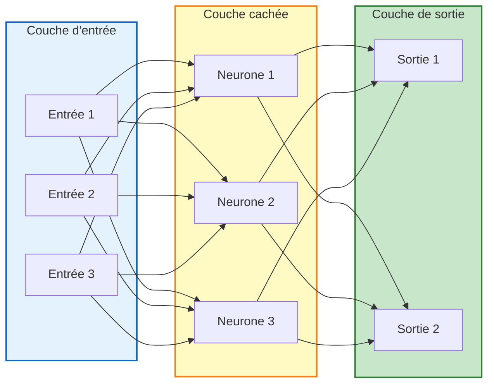

---

## Analogie avec le Cerveau

### Faits sur le Cerveau Humain

- Contient environ **100 milliards de neurones**
- Chaque neurone est connecté à environ **10.000 autres**

### Fonctionnement d'un Neurone Biologique

1. Un neurone reçoit des impulsions électriques de ses voisins via les **dendrites**
2. Si la somme des signaux dépasse un certain **seuil**, il se produit une décharge électrique de type **tout ou rien** appelée **potentiel d'action**
3. Le potentiel d'action se propage le long de l'**axone**, qui se ramifie en une multitude de dendrites
4. La terminaison d'une dendrite est une petite usine de production chimique
5. Elle diffuse des **neurotransmetteurs chimiques** dans un espace appelé **synapse**, qui rejoint un autre neurone

---

### Schéma du Neurone Biologique

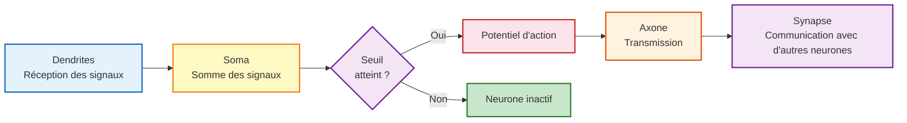

---

## Modélisation du Neurone

### Fonctionnement du Neurone Artificiel

- Induit une valeur en **sortie** à partir d'un ensemble de valeurs en **entrée**
- Les liens sont pondérés par des **poids**
- Réalise une **combinaison linéaire** des entrées suivie d'une **fonction de transfert** (fonction à seuil)

### Éléments du Neurone

$$
\text{Entrées} \xrightarrow{\text{Σ (Somme pondérée)}} \xrightarrow{f(\cdot)} \text{Sortie}
$$

**Fonction de transfert :**

$$
S = \sum_i w_i \times E_i
$$

- Biais optionnel $b$
- Fonction Sigmoïde :

$$
f(x) = \frac{1}{1 + e^{-x}}
$$

---

### Schéma d'un Neurone Artificiel

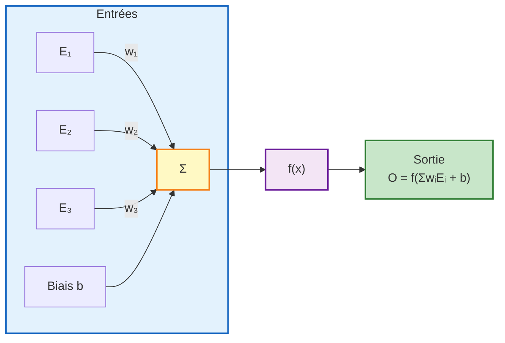

---

## Combinaison et Activation

### Phases du Traitement

1. **Phase de combinaison** : combine les entrées et produit une valeur en sortie
2. **Phase d'activation** : prend en entrée la sortie de la fonction de combinaison et déduit la valeur finale

### Fonctions de Combinaison

| Fonction | Description |
|----------|-------------|
| Produit scalaire | $y = \sum w_i x_i$ |
| Norme euclidienne | $y = \sqrt{\sum (x_i - w_i)^2}$ |
| Minimum / Maximum | $y = \min(x_i)$ ou $\max(x_i)$ |
| Majorité | Vote majoritaire |

### Fonctions d'Activation

Trois intervalles de fonctionnement :

| Intervalle | État du Neurone |
|------------|-----------------|
| En dessous du seuil | Neurone non actif |
| Aux alentours du seuil | Phase de transition |
| Au dessus du seuil | Neurone actif |

---

### Fonctions d'Activation Courantes

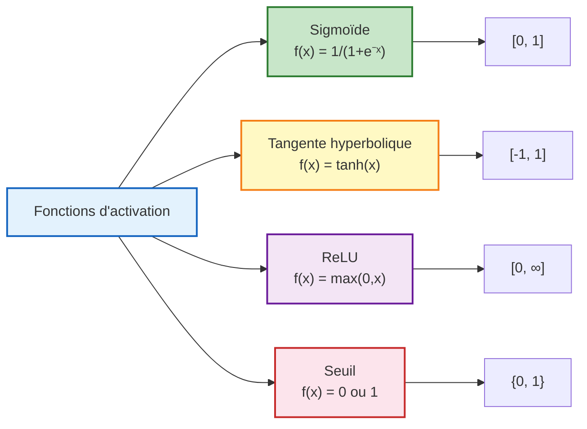

---

## Organisation en Réseau

### Réseau Multi-couches Totalement Connecté

Un réseau de neurones est organisé en couches :

1. **Couche d'entrée** : reçoit les données
2. **Couches cachées** : effectuent les calculs intermédiaires
3. **Couche de sortie** : produit le résultat

### Topologie

- Entrées, 1 ou 2 couches cachées, sorties
- Choix du nombre de neurones par couche dépend des entrées et sorties
- Couches cachées intermédiaires

### Normalisation des Variables d'Entrées

| Type de Variable | Méthode de Normalisation |
|------------------|--------------------------|
| Variable continue | Centrée réduite $[-1, +1]$ |
| Variable discrète | Codée ou valeurs attribuées aux entrées |
| Sorties | Booléenne codant les classes |

---

### Architecture d'un Perceptron Multicouche

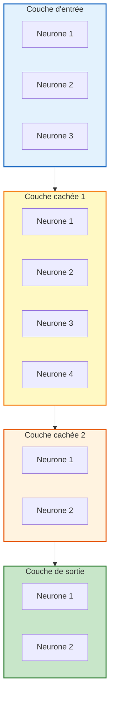

---

## Perceptron Multicouche

Le perceptron multicouche (PMC) est l'architecture la plus courante des réseaux de neurones.

### Caractéristiques

- Plusieurs couches de neurones
- Connexions totales entre les couches
- Apprentissage supervisé

---

## Apprentissage

### Principe

- Découverte de modèles complexes avec **affinage progressif**
- Le réseau s'adapte lors de la phase d'apprentissage

### Algorithmes d'Apprentissage

Plusieurs algorithmes possibles :

- Le plus utilisé = **Rétropropagation** (Backpropagation)
- Modification des poids $w$ par rétropropagation

### Modes d'Apprentissage

| Mode | Description | Avantage |
|------|-------------|----------|
| **Off-Line (Batch)** | Mise à jour après tous les exemples | Stable, converge mieux |
| **On-Line (Stochastique)** | Mise à jour après chaque exemple | Plus rapide, échappe aux minima locaux |

### Algorithme d'Apprentissage Générique

```
1. Initialiser la matrice des poids au hasard
2. Pour chaque exemple :
   a. Calculer la sortie avec les poids actuels du réseau
   b. Calculer les erreurs de sortie
   c. Appliquer l'algorithme de mise à jour des poids
```

---

### Schéma de l'Apprentissage

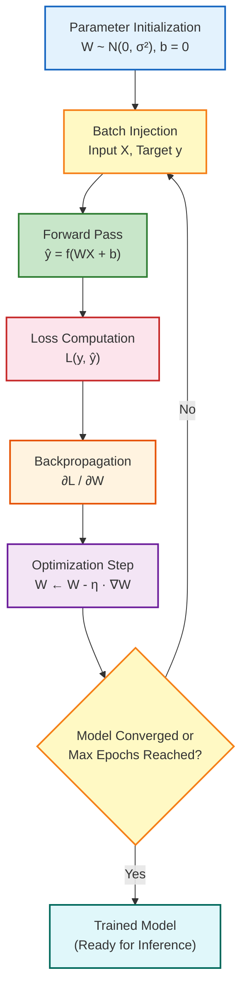

---

## Rétropropagation

### Initialisation

- Tirage aléatoire des poids sur $[-1, +1]$

### Étapes de la Rétropropagation

#### 1. Propager les Entrées en Avant (Forward Pass)

- Un exemple est appliqué aux entrées
- Le réseau calcule les sorties

#### 2. Propager les Erreurs en Arrière (Backward Pass)

**Pour une cellule de sortie :**

$$
Err = O(1 - O) \times (T - O)
$$

**Pour une cellule cachée :**

$$
Err = O(1 - O) \times \sum_k (w_k \times Err_k)
$$

#### 3. Corriger les Poids et Biais

$$
\Delta w_{ij} = \lambda \times Err_j \times O_i
$$

$$
\Delta b_j = \lambda \times Err_j
$$

Où :
- $\lambda$ : Taux d'apprentissage (learning rate)
- $Err_j$ : Erreur de la cellule $j$
- $O_i$ : Sortie de la cellule $i$

---

### Schéma de la Rétropropagation

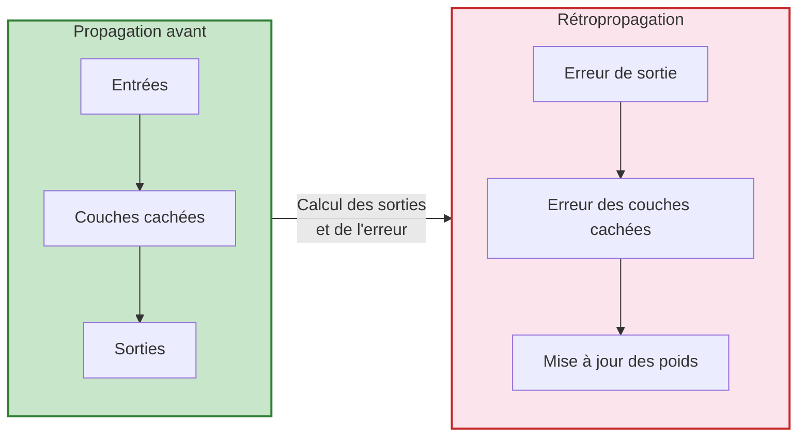

---

### Calcul de l'Erreur

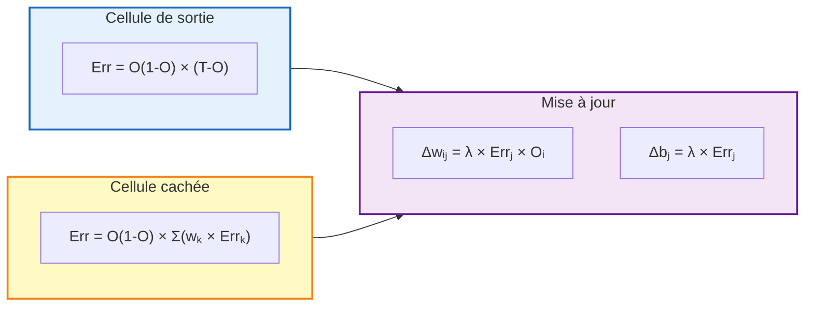

---

## Avantages et Inconvénients

### Inconvénients

| ❌ | Inconvénient | Description |
|----|--------------|-------------|
| ❌ | **Coûteux en apprentissage** | Calculs complexes, peu applicable sur de larges BD |
| ❌ | **Effet boîte noire** | Comportement difficile à expliquer |
| ❌ | **Temps d'entraînement** | Peut être très long pour de grands réseaux |
| ❌ | **Sur-apprentissage** | Risque de mémorisation des données |

### Avantages

| ✅ | Avantage | Description |
|----|----------|-------------|
| ✅ | **Capacité d'apprentissage** | Peut modéliser des relations complexes |
| ✅ | **Généralisation** | Bonne performance sur des données non vues |
| ✅ | **Adaptabilité** | Peut s'adapter à de nouvelles données |
| ✅ | **Applications variées** | Classification, régression, reconnaissance, etc. |

---

### Applications des Réseaux de Neurones

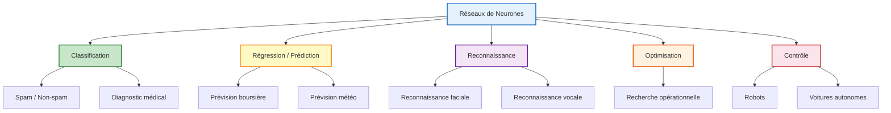

---

## Bilan de la Classification

### Techniques de Classification

De nombreuses techniques dérivées de l'IA et des statistiques :

- Règles associatives
- Raisonnement par cas
- Ensembles flous
- Arbres de décision
- Réseaux de neurones
- Machines à vecteurs supports (SVM)
- etc.

### Problème de Passage à l'Échelle

- Certaines techniques (arbres de décision, réseaux) ont des problèmes de passage à l'échelle
- Nécessité de **tester plusieurs techniques** pour résoudre un problème

### Y-a-t-il une Technique Dominante ?

> **Non.** Le choix de la technique dépend du problème, des données disponibles, et des contraintes opérationnelles.

---

### Comparaison des Classifieurs

```mermaid
flowchart LR
    subgraph Methods["Méthodes de classification"]
        M1["Arbres de décision"]
        M2["Réseaux de neurones"]
        M3["SVM"]
        M4["Bayésien naïf"]
        M5["k-NN"]
        M6["Règles associatives"]
    end
    
    subgraph Criteria["Critères de choix"]
        C1["Interprétabilité"]
        C2["Précision"]
        C3["Temps d'apprentissage"]
        C4["Taille des données"]
        C5["Type de données"]
        C6["Complexité du problème"]
    end
    
    Methods --> Criteria
    
    style Methods fill:#e3f2fd,stroke:#1565c0,stroke-width:2px
    style Criteria fill:#fff9c4,stroke:#f57f17,stroke-width:2px
```

---

### Synthèse Générale

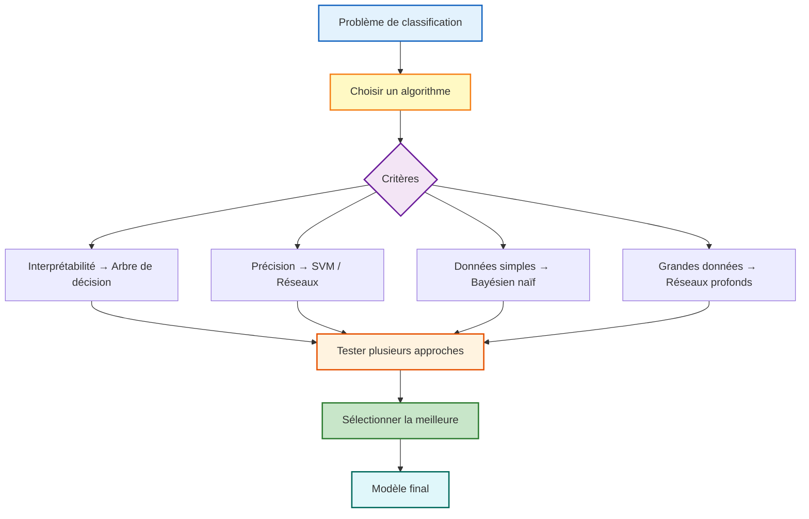


# [[00 - Table des Matières]]