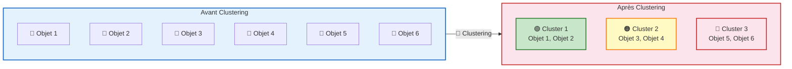

# 📊 Clustering - Cours Complet

**Pr. BEN LAHMAR EL Habib**

---

## 📑 Table des Matières

- [x] [[#1. Introduction au Clustering]]
- [x] [[#2. Structures de Données]]
- [x] [[#3. Standardisation des Données]]
- [x] [[#4. Mesures de Distance]]
- [x] [[#5. Variables Spécifiques]]
- [x] [[#6. Algorithmes de Partitionnement]]
	- [x] [[#6.1 K-Means]]
	- [x] [[#6.2 K-Médoïdes / PAM]]
- [x] [[#7. Algorithmes Hiérarchiques]]
	- [x] [[#7.1 Méthodes Agglomératives]]
	- [x] [[#7.2 BIRCH]]
	- [x] [[#7.3 CURE]]
- [ ] [[#8. ROCK - Robust Clustering using Links]]
- [ ] [[#9. DBSCAN - Density-Based Spatial Clustering]]
- [ ] [[#10. Comparaison des Méthodes]]
- [ ] [[#11. Critères d'Évaluation]]

---

## 1. Introduction au Clustering

### 1.1 Définition

Le **clustering** (ou regroupement) est une méthode d'apprentissage non supervisé qui consiste à partitionner un ensemble de données en groupes homogènes appelés **clusters**.

### 1.2 Objectif

Une bonne méthode de regroupement permet de garantir :

| Objectif | Description |
|----------|-------------|
| **Intra-groupe** | ✅ Grande similarité entre les objets d'un même cluster |
| **Inter-groupe** | ✅ Faible similarité entre les objets de clusters différents |

### 1.3 Facteur Déterminant

La qualité d'un regroupement dépend de :
- La **mesure de similarité** utilisée
- Son **implémentation**

### 1.4 Schéma Conceptuel



---

## 2. Structures de Données

### 2.1 Matrice de Données

Représentation des objets sous forme de tableau :

$$ \mathbf{X} = \begin{bmatrix}
x_{11} & \cdots & x_{1f} & \cdots & x_{1p} \\
\vdots & \ddots & \vdots & \ddots & \vdots \\
x_{i1} & \cdots & x_{if} & \cdots & x_{ip} \\
\vdots & \ddots & \vdots & \ddots & \vdots \\
x_{n1} & \cdots & x_{nf} & \cdots & x_{np}
\end{bmatrix} $$

Où $x_{if}$ est la valeur de l'objet $i$ pour la variable $f$.

### 2.2 Matrice de Similarité

Matrice des distances entre objets :

$$ \mathbf{D} = \begin{bmatrix}
0 & & & & \\
d(2,1) & 0 & & & \\
d(3,1) & d(3,2) & 0 & & \\
\vdots & \vdots & \vdots & \ddots & \\
d(n,1) & d(n,2) & \cdots & d(n,n-1) & 0
\end{bmatrix} $$

---

## 3. Standardisation des Données

### 3.1 Pourquoi Standardiser ?

Les variables mesurées sur des échelles différentes peuvent fausser les calculs de distance.

### 3.2 Écart Absolu Moyen

$$ s_f = \frac{1}{n} \sum_{i=1}^{n} |x_{if} - m_f| $$

Où $m_f$ est la moyenne :

$$ m_f = \frac{1}{n} \sum_{i=1}^{n} x_{if} $$

### 3.3 Mesure Standardisée (Z-score)

$$ z_{if} = \frac{x_{if} - m_f}{s_f} $$

### 3.4 Exemple de Standardisation

| | Age | Salaire |
|---|-----|---------|
| Personne 1 | 50 | 11000 |
| Personne 2 | 70 | 11100 |
| Personne 3 | 60 | 11122 |
| Personne 4 | 60 | 11074 |

**Calculs :**
- $m_{\text{Age}} = 60$, $s_{\text{Age}} = 5$
- $m_{\text{Salaire}} = 11074$, $s_{\text{Salaire}} = 148$

**Résultat standardisé :**

| | Age | Salaire |
|---|-----|---------|
| Personne 1 | -2 | -0.5 |
| Personne 2 | 2 | 0.175 |
| Personne 3 | 0 | 0.324 |
| Personne 4 | 0 | 0 |

---

## 4. Mesures de Distance 

### 4.1 Distance de Minkowski

$$ d(i, j) = \left( \sum_{k=1}^{p} |x_{ik} - x_{jk}|^q \right)^{1/q} $$

Où $q$ est un entier positif.

### 4.2 Distance Euclidienne $(q = 2)$

$$ d(i, j) = \sqrt{ \sum_{k=1}^{p} |x_{ik} - x_{jk}|^2 } $$

**Propriétés :**
- $d(i,j) \geq 0$
- $d(i,i) = 0$
- $d(i,j) = d(j,i)$
- $d(i,j) \leq d(i,k) + d(k,j)$ (Inégalité triangulaire)

### 4.3 Distance de Manhattan $(q = 1)$

$$ d(i, j) = \sum_{k=1}^{p} |x_{ik} - x_{jk}| $$

### 4.4 Comparaison des Distances
  

| Distance        | Formule                                     | Utilisation                              |
| --------------- | ------------------------------------------- | ---------------------------------------- |
| **Euclidienne** | $\sqrt{ \sum (x_i - x_i)^2 }$​              | Données continues, sensible aux outliers |
| **Manhattan**   | $\sum \|x_i - x_i\|$                        | Robuste, données continues               |
| **Minkowski**   | $\left( \sum \|x_i - x_i\|^q \right)^{1/q}$ | Généralisation                           |
| **Cosinus**     | $1− \frac {x.y} {\|x\|.\|y\|}$              | Orientation des vecteurs                 |

### 4.5 Exemple avec Standardisation

**Données standardisées :**

| | Age | Salaire |
|---|-----|---------|
| P1 | -2 | -0.5 |
| P2 | 2 | 0.175 |
| P3 | 0 | 0.324 |
| P4 | 0 | 0 |

**Distances Euclidiennes :**

$$ d(P_1, P_2) = \sqrt{(-2-2)^2 + (-0.5-0.175)^2} = 4.675 $$

$$ d(P_1, P_3) = \sqrt{(-2-0)^2 + (-0.5-0.324)^2} = 2.324 $$

**Conclusion :** $P_1$ ressemble plus à $P_3$ qu'à $P_2$

---

## 5. Variables Spécifiques

### 5.1 Variables Binaires

#### Table de Contingence

| Objet $i$ \ Objet $j$ | 1 | 0 | Sum |
|----------------------|---|---|-----|
| **1** | $a$ | $b$ | $a+b$ |
| **0** | $c$ | $d$ | $c+d$ |
| **Sum** | $a+c$ | $b+d$ | $p$ |

Où :
- $a$ = nombre de positions où $i$ et $j$ ont 1
- $b$ = nombre de positions où $i$ a 1, $j$ a 0
- $c$ = nombre de positions où $i$ a 0, $j$ a 1
- $d$ = nombre de positions où $i$ et $j$ ont 0

#### Coefficient d'Appariement Simple (Matching)

$$ d(i, j) = \frac{b + c}{a + b + c + d} $$

#### Coefficient de Jaccard

$$ d(i, j) = \frac{b + c}{a + b + c} $$

#### Variables Symétriques vs Asymétriques

| Type | Description | Exemple | Coefficient |
|------|-------------|---------|-------------|
| **Symétrique** | Les deux valeurs ont la même importance | Sexe (M/F) | Matching |
| **Asymétrique** | Une valeur est plus significative | Test médical (Positif/Négatif) | Jaccard |

#### Exemple avec Variables Mixtes

| Nom | Sexe | Fièvre | Toux | Test-1 | Test-2 | Test-3 | Test-4 |
|-----|------|--------|------|--------|--------|--------|--------|
| Jack | M | Y | N | P | N | N | N |
| Mary | F | Y | N | P | N | P | N |
| Jim | M | Y | P | N | N | N | N |

**Calculs :**
- Sexe = attribut symétrique
- Autres = attributs asymétriques

$$ d(Jack, Jim) = \frac{0 + 1}{3 + 0 + 1} = 0.33 $$

$$ d(Jack, Mary) = \frac{1 + 1}{3 + 1 + 1} = 0.4 $$

$$ d(Jim, Mary) = \frac{1 + 2}{1 + 1 + 2} = 0.75 $$

**Conclusion :** Jack et Mary sont les plus similaires.

### 5.2 Variables Catégorielles

#### Méthode 1 : Matching Simple

$$ d(i, j) = \frac{p - m}{p} $$

Où :
- $m$ = nombre d'appariements
- $p$ = nombre total de variables

#### Méthode 2 : Binarisation

Créer une variable binaire pour chaque modalité.

### 5.3 Variables Ordinales

#### Traitement en 3 Étapes

**Étape 1 :** Remplacer $x$ par son rang

$$ r_{if} \in \{1, \dots, M_f\} $$

**Étape 2 :** Normaliser le rang dans $[0,1]$

$$ z_{if} = \frac{r_{if} - 1}{M_f - 1} $$

**Étape 3 :** Utiliser une distance pour calculer la similarité

### 5.4 Variables de Différents Types

#### Formule Pondérée

$$ d(i, j) = \frac{\sum_f \delta_{ij}^{(f)} \times d_{ij}^{(f)}}{\sum_f \delta_{ij}^{(f)}} $$

Où :
- $\delta_{ij}^{(f)} = 1$ si valeur connue, $0$ si manquante
- $d_{ij}^{(f)}$ = distance calculée pour le type $f$

#### Traitement par Type

| Type de Variable | $d_{ij}^{(f)}$ |
|------------------|----------------|
| **Binaire ou Nominale** | $0$ si $x_{if} = x_{jf}$, sinon $1$ |
| **Intervalle** | Distance normalisée |
| **Ordinale** | Rangs normalisés |

---

## 6. Algorithmes de Partitionnement

### 6.1 K-Means

#### Principe

- Chaque cluster est représenté par son **centre** (moyenne)
- Algorithme itératif minimisant l'inertie intra-cluster

#### Algorithme

```
Entrée : D (données), k (nombre de clusters)
Sortie : k clusters

1. Initialisation :
   Choisir aléatoirement k objets comme centres initiaux {M₁, M₂, ..., Mₖ}

2. Répéter :
   a. Affectation :
      Pour chaque objet O ∈ D :
         Assigner O au cluster Cᵢ tel que d(O, Mᵢ) est minimal
   
   b. Mise à jour :
      Pour chaque cluster Cᵢ :
         Recalculer Mᵢ = moyenne des objets dans Cᵢ

3. Jusqu'à convergence (centres stables)
```

#### Fonction Coût (Inertie)

$$ J = \sum_{i=1}^{k} \sum_{x \in C_i} \|x - \mu_i\|^2 $$

Où $\mu_i$ est le centre du cluster $C_i$.

#### Exemple Détaillé

**Données :** $A = \{1, 2, 3, 6, 7, 8, 13, 15, 17\}$, $k = 3$

---

**Itération 1**

Initialisation : Centres = $\{1, 2, 3\}$

| Cluster | Éléments | Centre |
|---------|----------|--------|
| $C_1$ | $\{1\}$ | $M_1 = 1$ |
| $C_2$ | $\{2\}$ | $M_2 = 2$ |
| $C_3$ | $\{3, 6, 7, 8, 13, 15, 17\}$ | $M_3 = 69/7 = 9.86$ |

---

**Itération 2**

| Cluster | Éléments | Centre |
|---------|----------|--------|
| $C_1$ | $\{1\}$ | $M_1 = 1$ |
| $C_2$ | $\{2, 3\}$ | $M_2 = 2.5$ |
| $C_3$ | $\{6, 7, 8, 13, 15, 17\}$ | $M_3 = 66/6 = 11$ |

---

**Itération 3**

| Cluster | Éléments | Centre |
|---------|----------|--------|
| $C_1$ | $\{1\}$ | $M_1 = 1$ |
| $C_2$ | $\{2, 3, 6\}$ | $M_2 = 11/3 = 3.67$ |
| $C_3$ | $\{7, 8, 13, 15, 17\}$ | $M_3 = 12$ |

---

**Itération 4**

| Cluster | Éléments | Centre |
|---------|----------|--------|
| $C_1$ | $\{1, 2\}$ | $M_1 = 1.5$ |
| $C_2$ | $\{3, 6, 7\}$ | $M_2 = 5.34$ |
| $C_3$ | $\{8, 13, 15, 17\}$ | $M_3 = 13.25$ |

---

**Itération 5 (Convergence)**

| Cluster | Éléments | Centre |
|---------|----------|--------|
| $C_1$ | $\{1, 2, 3\}$ | $M_1 = 2$ |
| $C_2$ | $\{6, 7, 8\}$ | $M_2 = 7$ |
| $C_3$ | $\{13, 15, 17\}$ | $M_3 = 15$ |

**Résultat Final :**
- $C_1 = \{1, 2, 3\}$, Centre = 2
- $C_2 = \{6, 7, 8\}$, Centre = 7
- $C_3 = \{13, 15, 17\}$, Centre = 15

#### Avantages et Inconvénients

| ✅ Avantages | ❌ Inconvénients |
|--------------|-----------------|
| Simple et rapide | Nécessite de connaître $k$ |
| Efficace pour grandes bases | Sensible aux outliers |
| Convergence garantie | Dépend de l'initialisation |
| Facile à implémenter | Données numériques uniquement |
| | Peut converger vers un minimum local |

#### Choix du Nombre de Clusters : Méthode du Coude

Tracer l'inertie en fonction de $k$ et choisir le point d'inflexion.

---

### 6.2 K-Médoïdes / PAM

#### Principe

- Chaque cluster est représenté par un **objet réel** (le médoïde)
- Plus robuste aux outliers que K-Means

#### Différence avec K-Means

| Critère | K-Means | K-Médoïdes |
|---------|---------|------------|
| **Représentant** | Moyenne des points | Objet existant |
| **Robustesse** | Sensible aux outliers | Robuste |
| **Type de données** | Numériques uniquement | Tout type |
| **Vitesse** | Rapide | Plus lent |

#### Algorithme PAM (Partition Around Medoids)

```
1. Choisir arbitrairement k médoïdes

2. Répéter :
   a. Affecter chaque objet au médoïde le plus proche
   b. Pour chaque paire (h, j) où h = médoïde, j = non-médoïde :
      - Calculer le coût TC du remplacement de h par j
      - Si TC < 0 : remplacer h par j, recalculer les clusters

3. Jusqu'à stabilisation
```

#### Coût de Remplacement

$$ TC_{jh} = \sum_i C_{jh}^i $$

Où $C_{jh}^i$ dépend du cluster de l'objet $i$ :

| Cas | $C_{jh}^i$ |
|-----|------------|
| $i$ assigné à $j$ (médoïde remplacé) | $d(i, h) - d(i, j)$ |
| $i$ assigné à $t$ (autre médoïde) | $0$ |

#### Exemple

**Données :** $A = \{1, 3, 4, 5, 8, 9\}$, $k = 2$, $M = \{1, 8\}$

**Distance totale initiale :** $0 + 2 + 3 + 3 + 0 + 1 = 9$

**Test :** Remplacer 1 par 3

| Objet | Ancienne distance à 1 | Nouvelle distance à 3 | Différence |
|-------|----------------------|----------------------|------------|
| 3 | 2 | 0 | -2 |
| 4 | 3 | 1 | -2 |
| 5 | d(5,8)=3 | d(5,8)=3 | 0 |
| 9 | d(9,8)=1 | d(9,8)=1 | 0 |

**Coût total :** $TC = -4$ (amélioration !)

**Nouvel ensemble :** $M' = \{3, 8\}$

**Nouvelle distance :** $5$

#### Avantages et Inconvénients

| ✅ Avantages | ❌ Inconvénients |
|--------------|-----------------|
| Robuste aux outliers | Plus lent ($O(k(n-k)^2)$) |
| Tout type de données | Nécessite de connaître $k$ |
| Résultat interprétable | Ne fonctionne pas pour grandes bases |
| Médoïdes = objets réels | Coût de calcul élevé |

#### Applications

| Domaine | Application |
|---------|-------------|
| Bioinformatique | Classification de séquences ADN |
| Médecine | Regroupement de patients |
| Marketing | Segmentation clientèle |
| Image | Classification d'images |
| Text Mining | Regroupement de documents |

---

## 7. Algorithmes Hiérarchiques 

### 7.1 Méthodes Agglomératives 

#### Principe

- Chaque objet forme initialement son propre cluster
- Fusion itérative des clusters les plus proches
- Résultat : un dendrogramme

#### Algorithme

```
1. Initialisation : n clusters (chaque objet = un cluster)
2. Calculer la matrice des distances
3. Répéter :
   a. Trouver la paire de clusters la plus proche
   b. Fusionner les deux clusters
   c. Mettre à jour la matrice des distances
4. Jusqu'à ce que le seuil soit atteint ou qu'il reste k clusters
```

#### Mesures de Distance entre Clusters

| Lien | Formule | Caractéristique |
|------|---------|-----------------|
| **Single** | $\min\{dist(o_1, o_2) \mid o_1 \in C_1, o_2 \in C_2\}$ | Produit des chaînes, sensible au bruit |
| **Complete** | $\max\{dist(o_1, o_2) \mid o_1 \in C_1, o_2 \in C_2\}$ | Clusters compacts, robuste |
| **Average** | $\frac{1}{n_1 n_2} \sum_{o_1 \in C_1} \sum_{o_2 \in C_2} dist(o_1, o_2)$ | Compromis, équilibré |

### 7.2 BIRCH

**Balanced Iterative Reducing and Clustering using Hierarchies** (1996)

#### Caractéristiques

- Construit incrémentalement un **CF-tree**
- Structure hiérarchique avec phases de clustering

#### Clustering Feature Vector (CF)

$$ CF = (N, LS, SS) $$

Où :
- $N$ = nombre de points
- $LS$ = Linear Sum (somme des vecteurs)
- $SS$ = Square Sum (somme des carrés)

**Propriété additive :**
$$ CF_1 + CF_2 = (N_1 + N_2, LS_1 + LS_2, SS_1 + SS_2) $$

#### Phases BIRCH

| Phase | Description |
|-------|-------------|
| **Phase 1** | Scanner la base pour construire le CF-tree en mémoire |
| **Phase 2** | Utiliser un algorithme de clustering sur les feuilles du CF-tree |

#### Avantages et Inconvénients

| ✅ Avantages | ❌ Inconvénients |
|--------------|-----------------|
| Une seule passe sur la BD | Données numériques uniquement |
| Efficace pour grandes bases | Sensible à l'ordre des enregistrements |

### 7.3 CURE 

**Clustering Using Representatives** (1998)

#### Caractéristiques

- Utilise plusieurs points représentatifs par cluster
- Capture la forme du cluster
- Arrête la création dès qu'on a $k$ clusters

#### Algorithme

```
1. Prendre un sous-ensemble s
2. Partitionner s en p partitions de taille s/p
3. Dans chaque partition, créer s/pq clusters
4. Éliminer les outliers (points aberrants)
5. Regrouper les clusters partiels
```

#### Exemple

$$ s = 50, \quad p = 2, \quad s/p = 25, \quad s/pq = 5 $$

#### Points Représentatifs

- Rapprocher les points représentatifs vers le centre de gravité (facteur $\alpha$)
- Plusieurs points permettent de figurer la forme du cluster

---

## 8. ROCK - Robust Clustering using Links 

#### Principe

- Utilise les **liens** plutôt que la distance
- Pour données catégorielles

#### Problème de la Distance Simple

**Exemple :** 4 transactions sur 6 produits

$$ T_1 = \{1,2,3,5\}, \quad T_2 = \{2,3,4,5\}, \quad T_3 = \{1,4\}, \quad T_4 = \{6\} $$

$dist(T_1,T_2) = 2$ (plus petite distance) → $T_1$ et $T_2$ dans le même cluster

$dist(T_3,T_4) = 3$ → $T_3$ et $T_4$ aussi, mais n'ont aucun produit en commun !

#### Solution : Les Liens

**Lien** = nombre de voisins communs de 2 points

**Exemple avec transactions de taille 3 :**

$\{1,2,3\}, \{1,2,4\}, \{1,2,5\}, \{1,3,4\}, \{1,3,5\},$
$\{1,4,5\}, \{2,3,4\}, \{2,3,5\}, \{2,4,5\}, \{3,4,5\}$

- $\{1,2,3\}$ et $\{1,2,4\}$ ont un lien fort
- La similarité basée sur les liens est plus robuste

---

## 9. DBSCAN - Density-Based Spatial Clustering

#### Principe

- Voit les clusters comme des **régions denses**
- Clusters de formes arbitraires
- Détecte le bruit

#### Paramètres

| Paramètre | Description |
|-----------|-------------|
| **Eps** | Rayon maximum du voisinage |
| **MinPts** | Nombre minimum de points dans le voisinage-Eps |

#### Définitions

**Voisinage :**
$$ V_{Eps}(p) = \{q \in D \mid dist(p, q) \leq Eps\} $$

**Point central :** $|V_{Eps}(p)| \geq MinPts$

**Point frontière :** $|V_{Eps}(p)| < MinPts$ mais voisin d'un point central

**Point bruit :** $|V_{Eps}(p)| < MinPts$ et isolé

#### Types de Points

```
● Point central    ○ Point frontière    ✕ Point bruit
(≥ MinPts)         (< MinPts)           (< MinPts, isolé)
```

#### Accessibilité et Connexité

**Accessibilité directe :** $p$ accessible à partir de $q$ si :
1. $p \in V_{Eps}(q)$
2. $|V_{Eps}(q)| \geq MinPts$ ($q$ est un point central)

**Accessibilité :** Chaîne de points accessibles directement

**Connexité :** $p$ connecté à $q$ s'il existe $o$ tel que $p$ et $q$ sont accessibles à partir de $o$

---

## 10. Comparaison des Méthodes

### 10.1 Tableau Comparatif

| Critère | K-Means | K-Médoïdes | Hiérarchique | DBSCAN | BIRCH | CURE | ROCK |
|---------|---------|------------|--------------|--------|-------|------|------|
| **Type** | Partition | Partition | Hiérarchique | Densité | Hiérarchique | Hiérarchique | Liens |
| **k requis** | ✅ Oui | ✅ Oui | ❌ Non | ❌ Non | ❌ Non | ✅ Oui | ✅ Oui |
| **Données** | Numériques | Tout type | Tout type | Numériques | Numériques | Numériques | Catégorielles |
| **Outliers** | Sensible | Robuste | Variable | Robuste | Sensible | Robuste | Robuste |
| **Formes** | Sphériques | Sphériques | Arbitraires | Arbitraires | Sphériques | Arbitraires | Arbitraires |
| **Vitesse** | Rapide | Lent | Moyen | Moyen | Rapide | Lent | Lent |

### 10.2 Arbre de Décision pour Choisir un Algorithme

```
                                    Données
                                        │
                    ┌───────────────────┼───────────────────┐
                    │                   │                   │
               Numériques           Catégorielles       Mixtes
                    │                   │                   │
        ┌───────────┼───────────┐       │                   │
        │           │           │       │                   │
    Grandes     Petites     Formes    ROCK            K-Médoïdes
    bases       bases     complexes   │               Hiérarchique
        │           │           │     │                   │
      BIRCH    K-Means     CURE   ────┘                   │
        │       K-Médoïdes   │                            │
        │       Hiérarchique DBSCAN                       │
        └───────────┴───────────┘                        │
                    │                                     │
                    └─────────────────────────────────────┘
                                        │
                                      DBSCAN (pour formes complexes)
```

---

## 11. Critères d'Évaluation 

### 11.1 Inertie Intra-Cluster (W)

$$ W = \sum_{k=1}^{K} \sum_{i \in C_k} \|x_i - \mu_k\|^2 $$

**Objectif :** Minimiser $W$ (clusters compacts)

### 11.2 Inertie Inter-Cluster (B)

$$ B = \sum_{k=1}^{K} n_k \|\mu_k - \mu\|^2 $$

**Objectif :** Maximiser $B$ (clusters séparés)

### 11.3 Coefficient de Silhouette

$$ s(i) = \frac{b(i) - a(i)}{\max(a(i), b(i))} $$

Où :
- $a(i)$ = distance moyenne aux points du même cluster
- $b(i)$ = distance moyenne au cluster voisin le plus proche

**Interprétation :**
- $s(i) \approx 1$ : bien classé
- $s(i) \approx 0$ : sur la frontière
- $s(i) \approx -1$ : mal classé

### 11.4 Indice de Davies-Bouldin

$$ DB = \frac{1}{K} \sum_{i=1}^{K} \max_{j \neq i} \frac{\sigma_i + \sigma_j}{d(c_i, c_j)} $$

**Objectif :** Minimiser $DB$ (clusters bien séparés et compacts)

### 11.5 Résumé des Critères

| Critère | Formule | Objectif |
|---------|---------|----------|
| **Inertie intra** | $\sum_k \sum_{i \in C_k} \|x_i - \mu_k\|^2$ | Minimiser |
| **Inertie inter** | $\sum_k n_k \|\mu_k - \mu\|^2$ | Maximiser |
| **Silhouette** | $\frac{b(i) - a(i)}{\max(a(i), b(i))}$ | Maximiser |
| **Davies-Bouldin** | $\frac{1}{K} \sum_i \max_{j \neq i} \frac{\sigma_i + \sigma_j}{d(c_i, c_j)}$ | Minimiser |

---

## 📚 Références

- MacQueen, J. (1967). Some methods for classification and analysis of multivariate observations.
- Kaufman, L., & Rousseeuw, P. J. (1990). Finding Groups in Data: An Introduction to Cluster Analysis.
- Zhang, T., Ramakrishnan, R., & Livny, M. (1996). BIRCH: An efficient data clustering method.
- Guha, S., Rastogi, R., & Shim, K. (1998). CURE: An efficient clustering algorithm.
- Ester, M., et al. (1996). A density-based algorithm for discovering clusters.
- Guha, S., Rastogi, R., & Shim, K. (1999). ROCK: A robust clustering algorithm.
