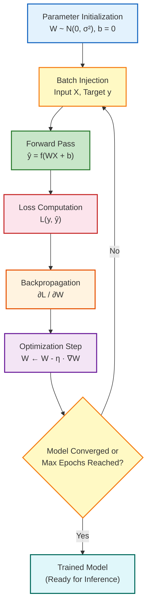
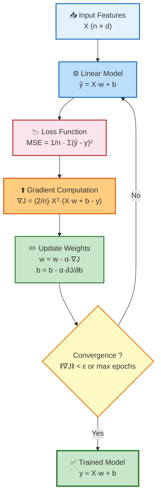
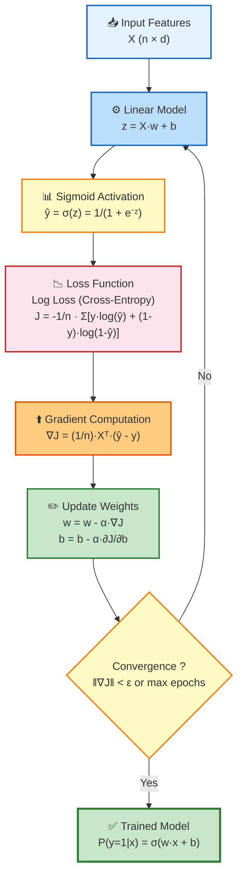
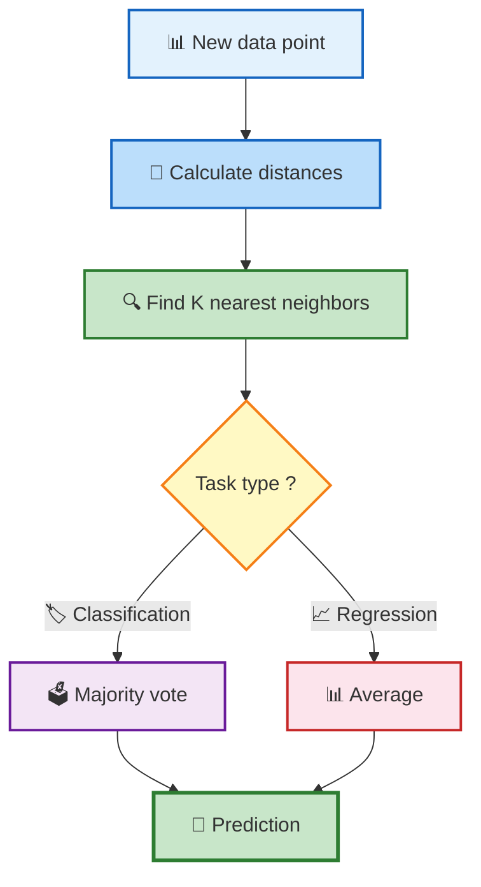

## 1. Data Understanding & Preparation

### Exploratory Data Analysis (EDA)

- **General Tabular:** 
	- Data distribution
	- missing values
	- duplicates
	- outliers
	- correlation
	- class distribution
	- feature statistics
	- data types
	- data quality
	- class imbalance
- **Image Data:**
	- Image resolution
	- color channels (RGB vs. grayscale)
	- image dimensions
	- corrupted images
	- class distribution
- **Text Data:** Tokens, vocabulary, sequence length, missing text, duplicate text.

### Data Preparation

- **Data Cleaning:** Handling missing values, duplicates, outliers, invalid values, noise, and corrupted samples.
- **Data Transformation:** Feature scaling (normalization, standardization), encoding, and distribution transformations.

## 2. Feature Engineering & Selection

### Feature Encoding

- **Nominal:** 
	- One-Hot Encoding
	- Mean Encoding.
- **Ordinal:** 
	- Label Encoding
	- Target-Guided Ordinal Encoding
- **Binning/Bucketing:** Grouping numerical data into intervals to summarize distributions or reduce outlier impacts (e.g., `"10–20"`, `"30–40"`, `"+50"`).
    

### Feature Generation & Selection

- **Feature Crosses:** Synthetic features created by multiplying or intersecting two or more features to capture non-linear interactions.
    
- **Feature Selection Methods:**
    - **Filter Methods:** Statistical tests independent of the model.
    - **Wrapper Methods:** Forward Feature Selection, Backward Feature Elimination.
    - **Embedded Methods:** Feature importance derived directly from model training (e.g., Lasso, Tree-based importance).

### Feature Scaling & Extraction

- **Scaling:** Data Normalization (Min-Max), Data Standardization (Z-score).
- **Extraction & Dimensionality Reduction:** Factor Analysis, Principal Component Analysis (PCA).

## 3. Machine Learning Algorithms

| **Algorithm**                     | **Type**                    | **Description / Subtypes**                                                                              |
| --------------------------------- | --------------------------- | ------------------------------------------------------------------------------------------------------- |
| **Linear Regression**             | Regression                  | • **Simple:** 1 independent variable<br>• **Multiple:** $N$ independent variables                       |
| **Logistic Regression**           | Classification              | • **Binary:** 2 classes<br>• **Multinomial:** 3+ unordered classes<br>• **Ordinal:** 3+ ordered classes |
| **K-Nearest Neighbors (KNN)**     | Classification / Regression | Instance-based non-parametric learning using distance metrics                                           |
| **Support Vector Machines (SVM)** | Classification / Regression | Finds optimal hyperplanes using kernel tricks                                                           |
| **Decision Trees**                | Classification / Regression | Tree-structured rule-based model                                                                        |
| **Naive Bayes**                   | Classification              | Probabilistic classifier based on Bayes' Theorem with independence assumptions                          |

## 4. Cost & Loss Functions

### Regression Loss Functions

- **MSE (Mean Squared Error):** Penallizes larger errors quadratically.
- **RMSE (Root Mean Squared Error):** Standard deviation of residuals.
- **MAE (Mean Absolute Error):** Robust to outliers; linear penalty.
- **MAPE / MPE:** Percentage-based error metrics.
- **Huber Loss:** Combines MSE for small errors and MAE for large errors.

### Classification Loss Functions

- **Binary:** Binary Cross-Entropy (BCE), `BCEWithLogitsLoss` (combines Sigmoid and BCE for numerical stability).
- **Multi-Class:** Cross-Entropy Loss, Categorical Cross-Entropy.

### Specialized & Deep Learning Losses

- **Metric Learning:** Contrastive Loss, Triplet Loss.
- **Computer Vision / Segmentation:** Focal Loss, Dice Loss.
- **Generative & Representation:** KL Divergence, Reconstruction Loss.

## 5. Optimization & Activation Functions

### Activation Functions

- **Sigmoid:** Maps input to $(0, 1)$. Formula: $\sigma(x) = \frac{1}{1 + e^{-x}}$
- **Tanh:** Maps input to $(-1, 1)$.
- **ReLU:** Maps input to $[0, \infty)$. Formula: $f(x) = \max(0, x)$
- **Step Function:** Binary output $\{0, 1\}$.

### Optimizers

- **Machine Learning:** Gradient Descent (Batch, Mini-Batch, Stochastic).
- **Deep Learning:** SGD with Momentum, RMSprop, Adam, AdamW.

## 6. Model Evaluation Metrics

| **Category**       | **Metrics**                                                                                        |
| ------------------ | -------------------------------------------------------------------------------------------------- |
| **Classification** | Accuracy, Precision, Recall, F1-score, Specificity, Sensitivity, ROC-AUC, PR-AUC, Confusion Matrix |
| **Regression**     | MAE, MSE, RMSE, $R^2$, MAPE                                                                        |

## 7. Artificial Neural Networks (ANN)

### Core Concepts & Architecture

- **Neural Network:** Interconnected computational units mapping inputs to outputs, loosely inspired by biological brains.
- **Architecture:** Layout of layers (Input, Hidden, Output) and connections.
- **Neuron / Node:** Calculates a weighted sum of inputs, adds a bias, and applies an activation function:
$$\hat{y} = f\left(\sum_{i} w_i x_i + b\right)$$
    
- **Parameters vs. Hyperparameters:**
    
    - **Parameters:** Learnable internal variables adjusted during training ($w$, $b$).
    - **Hyperparameters:** External configurations set before training 
	    - Learning rate
	    - Batch size
	    - Epochs
	    - Layers
	    - Neurons
	    - Dropout rate
	    - Weight decay
	    - Optimizer type
	    - Kernel size
	    - Number of filters

### Loss vs. Cost Function

- **Loss Function $L(y, \hat{y})$:** Computes error for a single training sample.
- **Cost Function $J(\theta)$:** Averages loss over the entire dataset or batch:
$$J(\theta) = \frac{1}{m} \sum_{i=1}^{m} L\left(y^{(i)}, \hat{y}^{(i)}\right)$$
### Key Terminology

- **Epoch:** One complete pass over the entire training dataset.
- **Batch:** A subset of training samples processed together.
- **Iteration / Step:** One weight update step performed by the optimizer.
- **Backpropagation:** Algorithmic application of the calculus chain rule backward from output to input layer to compute partial derivatives ($\frac{\partial L}{\partial W}$).

## 8. Training Pipeline (Schéma de l'Apprentissage)

1. **Parameter Initialization:** Initialize weights $W \sim \mathcal{N}(0, \sigma^2)$ and biases $b = 0$.
2. **Batch Injection:** Feed input data $X$ and ground truth targets $y$.
3. **Forward Pass:** Compute predictions $\hat{y} = f(W X + b)$.
4. **Loss Computation:** Measure prediction error using $L(y, \hat{y})$.
5. **Backpropagation:** Calculate gradients $\frac{\partial L}{\partial W}$ via the chain rule.
6. **Optimization Step:** Update parameters using learning rate $\eta$:    
$$W \leftarrow W - \eta \cdot \nabla_W L$$
7. **Convergence Check:** If loss has converged or max epochs are reached, export the model for inference; otherwise, repeat from Step 2.

### Schéma de l'Apprentissage




---
# Linear Regression 
>Supervised learning algorithm used to predict a **continuous numerical value**.

$$
{\hat{y}=wx+b}
$$
- $x$ → feature/input
- $w$ → weight
- $b$ → bias
- $\hat y$ → prediction

### Multiple Features

$${\hat y=w_1x_1+w_2x_2+\cdots+w_nx_n+b}$$
### Training life cycle


---

# Logistic Regression

>Supervised learning algorithm mainly used for **classification**.

### Step 1 — Linear Equation

$$z=wx+b$$

### Step 2 — Sigmoid

$${\sigma(z)=\frac{1}{1+e^{-z}}}$$

>Sigmoid converts $z$ into a **probability between 0 and 1**.

### Training life cycle

---

# KNN (K-Nearest Neighbors)

>A **supervised, non-parametric, lazy learning** algorithm for (Classification and Regression).
 A new point is predicted using its closest training points.




## Distance

### Euclidean Distance
$$d=\sqrt{\sum_i(x_i-y_i)^2}$$
### Manhattan Distance
$$d=\sum_i|x_i-y_i|$$
### Minkowski Distance
$$d=\left(\sum_i|x_i-y_i|^p\right)^{1/p}$$

## Weighted KNN

Closer neighbors can have more importance.

Common weight:

$$w_i=\frac{1}{d_i}$$
- $d_i$ : distance

---
# SVM (Support Vector Machines)
>is a supervised learning algorithm mainly used for classification, though it can also handle regression via SVR, by finding the optimal decision boundary that maximizes the margin between classes.

## Goal
>Maximize the margin

## Hyperplane

> The **hyperplane** is the decision boundary.

$w^Tx+b=0$

## Margin

>Distance between the decision boundary and the closest points of each class.

## Support Vectors

>Training points closest to the decision boundary.

## Hard-Margin SVM

Used when classes are perfectly separable.

Goal: 
$$
\min \frac{1}{2}||w||^2
$$

Subject to: 
$$
y_i(w^Tx_i+b)\geq1
$$
$$
y_i\hat{y_i}\geq1
$$

Problem: real data often contains noise.

## Soft-Margin SVM

Allows:
- Some points inside the margin
- Some classification errors

Uses **slack variables** $\xi_i$.

Objective:

$\min \frac12||w||^2+C\sum_i\xi_i$

### C parameter

**C = penalty for classification errors**

 **Small C → simpler model**  
 **Large C → more strict model**

## Decision Function

$$f(x)=w^Tx+b$$

Prediction:
- $f(x)>0 \rightarrow Class\ 1$
- $f(x)<0 \rightarrow Class\ 0$

## Hinge Loss

SVM commonly uses **hinge loss**:
$$L=\max(0,1-yf(x))$$
where:
$$y\in\{-1,1\}$$
# Non-Linear SVM

When a straight line cannot separate the data, SVM can use **kernels**.

> **Kernel → allows non-linear decision boundaries.**

## Kernel Trick

Common kernels:
### Linear
$$K(x,z)=x^Tz$$
### Polynomial
$$K(x,z)=(\gamma x^Tz+r)^d$$
### RBF / Gaussian
$$K(x,z)=e^{-\gamma||x-z||^2}$$
### Sigmoid
$$K(x,z)=\tanh(\gamma x^Tz+r)$$

# Multiclass SVM

SVM is naturally binary.

For multiple classes:

- One-vs-Rest (OvR)
- One-vs-One (OvO)

# SVR

**SVR = Support Vector Regression**

Used when the target is continuous.

Example:

```text
House features → SVR → House price
```

Important parameter: $\epsilon$

It defines an **epsilon-insensitive region** where small errors are ignored.

---
# Decision tree
>Is a supervised machine learning algorithm that makes predictions by asking a sequence of questions.

## Entropy
>Entropy measures uncertainty/impurity.
$$
\boxed{H(S)=-\sum p_i\log_2(p_i)}
$$

$p_i$ : Target probability

- Entropy = 0 → perfectly pure
- Entropy = 1 → maximum uncertainty for binary classification
## Information Gain
>Information Gain tells us how much a split improves the purity.

$$
\boxed{IG = H(S) - \sum \frac{|S_V|}{|S|} H(S_V)}
$$
- $S$ : Original dataset
- $S_V$ : Subset after splitting on feature value v
- $|S|$ : Total number of instances

<u>Higher Information Gain = better split → Most important feature</u>

## Gini
>How impure the root node is.
$$
\boxed{Gini=1-\sum_k p_k^2}
$$
<u>Lower Gini = better/purer node.</u>

## Entropy vs Gini

|Entropy|Gini|
|---|---|
|Measures uncertainty|Measures impurity|
|Uses logarithm|Uses squared probabilities|
|Used for Information Gain|Common default in sklearn|
|Lower = better|Lower = better|

---
# Naive Bayes
>Naive Bayes is a supervised learning, probabilistic classification algorithm based on Bayes' Theorem.

## Bayes' Theorem
$$
\boxed{P(A|B)=\frac{P(B|A)P(A)}{P(B)}}
$$
## Naive Bayes Formula
$$\boxed{X=(x_1​,x_2​,…,x_n​)}$$
$$
\boxed{P(C|X) = P(C) \prod_{i=1}^{n}P(x_i|C)}
$$
>><u>Choose the class with the highest probability​</u>

## Ex:

| Day | Outlook  | Temperature | Humidity | Wind   | Play |
| --- | -------- | ----------- | -------- | ------ | ---- |
| 1   | Sunny    | Hot         | High     | Weak   | No   |
| 2   | Sunny    | Hot         | High     | Strong | No   |
| 3   | Overcast | Hot         | High     | Weak   | Yes  |
| 4   | Rainy    | Mild        | High     | Weak   | Yes  |
| 5   | Rainy    | Cool        | Normal   | Weak   | Yes  |
| 6   | Rainy    | Cool        | Normal   | Strong | No   |
| 7   | Overcast | Cool        | Normal   | Strong | Yes  |
| 8   | Sunny    | Mild        | High     | Weak   | No   |
| 9   | Sunny    | Cool        | Normal   | Weak   | Yes  |
| 10  | Rainy    | Mild        | Normal   | Weak   | Yes  |
| 11  | Sunny    | Mild        | Normal   | Strong | Yes  |
| 12  | Overcast | Mild        | High     | Strong | Yes  |
| 13  | Overcast | Hot         | Normal   | Weak   | Yes  |
| 14  | Rainy    | Mild        | High     | Strong | No   |
### Step 1: Calculate Prior Probabilities

Total instances = 14
- Play = Yes: 9
- Play = No: 

**Prior Probabilities:**  
$$\boxed{P(Yes)=\frac {9}{14}=0.6429}  $$
$$\boxed{P(No)=\frac{5}{14}=0.3571}$$
### Step 2: Calculate Likelihoods for Each Feature

### **Outlook Likelihoods:**

| Outlook  | P(Outlook\|Yes)        | P(Outlook\|No)         |
| -------- | ---------------------- | ---------------------- |
| Sunny    | $\frac{2}{9}$ = 0.2222 | $\frac{3}{5}$= 0.6000  |
| Overcast | $\frac{4}{9}$= 0.4444  | $\frac{0}{5}$ = 0.0000 |
| Rainy    | $\frac{3}{9}$= 0.3333  | $\frac{2}{5}$ = 0.4000 |

### **Temperature Likelihoods:**

| Temperature | P(Temp\|Yes)           | P(Temp\|No)            |
| ----------- | ---------------------- | ---------------------- |
| Hot         | $\frac{2}{9}$= 0.2222  | $\frac{2}{5}$ = 0.4000 |
| Mild        | $\frac{4}{9}$ = 0.4444 | $\frac{2}{5}$ = 0.4000 |
| Cool        | $\frac{3}{9}$ = 0.3333 | $\frac{1}{5}$ = 0.2000 |

### **Humidity Likelihoods:**

| Humidity | P(Humidity\|Yes)       | P(Humidity\|No)        |
| -------- | ---------------------- | ---------------------- |
| High     | $\frac{3}{9}$= 0.3333  | $\frac{4}{5}$= 0.8000  |
| Normal   | $\frac{6}{9}$ = 0.6667 | $\frac{1}{5}$ = 0.2000 |

### **Wind Likelihoods:**

| Wind   | P(Wind\|Yes)           | P(Wind\|No)            |
| ------ | ---------------------- | ---------------------- |
| Weak   | $\frac{6}{9}$ = 0.6667 | $\frac{2}{5}$ = 0.4000 |
| Strong | $\frac{3}{9}$ = 0.3333 | $\frac{3}{5}$ = 0.6000 |

### Step 3: Make Predictions for New Instance

X =  (Outlook=Sunny, Temperature=Cool, Humidity=High, Wind=Strong)

#### Calculate P(Yes | X):

$P(Yes∣X)=P(Yes)×P(Sunny∣Yes)×P(Cool∣Yes)×P(High∣Yes)×P(Strong∣Yes)$
$=0.6429×0.2222×0.3333×0.3333×0.3333=0.6429×0.2222×0.3333×0.3333×0.3333$
$=0.0053$

#### Calculate P(No | X):

$P(No∣X)=P(No)×P(Sunny∣No)×P(Cool∣No)×P(High∣No)×P(Strong∣No)$
$=0.3571×0.6000×0.2000×0.8000×0.6000$
$=0.0206=0.0206$

#### Compare:

|Class|Probability|
|---|---|
|Yes|0.0053|
|No|0.0206 ✅|

**Decision: Play = No** (Higher probability)

---
# Clustering

## Distances
| Distance        | Formule                                     | Utilisation                              |
| --------------- | ------------------------------------------- | ---------------------------------------- |
| **Euclidienne** | $\sqrt{ \sum (x_i - x_i)^2 }$​              | Données continues, sensible aux outliers |
| **Manhattan**   | $\sum \|x_i - x_i\|$                        | Robuste, données continues               |
| **Minkowski**   | $\left( \sum \|x_i - x_i\|^q \right)^{1/q}$ | Généralisation                           |
| **Cosinus**     | $1− \frac {x.y} {\|x\|.\|y\|}$              | Orientation des vecteurs                 |

## Variables de différents types

### 1. Variable nominale / binaire

Exemples : sexe, couleur, ville, oui/non.

$$
\boxed{d_{ij}^{(f)}= \begin{cases} 0 & \text{si mêmes valeurs}\\ 1 & \text{si valeurs différentes} \end{cases}}
$$


### 2. Variable intervalle / numérique

Exemples : âge, salaire, taille.

On **normalise d'abord**, puis :

$$
\boxed{d_{ij}^{(f)}=|x_i^{norm}-x_j^{norm}|}
$$

### 3. Variable ordinale

Exemples : faible/moyen/élevé, lycée/licence/master.

1. Transformer les catégories en **rangs**.
2. Normaliser les rangs.
3. Calculer la différence :

$$
\boxed{d_{ij}^{(f)}=|r_i^{norm}-r_j^{norm}|}
$$
### 4. Valeurs manquantes

$$
\boxed{\delta_{ij}^{(f)}= \begin{cases} 1 & \text{valeur connue}\\ 0 & \text{valeur manquante} \end{cases}}
$$

### 5. Distance globale

$$
\boxed{ d(i,j)= \frac{\sum_f \delta_{ij}^{(f)}d_{ij}^{(f)}} {\sum_f\delta_{ij}^{(f)}} }
$$

---
# K-Means

>L'algorithme K-Means, un classique de l'apprentissage non supervisé, partitionne un ensemble de données en K catégories homogènes ; pour chacune d'elles, on définit un point central (le centroïde) qui n'est autre que la moyenne de tous les individus affectés à ce groupe.

## Inertie intra-classe
$$\boxed{J=\sum_{i=1}^{k}\sum_{x\in C_i}\|x-\mu_i\|^2}$$
- $C_i$ : cluster $i$
- $\mu_i$ : centroïde du cluster $i$
- $J$ : inertie intra-classe
 
$\boxed{ Plus\ J\ est\ petite \rightarrow meilleur\ regroupement.}$

## Algorithme

1. Choisir **K**.
2. Initialiser K centroïdes.
3. Affecter chaque point au centroïde le plus proche.
4. Recalculer chaque centroïde :

$$\boxed{\mu_i=\frac{1}{|C_i|}\sum_{x\in C_i}x}$$

5. Répéter les étapes.
6. Arrêter lorsque les centroïdes ne changent presque plus.

Voici la même chose pour **K-Medoids / PAM** (Partitioning Around Medoids) :

---

# K-Medoids / PAM

> L'algorithme K-Medoids (ou PAM) est un classique de l'apprentissage non supervisé qui partitionne un ensemble de données en K catégories homogènes ; pour chacune d'elles, on définit un point central (le médoïde) qui est un **véritable objet issu des données elles-mêmes** (contrairement à une moyenne virtuelle).

## Inertie intra-classe (ou coût)

$$\boxed{J=\sum_{i=1}^{k}\sum_{x\in C_i} d(x, m_i)}$$

- $C_i$ : cluster $i$
- $m_i$ : médoïde du cluster $i$ (un point réel des données)
- $d(x, m_i)$ : distance entre le point $x$ et le médoïde $m_i$ (généralement la distance euclidienne ou la distance de Manhattan)
- $J$ : inertie intra-classe / coût total

$$\boxed{ Plus\ J\ est\ petite \rightarrow meilleur\ regroupement.}$$
## Algorithme (PAM)

1. Choisir **K** (nombre de clusters).
2. Initialiser K médoïdes .
3. Affecter chaque point au médoïde le plus proche (selon la distance choisie).
4. Recalculer chaque medoid :$$m_i​=\min​\sum_{x\in C_i} d(x, y)$$
5. Répéter les étapes.
6. Arrêter lorsque les medoids ne changent presque plus.


---
# Algorithmes Hiérarchiques

## Méthodes Agglomératives

> Méthode de clustering hiérarchique où chaque objet commence dans son propre cluster, puis les clusters les plus proches sont fusionnés progressivement. Le résultat est représenté par un **dendrogramme**.

### Dendrogramme

- **Axe horizontal** → objets
- **Axe vertical** → distance de fusion
- Pour obtenir **K** clusters : **couper** le dendrogramme au niveau souhaité.

$$R = \sqrt{\frac{SS-\frac{LS^2}{N}}{N}}$$
### Algorithme

1. Chaque point forme son propre cluster → **n** clusters.
2. Calculer la matrice des distances.
3. Trouver les **2 clusters les plus proches**.
4. Les **fusionner**.
5. Mettre à jour les distances.
6. Répéter jusqu'à :
   - **1 seul cluster**, **OU**
   - **K** clusters atteints.

### Distances entre clusters (Linkage)

#### 1. Single Linkage

$$\boxed{D(C_1,C_2)=\min_{x\in C_1,\ y\in C_2} d(x,y)}$$

> Plus proche paire de points

- ✅ Détecte des clusters de **formes complexes**
- ❌ Sensible au **bruit** et **effet de chaîne**

#### 2. Complete Linkage

$$\boxed{D(C_1,C_2)=\max_{x\in C_1,\ y\in C_2} d(x,y)}$$

> Plus éloignée paire de points

- ✅ Clusters plus **compacts**
- ❌ Peut être trop restrictif

#### 3. Average Linkage

$$\boxed{D(C_1,C_2)=\frac{1}{n_1n_2}\sum_{x\in C_1}\sum_{y\in C_2} d(x,y)}$$

> Moyenne de toutes les distances

- ✅ **Compromis** entre Single et Complete

---
# BIRCH

> **BIRCH** (_Balanced Iterative Reducing and Clustering using Hierarchies_) est un algorithme de clustering hiérarchique conçu pour les **grandes bases de données**. Il utilise une structure appelée **CF-tree** pour résumer les données de manière incrémentale.

## CF-Tree

**CF** = _Clustering Feature_ (résumé d'un cluster)

$$\boxed{CF = (N, LS, SS)}$$

- **$N$** : nombre de points dans le cluster
- **$LS$** : somme linéaire des vecteurs → $\boxed{LS = \sum x_i}$
- **$SS$** : somme des carrés → $\boxed{SS = \sum x_i^2}$

### Propriété additive

Si on fusionne deux clusters :

$$\boxed{CF_1 + CF_2 = (N_1 + N_2,\ LS_1 + LS_2,\ SS_1 + SS_2)}$$

## Paramètre $T$ : Seuil

BIRCH utilise un paramètre **$T$ (Threshold)** qui contrôle la taille acceptable d'un sous-cluster.

Pour chaque nouveau point, on teste si son ajout au cluster respecte le seuil.

On calcule le **rayon $R$** du cluster :

$$\boxed{ R = \sqrt{ \frac{SS-\frac{LS^2}{N}}{N} } }$$

> Pour des données multidimensionnelles, le calcul est effectué sur les différentes dimensions.

### Règle de décision

$R≤T$⇒ajouter le point au cluster $\boxed{R\leq T \Rightarrow \text{ajouter le point au cluster}}$ 
$R>T$⇒ne pas ajouter le point $\boxed{R>T \Rightarrow \text{ne pas ajouter le point}}$

Si le point ne peut pas être ajouté au sous-cluster :
- On cherche un autre sous-cluster compatible.
- S'il n'y en a pas, on **crée un nouveau sous-cluster**.

---

# CURE — Clustering Using REpresentatives

## Définition

>est un algorithme de clustering hiérarchique agglomératif qui représente chaque cluster par plusieurs points (plutôt qu'un seul centroïde), ce qui lui permet de détecter efficacement des clusters de formes complexes et de tailles différentes tout en étant robuste aux outliers.

## Idée principale

Contrairement à K-Means :

- **K-Means** → 1 centroïde par cluster.
- **CURE** → plusieurs représentants par cluster.

Les représentants permettent de mieux décrire la **forme du cluster**.

## Paramètres

- $k$ : nombre final de clusters.
- $c$ : nombre de représentants par cluster.
- $\alpha$ : facteur de rétrécissement.

Généralement :

$$0<\alpha<1$$
## Étapes de CURE

1. Commencer avec chaque point comme un cluster.
2. Calculer les distances entre clusters.
3. Fusionner les clusters les plus proches.
4. Calculer le centroïde du nouveau cluster.
5. Choisir $c$ points représentatifs.
6. Rapprocher les représentants du centroïde.
7. Recalculer les distances entre clusters.
8. Répéter jusqu'à obtenir $k$ clusters.

## Sélection des représentants

Pour un cluster :

$$C=\{x_1,x_2,\ldots,x_n\}$$

on calcule son centroïde :

$$\mu= \left( \frac{1}{n} \sum x_i\right)$$

Puis on choisit plusieurs points qui représentent différentes parties du cluster.

## Rétrécissement des représentants

Formule importante :

$$\boxed{r'=r+\alpha(\mu-r)}$$

avec :

- $r$ : représentant initial ;
- $\mu$ : centroïde ;
- $\alpha$ : facteur de rétrécissement ;
- $r'$ : nouveau représentant.

### But

- rapprocher les représentants du centre ;
- réduire l'influence des outliers ;
- conserver la forme du cluster.

## Distance entre deux clusters

Si :

$$C_1=\{r_1,\ldots,r_c\}$$

et :

$$C_2=\{s_1,\ldots,s_c\}$$

on peut utiliser la distance minimale entre représentants :

$$\boxed{ D(C_1,C_2) = \min_{r\in C_1,s\in C_2}d(r,s) }$$

Distance euclidienne :

$$\boxed{ d(P,Q)= \sqrt{(x_P-x_Q)^2+(y_P-y_Q)^2} }$$

---
# ROCK — Robust Clustering using Links

## Définition

- **ROCK** = **Robust Clustering using Links**.
- Algorithme de **clustering hiérarchique**.
- Principalement adapté aux **données catégorielles**.
- Utilise les **liens (links)** entre les objets plutôt qu'une distance classique.

## Pourquoi ROCK ?

### Problème des distances classiques

Pour des données catégorielles, une distance simple peut donner des résultats incorrects.

Exemple :

$T_1=\{1,2,3,5\}$
$T_2=\{2,3,4,5\}$
$T_3=\{1,4\}$
$T_4=\{6\}$

Une distance peut indiquer que deux objets sont proches même s'ils ne partagent pas réellement une structure commune.

👉 **ROCK utilise donc les voisins communs pour mesurer la similarité.**

## Notion de voisin

Deux objets sont considérés comme **voisins** lorsqu'ils sont suffisamment similaires selon un seuil de similarité.

On définit généralement :

$$sim(x,y)$$

comme la similarité entre x et y

Si :

$$sim(x,y)\geq \theta$$

alors x et y sont voisins.

où $\theta$ = **seuil de similarité**.

## Notion de Link

### Définition

Le **link** entre deux objets correspond au **nombre de voisins communs** qu'ils possèdent.

$$\boxed{ link(x,y)=|N(x)\cap N(y)| }$$

où :

- $N(x)$ = ensemble des voisins de x ;
- $N(y)$ = ensemble des voisins de y.

### Interprétation

- Beaucoup de voisins communs → **lien fort**.
- Peu de voisins communs → **lien faible**.
- Aucun voisin commun → **pas de lien**.

## Exemple

Considérons des transactions de taille 3 :
$$\{1,2,3\}\ \{1,2,4\} \{1,2,5\} \{1,3,4\} \{1,3,5\} \{1,4,5\} \{2,3,4\} \{2,3,5\} \{2,4,5\} \{3,4,5\}$$
Supposons que :
$$A=\{1,2,3\}$$
et :
$$B=\{1,2,4\}$$
ont plusieurs voisins communs.

Donc :

ˊ$\boxed{link(A,B)\text{ est élevé}}$

Ils ont une forte probabilité d'appartenir au **même cluster**.

## Principe général de ROCK

ROCK fonctionne en plusieurs étapes :

1. Calculer la similarité entre les objets.
2. Déterminer les voisins.
3. Calculer les **links** entre les objets.
4. Fusionner les clusters ayant les liens les plus forts.
5. Répéter jusqu'à obtenir le nombre de clusters souhaité.

## Fonction de similarité

Pour des données catégorielles, on peut utiliser une mesure de similarité basée sur les attributs communs.

Par exemple, pour deux objets :

$$X=(x_1,x_2,\ldots,x_n)$$

et :

$$Y=(y_1,y_2,\ldots,y_n)$$

on peut compter les attributs identiques :

$$sim(X,Y)= \frac{\text{nombre d'attributs communs}} {\text{nombre total d'attributs}}$$

Puis fixer un seuil $\theta$ pour déterminer les voisins.

## Fusion des clusters

ROCK ne cherche pas simplement distance minimale

comme certains algorithmes hiérarchiques.

Il cherche plutôt les clusters ayant **beaucoup de liens**.

Donc :

$$\boxed{ \text{plus de links} \Rightarrow \text{clusters plus similaires} }$$

---

---

# Vocabulary

- Ajuster les poids = اضبط الأوزان
- Closest  = الأقرب
- Pure = نقي
- 


----
# Imbalanced Data
>Si les données sont trop déséquilibrées, le modèle peut prédire un résultat non significatif : il apprend simplement à toujours prédire la classe majoritaire . 
>C'est une forme d'overfitting sur la classe majoritaire.

#### Comment limiter l'overfitting sur données déséquilibrées ?
- Techniques de rééchantillonnage.
- Réserver un jeu de données de validation.
