# CHAPITRE 1 : Fondamentaux DataOps & MLOps

**Pr. Mohammed AIT DAOUD**

---

## PLAN DU MODULE

- **Chapitre 1 : Fondamentaux DataOps & MLOps**
- Chapitre 2 : Pipelines agiles & orchestration
- Chapitre 3 : Qualité & tests de données
- Chapitre 4 : Pipelines reproductibles & MLflow + Azure ML CLI
- Chapitre 5 : CI/CD, conteneurisation et déploiement des services ML
- Chapitre 6 : Monitoring, observabilité, gouvernance et ouverture vers LLMOps
- Projet intégrateur

---

## OBJECTIFS DU MODULE

- Comprendre les concepts fondamentaux de MLOps et DataOps dans le cycle de vie des projets data et IA.
- Maîtriser les bonnes pratiques d'intégration continue, de déploiement continu (CI/CD) et d'automatisation des pipelines de données et modèles ML.
- Savoir gérer les environnements, la version des données, des modèles et du code.
- Appliquer les outils et plateformes MLOps/DataOps pour superviser, monitorer et maintenir les systèmes en production.
- Assurer la collaboration efficace entre équipes data science, data engineering et opérations.
- Gérer la qualité, la sécurité et la gouvernance des données dans les pipelines DataOps.
- Développer des workflows robustes pour le déploiement, la mise à jour et la surveillance des modèles ML en production.

---

## COMPÉTENCES À ACQUÉRIR

- Concevoir et automatiser des pipelines CI/CD pour modèles ML et données.
- Gérer la mise en production et la mise à jour continue des modèles ML.
- Implémenter des workflows de surveillance et de monitoring des systèmes ML.
- Utiliser des outils MLOps/DataOps pour orchestrer des pipelines complexes.
- Assurer la traçabilité, la reproductibilité et la qualité des données et modèles.
- Mettre en place des processus collaboratifs entre équipes multidisciplinaires.
- Gérer les aspects sécuritaires et réglementaires dans les pipelines de données.
- Résoudre efficacement les problèmes liés aux déploiements et aux opérations ML.

---

## CONNAISSANCES À ACQUÉRIR

- Principes fondamentaux de MLOps et DataOps.
- Cycle de vie complet des projets ML et data (de la collecte à la production).
- Concepts de CI/CD appliqués aux données et modèles ML.
- Gestion des versions de données, modèles et code (versioning).
- Outils et plateformes MLOps/DataOps (Kubeflow, MLflow, Airflow, Jenkins, Git).
- Automatisation des pipelines de données et de modèles.
- Méthodes de surveillance, monitoring et gestion des incidents en production.
- Gouvernance des données, sécurité et conformité.
- Collaboration interdisciplinaire entre équipes data science, engineering et opérations.

---

## VOLUME HORAIRE

| Activités           | Pourcentage | Volume Horaire |
| ------------------- | ----------- | -------------- |
| Cours               | 60%         | 30h            |
| TD                  | 8%          | 4h             |
| TP                  | 20%         | 10h            |
| Activités Pratiques | 8%          | 4h             |
| Évaluation          | 4%          | 2h             |

---

## PLAN DU MODULE

- **Chapitre 1 :** Fondamentaux DataOps & MLOps
- **Chapitre 2 :** Pipelines agiles & orchestration
- **Chapitre 3 :** Qualité & tests de données
- **Chapitre 4 :** Pipelines reproductibles & MLflow + Azure ML CLI
- **Chapitre 5 :** CI/CD, conteneurisation et déploiement des services ML
- **Chapitre 6 :** Monitoring, observabilité, gouvernance et ouverture vers LLMOps
- **Projet intégrateur**

---

## INTRODUCTION

L'intelligence artificielle et le machine learning ne créent de valeur que lorsqu'ils sont opérationnalisés en production. Or, une part importante des projets de data science reste limitée à des prototypes, ou ne parvient pas à maintenir des performances stables dans le temps une fois déployée. Cette difficulté met en évidence un enjeu majeur : la réussite d'un projet IA ne dépend pas uniquement de la qualité des algorithmes, mais de l'industrialisation de la chaîne complète, depuis la collecte et la transformation des données jusqu'au déploiement, au monitoring et à la gouvernance.

### Pourquoi un module couplant DataOps et MLOps ?

Parce que ces deux disciplines sont les piliers jumeaux de l'industrialisation de l'IA :

- **DataOps (Data Operations)** : application des principes d'agilité et de DevOps aux pipelines de données afin d'assurer fiabilité, fraîcheur, traçabilité, tests automatisés et qualité des données avant leur consommation (BI, ML, produits data).

- **MLOps (Machine Learning Operations)** : extension de ces principes au cycle de vie des modèles (expérimentation reproductible, gestion des versions, déploiement automatisé, surveillance des performances, détection des dérives et réentraînement).

Ensemble, DataOps et MLOps constituent le socle méthodologique et technique permettant de transformer un projet IA d'un exercice de R&D en un levier durable de création de valeur.

---

# CHAPITRE 1 : FONDAMENTAUX DATAOPS & MLOPS

## Objectifs

- Comprendre DataOps et MLOps : pourquoi, pour qui, et dans quels contextes.
- Connaître le cycle de vie DataOps (Plan → Build → Test → Deploy → Monitor).
- Clarifier DevOps vs DataOps vs MLOps.
- Identifier les rôles et l'organisation d'une équipe.
- Se préparer à la certification DataOps Fundamentals (DataKitchen) (quiz + attentes).

## Contenu

- Définition DataOps, DevOps, MLOps
- DevOps vs DataOps vs MLOps : périmètres et synergies
- Rôles et collaboration (DS/DE/MLE/Ops)
- Préparation certification DataKitchen (quiz blanc)

---

## Du prototype au système : le vrai problème de la data science

L'un des constats majeurs mis en avant dans les ouvrages est le décalage entre la réussite d'un prototype en environnement contrôlé et la réussite d'un système en environnement réel.

Dans de nombreux projets, les équipes savent produire un notebook convaincant, un modèle précis ou une démonstration fonctionnelle, mais rencontrent des difficultés lorsqu'il s'agit de :

- réexécuter exactement la même chaîne dans un autre environnement ;
- garantir la disponibilité des données au bon moment ;
- expliquer quelle version des données, du code et des paramètres a produit un résultat ;
- maintenir le système lorsque les sources évoluent ;
- surveiller le comportement du modèle dans le temps ;
- collaborer entre data scientists, ingénieurs données, développeurs logiciels, équipes cloud et responsables métier.

### Bon prototype ≠ Bon système
- Données instables : Les pipelines input changent sans préavis
- Processus manuels : Interventions humaines non reproductibles 
- Déploiement fragile : Environnements dev ≠ production
- Absence de monitoring : Aucune détection de dérive ou d'erreur

Le problème n'est donc pas uniquement technique. Il est également organisationnel, méthodologique et opérationnel. La data science traditionnelle a souvent privilégié la performance expérimentale locale. Les environnements industriels exigent au contraire :

- des processus standardisés ;
- de la traçabilité ;
- de l'automatisation ;
- des mécanismes de contrôle qualité ;
- des responsabilités claires ;
- une intégration continue entre les composants du système.

Autrement dit, le problème central n'est pas seulement « comment construire un bon modèle ? », mais « comment livrer et maintenir un système data/ML robuste et utile dans la durée ? ».

### Expérimentation locale vs Production réelle

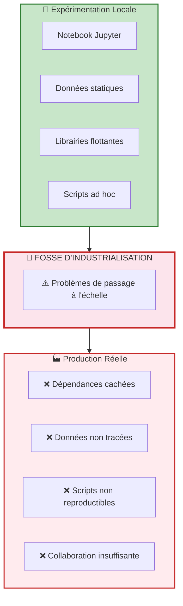
**Fossé d'industrialisation**

---

## Définition et portée de DevOps

### Définition

> "DevOps is the combination of cultural philosophies, practices, and tools that increases an organization's ability to deliver applications and services at high velocity: evolving and improving products at a faster pace than organizations using traditional software development and infrastructure management processes."
>
> — Jabbari, R., & al (2016). What is DevOps?

### Principes clés de DevOps

| Pratique                   | Description                                    |
| -------------------------- | ---------------------------------------------- |
| **Versionnement**          | Git, branches, historique immuable du code     |
| **Tests**                  | Unitaires, intégration, régression automatisés |
| **CI/CD**                  | Livraison continue, déploiements automatisés   |
| **Infrastructure as Code** | Terraform, Ansible, reproductibilité infra     |
| **Monitoring**             | Alertes, logs, observabilité système           |
| **Collaboration Dev/Ops**  | Culture partagée, responsabilité commune       |

Avant l'apparition de DataOps et MLOps, le paradigme dominant pour l'industrialisation logicielle était DevOps. Celui-ci vise à réduire la séparation entre développement et exploitation grâce à l'automatisation, à l'intégration continue, au déploiement continu, au monitoring et à une culture de collaboration.

DevOps reste fondamental. Il fournit des principes structurants :

- automatisation des builds et déploiements ;
- gestion du code source ;
- tests continus ;
- infrastructure comme code ;
- réduction du délai entre développement et mise en production ;
- feedback rapide.

Cependant, les systèmes data et ML introduisent des spécificités que DevOps ne couvre pas complètement.

---

## Pourquoi DevOps ne suffit pas à lui seul

| Problème | Description |
|----------|-------------|
| Le code ne suffit pas à expliquer le comportement | Le même code + données différentes = résultat différent |
| Les données changent en permanence | Schémas, distributions, sources — tout évolue |
| Les modèles dérivent dans le temps | Data drift, concept drift, dégradation silencieuse |
| Les pipelines cassent de façon inattendue | Dépendances fragiles, versions incompatibles |
| Les résultats doivent rester auditables | Conformité réglementaire, responsabilité algorithmique |

Dans un système logiciel classique, le comportement de l'application est principalement déterminé par le code. Dans un système data/ML, le comportement dépend aussi :

- des données d'entrée ;
- des transformations de données ;
- des features générées ;
- des versions de modèles ;
- des paramètres d'entraînement ;
- de la dérive des données et des usages.

Ainsi, même si DevOps fournit une base indispensable, il doit être prolongé par des approches plus spécialisées :

- **DataOps** pour la chaîne de données ;
- **MLOps** pour le cycle de vie du modèle.

---

## Définition et portée de DataOps

### Définition

> "DataOps is a combination of Agile development, DevOps, and lean manufacturing (Statistical Process Control) applied to data science and data engineering."
>
> — Bergh, C. (2017) DataOps Manifesto

**Figure : The intellectual heritage of DataOps**

### Approche DataOps face aux défis

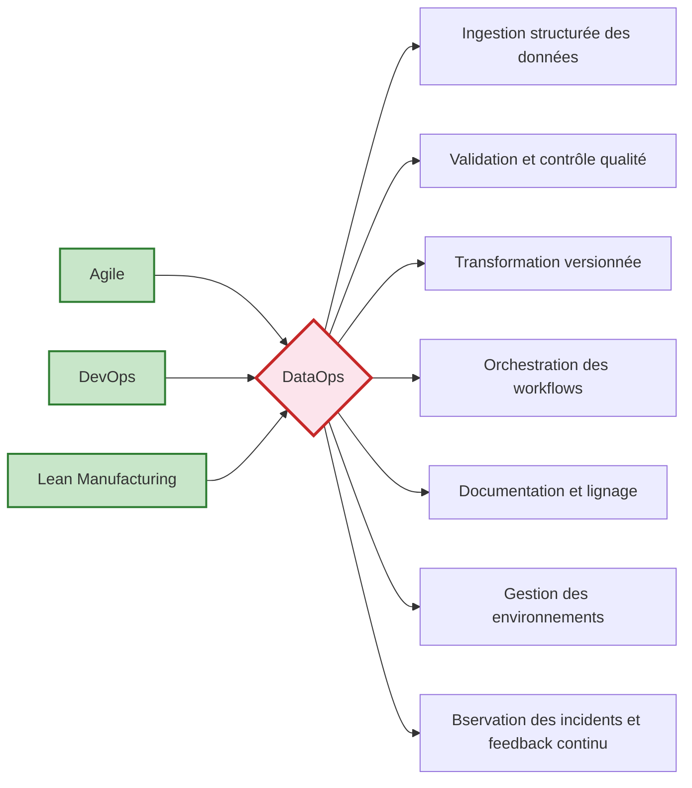
### Démarche DataOps selon Christopher Bergh

Les sept étapes du DataOps selon Christopher Bergh.

### Définition et portée de DataOps (suite)

> "DataOps is a solution to many of the challenges faced by data science and analytics once you realize that converting raw data into useful data products can be treated as an end-to-end assembly line process that requires high levels of collaboration, automation, and continuous improvement."
>
> — Atwal, H. (2019). Practical DataOps

### Objectifs de DataOps

| Objectif | Description |
|----------|-------------|
| **Industrialize** | Les pipelines de données de bout en bout |
| **Quality and Reliability** | Données valides, fraîches, conformes |
| **Faster, Better, Cheaper** | Réduire le délai de mise à disposition |
| **Standardize, Reuse, Refine** | Ne pas réinventer la roue, réutiliser les composants de code et de données |
| **Collaborate, Iterate, Automate** | Travailler ensemble, par cycles, et automatiser tout ce qui peut l'être |

**DataOps** peut être défini comme un cadre d'organisation, d'automatisation et de gouvernance visant à améliorer la livraison, la fiabilité et la qualité des produits de données.

Les objectifs typiques de DataOps sont :

1. réduire le délai entre le besoin métier et la disponibilité d'une donnée exploitable ;
2. augmenter la qualité, la cohérence et la fiabilité des jeux de données ;
3. rendre les pipelines reproductibles et maintenables ;
4. favoriser la collaboration entre métiers, analystes, ingénieurs et décideurs ;
5. permettre des livraisons fréquentes et contrôlées des transformations de données.

DataOps repose sur une idée essentielle : la donnée n'est pas un sous-produit passif. Elle est un **actif vivant**, traversant des chaînes complexes, et doit donc être gérée avec une discipline d'ingénierie.

---

## Définition et portée de DataOps (Harvinder Atwal)

> "DataOps is the alignment of people, process and technology to enable an agile, high-quality, self-service, and efficient data organization."
>
> — Atwal, H. (2019). Practical DataOps

Pour Atwal, cette définition repose sur une interprétation précise du terme "collaboratif" et "flux" :

1. **Le DataOps comme "Usine à Données" (The Data Factory)**

2. **L'alignement des trois composantes**
   - **Les Personnes** : Collaboration entre Data Engineers, Data Scientists et Analystes Métiers.
   - **Le Processus** : Utilisation des méthodes Agile et Lean.
   - **La Technologie** : Automatisation via le DevOps (CI/CD, IaC).

3. **L'objectif ultime : La Confiance (Trust)**

### Démarche de transformation orientée valeur (Atwal)

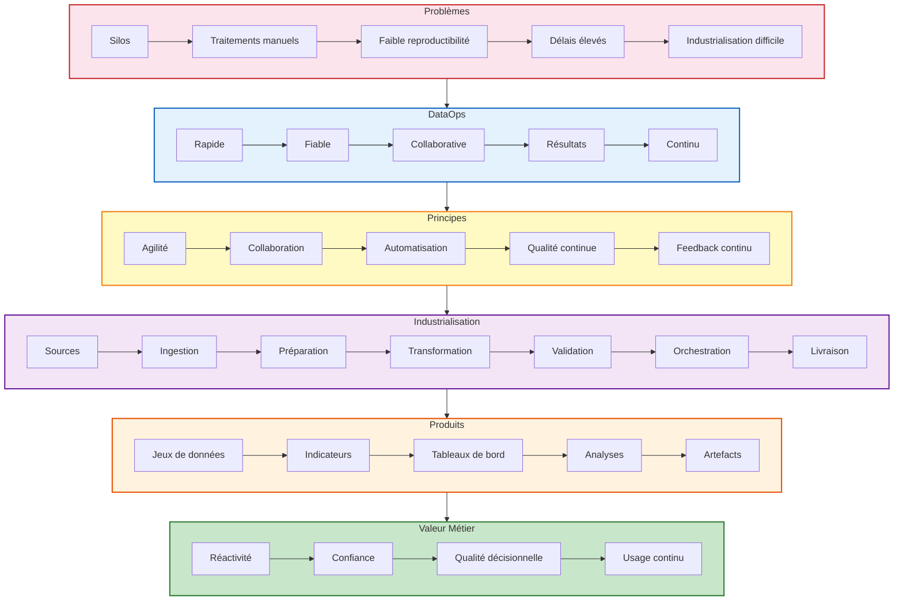

---

## Définition et portée de MLOps

### Définition

> "MLOps is the process of taking a Machine Learning model from a laptop to a production environment where it can be monitored, scaled, and updated automatically."
>
> — Gift et Deza (2021), Practical MLOps

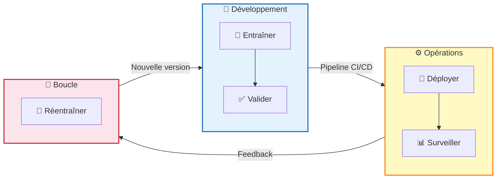

MLOps ne se limite pas au déploiement — il couvre toute la vie du modèle Dev-Prd.

**MLOps = Machine Learning + Operations**

Ensemble de pratiques pour industrialiser et opérationnaliser les systèmes de ML en production.

### Cycle de vie MLOps

MLOps désigne l'ensemble des pratiques permettant d'industrialiser le cycle de vie des modèles de machine learning, depuis l'expérimentation jusqu'au déploiement, à la surveillance et à la réentraînement éventuel.

MLOps ne se réduit pas au déploiement d'un modèle. Il couvre un cycle beaucoup plus large :

1. formulation du problème ;
2. préparation et versionnement des données ;
3. entraînement ;
4. suivi des expériences ;
5. validation ;
6. packaging ;
7. déploiement ;
8. surveillance du modèle en production ;
9. gestion de la dérive ;
10. gouvernance et retrait des modèles obsolètes.

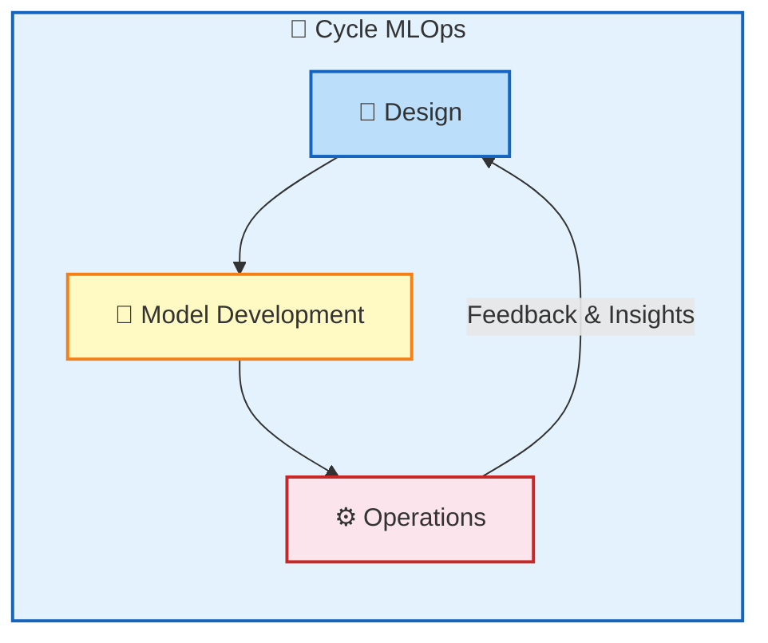

Dans ce cadre, le modèle devient un artefact versionné, comparable à un composant logiciel, mais avec des propriétés supplémentaires :

- il dépend fortement des données ;
- ses performances peuvent décroître dans le temps ;
- son comportement n'est pas déterministe au sens classique ;
- il nécessite souvent des réentraînements ;
- il pose des enjeux de biais, d'explicabilité et de conformité.

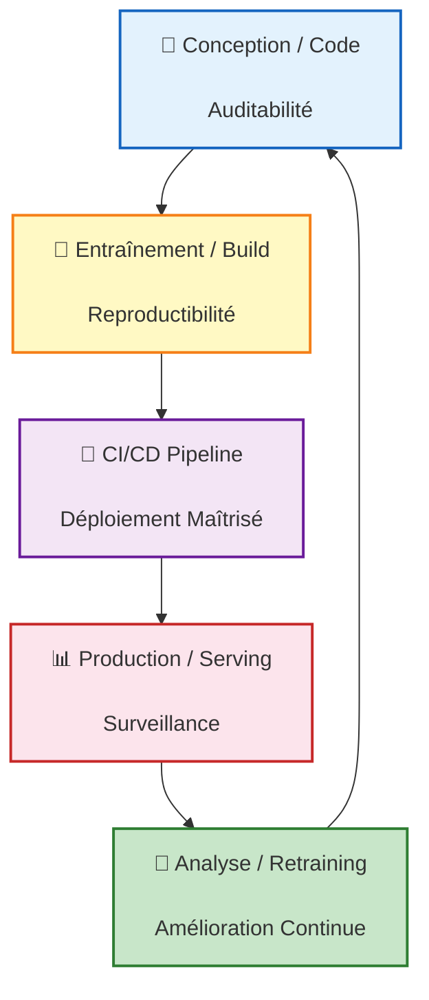
---

## DevOps vs DataOps vs MLOps

| Dimension | DevOps | DataOps | MLOps |
|-----------|--------|---------|-------|
| **Objet principal** | Code applicatif | Pipelines de données | Modèles ML |
| **Finalité** | Livrer du logiciel | Fiabiliser la donnée | Industrialiser le ML |
| **Artefacts** | Builds, releases | Datasets, transformations | Modèles, métriques |
| **Risques clés** | Régression logicielle | Drift de données | Drift de modèle |
| **Pratiques phares** | CI/CD, tests unitaires | Data quality, lineage | Experiment tracking, registry |
| **Temporalité** | Cycle logiciel | Flux de données continus | Cycle du modèle + évolution des données |

### Synthèse des périmètres

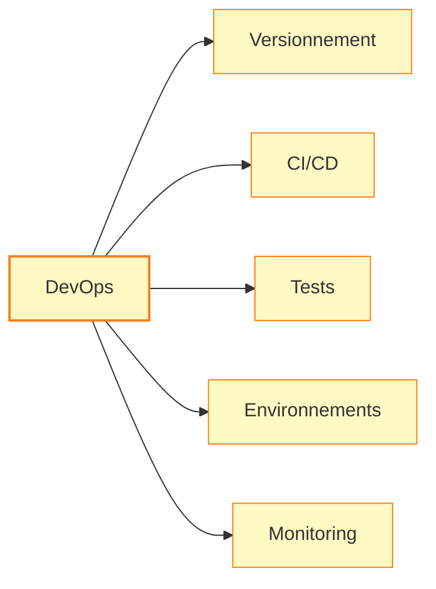
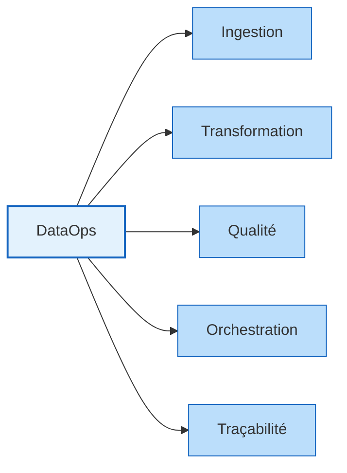
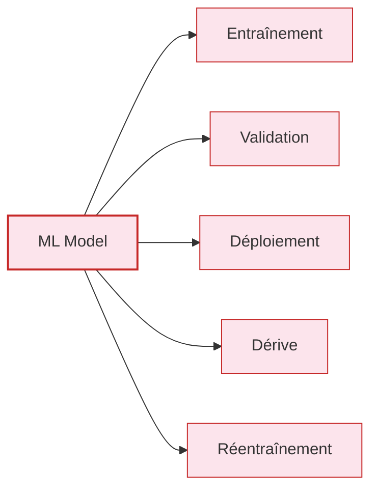
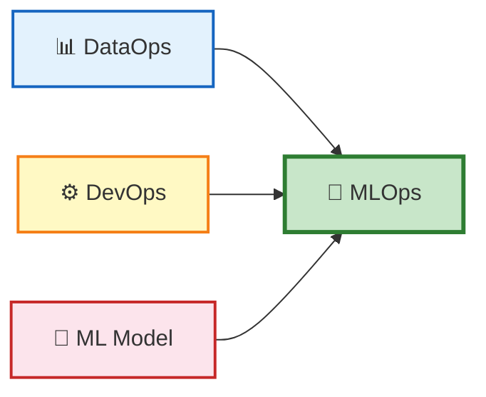
---

## La hiérarchie des besoins en MLOps

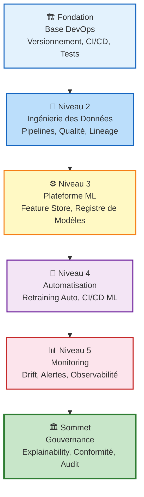

---

## L'apport de l'agilité dans DataOps

Dans son livre, Atwal (2019) nous montre que les approches data échouent souvent lorsqu'elles sont conçues comme des projets linéaires et massifs, avec spécification exhaustive initiale, faible feedback et livraison tardive.

Or, les produits data évoluent dans des environnements incertains :

- les besoins métier changent ;
- les sources de données évoluent ;
- les hypothèses analytiques se révisent ;
- les métriques doivent être rediscutées ;
- la valeur se découvre progressivement.

L'agilité appliquée à DataOps implique :

- des itérations courtes ;
- des incréments de valeur ;
- une validation fréquente avec les parties prenantes ;
- une intégration continue des retours ;
- une réduction du gaspillage ;
- une capacité d'adaptation rapide.

Il ne s'agit pas d'appliquer mécaniquement Scrum ou Kanban à la donnée. Il s'agit plutôt d'adopter une culture de flux, de feedback et d'amélioration continue.

Dans un contexte DataOps, l'agilité suppose notamment :

- de livrer un pipeline minimal mais fiable avant un pipeline complexe et fragile ;
- de mesurer la qualité et les délais ;
- de traiter rapidement les incidents ;
- de maintenir un dialogue constant entre technique et métier.

Chez Harvinder Atwal, DataOps est présenté comme une démarche d'industrialisation de la chaîne analytique visant à produire rapidement des résultats fiables et utiles au métier. Les 18 principes du DataOps Manifesto permettent de formaliser cette logique autour de la valeur, de la collaboration, de l'automatisation, de la reproductibilité, de la qualité et de l'amélioration continue.

```mermaid
flowchart TD
    A["PRINCIPES DataOps"] --> B["💎 Valeur Métier"]
    A --> C["🤝 Collaboration"]
    A --> D["🏭 Industrialisation"]
    A --> E["📈 Qualité, Mesure, Amélioration"]
    
    B --> B1["✅ Satisfaire le client"]
    B --> B2["🔄 Livrer de la valeur continue"]
    B --> B3["🔀 Accepter le changement"]
    
    C --> C1["👥 Travail d'équipe"]
    C --> C2["💬 Interactions quotidiennes"]
    C --> C3["🔄 Auto-organisation"]
    C --> C4["🦸 Réduire le Heroism"]
    C --> C5["🧠 Réflexion continue"]
    
    D --> D1["📝 Analytics as Code"]
    D --> D2["⚙️ Orchestration"]
    D --> D3["🔁 Reproductibilité"]
    D --> D4["🧪 Environnements jetables"]
    D --> D5["🎯 Simplicité"]
    D --> D6["🏭 Analytique comme production"]
    
    E --> E1["✅ Qualité primordiale"]
    E --> E2["📊 Monitoring continu"]
    E --> E3["♻️ Réutilisation"]
    E --> E4["⏱️ Amélioration des temps de cycle"]
    
    style A fill:#e3f2fd,stroke:#1565c0,stroke-width:3px
    style B fill:#c8e6c9,stroke:#2e7d32,stroke-width:2px
    style C fill:#fff9c4,stroke:#f57f17,stroke-width:2px
    style D fill:#f3e5f5,stroke:#6a1b9a,stroke-width:2px
    style E fill:#fce4ec,stroke:#c62828,stroke-width:2px
```

---

## Cycle de vie d'un projet data/ML

Les systèmes data et ML suivent un cycle de vie complet, dont chaque étape a des exigences propres.

1. **Cadrage du besoin** : On identifie le problème métier, les indicateurs de succès, les contraintes, les acteurs impliqués et les conditions d'usage.

2. **Acquisition et préparation des données** : Les données sont collectées, qualifiées, nettoyées, transformées et documentées.

3. **Construction des pipelines** : Les transformations sont codifiées, versionnées, orchestrées et testées.

4. **Expérimentation et entraînement** : Les modèles sont entraînés, comparés, évalués et tracés.

5. **Validation** : On vérifie non seulement la performance, mais aussi la robustesse, la conformité, la cohérence des entrées/sorties et l'aptitude au déploiement.

6. **Déploiement** : Le modèle ou le pipeline est intégré dans un environnement opérationnel.

7. **Monitoring et observabilité** : On surveille la qualité des données, les performances du modèle, la latence, les erreurs, la dérive, les incidents.

8. **Maintenance et amélioration continue** : Le système est ajusté, réentraîné, refactorisé ou retiré si nécessaire.

Cette lecture en cycle de vie permet d'éviter une vision fragmentée du projet. Elle prépare directement les chapitres ultérieurs du module.

---

## Reproductibilité, traçabilité et gouvernance

Trois notions doivent être placées au centre de toute démarche MLOps et DataOps :

**Est-ce le même résultat ?**
1. **Reproductibilité** : La reproductibilité est la capacité à réexécuter un pipeline, une expérience ou un entraînement dans les mêmes conditions et à obtenir un résultat cohérent, grâce à la maîtrise des versions de données, de code, de paramètres et d’environnement.
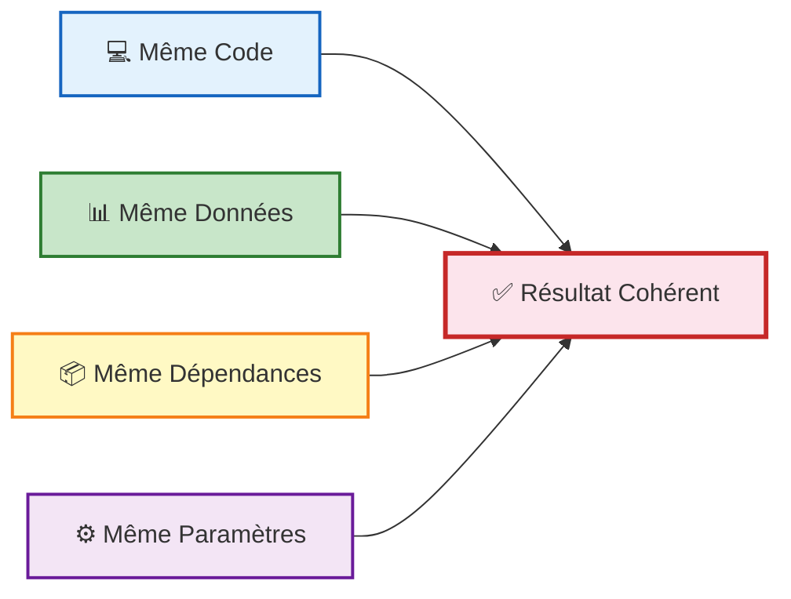
**D’où vient ce résultat ?**
2. **Traçabilité** : La traçabilité est la capacité à relier un résultat à l’ensemble des éléments qui l’ont produit : données, transformations, code, modèle, versions, paramètres, auteurs et décisions de validation.
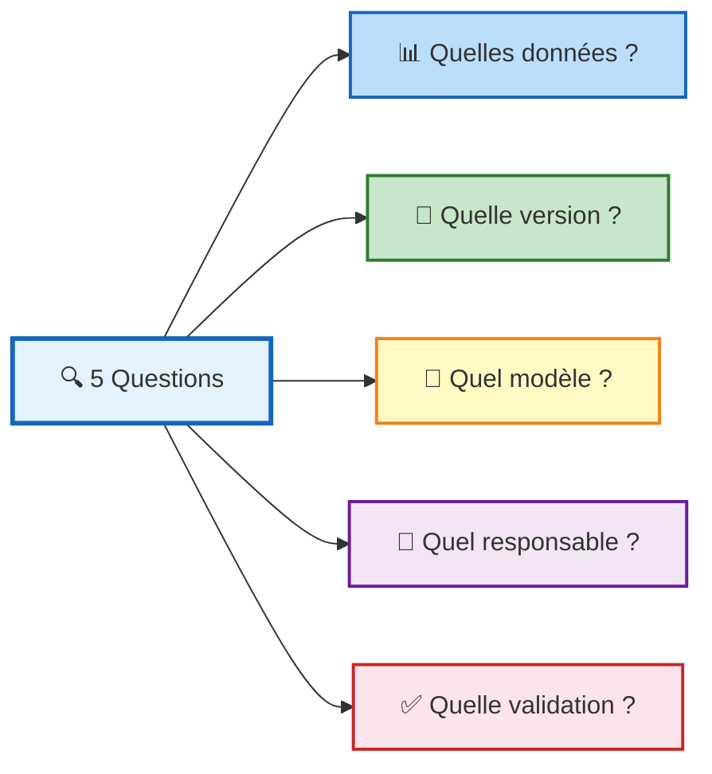
**Pour qui est ce résultat ?**
2. **Gouvernance** : La gouvernance des données regroupe les règles, responsabilités, processus et contrôles mis en place pour garantir la qualité, la sécurité, la conformité, l’accessibilité et le bon usage des données dans une organisation.
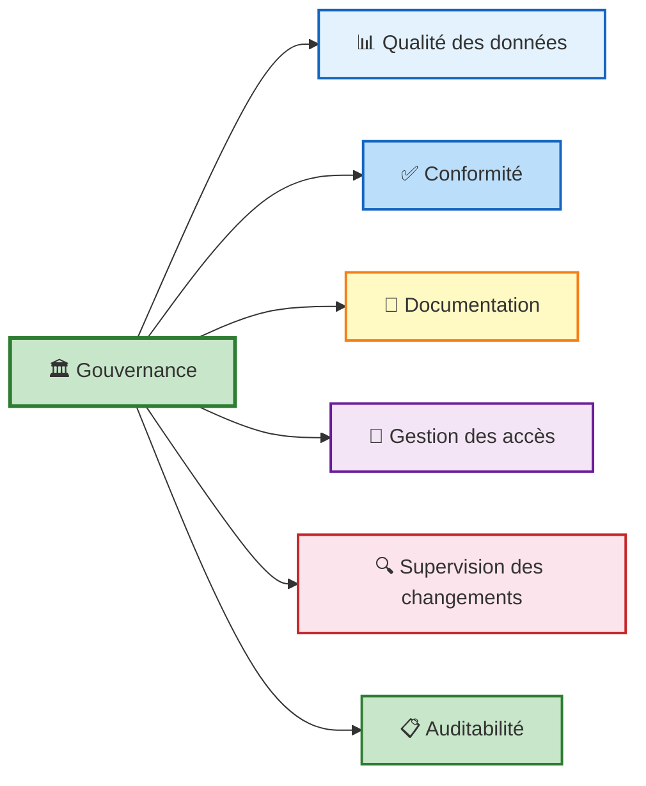

---

## De la donnée au service : la notion de produit

L'une des évolutions importantes des pratiques contemporaines consiste à considérer les pipelines, les jeux de données transformés et les modèles comme des produits plutôt que comme de simples livrables ponctuels.

Un produit data ou ML possède :

- des utilisateurs identifiés ;
- un niveau de service attendu ;
- une documentation ;
- un cycle de maintenance ;
- des métriques de qualité ;
- des responsables explicites.

Cette logique de produit change profondément la manière de travailler :

- on conçoit pour l'usage durable, non pour la démonstration ponctuelle ;
- on pense à la maintenance dès la conception ;
- on documente ;
- on mesure la qualité de service ;
- on planifie l'évolution.

Cette idée relie DataOps et MLOps à la gouvernance, à la responsabilisation des équipes et à la transformation numérique des organisations.

---

## AIOps & LLMOps

### AIOps

> "AIOps combines big data and machine learning to automate IT operations processes, including data ingestion, event correlation analysis, anomaly detection, and root cause determination."
>
> — Gartner (2017)

Intelligence artificielle au service des opérations IT :

- Détection automatique d'anomalies système
- Analyse prédictive des incidents
- Corrélation automatique d'alertes
- Réduction du bruit opérationnel

### LLMOps

> "LLMOps is a set of practices and tools for managing the lifecycle of applications powered by Large Language Models (LLMs), including development, deployment, and maintenance."
>
> — Databricks Glossary (2023)

Exploitation maîtrisée des systèmes à base de LLM :

- Prompt versioning & evaluation
- RAG pipelines et gestion du contexte
- Guardrails, safety et monitoring LLM
- Fine-tuning et gestion des coûts

---

# CHAPITRE 2 : PIPELINES AGILES & ORCHESTRATION

## Contenu

- Versionnement données & artefacts (Git, DVC)
- DVC pipelines : stages, remotes, reproductibilité
- Orchestration : Airflow (DAGs, scheduling, retries) + aperçu Dagster