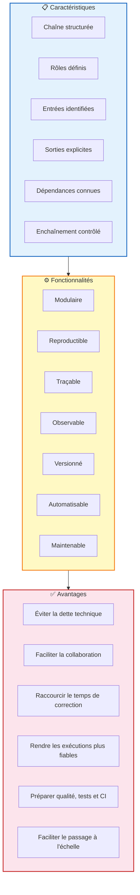
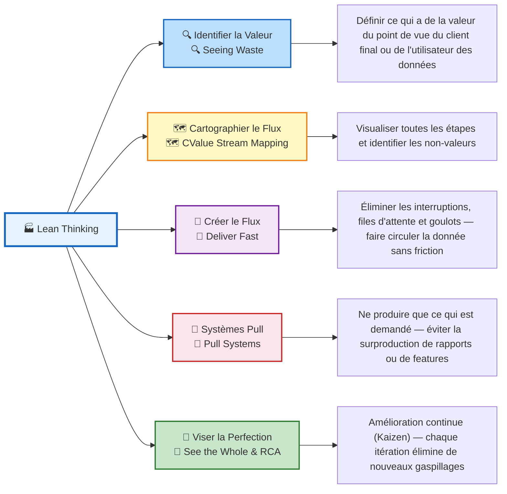
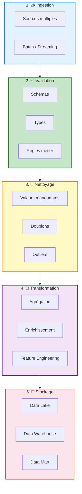
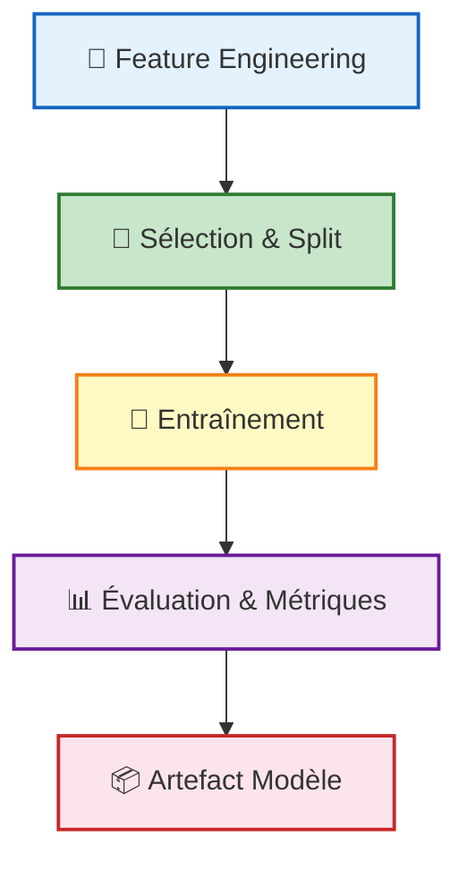
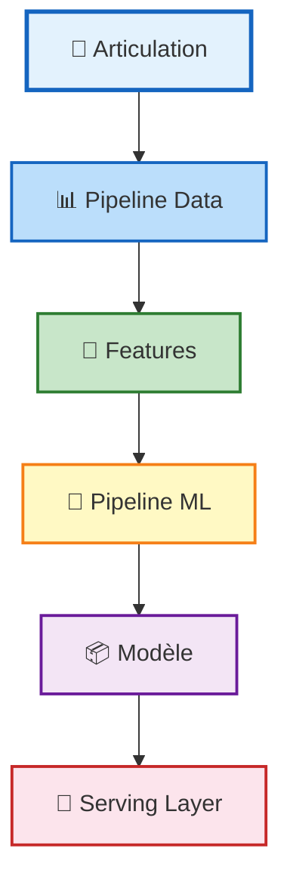
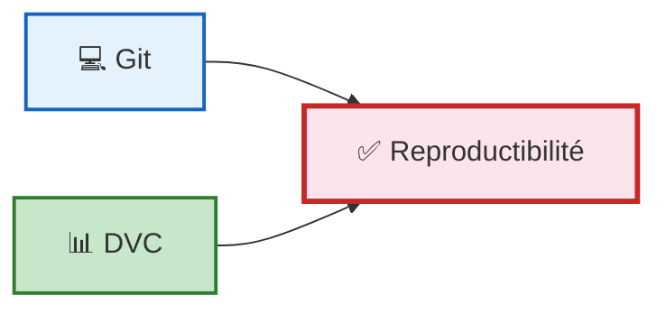
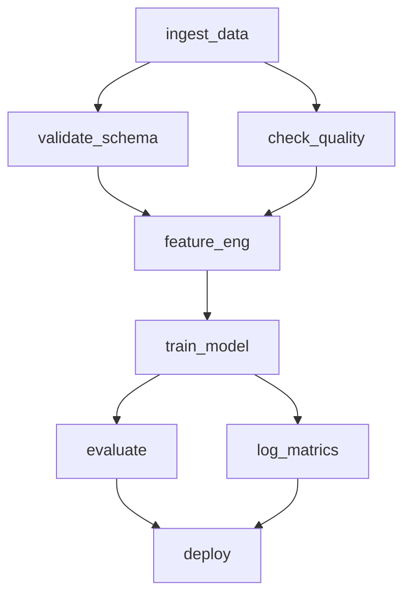
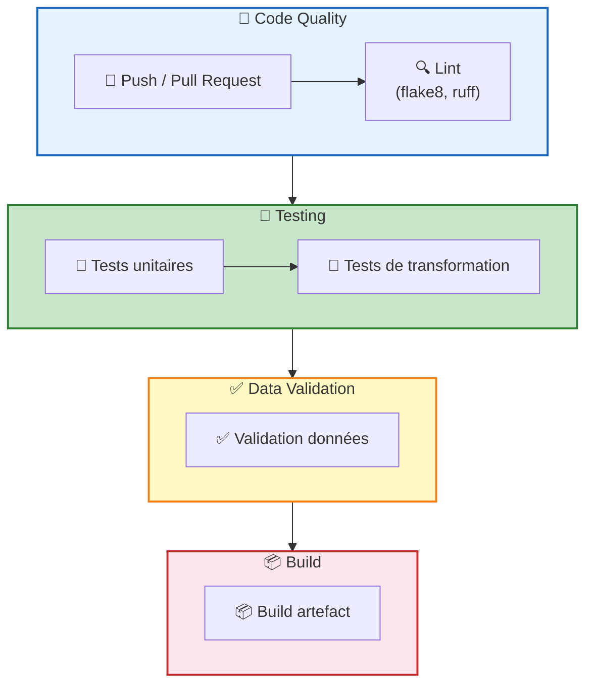

# CHAPITRE 2 : PIPELINES AGILES & ORCHESTRATION

**Pr. Mohammed AIT DAOUD**

---

## PLAN DU MODULE

- Chapitre 1 : Fondamentaux DataOps & MLOps
- **Chapitre 2 : Pipelines agiles & orchestration**
- Chapitre 3 : Qualité & tests de données
- Chapitre 4 : Pipelines reproductibles & MLflow + Azure ML CLI
- Chapitre 5 : CI/CD, conteneurisation et déploiement des services ML
- Chapitre 6 : Monitoring, observabilité, gouvernance et ouverture vers LLMOps
- Projet intégrateur

---
## Objectifs

- Caractériser un pipeline data/ML industrialisé et le distinguer d'une approche artisanale
- Appliquer le Lean Thinking pour identifier la valeur et cartographier les flux de données
- Mobiliser les pratiques Agile et les principes DataOps dans un projet data/ML
- Versionner l'ensemble des artefacts d'un pipeline : code, données, configs, modèles
- Configurer des environnements reproductibles et maîtriser les dépendances
- Concevoir un pipeline orchestré, résilient et supervisé
- Intégrer la Continuous Integration dans un workflow pipeline data/ML

## Contenu

- Pourquoi les pipelines ?
- Lean Thinking appliqué aux systèmes data/ML
- Agile Collaboration appliquée à DataOps
- Pipelines de données et pipelines ML
- Versionnement étendu
- Environnements reproductibles
- Orchestration des pipelines
- Continuous Integration appliquée aux pipelines
- Modularité, réutilisation et automatisation

---

## Introduction

L'un des problèmes centraux des projets data/ML ne réside pas uniquement dans les modèles eux-mêmes, mais dans la manière dont les traitements sont organisés. Dans de nombreux contextes, les équipes produisent des résultats pertinents sans pour autant disposer d'un système robuste : les scripts sont dispersés, les données changent sans contrôle, les dépendances ne sont pas documentées, les exécutions ne sont pas reproductibles, et les livrables dépendent fortement des individus qui les manipulent.

> **« Industrialiser un système data ou ML, ce n'est pas seulement produire un bon résultat ; c'est construire un flux fiable, traçable, reproductible et gouvernable. »**

---

## De l'approche artisanale à l'approche industrialisée

Les approches artisanales reposent souvent sur :

- des scripts dispersés, des données non contrôlées, des dépendances peu documentées, des exécutions difficilement reproductibles.

Cette situation rend les systèmes fragiles, surtout lorsque le projet grandit ou doit être audité.

L'industrialisation commence par la mise en pipeline :

- entrées explicites, étapes définies, sorties contrôlées, dépendances maîtrisées, versions traçables, exécution reproductible.

Les approches Lean et Agile permettent de transformer ces traitements en un flux de valeur structuré, fiable et améliorable.

### Ce qui fonctionne une fois ne fonctionne pas forcément durablement

| Approche Artisanale | Approche Industrialisée |
|---------------------|------------------------|
| Scripts isolés | Pipeline structuré |
| Exécution manuelle | Exécution contrôlée |
| Dépendance aux individus | Processus partagé |
| Faible traçabilité | Versions et artefacts suivis |
| Environnement implicite | Environnement reproductible |
| Erreurs tardives | Vérifications intégrées |
| Échelle difficile | Robustesse et évolutivité |

**Passer du prototype utile au flux maîtrisé**

---

## Comparaison structurelle : Artisanal vs. Pipeline industrialisé

| Approche Artisanale | Pipeline Industrialisé |
|---------------------|----------------------|
| Notebook Jupyter manuel | Pipeline modulaire déclaratif |
| Exécution séquentielle manuelle | Déclenchement automatique / scheduling |
| Code non versionné (ou partiel) | Code + données + configs versionnés |
| Environnement "local" | Environnement reproductible documenté |
| Pas de tests | Tests unitaires, d'intégration, de données |
| Pas de logs structurés | Logs, métriques, alertes |
| Difficile à partager | Réutilisable, partageable, maintenable |

---

## Pipeline industrialise


## Lean Thinking appliqué aux systèmes data/ML

### Définition

> "Le Lean Thinking est une philosophie de management visant à maximiser la valeur livrée au client en éliminant systématiquement tout ce qui ne contribue pas directement à cette valeur (le « muda » — 'uselessness' ou inutilité)."
>
> — Atwal, H. (2019). Practical DataOps



### Les 7 Types de gaspillages dans les systèmes data/ML

| Type de gaspillage                     | Manifestation dans un système data/ML                                                                  |
| -------------------------------------- | ------------------------------------------------------------------------------------------------------ |
| **Surproduction (Overproduction)**     | Générer des reports, features ou modèles non demandés                                                  |
| **Attente (Waiting)**                  | Données bloquées en attente de validation manuelle ou de droits d'accès                                |
| **Transport inutile (Transportation)** | Copie de datasets entre environnements sans nécessité                                                  |
| **Sur-traitement (Overprocessing)**    | Enrichissements excessifs sans valeur ajoutée pour l'usage final                                       |
| **Défauts (Defects)**                  | Données corrompues propagées silencieusement dans le pipeline                                          |
| **Excès de mouvement (Excess motion)** | Faire bouger les personnes et les équipements plus que nécessaire gaspille du temps et de l'énergie    |
| **Inventaire (Inventory)**             | L'accumulation de travaux en cours ou de livrables stockés résulte de l'attente et de la surproduction |
### Principes Lean appliqués aux systèmes data/ML

| Principe                | gaspillage resoudre                                         | Application                                                                                                                                                                                                                                                                          |
| ----------------------- | ----------------------------------------------------------- | ------------------------------------------------------------------------------------------------------------------------------------------------------------------------------------------------------------------------------------------------------------------------------------ |
| **Deliver Fast**        | Waiting, Excess motion                                      | Livrer fréquemment et en petits incréments. Réduire les batchs de traitement — less work in progress. Feedback rapide = détection précoce des erreurs. Application DataOps : pipeline qui livre un modèle ou un rapport dès que les données sont prêtes, sans intervention manuelle. |
| **Pull Systems**        | Overproduction, Transportation, Over-processing , Inventory | Ne produire que ce qui est demandé en aval. Éviter la surproduction de features ou de datasets non consommés. Application : pipeline déclenché à la demande (event-driven) plutôt que push planifié sans destinataire.                                                               |
| **Root Cause Analysis** | Defects                                                     | Ne pas corriger le symptôme mais la cause racine. 5 Pourquoi (5 Whys) appliqué aux défauts de données. Ex : si un modèle dérive → analyser la source des données, pas seulement re-entraîner. Principe : See the Whole — regarder le système, pas juste le composant défaillant.     |
| **See the Whole**       |                                                             | Éviter l'optimisation locale isolée. Considérer dépendances et délais. Considérer maintenabilité et impact global. Un gain local peut devenir une perte globale.                                                                                                                     |

**Aller plus vite utilement | Ne pas tout traiter, tout le temps, sans raison | Corriger un symptôme n'améliore pas le système | Performance globale > optimisation locale**

---

## Agile Collaboration appliquée à DataOps

### Définition

> "L'Agile dans le contexte du DataOps est l'application de frameworks de développement itératifs (comme Scrum et Kanban) et de valeurs collaboratives à l'ensemble du cycle de vie de la data science. Son objectif est d'éliminer les inefficacités de la gestion de projet traditionnelle, permettant aux équipes de données de travailler sur les bonnes choses pour les bonnes parties prenantes et de livrer continuellement des produits de données analytiques de valeur."
>
> — Atwal, H. (2019). Practical DataOps

| Agile ne signifie pas         | Agile signifie                       |
| ----------------------------- | ------------------------------------ |
| Coder sans structure          | Itérer avec méthode                  |
| Supprimer toute documentation | Conserver une discipline             |
| Changer sans contrôle         | Documenter utilement                 |
| Travailler sans vision        | Adapter avec feedback                |
|                               | Améliorer le système progressivement |
### Problèmes des projets data/ML en mode waterfall

- Spécifications initiales figées ≠ réalité des données
- Long délai avant la première livraison de valeur
- Découverte tardive des problèmes de qualité
- Silos entre data scientists, ingénieurs et métier
- Incertitude inhérente à la data science ignorée

### 4 Valeurs Agile (Manifeste Agile)

- **Individus et interactions** plus que processus et outils
- **Logiciel/pipeline fonctionnel** plus que documentation exhaustive
- **Collaboration avec le client** plus que négociation contractuelle
- **Réponse au changement** plus que suivi d'un plan

### Application de l'Agilité au DataOps

Agile permet de gérer l'incertitude inhérente aux projets data : les données changent, les besoins évoluent, les modèles dérivent. Des sprints courts (1-2 semaines) permettent d'ajuster les pipelines rapidement, d'intégrer le feedback des utilisateurs de données, et d'éviter de construire le mauvais pipeline.

### DataOps Manifesto (18 principes — DataKitchen, 2021)

| N°  | Principe                                | Explication                                                                                                                     |
| --- | --------------------------------------- | ------------------------------------------------------------------------------------------------------------------------------- |
| 1   | Satisfaire continuellement le client    | Livrer en continu des analyses et résultats qui répondent aux besoins réels des utilisateurs.                                   |
| 2   | Valoriser l'analytique fonctionnelle    | La priorité est de produire une analytique utile, exploitable et créatrice de valeur.                                           |
| 3   | Accueillir le changement                | Les besoins, les données et les usages évoluent ; le système doit pouvoir s'adapter rapidement.                                 |
| 4   | C'est un sport d'équipe                 | La valeur analytique est produite par une collaboration entre métiers, analystes, ingénieurs et opérations.                     |
| 5   | Interactions quotidiennes               | Les échanges fréquents entre acteurs réduisent les malentendus et accélèrent les ajustements.                                   |
| 6   | Auto-organisation                       | Les équipes doivent pouvoir s'organiser efficacement autour du flux de travail et de la résolution des problèmes.               |
| 7   | Réduire l'héroïsme                      | Le système ne doit pas dépendre d'une ou deux personnes "indispensables" ; il doit être partagé et maîtrisé collectivement.     |
| 8   | Réfléchir et s'améliorer                | Les équipes doivent régulièrement analyser leurs pratiques pour améliorer le flux, la qualité et la vitesse.                    |
| 9   | L'analytics est du code                 | Les traitements analytiques doivent être conçus avec une discipline d'ingénierie comparable à celle du développement logiciel.  |
| 10  | Orchestrer                              | Les tâches analytiques doivent être coordonnées, planifiées et pilotées dans un workflow maîtrisé.                              |
| 11  | Rendre les résultats reproductibles     | Une exécution analytique doit pouvoir être rejouée dans des conditions cohérentes et vérifiables.                               |
| 12  | Environnements jetables                 | Les environnements doivent être recréables facilement afin de limiter les effets de dérive et les dépendances implicites.       |
| 13  | Simplicité                              | Il faut éviter la complexité inutile et privilégier les solutions lisibles, maintenables et compréhensibles.                    |
| 14  | L'analytics est une forme de production | L'analytique doit être pensée comme un flux de production, avec des entrées, des transformations, des contrôles et des sorties. |
| 15  | La qualité est primordiale              | La qualité des données, des traitements et des sorties doit être intégrée au cœur du processus.                                 |
| 16  | Surveiller la qualité et la performance | Il faut mesurer en continu la qualité du pipeline et ses performances pour détecter les dérives ou points faibles.              |
| 17  | Réutiliser                              | Les composants, traitements et patterns efficaces doivent être réemployés pour gagner en cohérence et en efficacité.            |
| 18  | Améliorer les temps de cycle            | L'objectif est de réduire le délai entre le besoin et la livraison d'un résultat analytique fiable.                             |

---

## Agile Collaboration appliquée à DataOps

### 8 Principes opérationnels clés du DataOps inspirés du DataOps Manifesto (AIT DAOUD, 2025)

1. **Livrer rapidement et fréquemment de la valeur analytique**
2. **Collaborer en continu entre métiers, data et opérations**
3. **S'adapter au changement et favoriser l'amélioration continue**
4. **Tester, mesurer et surveiller en continu la qualité et la performance**
5. **Automatiser, simplifier et réutiliser autant que possible**
6. **Orchestrer et reproduire les pipelines et les environnements**
7. **Industrialiser l'analytics = processus d'ingénierie et de production**
8. **Partager la responsabilité et la transparence => pas d'héroïsme**

**Objectif :** Accélérer la livraison de valeur analytique tout en améliorant la qualité, la collaboration, la reproductibilité et la robustesse des pipelines.

---

## Pipelines de données et pipelines ML

### Pipeline de données

> **Définition :** Un pipeline de données est une chaîne structurée d'étapes automatisées qui ingère, transforme et prépare des données brutes pour les rendre exploitables de manière fiable et traçable.
>
> — AIT DAOUD, M. (2025)   IBM (What is a data pipeline?)

**Étapes typiques d'un pipeline de données :**



### pipelines de donnees et Pipelines ML

> **Définition :** Un pipeline ML est une chaîne structurée d'étapes automatisées qui transforme des données préparées en modèle déployable et évaluable, avec traçabilité des versions, métriques et artefacts.
>
> — AIT DAOUD, M. (2025)  <=>  IBM (What is a ML pipeline?)



---

## Articulation : Pipelines de données VS pipelines ML

| Critère | Pipeline de données | Pipeline ML |
|---------|--------------------|-------------|
| **Objectif principal** | Rendre des données disponibles et exploitables | Produire un modèle évalué et déployable |
| **Déclencheur** | Schedule, événement de nouvelles données | Nouveau dataset, dérive détectée, CI |
| **Sortie principale** | Table/fichier enrichi, rapport | Modèle (.pkl, .onnx), métriques, rapport |
| **Qui le consomme ?** | Scientist, Analystes, BI tools, applications | API d'inférence, batch scoring |
| **Critère de succès** | Fraîcheur, complétude, qualité des données | Précision, latence, robustesse du modèle |
| **Outils typiques** | Git/GitHub, Dbt, Airflow ou Dagster | MLflow, Kubeflow, DVC, Prometheus/Grafana |
| **Interdépendance** | Alimente le pipeline ML en features | Dépend du pipeline de données en amont |



---

## Versionnement étendu

### Pourquoi le versionnement du code seul est insuffisant ?

Un modèle ML n'est pas seulement du code. Sa reproductibilité dépend aussi de la version des données d'entraînement, des hyperparamètres, de l'environnement de calcul et des transformations appliquées. Sans versionnement de ces éléments, reproduire un résultat est impossible.

### Ce qu'il faut versionner dans un système data/ML

| Élément        | Outil                  | Contenu                                           |
| -------------- | ---------------------- | ------------------------------------------------- |
| Code           | **Git**                | Scripts, notebooks, configs applicatives          |
| Données        | **DVC / Delta Lake**   | Raw data, datasets transformés, splits train/test |
| Configurations | **Git + YAML**         | Hyperparamètres, paramètres de pipeline           |
| Schémas        | **Great Expectations** | Schémas de données, contrats de données           |
| Artefacts      | **MLflow Artifacts**   | Modèles sérialisés, fichiers de features          |
| Modèles        | **MLflow Registry**    | Versionner avec métadonnées et métriques          |
| Environnements | **Docker / Conda**     | Images Docker, requirements.txt, env.yaml         |


### Git — Versionnement du code

- Pipelines, scripts, modules Python
- Fichiers de configuration (YAML, JSON)
- Requirements, Dockerfile
- Notebooks (avec précaution)
- Résultats de tests, rapports légers

**Avantages :**
- Diff ligne par ligne
- Branches, merge, blame, tag

**Limite :** 
- Ne pas versionner les gros fichiers binaires (datasets, modèles) directement dans Git

### DVC — Versionnement des données

- Datasets volumineux (S3, GCS, Azure Blob...)
- Modèles sérialisés (.pkl, .onnx)
- Splits train/validation/test
- Fichiers de features pré-calculées
- Snapshots de pipelines de transformation

**Avantages :**
- Stockage distant
- Fichiers .dvc pointer dans Git
- Reproductibilité totale

**Principe :** 

- Git trace le qui/quand/pourquoi
- DVC trace le quoi (données)

---

## Environnements reproductibles

**Problème :** "Ça marche sur mon laptop"  **Bon prototype ≠ Bon système** "Ça marche pas sur mon serveur"

L'absence d'environnement maîtrisé est la première cause d'irreproductibilité dans les projets data/ML. Versions Python, bibliothèques, CUDA, OS : toute divergence peut invalider un résultat.


### Niveaux de maîtrise de l'environnement

| Niveau | Description |
|--------|-------------|
| **Dépendances explicites** (requirements.txt / setup.cfg) | Lister toutes les dépendances avec leurs versions exactes (pip freeze). Nécessaire mais insuffisant. |
| **Environnement virtuel** (venv / Conda / Poetry) | Isoler chaque projet dans son propre environnement. Évite les conflits entre projets sur le même serveur. |
| **Fichier d'environnement déclaratif** (environment.yml / Pipfile) | Décrire l'environnement complet de manière reproductible et versionnable dans Git. |
| **Conteneurisation** (Docker / Podman) | Encapsuler l'OS, les dépendances et le code dans une image immuable. Reproductibilité maximale. |

---

## Orchestration des pipelines

### Définition

> "L'orchestration est la capacité à coordonner automatiquement l'exécution des étapes d'un pipeline selon des dépendances définies, un scheduling, avec gestion des erreurs, relances automatiques et supervision centralisée."
>
> — Atwal, H. (2019). Practical DataOps

### Automatisation simple (cron) vs Orchestration

| Automatisation simple (cron) | Orchestration (ex : Airflow ou Dagster) |
|------------------------------|----------------------------------------|
| Pas de gestion de dépendances entre tâches | DAG de dépendances entre tâches |
| Pas de retry automatique en cas d'échec | Retry configurable par tâche (n fois) |
| Pas de visualisation du statut d'exécution | Interface web de monitoring |
| Pas de logs centralisés | Logs structurés par run et par tâche |
| Pas d'alertes configurables | Alertes (email, Slack) en cas d'échec |
| | Parallélisation automatique des tâches indépendantes |

### Orchestrateurs courants dans l'écosystème data/ML

- **Apache Airflow** (DAG Python, le plus répandu)
- **Prefect** (Python-native, cloud-friendly)
- **Dagster** (assets-oriented, data-aware)
- **Metaflow** (Netflix, ML-native)
- **Kubeflow Pipelines** (Kubernetes-native, ML)

### DAG (Directed Acyclic Graph)

> **Définition :** Un DAG (Directed Acyclic Graph, ou Graphe Orienté Acyclique en français) est une structure de données modélisant des tâches orientées (dans un seul sens) sans boucle de retour. Essentiels en ingénierie de données et informatique, les DAGs définissent l'ordre d'exécution (dépendances) et permettent de paralléliser les processus.
>
> — Atwal, H. (2019). IBM (Qu'est-ce qu'un DAG ?)

**Exemple de DAG de pipeline ML :**



---

## Continuous Integration appliquée aux pipelines

### Définition

> "La CI est la pratique qui consiste à intégrer automatiquement les changements de code dans un dépôt partagé, en déclenchant une suite de contrôles (tests, linting, validation) à chaque commit ou pull request."
>
> — Atwal, H. (2019). IBM (Qu'est-ce qu'un DAG ?)

### Workflow CI typique pour un pipeline data/ML



### Contrôles intégrables dans un pipeline CI data/ML

| Type de contrôle | Outil(s) typique(s) | Ce que ça vérifie |
|-----------------|-------------------|------------------|
| Linting | flake8, ruff, pylint | Conformité du style et des bonnes pratiques Python |
| Tests unitaires | pytest | Comportement des fonctions de transformation, parsing |
| Tests de transformation | pytest + fixtures | Résultat des étapes clés du pipeline sur petits datasets |
| Validation de config | jsonschema, pydantic | Structure et types des YAML/JSON de configuration |
| Structure projet | scripts bash / pytest | Présence des fichiers obligatoires, conventions de nommage |
| Tests sur mini-dataset | pytest + DVC repro | Reproductibilité de bout en bout sur un sous-ensemble |

---

## CI avec GitHub Actions

```yaml
name: ML Pipeline CI
on: [push, pull_request]

jobs:
  test:
    runs-on: ubuntu-latest
    steps:
      - uses: actions/checkout@v3
      - name: Setup Python
        uses: actions/setup-python@v4
      - name: Install deps
        run: pip install -r requirements.txt
      - name: Lint
        run: ruff check
      - name: Test pipeline
        run: pytest tests/ -v
      - name: Validate data schema
        run: python scripts/validate_schema.py
```

**Principe clé :** Chaque push déclenche automatiquement la validation complète du pipeline. Un pipeline qui ne passe pas les tests ne peut pas être mergé.

---

## Modularité · Réutilisation · Automatisation maîtrisée

**Principe fondamental :** On n'automatise pas le chaos. Il faut d'abord comprendre, simplifier et standardiser, puis automatiser.

### Modularité

- Décomposer le pipeline en composants indépendants
- Chaque module a une seule responsabilité (SRP)
- Un module = une fonction, un script, une tâche Airflow
- Testable indépendamment
- Remplaçable sans impacter le reste

### Réutilisation

- Bibliothèques internes de transformations communes
- Templates de pipelines standardisés
- Ne pas réécrire ce qui existe déjà et fonctionne
- Simplify and Reuse (Atwal, Chap. 7)
- Industrialiser = capitaliser sur l'existant validé

### Automatisation progressive

- Automatiser les tâches répétitives à fort volume
- Commencer manuel → scripts → pipeline → CI/CD
- Ne jamais automatiser avant de comprendre
- Chaque automation doit être testée et monitorée
- Platform Automation (Gift & Deza, Chap. 1)

---

## Architecture de référence — Git + DVC + Orchestrateur + CI

### Composants de l'architecture

1. **Git** : Versionnement du code, des configurations, des notebooks
2. **DVC** : Versionnement des données et des modèles
3. **Orchestrateur** (Airflow / Dagster) : Coordination des pipelines
4. **CI** (GitHub Actions / GitLab CI) : Validation automatique
5. **Registre** (MLflow) : Tracking des expériences, métriques, modèles

### Stockage distant des artefacts

- **S3 / GCS / Azure Blob** : Stocke les datasets versionnés (DVC), modèles sérialisés, artefacts de pipeline, images Docker
- **Registry MLflow** : Stocke les expériences, métriques, paramètres, modèles avec leur version

```mermaid
gantt
    title CI/CD Pipeline
    dateFormat  HH:mm
    axisFormat %H:%M
    
    section Code
    Push/Pull Request    :a1, 00:00, 1m
    Lint (flake8/ruff)   :a2, 00:01, 2m
    
    section Tests
    Tests unitaires      :b1, 00:03, 5m
    Tests transformation :b2, 00:08, 5m
    
    section Validation
    Validation données   :c1, 00:13, 3m
    
    section Build
    Build artefact       :d1, 00:16, 5m
```

