# CHAPITRE 3 : QUALITÉ & TESTS DE DONNÉES

---

## PLAN DU MODULE

- Chapitre 1 : Fondamentaux DataOps & MLOps
- Chapitre 2 : Pipelines agiles & orchestration
- **Chapitre 3 : Qualité & tests de données**
- Chapitre 4 : Pipelines reproductibles & MLflow + Azure ML CLI
- Chapitre 5 : CI/CD, conteneurisation et déploiement des services ML
- Chapitre 6 : Monitoring, observabilité, gouvernance et ouverture vers LLMOps
- Projet intégrateur

---

## Objectifs

- Distinguer donnée disponible, exploitable et fiable
- Expliquer la notion de confiance dans les données
- Identifier les principales dimensions de qualité
- Comprendre le rôle des métadonnées, du lineage et de la gouvernance
- Reconnaître les principaux types de tests de données
- Comprendre l'intérêt de l'automated testing
- Relier qualité, monitoring et amélioration continue

## Contenu

- Introduire la discipline de validation
- Passer du pipeline automatisé au pipeline fiable
- Relier qualité, tests, gouvernance et confiance
- Reproductibilité des expériences
- Intégration des tests dans la CI
- Monitoring et observabilité
- Gouvernance opérationnelle

---

## Introduction

### La performance du Machine Learning dépend fondamentalement de la qualité des données

**Qualité ML = f(Code, Données)**

| Problème | Description |
|----------|-------------|
| **L'Illusion du Code Parfait** | Un algorithme optimisé échouera silencieusement si les données sous-jacentes sont corrompues. |
| **Data Drift** | L'évolution naturelle des données de production qui dégrade la performance du modèle au fil du temps. |
| **Concept Drift** | Le changement de la relation entre les variables d'entrée et la cible métier. |

> **Garbage in, garbage out — la robustesse n'est pas qu'une question de mathématiques, c'est un problème d'ingénierie de la donnée.**

**Exemple :** une table de commandes peut être chargée sans erreur, mais rester non fiable si elle contient des doublons, des montants négatifs ou aucune définition métier.

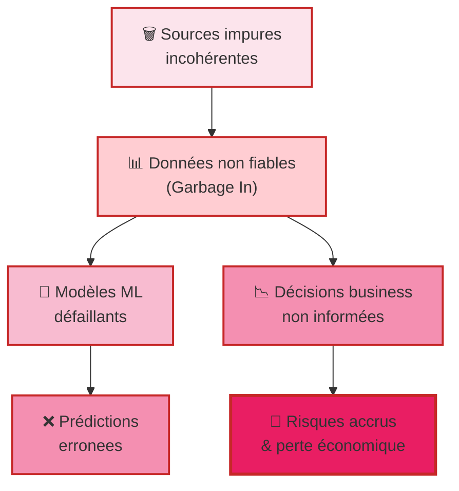
---

## De la donnée disponible à la donnée fiable

| Niveau                       | Caractéristiques                                 | Description                                                                                        |
| ---------------------------- | ------------------------------------------------ | -------------------------------------------------------------------------------------------------- |
| **Donnée disponible**        | Brute, non vérifiée, stockée en vrac             | Donnée présente dans un système et accessible techniquement.                                       |
| **Donnée exploitable**       | Formatée, accessible, données bruitées           | Donnée disponible dans un format manipulable pour l'analyse, la transformation ou l'apprentissage. |
| **Donnée fiable**            | Complète, valide et exacte, opportune, cohérente | Donnée testée et maîtrisée pour soutenir un usage analytique ou décisionnel.                       |
| **Donnée adaptée à l'usage** | Appropriée au contexte                           | Donnée adaptée à l'usage.                                                                          |

---

## Construire la confiance dans les données

### Définition

> "La confiance dans les données est le degré d'assurance qu'un utilisateur ou un système peut avoir quant à la fiabilité, la compréhension, la traçabilité et la stabilité d'un actif de données."
>
> — Atwal, H. (2019). Practical DataOps

### Questions de confiance

- D'où vient cette donnée ?
- Comment a-t-elle été produite ?
- A-t-elle été contrôlée ?
- Est-elle à jour ?
- Qui en est responsable ?
- Quelles transformations a-t-elle subies ?
- Quelles sont ses limites d'usage ?

### Éléments de confiance

- Qualité des données
- Métadonnées
- Data lineage
- Tests et validations
- Gouvernance
- Monitoring
- Feedback loops

> **La confiance ne se décrète pas : elle se construit par des garanties techniques et organisationnelles.**

---

## Définition de la qualité des données

### Définition

> "La qualité des données s'inscrit dans la construction de la confiance : une donnée de qualité est une donnée évaluée, contrôlée, nettoyée, documentée et gouvernée, de manière à pouvoir être utilisée de façon fiable dans les produits de données et les pipelines analytiques."
>
> — Atwal, H. (2019). Practical DataOps

> "La qualité des données désigne l'aptitude d'un jeu de données à satisfaire les usages attendus, selon des critères mesurables définis dans un contexte donné « fitness for use »."
>
> — Wang, R. Y., & Strong, D. M. (1996). What Data Quality Means to Data Consumers

### Ce que cela implique

- Pas une notion absolue
- Dépend du cas d'usage
- Évaluée par des critères explicites
- Traduite en règles de validation

### Conséquence en ingénierie

- Définir les attentes
- Tester la conformité
- Suivre les indicateurs
- Réviser les règles dans le temps

> **En DataOps et MLOps, la qualité doit être définie, testée et surveillée.**

---

## Les principales dimensions de la qualité

Wang et Strong ont montré que la qualité des données ne se réduit pas à l'exactitude et qu'elle doit être pensée comme un ensemble multidimensionnel. Chaque dimension correspond à un risque spécifique et peut être traduite en contrôle ou en test.

| Dimension | Définition | Exemple |
|-----------|------------|---------|
| **Complétude** | Mesure le degré de présence des données attendues dans un jeu de données. | `customer_id` manquant dans certaines commandes. |
| **Validité** | Vérifie si les valeurs respectent le format, le type ou le domaine autorisé. | Un code pays différent de la liste autorisée (XX au lieu de MA, FR, ES). |
| **Cohérence** | Vérifie l'absence de contradiction logique entre les données. | `delivery_date` antérieure à `order_date`. |
| **Cohérence métier** | Vérifie que les données respectent les règles du domaine fonctionnel ou métier. | Un montant de vente négatif dans une table de ventes. |
| **Unicité** | Vérifie qu'un identifiant ou une clé censée être unique ne contient pas de doublons. | Deux lignes avec le même `order_id`. |
| **Exactitude** | Mesure à quel point la donnée reflète correctement la réalité observée. | Un montant enregistré à 10000 au lieu de 1000. |
| **Fraîcheur** | Mesure si la donnée est disponible dans un délai compatible avec l'usage attendu. | Un fichier quotidien reçu avec 2 jours de retard. |
| **Intégrité** | Vérifie que les relations entre objets ou tables sont respectées. | Une commande associée à un `customer_id` inexistant dans la table clients. |
| **Traçabilité** | Mesure la capacité à identifier l'origine d'une donnée et les transformations qu'elle a subies. | Impossible de savoir de quelle source provient une colonne calculée. |
| **Uniformité** | Vérifie que les données sont représentées de manière homogène dans tout le système. | Les dates sont parfois au format YYYY-MM-DD et parfois DD/MM/YYYY. |
| **Documentation / Métadonnées** | Vérifie que les données sont décrites, comprises et contextualisées par des métadonnées suffisantes. | Une colonne `status` existe, mais sa signification métier n'est pas documentée. |

---

## Pourquoi la qualité doit être traitée dès l'ingestion

### Contrôler dès l'entrée permet de

- Détecter les anomalies au plus tôt
- Éviter la propagation en aval
- Réduire le coût de correction
- Localiser la source d'un incident
- Empêcher la promotion de données invalides

### Contrôles possibles

- Présence du fichier ou du flux
- Conformité du schéma
- Colonnes obligatoires
- Types de données
- Volume attendu
- Fraîcheur du flux
- Anomalies évidentes
### Approche Traditionnelle
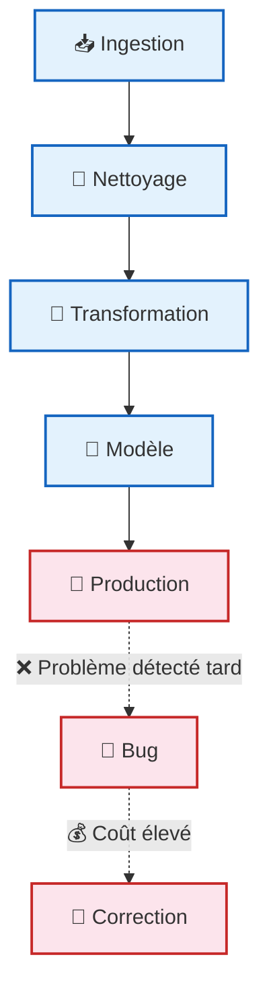
### Approche DataOps (Shift Left)
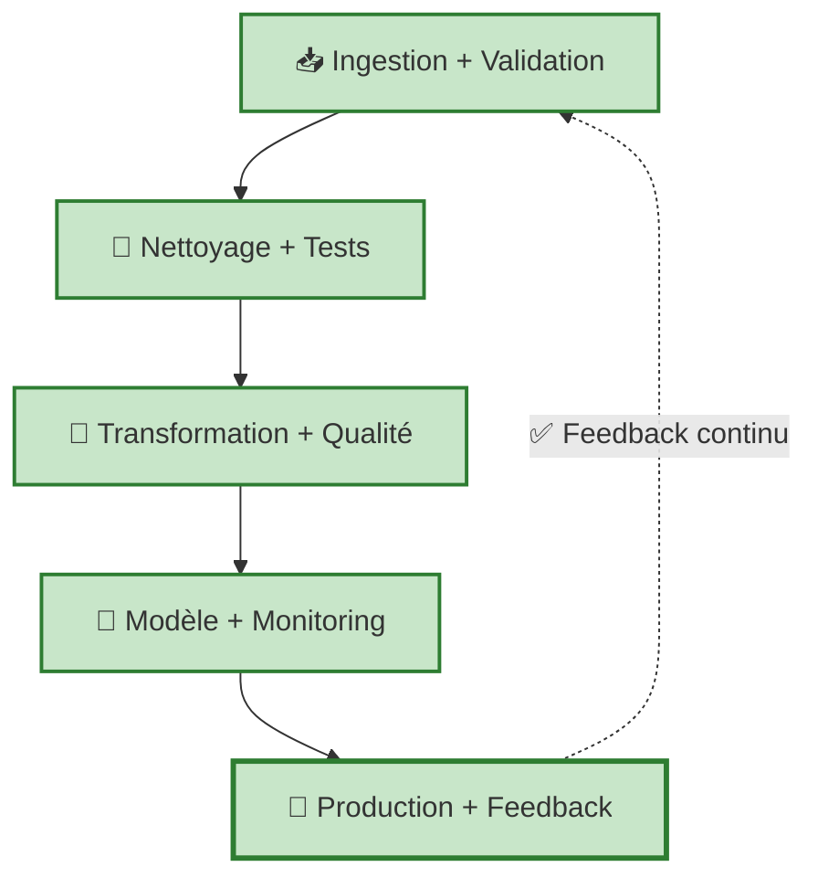

> **Qualité à la source → Pipeline plus fiable → Meilleurs usages analytiques et ML**

### Détection d'anomalies et Statistical Process Control (SPC)

#### Définition du SPC

> Le Statistical Process Control (SPC) est une méthode de surveillance statistique permettant de détecter des variations anormales dans un flux de données au cours du temps.

#### Ce que l'on détecte

- Chute ou hausse anormale du volume
- Rupture de tendance
- Variations inhabituelles
- Dérive progressive du comportement
- Signaux faibles avant incident

Le SPC complète les tests de structure et de contenu en surveillant le comportement global des données dans le temps.

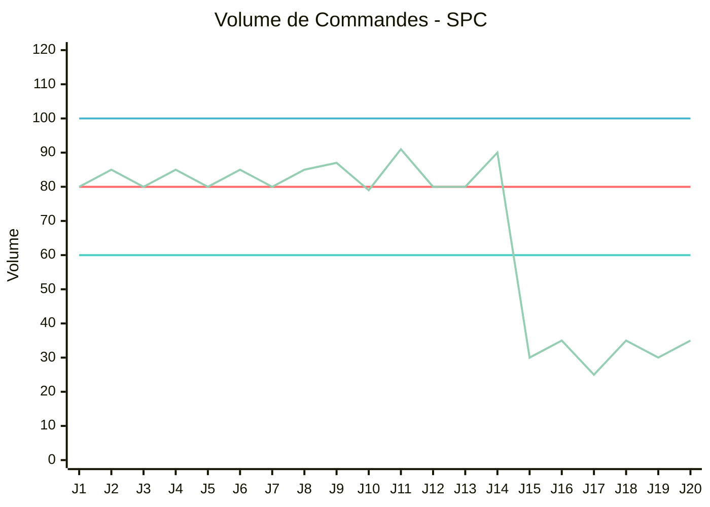

> **À retenir :** Une anomalie statistique n'est pas une erreur de schéma, mais elle peut signaler une dérive critique du pipeline ou des usages ML.

---

## Métadonnées : comprendre et documenter les données

### Définition

> "Les métadonnées sont des données qui décrivent d'autres données : structure, sens, source, fréquence, responsabilité, contraintes de qualité, usages autorisés."
>
> — Atwal, H. (2019). Practical DataOps

> "More data beats clever algorithms, but better data beats more data."
>
> — Peter Norvig, Director of Research at Google Inc

### Elles peuvent inclure

- Nom logique et technique
- Définition des champs
- Types de données
- Source d'origine
- Fréquence de mise à jour
- Propriétaire de la donnée
- Règles de qualité
- Sensibilité ou confidentialité

### Elles permettent de

- Faciliter la compréhension
- Améliorer la réutilisation
- Soutenir la gouvernance
- Renforcer la traçabilité
- Rendre les contrôles explicites
- Augmenter la confiance

### Types de métadonnées

1. **Descriptives (Le Métier)**: Signification des données (ex: glossaire, définition de amount comme montant TTC). Facilite la découverte.
2. **Structurelles (L'Architecture)**: Schémas, relations par clés étrangères, types de données (ex: order_id est un INT64).
3. **Administratives (La Gouvernance)**: Permissions d'accès, fraîcheur, politique de rétention, propriétaire de la donnée.

> **Une table complète à 99% mais sans métadonnées ne peut pas être une donnée de confiance car son contexte et ses règles d'usage sont inconnus.**

---

## Data lineage : retracer l'origine et les transformations

### Définition

> "Le data lineage désigne la traçabilité du parcours d'une donnée, depuis sa source jusqu'à ses transformations et ses usages finaux."
>
> — Atwal, H. (2019). Practical DataOps

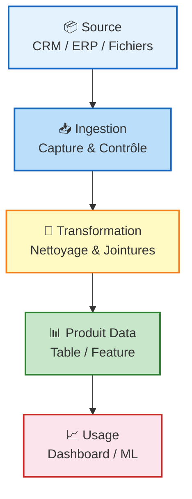

Questions résolues
	• D’où vient la donnée ?
	• Quelles transformations a-t-elle subies ?
	• Quels objets en dépendent ?
Apports
	• Analyse d’impact
	• Diagnostic d’erreur
	• Audit et conformité
	• Confiance dans les pipelines

> **Sans lineage, les erreurs circulent plus vite que leur explication.**

---

## Gouvernance des données : règles, responsabilités et pilotage

### Gouvernance Agile (DataGovOps) : Automatiser la conformité sans freiner l'innovation

| Approche Traditionnelle | Approche DataGovOps |
|-------------------------|---------------------|
| Processus manuels, silos informatiques, règles rigides (bottleneck). La gouvernance est vue comme une tâche purement administrative. | Libre-services encadrés, règles implémentées sous forme de code (Governance-as-code), gestion par les métadonnées. |

> **La gouvernance moderne n'est pas un formulaire à remplir ; c'est un ensemble de règles automatisées (contrôle d'accès, masquage de PII) intégrées directement dans le pipeline CI/CD.**

### Définition

> "La gouvernance des données est l'ensemble des règles, rôles, responsabilités et mécanismes de pilotage qui encadrent la production, l'usage et l'évolution des données."
>
> — Atwal, H. (2019). Practical DataOps

### La qualité comme engagement organisationnel

| La gouvernance définit | Elle répond à |
|------------------------|---------------|
| Rôles et responsabilités | Qui est responsable ? |
| Règles d'usage et de qualité | Qui valide les définitions métier ? |
| Mécanismes de validation | Quels seuils respecter ? |
| Gestion des changements | Qui autorise une évolution de schéma ? |
| Traitement des incidents | Que faire en cas de non-conformité ? |
| Contrôle, conformité et pilotage | |
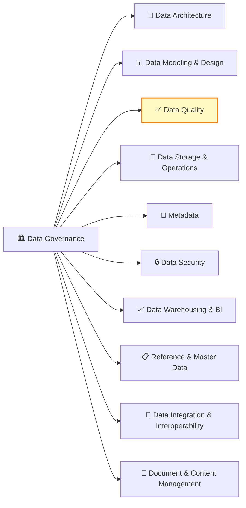
> **La gouvernance transforme la qualité en responsabilité organisationnelle, et pas seulement en bonne pratique technique.**

---

## Validation dans les pipelines : contrôler à plusieurs niveaux

### Une chaîne de points de contrôle distribués

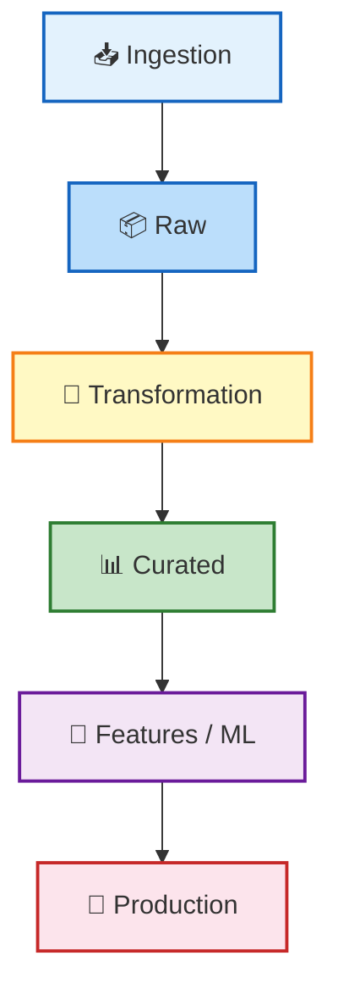
### La validation permet de

- Détecter les anomalies
- Bloquer ou isoler les données invalides
- Prévenir les régressions

### Principe fondamental

- Pas une étape unique
- Contrôles répétés
- Intégrés au flux
- Adaptés au niveau du pipeline

> **Les contrôles de validation sont distribués le long du pipeline**

---

## Les principaux types de tests de qualité

### Traduire les risques en contrôles vérifiables

| Test                    | Problème                 | Code Exemple                                |
| ----------------------- | ------------------------ | ------------------------------------------- |
| **📐 Schéma**           | Rupture de structure     | `assert schema == expected`                 |
| **🔍 Nullité**          | Données manquantes       | `customer_id.isnull().mean() < 0.01`        |
| **🔑 Unicité**          | Doublons                 | `order_id.nunique() == len(df)`             |
| **🔗 Intégrité**        | Relations référentielles | `customer_id in customers.id`               |
| **📊 Cohérence métier** | Règles métier            | `delivery_date >= order_date`               |
| **🎯 Domaine**          | Valeurs inattendues      | `amount >= 0 AND country in valid_list`     |
| **⏱️ Fraîcheur**        | Données obsolètes        | `max(updated_at) > today - 1 day`           |
| **📈 Anomalie**         | Dérives statistiques     | `abs(row_count_today - avg_7d) < threshold` |

>Une bonne stratégie de qualité combine plusieurs familles de tests complémentaires.

> **Règle d'or :** Les tests de données doivent être versionnés et exécutés exactement comme les tests unitaires en génie logiciel.

Atwal met explicitement en avant l'automated testing et l'intégration continue des pipelines de données. Cela justifie une typologie claire des tests.

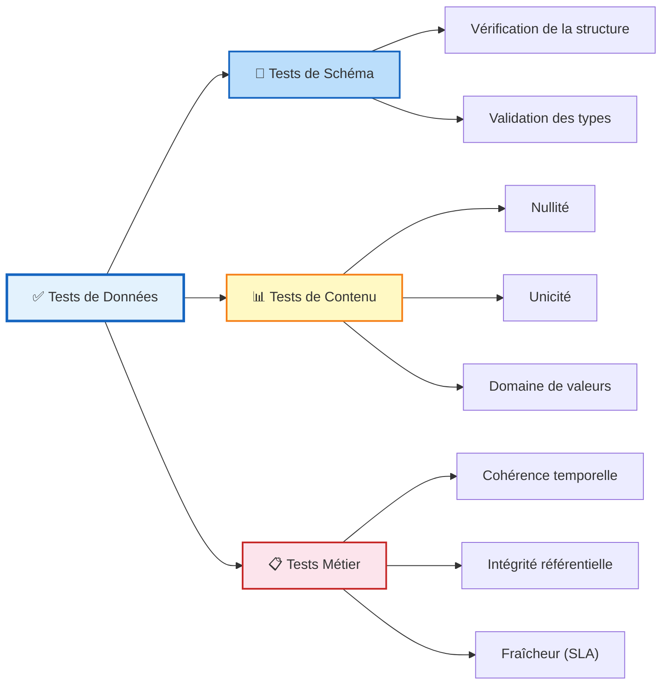

**Risques :**
- Une structure invalide rend la donnée instable
- Sans complétude, unicité et intégrité, la fiabilité analytique devient fragile
- Un pipeline syntaxiquement valide peut rester sémantiquement faux

---

## Qualité des données et intégration continue des pipelines

### Intégrer les tests de données dans le cycle CI des pipelines

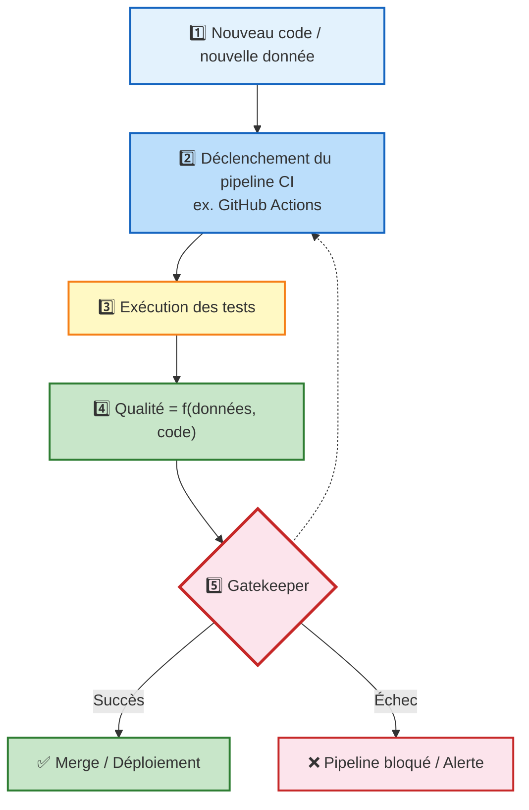

---

## Feedback loops : améliorer la qualité en continu

### Définition

> "Kaizen désigne une démarche d'amélioration continue, fondée sur de petites améliorations progressives et régulières apportées aux processus, afin d'améliorer durablement la qualité, l'efficacité et la performance."
>
> — M. Kaizen (1986). The Key to Japan's Competitive Success.

### Boucle d’amélioration continue
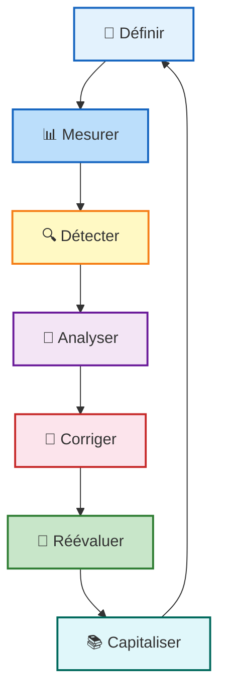

### Boucle d'Amélioration Continue (Kaizen) pour les Pipelines de Données

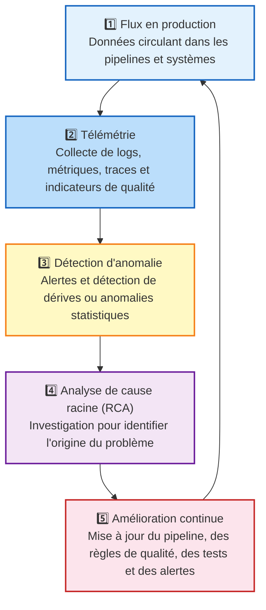

---

## Data Contract

### Définition

> Engagement formalisé entre producteurs et consommateurs de données sur le schéma, la qualité, la fréquence, les responsabilités et l'évolution des données.

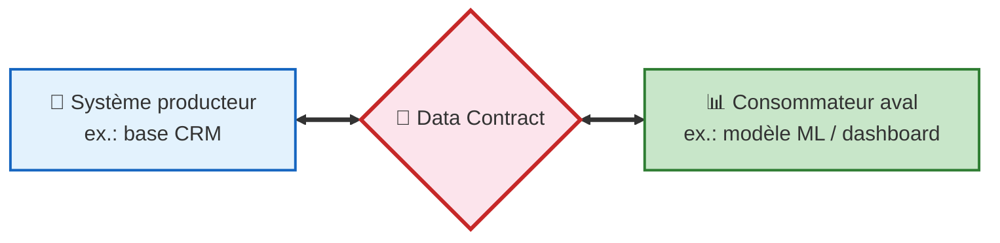

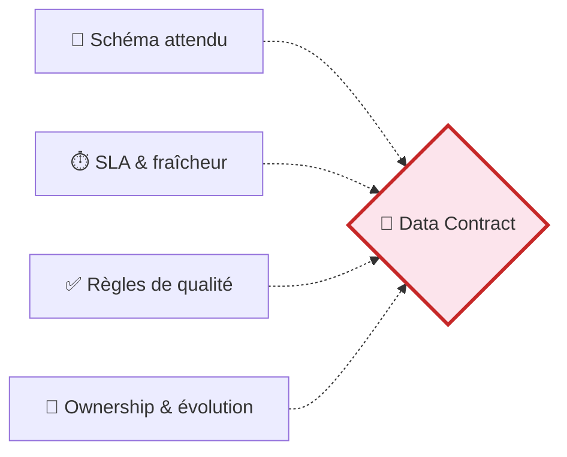
### Composants

| Humain (L'Accord)                                | Machine (Le Test Exécutable)                 |
| ------------------------------------------------ | -------------------------------------------- |
| Documentation partagée sur la structure attendue | Tests automatisés qui valident la conformité |
| Règles métier explicitées                        | Seuils de qualité vérifiés                   |
| Responsabilités définies                         | Alertes en cas de non-conformité             |

> **Ce n'est pas qu'une simple documentation. C'est un engagement formel sur la structure et la qualité de la donnée.**

### Points clés

- Tout changement de schéma (ex: renommer une colonne) doit être anticipé et négocié pour éviter de casser les pipelines en aval.
- Le contrat est traduit en tests automatisés qui bloquent la production si les engagements ne sont pas respectés.

### Éléments du contrat

1. Schéma attendu : colonnes, types, structure
2. Règles de qualité : contraintes, seuils
3. Fréquence de mise à jour
4. Responsabilités (producteur, consommateur)
5. Modalités d'évolution

---

## Les idées clés à retenir

- Une donnée disponible n'est pas nécessairement fiable
- La qualité doit être intégrée dès l'ingestion
- La confiance repose sur qualité, métadonnées, lineage et gouvernance
- Les tests doivent être explicites, structurés et automatisés
- Les data contracts formalisent les attentes entre producteurs et consommateurs
- Monitoring et feedback loops soutiennent l'amélioration continue
- La qualité conditionne la robustesse analytique et ML

> **La qualité des données n'est pas une correction a posteriori ; elle est une exigence d'ingénierie intégrée au pipeline.**