# CHAPITRE 4 : REPRODUCTIBILITÉ ET CYCLE DE VIE DES MODÈLES

---

## PLAN DU MODULE

- Chapitre 1 : Fondamentaux DataOps & MLOps
- Chapitre 2 : Pipelines agiles & orchestration
- Chapitre 3 : Qualité & tests de données
- **Chapitre 4 : Reproductibilité et Cycle de vie des modèles**
- Chapitre 5 : CI/CD, conteneurisation et déploiement des services ML
- Chapitre 6 : Monitoring, observabilité, gouvernance et ouverture vers LLMOps
- Projet intégrateur

---

## Objectifs

- Comprendre pourquoi la reproductibilité est une exigence centrale en MLOps.
- Distinguer une expérimentation artisanale d'un workflow ML reproductible.
- Comprendre l'intérêt du suivi et de la traçabilité des expériences.
- Identifier les éléments à versionner dans un projet ML.
- Expliquer le versionnement des datasets et modèles ML.
- Décrire les principaux états du cycle de vie d'un modèle.
- Comprendre la structure d'un pipeline ML reproductible.

## Contenu

- Problématique : pourquoi un modèle performant ne suffit pas.
- Passage de l'expérimentation exploratoire au système ML reproductible.
- Définition, Enjeux et dimensions de la reproductibilité.
- Suivi et traçabilité des expériences.
- Versionnement des datasets et des modèles.
- Cycle de vie du modèle.
- Pipelines ML reproductibles.
- Reproductibilité, auditabilité et industrialisation.

---

## Introduction

Un modèle peut être performant et pourtant rester sans valeur industrielle si l'on ne peut pas répondre à :

- Quel code exact a produit ce modèle ?
- Quel jeu de données a été utilisé, et sous quelle version ?
- Quels hyperparamètres et quel environnement d'exécution ?
- Peut-on rejouer l'expérience aujourd'hui, à l'identique ?
- Peut-on comparer ce modèle à une version antérieure ?
- Peut-on justifier sa mise en production devant un audit ?

> **La performance seule ne suffit pas ; il faut maîtriser le processus de fabrication du modèle.**

> **La reproductibilité transforme un résultat ponctuel en processus que l'on peut reconstruire et expliquer.**

---

## Plan de développement du chapitre

1. Comprendre la notion de reproductibilité
2. Traçabilité des expériences
3. Versionnement des datasets
4. Versionnement des modèles
5. Le model registry
6. Packaging d'un projet ML
7. Pipelines ML reproductibles
8. Cycle de vie du modèle
9. Auditabilité & industrialisation

---

## La reproductibilité en contexte MLOps

### Définition

> "La capacité à reconstruire et rejouer un workflow de machine learning dans des conditions définies, à partir d'éléments identifiés, versionnés et documentés, afin d'obtenir des résultats cohérents, comparables et explicables."
>
> — Atwal, H. (2019). Practical DataOps

### Expérimentation Artisanale vs Workflow Reproductible

| Expérimentation Artisanale | Workflow Reproductible |
|----------------------------|----------------------|
| Notebook unique | Pipeline structuré |
| Données locales | Données identifiées |
| Paramètres modifiés à la main | Paramètres tracés |
| Dépendances implicites | Environnement maîtrisé |
| Résultats peu documentés | Suivi des expériences |
| Modèle sauvegardé localement | Modèle versionné et gouverné |

> **Reproduire un modèle, c'est reproduire le processus qui l'a produit.**

---

## Les six dimensions de la reproductibilité

1. **Reproductibilité du code** : Version du code source, commit précis
2. **Reproductibilité des données** : Dataset identifié, versionné, snapshot
3. **Reproductibilité des dépendances** : Environnement, librairies, versions
4. **Reproductibilité des configurations** : Hyperparamètres, métriques
5. **Reproductibilité des résultats** : Métriques, logs, rapports
6. **Reproductibilité des Modèles** : Version, dataset, statut

> **Reproductibilité systémique : Ne repose pas sur un seul élément. Le maillon le plus faible détermine la fiabilité globale.**

---

## MINI-EXERCICE

### Diagnostiquer une expérience non reproductible

**Cas pratique :** Un collègue vous montre un notebook nommé `final_model.ipynb`. Le score affiché est F1 = 0.91. Il vous dit : « ça fonctionnait hier, je ne sais plus pourquoi ça ne marche plus aujourd'hui ».

#### À identifier :

- Quelles dimensions de reproductibilité sont absentes ici ?
- Quelles informations manquent pour rejouer cette expérience ?
- Quelles pratiques (tracking, versionnement) auraient évité ce problème ?

---

## MINI-EXERCICE CORRECTION

### 1. Dimensions de la reproductibilité absentes

Les dimensions absentes ou insuffisamment maîtrisées sont :

| Dimension | Problème identifié |
|-----------|-------------------|
| **Reproductibilité du code** | Le notebook seul ne garantit pas une exécution stable ni une version claire du code. |
| **Reproductibilité des données** | On ne sait pas quel dataset exact a été utilisé. |
| **Reproductibilité des dépendances** | On ignore les versions de Python et des bibliothèques. |
| **Reproductibilité des configurations** | Les hyperparamètres et options d'exécution ne sont pas explicitement tracés. |
| **Reproductibilité des résultats** | Le score F1 = 0.91 est affiché, mais son contexte de production n'est pas documenté. |
| **Traçabilité des expériences** | Il n'y a pas d'identifiant de run, ni d'historique clair de l'expérience. |

### 2. Informations manquantes pour rejouer l'expérience

Pour pouvoir rejouer correctement cette expérience, il faudrait au minimum connaître :

- La version exacte du code (commit Git)
- Le dataset utilisé (version, snapshot)
- Les dépendances (versions Python + librairies)
- Les hyperparamètres exacts
- Le split train/validation/test utilisé
- Les transformations appliquées aux données
- La graine aléatoire (random seed)
- La commande ou le script d'exécution

### 3. Pratiques qui auraient permis d'éviter ce problème

Les pratiques suivantes auraient permis d'éviter cette situation :

- Versionnement du code avec Git
- Versionnement des données ou au minimum identification claire du dataset utilisé
- Tracking des expériences pour enregistrer : le run, les paramètres, les métriques, les artefacts, la version du code, la version du dataset
- Gestion explicite des dépendances avec un fichier comme `requirements.txt` ou `pyproject.toml`
- Externalisation des configurations dans un fichier de configuration
- Structuration du projet en pipeline reproductible, au lieu de dépendre uniquement d'un notebook
- Nomenclature claire des modèles et artefacts, au lieu de noms ambigus comme `final_model.ipynb`

---

## Traçabilité des expériences

### Définition

> "La capacité à conserver et relier les métadonnées d'un run de machine learning — code, données, paramètres, métriques et artefacts — afin de rendre l'expérience comparable, rejouable et explicable."
>
> — AIT DAOUD, M. (2025) / Atwal, H. (2019). Practical DataOps

### Problème

Dans un projet ML, plusieurs essais coexistent simultanément :

- Jeux de données
- Algorithmes
- Hyperparamètres
- Métriques
- Versions de code

Sans suivi structuré, il devient impossible de savoir :

- Quel essai est le meilleur ?
- Pourquoi est-il meilleur ?
- Comment a-t-il été obtenu ?
- Peut-on le rejouer fidèlement ?

> **Tracer une expérience, c'est conserver les preuves de sa construction.**

### Anatomie d'une fiche de suivi de run

```
run_2026_04_15_001
├── Auteur : équipe churn : Identifiant de run + date + auteur
├── Code version : commit a84f2d : Version du code source
├── Dataset : customers_snapshot_2026_04 : Version du dataset utilisé
├── Modèle : Random Forest
├── Hyperparamètres : depth=8, n_estimators=200
├── Accuracy : 0.88
├── F1-score : 0.86
└── Artefact : model_v12.pkl
```

| Champ                             | Valeur                                 | Description                        |
| --------------------------------- | -------------------------------------- | ---------------------------------- |
| **🔑 Identifiant de run**         | `run_2026_04_15_001`                   | Identifiant unique + date + auteur |
| **👤 Auteur / Équipe**            | `churn`                                | Personne ou équipe responsable     |
| **📝 Version du code source**     | `commit a84f2d`                        | Commit Git associé                 |
| **📊 Version du dataset**         | `customers_snapshot_2026_04`           | Version des données utilisées      |
| **🧠 Type de modèle**             | `Random Forest`                        | Algorithme entraîné                |
| **⚙️ Hyperparamètres**            | `depth=8, n_estimators=200`            | Paramètres de l'entraînement       |
| **📈 Métriques de performance**   | `Accuracy = 0.88`<br>`F1-score = 0.86` | Scores obtenus                     |
| **📦 Artefacts générés**          | `model_v12.pkl`                        | Modèle, rapports, fichiers         |
| **🖥️ Environnement d'exécution** | `prod` / `staging` / `dev`             | Environnement utilisé              |
### Comparer plusieurs expériences (suivi d'expériences)

| Run | Dataset | Modèle | Paramètres | F1-score | Décision |
|-----|---------|--------|------------|----------|----------|
| run_001 | v1 | Random Forest | depth=5 | 0.78 | rejeté |
| run_002 | v1 | Random Forest | depth=8 | 0.83 | retenu pour comparaison |
| run_003 | v2 | XGBoost | lr=0.05 | 0.86 | candidat |
| run_004 | v2 | XGBoost | lr=0.10 | 0.81 | rejeté |

### Conséquences de l'absence de traçabilité

- Les essais se confondent
- Les résultats deviennent difficiles à comparer
- Les erreurs se répètent
- Les justifications disparaissent
- La collaboration se dégrade
- L'audit devient difficile
- Le passage en production devient risqué

## Le Cycle de Vie du Modèle

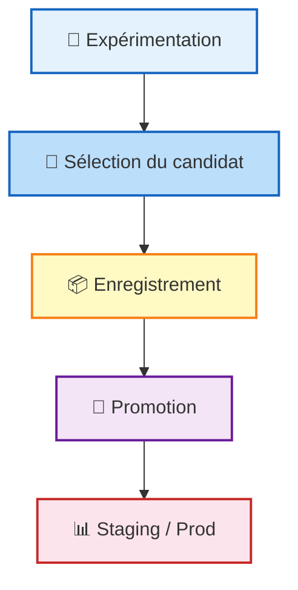

## Les 4 Piliers de la Traçabilité
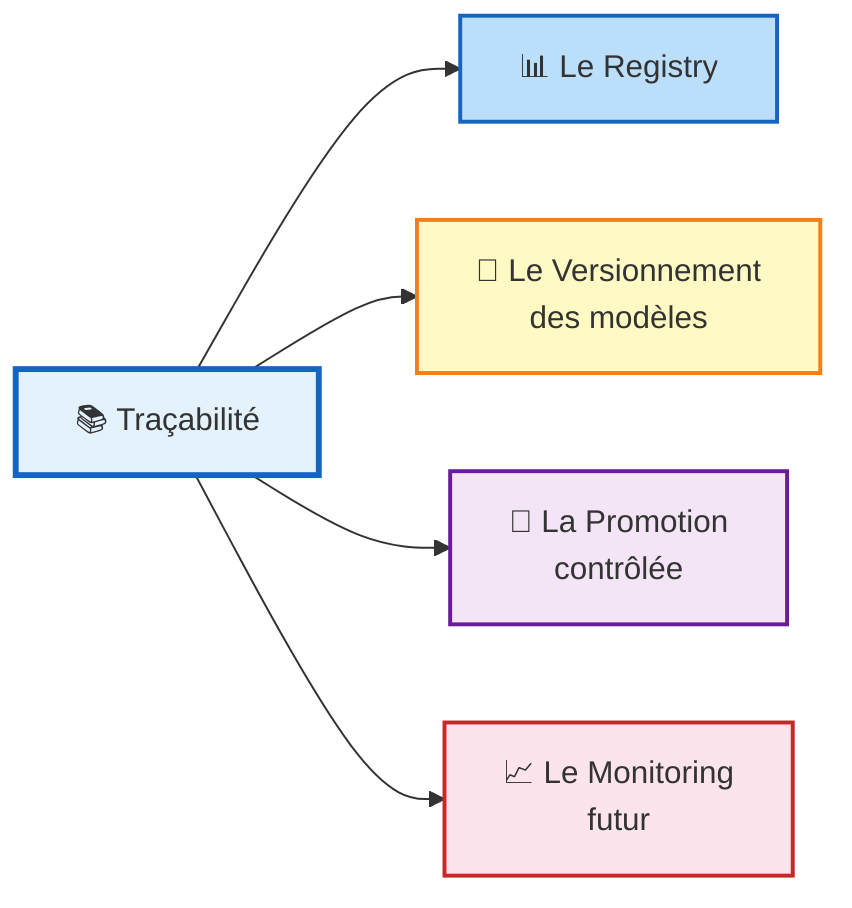

## Ce que la Traçabilité Apporte au Projet

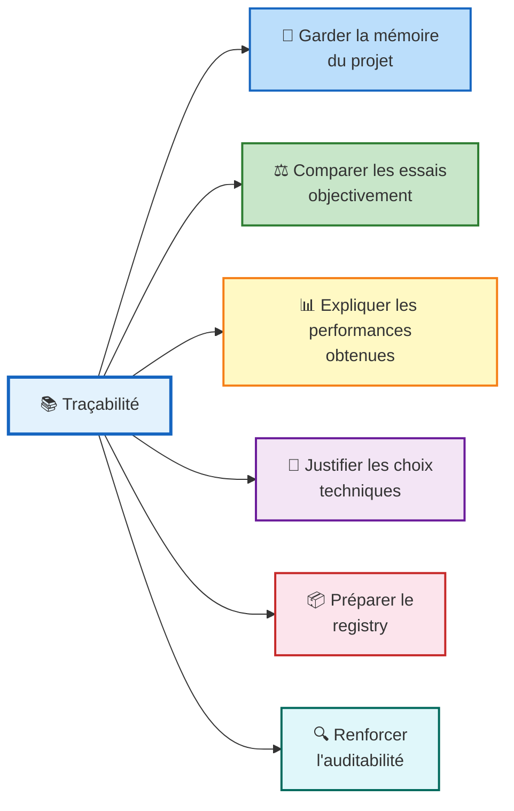
## Versionnement des Datasets & Modèles

### Définition

> "Le versionnement est le processus qui consiste à identifier, distinguer et historiser les différentes versions d'un artefact au cours de son évolution, afin de pouvoir suivre les changements, comparer les états successifs, revenir à une version antérieure et garantir la traçabilité."
>
> — AIT DAOUD, M. (2025) / Atwal, H. (2019). Practical DataOps

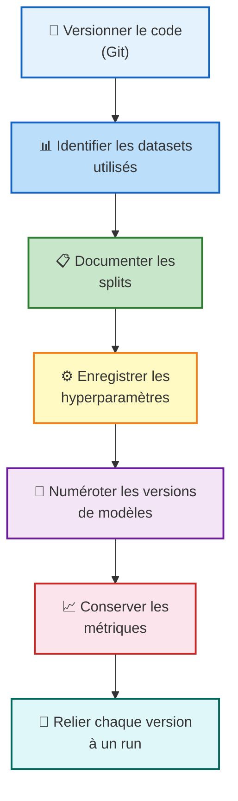

> **Le versionnement est d'abord une discipline, avant d'être un outil.**

---

## Versionnement des Datasets

### Définition

> "Le versionnement des datasets est le processus qui consiste à identifier et historiser les différents états d'un jeu de données — données brutes, préparées ou transformées — afin de savoir précisément quelles données ont été utilisées à un moment donné, dans quel état, avec quel schéma, quelles transformations et pour quel usage dans le pipeline."
>
> — AIT DAOUD, M. (2025) / Atwal, H. (2019). Practical DataOps

### Que signifie versionner un dataset ?

| Élément | Exemple |
|---------|---------|
| Source d'origine | CRM export |
| Date ou snapshot | 2026-04-01 |
| Transformations appliquées | Nettoyage, encodage |
| Usage dans le pipeline | Entraînement |
| Périmètre des données | Clients actifs depuis 12 mois |
| Schéma (colonnes) | 58 colonnes |
| Règles de filtrage | churn_flag défini |

**Exemple :** Dataset : `customers_snapshot_2026_04` – Source : CRM export – Date d'extraction : 2026-04-01 – Colonnes : 58 – Cible : churn_flag – Filtre : clients actifs depuis 12 mois

### Points clés

- Le dataset ne suffit pas ; le découpage des données doit aussi être reproductible
- Le split train/validation/test doit aussi être maîtrisé
- Le découpage des données influence directement : 
	- L'entraînement
	- L'évaluation
	- La comparaison des modèles
	- La stabilité des résultats

### Sans versionnement des données

- Impossibilité de rejouer un entraînement
- Comparaison faussée entre deux modèles
- Confusion sur la source des gains de performance
- Diagnostic difficile en cas de régression
- Audit très limité
- Réentraînement non maîtrisé

---

## Versionnement des Modèles

### Définition

> "Le versionnement des modèles est le processus qui consiste à identifier, enregistrer et historiser les différentes versions d'un modèle de machine learning, en les reliant à leur contexte de fabrication — code, données, paramètres, métriques et statut — afin de pouvoir les comparer, les gouverner, les promouvoir, les remplacer ou revenir à une version antérieure."
>
> — AIT DAOUD, M. (2025) / Atwal, H. (2019). Practical DataOps

### Un modèle versionné n'est pas qu'un fichier


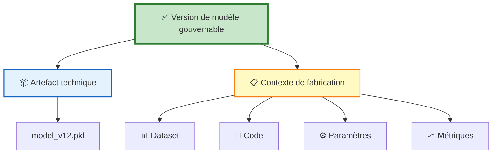
### Statuts possibles dans le cycle de vie

| Statut | Description |
|--------|-------------|
| **Experimental** | Essai en cours, non validé |
| **Candidate** | Modèle prometteur, en attente de validation |
| **Staging** | En validation avancée, pré-production |
| **Production** | Déployé et actif |
| **Archivé** | Retiré, conservé pour historique |

---

## États typiques du cycle de vie d'un modèle

### Exemple de progression

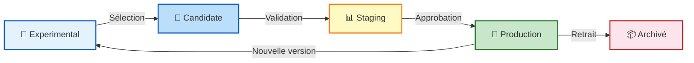

### Actif ML reproductible

Un actif ML est reproductible lorsqu'il peut être reconstruit et rejoué de manière fiable à partir d'éléments versionnés, documentés et traçables.

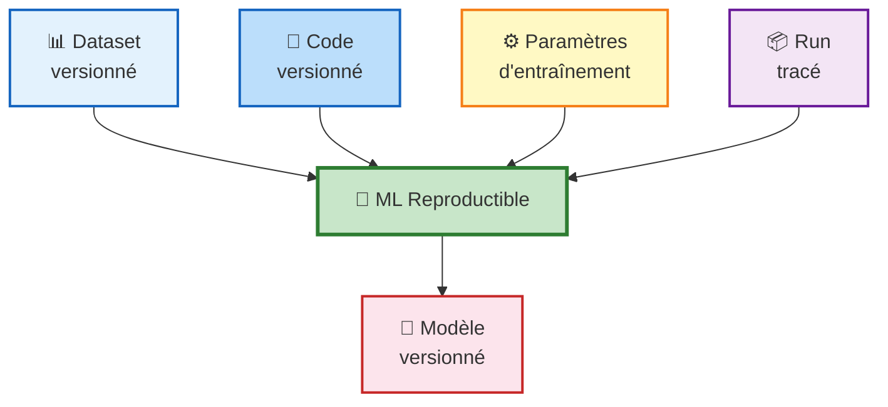

> **Si l'un de ces éléments n'est pas relié au modèle, on ne peut pas savoir :**
> - Ce qui explique sa performance
> - Ce qui différencie deux versions
> - Ce qu'il faut rejouer pour le reconstruire

---

## Le model registry comme dispositif de gouvernance

### Définition

> "Composant centralisé permettant d'enregistrer, versionner, documenter et gouverner les modèles tout au long de leur cycle de vie."
>
> — AIT DAOUD, M. (2025) / Atwal, H. (2019). Practical DataOps

### Fonctions du registry

- Enregistrer les versions
- Centraliser les artefacts
- Stocker les métriques
- Gérer les statuts
- Suivre promotions et archivages
- Associer des métadonnées
- Relier le modèle à son historique d'expérimentation

### Avant registry vs Après registry

| Avant registry | Après registry |
|----------------|----------------|
| Résultat d'entraînement | Artefact enregistré |
| Fichier local | Version identifiée |
| Statut implicite | Métadonnées associées |
| Contexte parfois incomplet | Statut explicite |
| Gouvernance limitée | Gouvernance possible |

---

## Promotion, contrôle et rollback

> **La promotion doit être fondée sur des critères explicites, pas sur une impression.**

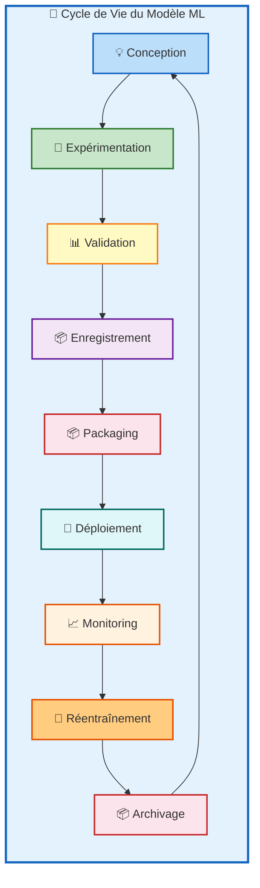

### 1. 💡 Conception
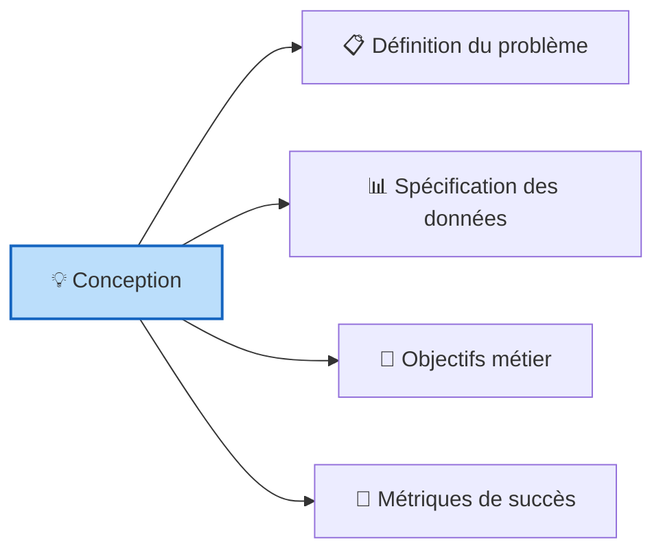

### 2. 🧪 Expérimentation
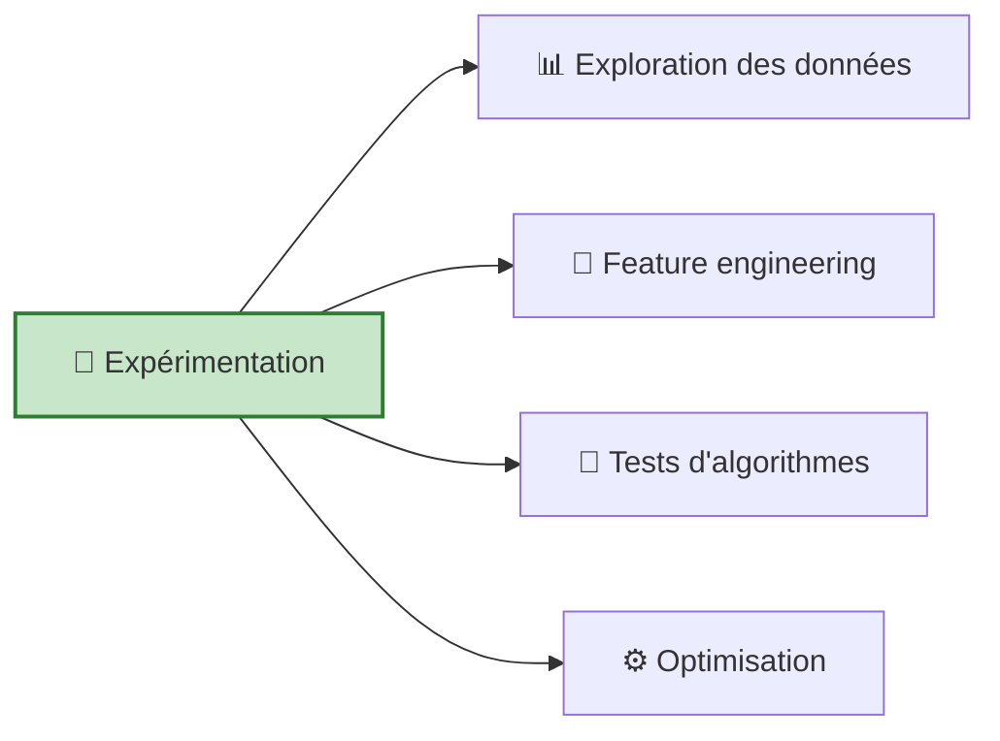

### 3. 📊 Validation

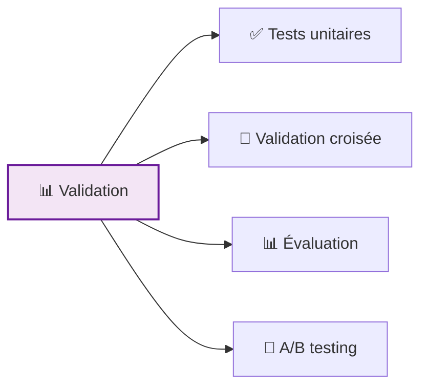
### 4. 📦 Enregistrement
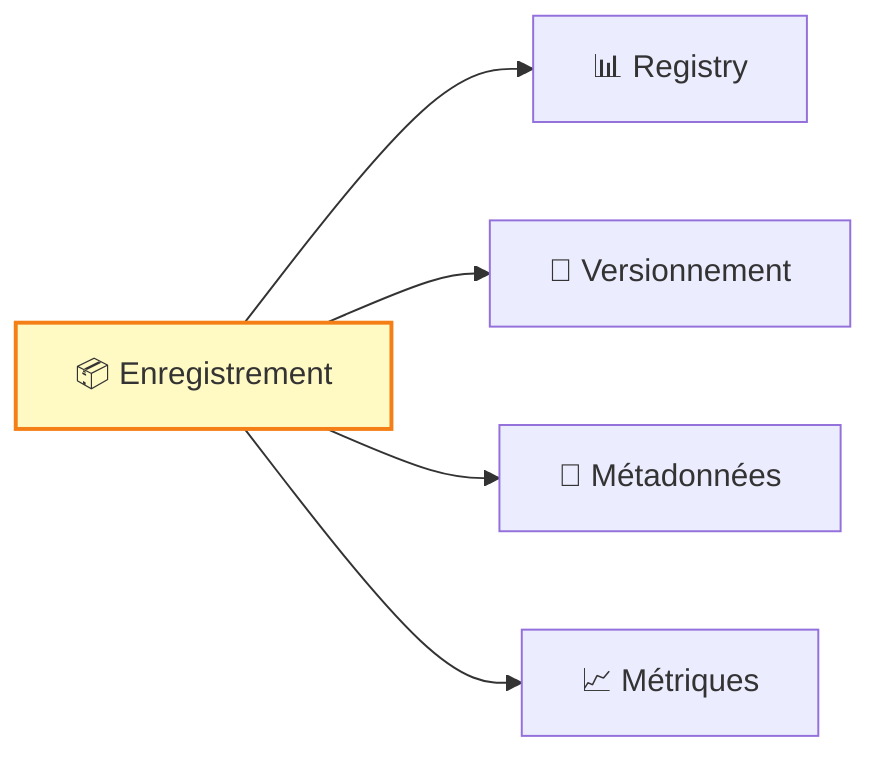
### 5. 📦 Packaging

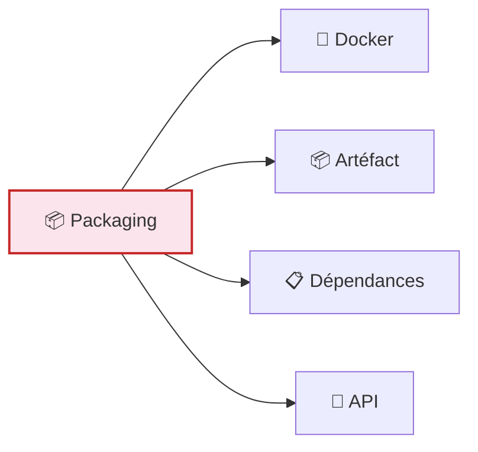
### 6. 🚀 Déploiement

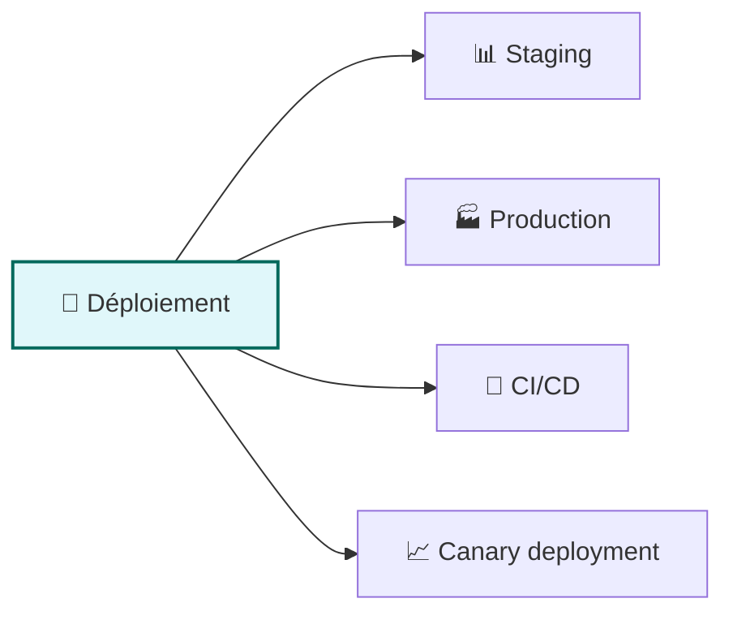
### 7. 📈 Monitoring

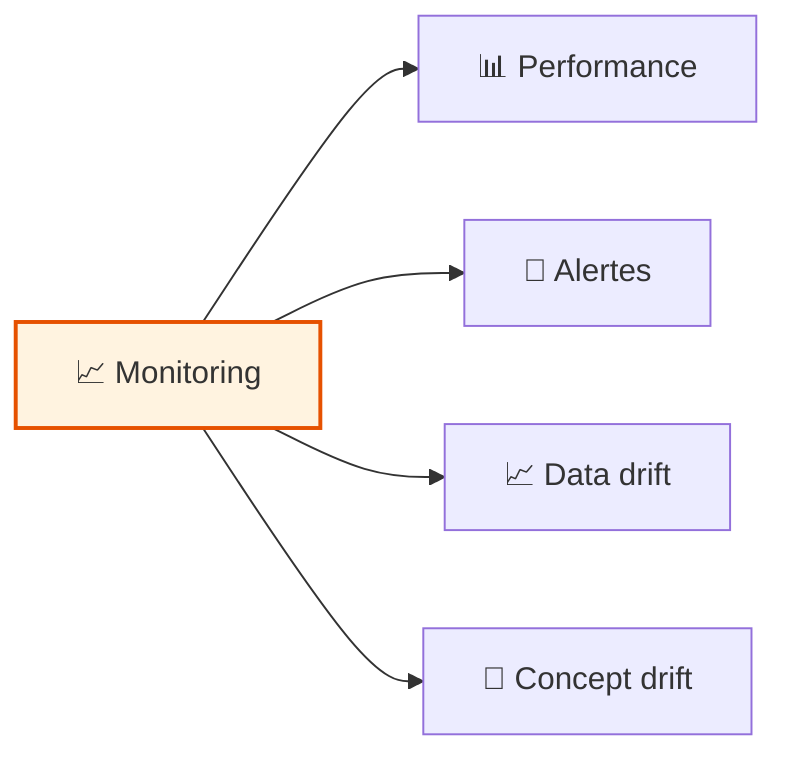
### 8. 🔄 Réentraînement

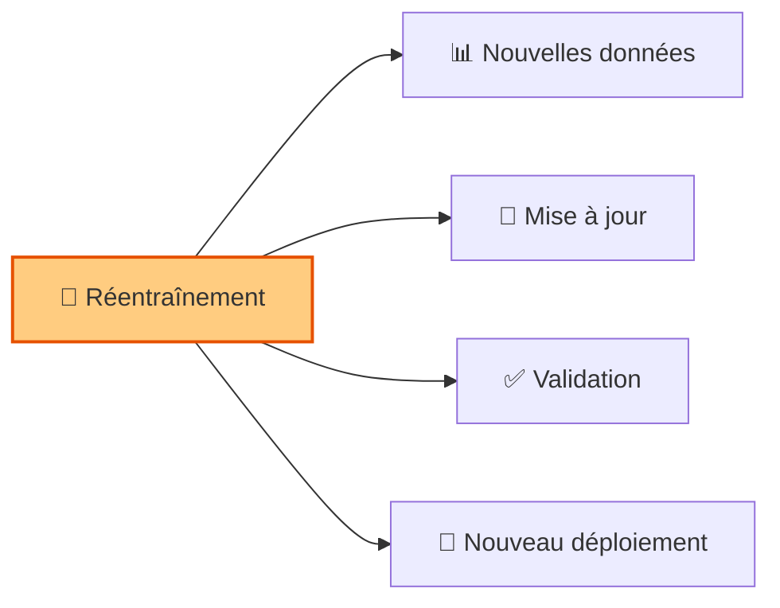
### 9. 📦 Archivage

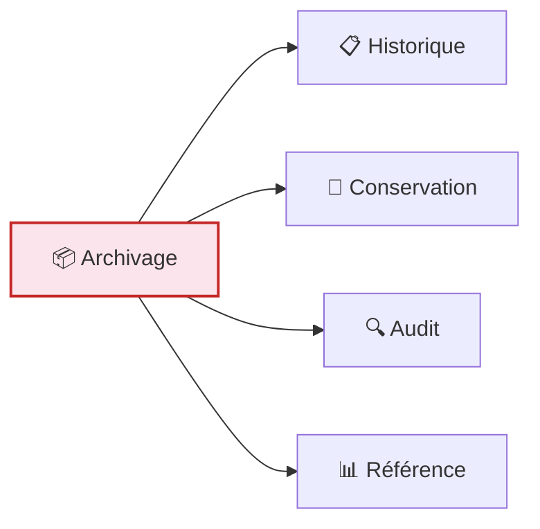
### Critères de promotion

- Métriques suffisantes
- Comparaison favorable à une baseline
- Données identifiées, run traçable
- Artefacts complets
- Tests techniques validés

### Apport du rollback

- Identifier la version active
- Retrouver la version précédente
- Comparer leurs métriques
- Comprendre leurs différences
- Restaurer une version stable

**Question :** Un modèle en production échoue brutalement sur de nouvelles données. Quelles informations le registry doit-il fournir en moins de 5 minutes ?

**Réponse :** Le registry doit jouer son rôle de source centrale de vérité sur la version active du modèle. Il doit permettre d'identifier quel modèle est en production (version déployée), d'où il vient, avec quelles données et quel code il a été construit (contexte de fabrication), quelles étaient ses performances attendues (comparaison), et quelle version antérieure peut être restaurée rapidement (rollback).

---

## Packaging d'un projet ML

### Définition

> "Encapsuler un projet, un modèle ou un service ML dans une forme organisée, stable et réutilisable, afin de faciliter son exécution, son partage, son intégration et sa préparation au déploiement."
>
> — AIT DAOUD, M. (2025) / Atwal, H. (2019). Practical DataOps

### À quoi sert le packaging ?

- Préparer le projet pour un environnement maîtrisé
- Réduire la dépendance au contexte local
- Permettre l'exécution automatisée
- Faciliter le partage et la collaboration
- Préparer le déploiement

### Continuum de structuration

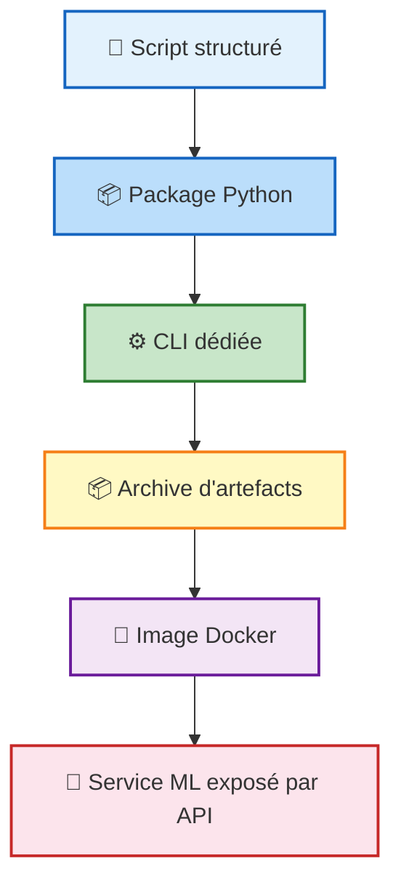

> **Le packaging transforme un projet local en composant d'ingénierie (réduire la dépendance au contexte local)**

### Structure reproductible d'un projet ML

```
churn-mlops-project/
│
├── data/
│   ├── raw/
│   │   └── customers.csv
│   └── processed/
│       └── customers_prepared.csv
│
├── configs/
│   └── train_config.yaml
│
├── src/
│   ├── prepare_data.py
│   ├── train.py
│   ├── evaluate.py
│   ├── predict.py
│   └── serve.py
│
├── churn_model/
│   ├── __init__.py
│   ├── data.py
│   ├── features.py
│   ├── training.py
│   ├── evaluation.py
│   └── inference.py
│
├── cli/
│   └── main.py
│
├── models/
│   └── model_v12.pkl
│
├── reports/
│   ├── metrics.json
│   └── confusion_matrix.png
│
├── artifacts/
│   └── release_v12/
│       ├── model_v12.pkl
│       ├── metrics.json
│       └── config.yaml
│
├── api/
│   └── app.py
│
├── tests/
│   ├── test_data.py
│   ├── test_training.py
│   └── test_api.py
│
├── requirements.txt
├── pyproject.toml
├── Dockerfile
├── README.md
└── .gitignore
```

### Pourquoi cette structure compte :

- Structure claire et lisible
- Point d'entrée explicite
- Dépendances définies
- Organisation des artefacts

### Pourquoi faut-il un point d'entrée explicite ?

Une commande claire afin de remplacer les suites d'actions implicites dans un notebook :

```bash
python train.py --config configs/train.yaml
```

---

## Pipelines ML reproductibles

### Définition

> "Chaîne structurée d'étapes d'un workflow ML dont les entrées, sorties, paramètres et artefacts sont identifiés de manière à permettre une exécution répétable, traçable et contrôlée."
>
> — AIT DAOUD, M. (2025) / Atwal, H. (2019). Practical DataOps

### Propriétés attendues d'un pipeline reproductible

- Modularité
- Traçabilité
- Rejouabilité
- Clarté des dépendances
- Stabilité
- Intégration
- Tracking et registry.

### Étapes typiques d'un pipeline ML reproductible

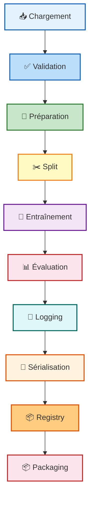

| Étape | Entrée | Sortie |
|-------|--------|--------|
| **Chargement** | Source de données : `customers.csv` | DataFrame brut |
| **Validation initiale** | DataFrame brut | Données conformes au schéma attendu |
| **Préparation / feature engineering** | DataFrame validé | Dataset transformé avec variables prêtes pour le modèle |
| **Split** | Dataset transformé et préparé | Train / Validation / Test : `X_train, X_val, X_test, y_train, y_val, y_test` |
| **Entraînement** | Train set + configuration : `X_train, y_train + config du modèle` | Modèle entraîné : Random Forest |
| **Évaluation** | Modèle entraîné + `X_test, y_test` | Métriques : accuracy, precision, recall, F1-score |
| **Logging des métriques** | Métriques + hyperparamètres + run | Historique d'expérience : fiche de run enregistrée |
| **Sérialisation du modèle** | Modèle + contexte | Fichier modèle sauvegardé : `model_v12.pkl` |
| **Enregistrement dans le registry** | `model_v12.pkl + métriques + dataset + code version` | Version enregistrée : `churn_classifier v12` |
| **Packaging / préparation au déploiement** | Modèle enregistré + dépendances + code d'inférence | Composant déployable : package Python ou image Docker |

---

## Packaging et pipelines reproductibles

### Comparaison : Script unique vs Pipeline structuré

| Critère | Script unique | Pipeline structuré |
|---------|---------------|-------------------|
| Lisibilité | Difficile à relire | Modulaire et lisible |
| Tests | Difficile à tester | Étapes testables isolément |
| Reprise | Difficile à reprendre | Facile à rejouer |
| Réutilisation | Difficile à réutiliser | Adapté à l'industrialisation |

### Notions clés

| Notion | Définition simple | Rôle principal | Exemple |
|--------|------------------|----------------|---------|
| **Artefact** | Objet concret produit, utilisé ou conservé dans un pipeline | Matérialiser une étape du workflow | `model.pkl`, `metrics.json`, `config.yaml`, image Docker |
| **Version** | État identifié d'un artefact à un moment donné | Distinguer les évolutions successives | `model_v12.pkl`, `dataset_snapshot_2026_04`, `config_v2.yaml` |
| **Release** | Regroupement cohérent de plusieurs artefacts versionnés prêts à être transmis, archivés ou déployés | Figer une version exploitable, transférable ou déployable | `release_v12/` peut contenir : `model_v12.pkl`; `metrics.json`; `config.yaml`; `requirements.txt`; `README.md` |
| **Registry** | Le système de gestion qui permet de stocker, documenter et gouverner certaines versions, surtout les modèles | Gérer le cycle de vie des versions de modèles | `churn_classifier` version `v12` statut `staging` métrique `F1 = 0.86` |

### Prototype ML vs Actif industrialisable

| Prototype ML | Actif industrialisable |
|--------------|----------------------|
| Dépend du poste local | Exécutable en environnement maîtrisé |
| Logique implicite | Pipeline explicite |
| Données peu tracées | Datasets identifiés |
| Mémoire faible du projet | Tracking structuré |
| Modèle isolé | Modèle versionné et gouverné |
| Difficile à déployer | Prêt pour CI/CD et déploiement |

> **Build once, run many**

---

## Auditabilité & Industrialisation

### Auditabilité

L'auditabilité suppose que l'on puisse répondre à :

- Quel modèle a été utilisé ?
- Quelle version est en production ?
- Quelles données ont servi à l'entraînement ?
- Quels paramètres ont été choisis ?
- Quel run a produit cette version ?
- Pourquoi ce modèle a-t-il été retenu ?

### Industrialisation

Un modèle industrialisable doit pouvoir être :

- Rejoué
- Comparé
- Transféré
- Intégré dans un pipeline
- Déployé proprement
- Surveillé dans le temps
- Remplacé ou réentraîné

| Auditabilité | Industrialisation |
|--------------|-------------------|
| Retrouver la version du code | Rejouer le modèle |
| Retrouver la version du dataset | Le comparer |
| Retrouver le split et les paramètres | Le transférer |
| Retrouver les métriques et l'artefact | L'intégrer dans un pipeline |
| Retrouver le run d'origine et le statut | Le déployer proprement |
| | Le surveiller dans le temps |

---

## SYNTHÈSE

| # | Point clé |
|---|-----------|
| 1 | **La performance seule ne suffit pas** — Sans reproductibilité, pas de confiance durable ni d'industrialisation crédible. |
| 2 | **Le tracking donne une mémoire exploitable** — Chaque run doit être documenté pour comparer, décider, justifier. |
| 3 | **Le versionnement relie le modèle à son contexte** — Dataset + code + paramètres + métriques = une version complète. |
| 4 | **Le registry gouverne les versions retenues** — Statuts, promotions, rollbacks, auditabilité. |
| 5 | **Packaging et pipeline préparent le déploiement** — On ne déploie correctement que ce qui est structuré pour être rejoué. |
| 6 | **Reproductibilité = auditabilité + industrialisation** — Les trois notions sont indissociables en pratique. |

> **Un modèle n'a de valeur en production que s'il peut être :**
>
> ✓ Reconstruit
> ✓ Rejoué
> ✓ Comparé
> ✓ Audité
> ✓ Versionné
> ✓ Réutilisé
> ✓ Préparé au déploiement
> ✓ Gouverné dans le temps