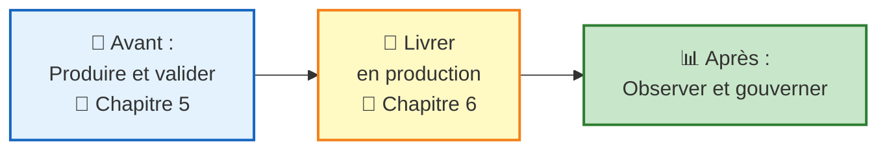
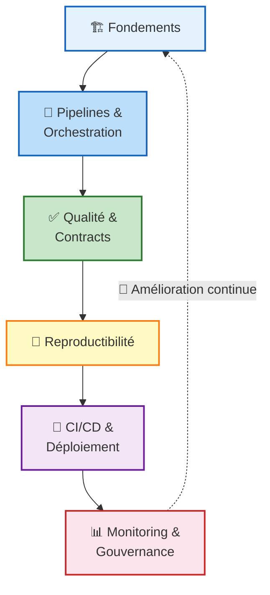
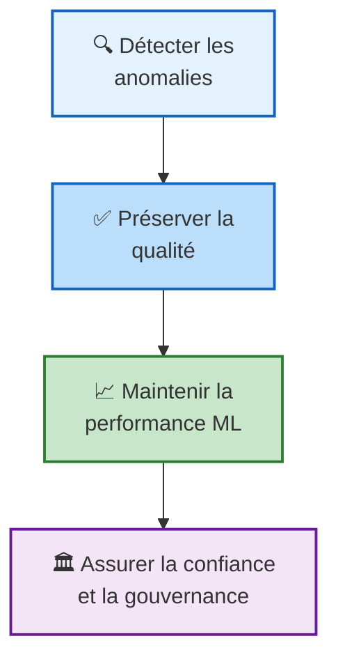
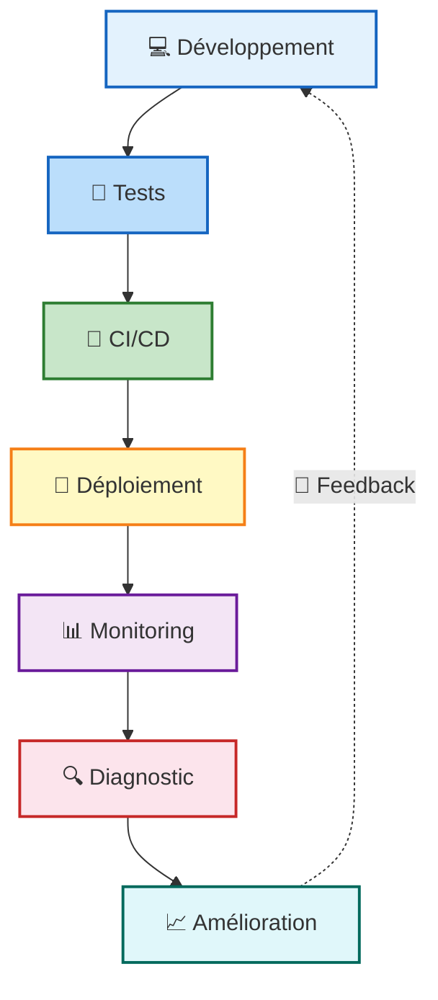
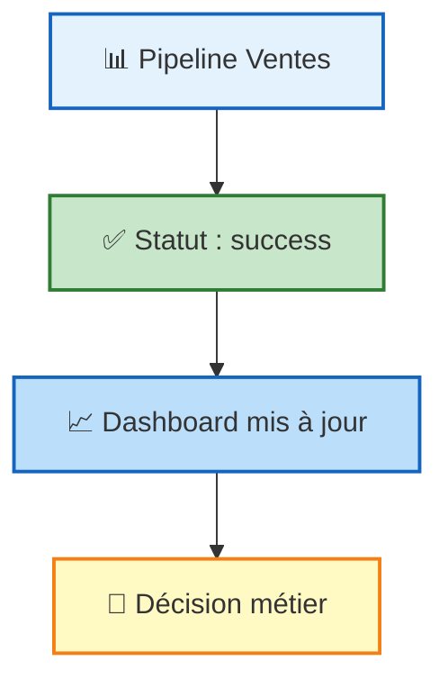
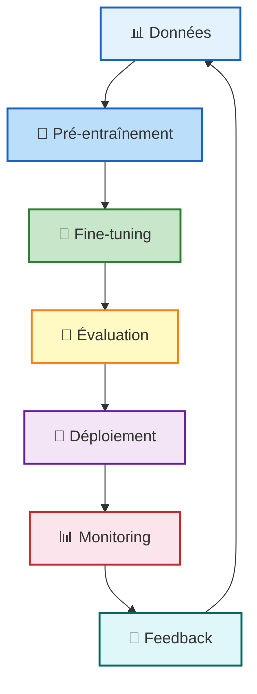
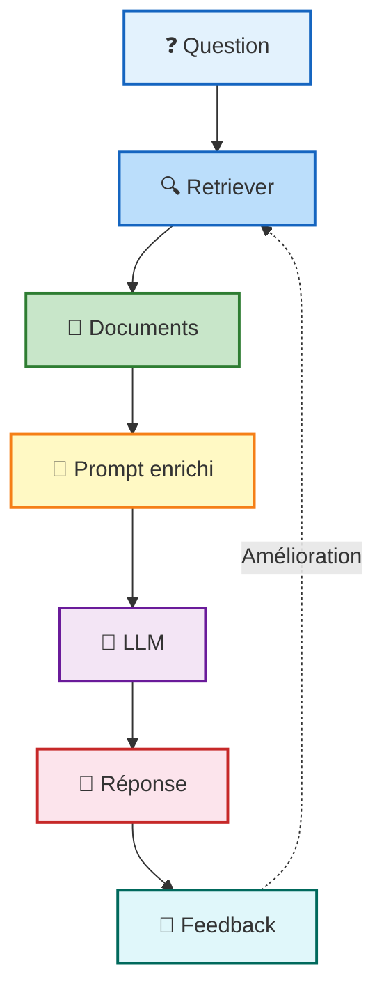

# MLOPS & DATAOPS
**Pr. Mohammed AIT DAOUD**

---

## Sommaire du module

- **Chapitre 1** : Fondamentaux DataOps & MLOps
- **Chapitre 2** : Pipelines agiles & orchestration
- **Chapitre 3** : Qualité & tests de données
- **Chapitre 4** : Reproductibilité et Cycle de vie des modèles
- **Chapitre 5** : CI/CD, conteneurisation et déploiement des services ML
- **Chapitre 6 : Monitoring, observabilité, gouvernance et ouverture vers LLMOps**
- **Projet intégrateur**

---

# MLOPS & DATAOPS : DE LA DONNÉE BRUTE À L'IA INDUSTRIELLE

## Chapitre 6 : Monitoring, observabilité, gouvernance et ouverture vers LLMOps

### Objectifs :

- Distinguer monitoring et observabilité.
- Identifier logs, métriques, traces et alertes.
- Définir les KPIs de santé d'un pipeline ou produit data/ML.
- Expliquer data drift, prediction drift et concept drift.
- Proposer une stratégie de model monitoring.
- Relier feedback loops, confiance, lineage et gouvernance.
- Intégrer sécurité, privacy, traçabilité, FinOps et ouverture LLMOps.

---

## Contenu :

- Pourquoi industrialiser le déploiement ML
- Continuous Integration et Continuous Delivery
- Packaging des composants ML
- Conteneurisation avec Docker
- Services ML : batch, API, microservice, serverless
- Pipeline de déploiement, tests et rollout
---

## Introduction

Ce chapitre constitue la dernière étape logique du module MLOps & DataOps. Après avoir étudié les fondements, les pipelines, la qualité, la reproductibilité, la conteneurisation et le déploiement, il montre que la mise en production n'est pas une finalité. Un système data/ML déployé doit être surveillé, expliqué, gouverné, sécurisé et amélioré en continu.



- **En amont** : qualité des données, reproductibilité et cycle de vie fournissent un modèle validé, prêt à être industrialisé.
- **Ce chapitre** : transformer un modèle validé en service fiable, testé et déployable de façon reproductible.
- **En aval** : une fois en production, le service doit être surveillé et gouverné dans la durée (chapitre 6).



### Question centrale

$$\boxed{\text{Que se passe-t-il après le déploiement ?}}$$

- Les chapitres précédents ont construit et déployé le pipeline data/ML.
- Ce chapitre traite l'exploitation continue : surveillance, diagnostic, sécurité, coût et valeur.
- Il prépare directement le projet final : architecture de monitoring, KPIs, alertes et gouvernance minimale.

---

## Pourquoi surveiller après le déploiement ?

Un modèle disponible n'est pas nécessairement fiable dans le temps.

| Données sources | Comportements | Performance ML |
|---|---|---|
| schéma, volume, fraîcheur | clients, utilisateurs, marché | drift, segments, labels différés |

| Exploitation | Risques | Coûts |
|---|---|---|
| latence, erreurs, incidents | sécurité, privacy, conformité | ressources cloud, inference, tokens |

La surveillance post-déploiement vise donc quatre objectifs :



Du modèle déployé au système exploité :



---

## Monitoring
> surveillance continue d'un système à partir d'indicateurs prédéfinis à l'aide de métriques, logs et traces afin de détecter rapidement les anomalies et maintenir son bon fonctionnement.

### Exemples d'indicateurs surveillés :

- taux d'erreur API
- latence moyenne
- pipelines échoués
- volume ingéré
- taux de valeurs nulles
- score de drift
- coût par prédiction

$$\boxed{\text{Le système est-il dans un état normal ou anormal ?}}$$

---

## Observabilité
> la capacité à comprendre l'état interne d'un système à partir des signaux qu'il produit.

### Exemples des signaux :

- logs
- métriques
- traces
- événements
- Métadonnées
- lineage

**Diagnostic → Action**

- Pourquoi le pipeline a-t-il échoué ?
- Quelle transformation a introduit l'anomalie ?
- Quelle version du modèle a produit cette prédiction ?
- Quelle donnée source est responsable ?

> Le monitoring signale un problème ; l'observabilité aide à le comprendre.

---

## MINI-EXERCICE : Monitoring vs observabilité

### Placer les phrases dans l'emplacement adéquat

- Est-ce que quelque chose ne va pas ? 
- Pourquoi cela ne va pas ? 
- Indicateurs prédéfinis 
- Exploration et diagnostic 
- Métriques, seuils, alertes 
- Logs, métriques, traces, lineage, événements 
- Alerte : taux d'erreur > 5 % 
- Analyse : quelle version du modèle, quelle source et quelle requête ont causé l'erreur ?
- Détection 
- Compréhension et résolution

| Critère                 | Monitoring | Observabilité |
| ----------------------- | ---------- | ------------- |
| **Question principale** |            |               |
| **Approche**            |            |               |
| **Données utilisées**   |            |               |
| **Exemple**             |            |               |
| **Objectif**            |            |               |
### Correction

| Critère                 | Monitoring                           | Observabilité                                                                            |
| ----------------------- | ------------------------------------ | ---------------------------------------------------------------------------------------- |
| **Question principale** | Est-ce que quelque chose ne va pas ? | Pourquoi cela ne va pas ?                                                                |
| **Approche**            | Indicateurs prédéfinis               | Exploration et diagnostic                                                                |
| **Données utilisées**   | Métriques, seuils, alertes           | Logs, métriques, traces, lineage, événements                                             |
| **Exemple**             | Alerte : taux d'erreur > 5 %         | Analyse : quelle version du modèle, quelle source et quelle requête ont causé l'erreur ? |
| **Objectif**            | Détection                            | Compréhension et résolution                                                              |

---

## Logging
> consiste à enregistrer les événements importants produits par une application, un pipeline ou un modèle en production.

### Les signaux fondamentaux d'observabilité :

| Logs                  | Métriques             | Traces              | Alertes              | Lineage                   |
| --------------------- | --------------------- | ------------------- | -------------------- | ------------------------- |
| événements structurés | mesures dans le temps | parcours de requête | signaux actionnables | origine & transformations |

> **les logs expliquent, les métriques indiquent, les traces localisent, le lineage contextualise.**

### Un log utile doit permettre de diagnostiquer :

- données d'entrée – prédictions
- performance - drift – latence
- segments utilisateurs
- version du modèle
- coût d'inférence

### Exemple de log structuré

```json
{
  "timestamp": "2026-05-14T10:35:20Z",
  "service": "churn-api",
  "model_version": "v1.4.2",
  "request_id": "req_45821",
  "latency_ms": 187,
  "status": "success"
}
```

---

## Les familles de métriques

### Définition

**AIT DAOUD, M. (2025)**

> Une métrique est une mesure quantitative collectée régulièrement. Dans un pipeline data/ML, on peut distinguer plusieurs familles de métriques.

| Famille | Exemples |
|---|---|
| **Système** | CPU, mémoire, disque, réseau |
| **Application** | requêtes, erreurs, latence |
| **Pipeline data** | volume, fraîcheur, durée, échecs |
| **Qualité des données** | nulls, doublons, schéma, validité |
| **Modèle ML** | performance, drift, prédictions |
| **Business** | adoption, gain, valeur produite |
| **Coût** | coût pipeline, coût prédiction, coût inférence |

---

## Alerting : transformer les signaux en action

### Définition

**AIT DAOUD, M. (2025)**

> Une alerte est une notification déclenchée lorsqu'un indicateur dépasse un seuil ou révèle un comportement anormal nécessitant une action.

### Les signaux fondamentaux d'observabilité :

| Logs | Métriques | Traces | Alertes | Lineage |
|---|---|---|---|---|
| événements structurés | mesures dans le temps | parcours de requête | signaux actionnables | origine & transformations |

> **Une alerte utile indique aussi quoi vérifier et qui doit agir**

### Exemples d'indicateurs surveillés :

- taux d'erreur API > 5 % pendant 10 minutes
- pipeline non exécuté depuis 24 h
- volume ingéré inférieur de 40 % à la moyenne
- drift détecté sur plusieurs variables
- coût d'inférence supérieur au budget

**Caractéristiques d'une alerte :**
- actionnable
- priorisée
- contextualisée
- reliée à une procédure
- limitée

---

## 1.4 CHAPITRE 6 : MONITORING, OBSERVABILITÉ, GOUVERNANCE ET OUVERTURE VERS LLMOPS

### Monitoring des pipelines de données

- Le monitoring d'un pipeline de données vise à vérifier que les flux de données restent disponibles, fiables, cohérents et exploitables.

| Dimension | Question de contrôle | Métrique |
|---|---|---|
| **Disponibilité** | Le pipeline tourne-t-il ? | taux de succès |
| **Fraîcheur** | Les données sont-elles à jour ? | âge dernière donnée |
| **Volume** | Le volume est-il normal ? | nombre de lignes |
| **Schéma** | La structure est-elle stable ? | colonnes modifiées |
| **Qualité** | Les règles sont-elles respectées ? | taux de nulls |
| **Performance** | Le job est-il rapide ? | durée d'exécution |
| **Coût** | La consommation est-elle maîtrisée ? | coût par run |

---

## MINI-EXERCICE :

### Cas 1 : pipeline en succès, données incomplètes

Un pipeline quotidien alimente un dashboard de ventes. Le volume habituel est de 100 000 lignes par jour. Un matin, seulement 12 000 lignes sont ingérées. Le pipeline est techniquement en succès, mais le résultat est incomplet.

**Analyse**

- le job est techniquement réussi
- les données sont fonctionnellement fausses
- le dashboard devient trompeur
- il faut une alerte sur volume et fraîcheur
- Sans monitoring de volume et de fraîcheur, le problème peut passer inaperçu et produire un dashboard erroné. Avec une règle de monitoring,
- Une alerte doit être déclenchée :



> **Alerte : volume journalier inférieur de 80 % à la moyenne des 7 derniers jours.**

---

## Monitoring des modèles ML

- Le monitoring des modèles vise à vérifier qu'un modèle conserve sa performance et sa pertinence en production.

**Données → Features → Modèle → Prédictions → Feedback**

- Le model monitoring surveille :

| Élément | Exemple de question |
|---|---|
| **Données d'entrée** | Les variables reçues ressemblent-elles aux données d'entraînement ? |
| **Prédictions** | La distribution des prédictions a-t-elle changé ? |
| **Performance** | Le modèle reste-t-il précis lorsque les labels réels arrivent ? |
| **Segments** | Le modèle fonctionne-t-il pour tous les groupes d'utilisateurs ? |
| **Latence** | Le modèle répond-il assez vite ? |
| **Robustesse** | Le modèle réagit-il correctement aux valeurs extrêmes ? |
| **Version** | Quelle version du modèle a produit quelle prédiction ? |

---

## Le problème du délai des labels

- Dans beaucoup de systèmes ML, la vérité terrain n'est pas disponible immédiatement.

| Cas | Label réel disponible | Signaux indirects |
|---|---|---|
| **Churn** | après plusieurs semaines | features, prédictions, feedback |
| **Crédit** | après plusieurs mois | scores, défauts retardés |
| **Maintenance** | au futur incident | capteurs, anomalies |
| **Recommandation** | après comportement utilisateur | clics, achats, satisfaction |

> **Quand les labels tardent, on surveille les distributions, la confiance, le drift et les métriques business retardées.**

---

## Data drift, prediction drift, concept drift

### Définition

**AIT DAOUD, M. (2025)**

> Le **data drift** désigne un changement dans la distribution statistique des données d'entrée.
>
> Le **prediction drift** désigne un changement dans la distribution des prédictions.
>
> Le **concept drift** apparaît lorsque la relation entre les variables d'entrée et la variable cible change (la même donnée n'a plus la même signification).

| Type de drift | Ce qui change | Exemple |
|---|---|---|
| **Data drift** | Distribution des variables d'entrée | nouveaux profils clients |
| **Prediction drift** | Distribution des sorties du modèle | hausse des prédictions "risque élevé" |
| **Concept drift** | Relation entre X et y | nouvelles stratégies de fraude |

**Data drift** → Entrées X → **Modèle** → Prédictions ŷ → Réalité y → **Concept drift**

---

## CHAPITRE 6 : MONITORING, OBSERVABILITÉ, GOUVERNANCE ET OUVERTURE VERS LLMOPS

### Feedback loops : amélioration continue

**Définition M. Kaizen (1986).** *The Key to Japan's Competitive Success.*

> Kaizen désigne une démarche d'amélioration continue, fondée sur de petites améliorations progressives et régulières apportées aux processus, afin d'améliorer durablement la qualité, l'efficacité et la performance.

**Le feedback loop transforme les signaux de production, les erreurs et les retours utilisateurs en amélioration du système.**

**Définir → Mesurer → Détecter → Analyser → Corriger → Redéploiement → Capitaliser**

- baisse du taux de clic
- détection d'un drift
- réentraînement
- suivi après redéploiement

---

## KPIs de santé d'un produit data/ML

- Un produit data/ML doit être suivi comme un produit opérationnel. Les KPI ne doivent pas seulement être techniques. Ils doivent couvrir plusieurs dimensions.

| Dimension | Exemples de KPI |
|---|---|
| **Santé technique** | disponibilité, erreurs, latence, incidents |
| **Santé data** | fraîcheur, complétude, validité, tests réussis |
| **Santé modèle** | performance, drift, stabilité, performance par segment |
| **Santé produit** | adoption, satisfaction, usage, décisions assistées |
| **Santé économique** | coût par run, coût par prédiction, coût par utilisateur |

> **Un système data/ML doit être suivi comme un produit vivant.**

---

## La confiance comme objectif central

- **Building Trust**, Atwal place la confiance au cœur du DataOps. La confiance ne se décrète pas. Elle se construit par des mécanismes techniques, organisationnels et de gouvernance.
- Un utilisateur fait confiance s'il peut comprendre :
  - d'où viennent les données
  - comment elles ont été transformées
  - qui en est responsable
  - qui y a accès
  - quelle version du modèle est utilisée
  - comment les anomalies sont corrigées

**La confiance repose donc sur :**

| Qualité | Métadonnées |
|---|---|
| **Lineage** | **Sécurité** |
| **Privacy** | **Gouvernance** |
| **Monitoring** | **Feedback** |

---

## Métadonnées : comprendre et documenter les données

### Définition

**Atwal, H. (2019).** *Practical DataOps*

> Les métadonnées sont des données qui décrivent d'autres données : structure, sens, source, fréquence, responsabilité, contraintes de qualité, usages autorisés.

> *More data beats clever algorithms, but better data beats more data.* — **Peter Norvig**, Director of Research at Google Inc

### Elles peuvent inclure

- Nom logique et technique
- Définition des champs
- Types de données
- Source d'origine
- Fréquence de mise à jour
- Propriétaire de la donnée
- Règles de qualité
- Sensibilité ou confidentialité

### Elles permettent de

- Faciliter la compréhension
- Améliorer la réutilisation
- Soutenir la gouvernance
- Renforcer la traçabilité
- Rendre les contrôles explicites
- Augmenter la confiance

### Les Métadonnées fournissent le contexte essentiel pour auditer et exploiter l'information

**RAW DATA BLOCK** `[1042.5, 2023-10-04, FR]` → **DATA TAG**

1. **Descriptives (Le Métier)** : Signification des données (ex: glossaire, définition de montant comme montant TTC). Facilite la découverte.
2. **Structurelles (L'Architecture)** : Schémas, relations par clés étrangères, types de données (ex: order_id est un INT64).
3. **Administratives (La Gouvernance)** : Permissions d'accès, fraîcheur, politique de...

> **Une table complète à 99% mais sans métadonnées ne peut pas être une donnée de confiance car son contexte et ses règles d'usage sont inconnus.**

---

## CHAPITRE 3 : QUALITÉ & TESTS DE DONNÉES

### Data lineage : retracer l'origine et les transformations

### Définition

**Atwal, H. (2019).** *Practical DataOps*

> Le data lineage désigne la traçabilité du parcours d'une donnée, depuis sa source jusqu'à ses transformations et ses usages finaux.

**Source → Ingestion → Transformation → Produit data → Usage**

| Source | Ingestion | Transformation | Produit data | Usage |
|---|---|---|---|---|
| CRM / ERP / fichiers | Capture & contrôle | Nettoyage & jointures | Table / feature | Dashboard / ML |

### Questions résolues

- D'où vient la donnée ?
- Quelles transformations a-t-elle subies ?
- Quels objets en dépendent ?

### Apports

- Analyse d'impact
- Diagnostic d'erreur
- Audit et conformité
- Confiance dans les pipelines

> **Sans lineage, les erreurs circulent plus vite que leur explication.**

---

## 6.2. The workflow to deliver trust in data

**Atwal, H. (2019)**

### Gouvernance des données : règles, responsabilités et pilotage

**Gouvernance Agile (DataGovOps) : Automatiser la conformité sans freiner l'innovation**

| Command & Control | Agile / DataGovOps |
|---|---|
| Processus manuels, silos informatiques, règles rigides (bottleneck). La gouvernance est vue comme une tâche purement administrative. | Libres-services encadrés, règles implémentées sous forme de code (Governance-as-code), gestion par les métadonnées. |

> **La gouvernance moderne n'est pas un formulaire à remplir ; c'est un ensemble de règles automatisées (contrôle d'accès, masquage de PII) intégrées directement dans le pipeline CI/CD.**

---

- Une gouvernance efficace n'est pas seulement administrative. Elle doit être intégrée aux pipelines : tests automatisés, contrôles d'accès, logs d'audit, documentation, lineage et règles de validation.

## CHAPITRE 6 : MONITORING, OBSERVABILITÉ, GOUVERNANCE ET OUVERTURE VERS LLMOPS

### Gouvernance des données et des modèles

**Atwal, H. (2019).** *Practical DataOps*

> La gouvernance désigne l'ensemble des règles, rôles, processus et contrôles permettant d'assurer une utilisation fiable, sécurisée et responsable des données et des modèles.

| Données | Modèles ML |
|---|---|
| ownership | versions de modèles |
| droits d'accès | datasets d'entraînement |
| classification | métriques d'évaluation |
| qualité | validation avant production |
| documentation | risques de biais |
| conformité | retrait ou remplacement |
| audit | |

---

## Sécurité, privacy et traçabilité

- Les systèmes data/ML manipulent souvent des données sensibles : données clients, données financières, données RH, données de santé, données comportementales.

### Enjeux

- confidentialité
- intégrité
- disponibilité
- protection des données personnelles
- auditabilité
- traçabilité des accès

### Contrôles possibles

- gestion des rôles
- authentification forte
- chiffrement
- masquage / pseudonymisation
- logs d'accès
- séparation des environnements
- revue des permissions
- politiques de rétention

> **Un modèle performant mais non sécurisé peut devenir un risque pour l'organisation.**

---

## Outils

| Outil | Rôle dans le chapitre |
|---|---|
| **Prometheus** | collecte de métriques, séries temporelles, alerting |
| **Grafana** | dashboards, exploration, visualisation opérationnelle |
| **Evidently** | data drift, qualité, model monitoring, rapports |
| **OpenLineage** | traçabilité des datasets, jobs, runs et dépendances |
| **Azure ML** | illustration managée : endpoints, logs, métriques, drift |
| **DataKitchen** | logique DataOps : qualité continue et observabilité |

---

## Ouverture vers LLMOps

- Le LLMOps applique les principes MLOps aux systèmes fondés sur des modèles de langage. Il ajoute des objets spécifiques à surveiller :

| Prompts      | Réponses générées  | Contexte RAG | Documents récupérés      | Hallucinations           |
| ------------ | ------------------ | ------------ | ------------------------ | ------------------------ |
| **Sécurité** | **Coût en tokens** | **Latence**  | **Feedback utilisateur** | **Qualité des réponses** |

- Les systèmes génératifs présentent des risques particuliers :

| prompt injection                        | réponses non vérifiables | fuite d'informations sensibles        | instabilité des réponses    | Hallucinations                                   |
| --------------------------------------- | ------------------------ | ------------------------------------- | --------------------------- | ------------------------------------------------ |
| **difficulté d'évaluation automatique** | **Coût variable**        | **dépendance à des modèles externes** | **biais dans les réponses** | **mauvaise utilisation des documents récupérés** |


---

## Monitoring d'un système RAG



| Dimension | Indicateurs à surveiller |
|---|---|
| **Retrieval** | nombre de documents, score de similarité, requêtes sans source |
| **Génération** | longueur, refus, hallucination suspectée |
| **Coût** | tokens input/output, coût par conversation |
| **Sécurité** | prompt injection, requêtes sensibles, fuite d'information |
| **Qualité** | feedback, exactitude, taux d'escalade humaine |
| **Performance** | latence totale, retrieval, LLM |

---

## Synthèse générale du chapitre

**Sources de changement :**
- Code
- Données
- Configurations
- Modèle
- Infrastructure

**Git / Versionnement**

**CI — Continuous Integration :**
1. Commit / Pull Request
2. Linting & Qualité du code
3. Tests unitaires
4. Tests de données / schéma / qualité
5. Tests de pipeline
6. Validation du modèle
7. Build package / artefacts

**Artefacts validés :**
- Package Python
- Image Docker
- Modèle versionné
- Configurations

*Build once, run many*

**CD — Continuous Delivery / Deployment :**
1. Publication dans registre
2. Déploiement en Staging
3. Smoke tests / Tests d'intégration
4. Approbation / Promotion
5. Déploiement en Production

**Service en production :**
- Batch
- API
- Microservice
- Serverless

**Supervision continue :**
- Monitoring
- Logs
- Performance
- Qualité des données
- Dérive
- Alertes
- Feedback
