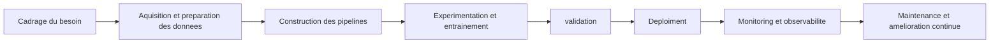

# Objectif

>Pas seulment "Coment construire un bon model?" mais "Comment livrer et maintenir un system data/ML robuste et utile dans la durees?"

# DevOps

>Est l'automatisation des builds, test et deploiments pour livre l'application avec une grand vitesse et utilisant un ensemble des philosofies et outiles.

# DataOps

>Est un cadre d'organisation et de collaboration qui vise a automatiser l'ensemble du cycle de vie de la donnee, de sa collect a sa livraison, en integrant en continue des controles de qualite, de securite et de gouvernance afin de fournir des donnees fiables et utiles aux utilisateurs avec un grand velocite.

- **Devops**
- **Agile**
- **Lean Manufacturing**
### De la donnée disponible à la donnée fiable

| Niveau                       | Caractéristiques                                 |
| ---------------------------- | ------------------------------------------------ |
| **Donnée disponible**        | Brute, non vérifiée, stockée en vrac             |
| **Donnée exploitable**       | Formatée, accessible, données bruitées           |
| **Donnée fiable**            | Complète, valide et exacte, opportune, cohérente |

### Questions de confiance
- D'où vient cette donnée ?
- Comment a-t-elle été produite ?
- A-t-elle été contrôlée ?
- Est-elle à jour ?
- Qui en est responsable ?
- Quelles transformations a-t-elle subies ?
- Quelles sont ses limites d'usage ?
### Éléments de confiance des donnees
- Qualité des données
- Métadonnées
- Data lineage
- Tests et validations
- Gouvernance
- Monitoring
- Feedback loops
### Les principales dimensions de la qualité

| Dimension                       | Définition                                                                                           | Exemple                                                                         |
| ------------------------------- | ---------------------------------------------------------------------------------------------------- | ------------------------------------------------------------------------------- |
| **Complétude**                  | Mesure le degré de présence des données attendues dans un jeu de données.                            | `customer_id` manquant dans certaines commandes.                                |
| **Validité**                    | Vérifie si les valeurs respectent le format, le type ou le domaine autorisé.                         | Un code pays différent de la liste autorisée (XX au lieu de MA, FR, ES).        |
| **Cohérence**                   | Vérifie l'absence de contradiction logique entre les données.                                        | `delivery_date` antérieure à `order_date`.                                      |
| **Cohérence métier**            | Vérifie que les données respectent les règles du domaine fonctionnel ou métier.                      | Un montant de vente négatif dans une table de ventes.                           |
| **Unicité**                     | Vérifie qu'un identifiant ou une clé censée être unique ne contient pas de doublons.                 | Deux lignes avec le même `order_id`.                                            |
| **Exactitude**                  | Mesure à quel point la donnée reflète correctement la réalité observée.                              | Un montant enregistré à 10000 au lieu de 1000.                                  |
| **Fraîcheur**                   | Mesure si la donnée est disponible dans un délai compatible avec l'usage attendu.                    | Un fichier quotidien reçu avec 2 jours de retard.                               |
| **Intégrité**                   | Vérifie que les relations entre objets ou tables sont respectées.                                    | Une commande associée à un `customer_id` inexistant dans la table clients.      |
| **Traçabilité**                 | Mesure la capacité à identifier l'origine d'une donnée et les transformations qu'elle a subies.      | Impossible de savoir de quelle source provient une colonne calculée.            |
| **Uniformité**                  | Vérifie que les données sont représentées de manière homogène dans tout le système.                  | Les dates sont parfois au format YYYY-MM-DD et parfois DD/MM/YYYY.              |
| **Documentation / Métadonnées** | Vérifie que les données sont décrites, comprises et contextualisées par des métadonnées suffisantes. | Une colonne `status` existe, mais sa signification métier n'est pas documentée. |

# MLOps

> Est une méthodologie qui automatise l'ensemble du cycle de vie d'un modèle, **depuis la préparation des données** jusqu'au déploiement en production. Elle simplifie sa maintenance grâce à une **surveillance continue et des boucles de retraining**, tout en garantissant un fonctionnement fiable, scalable, **reproductible et auditable**.

# IAOps

>Est l'application de l'intelligence artificielle et du Machine Learning aux opérations IT.
###  Les 3 piliers de l'IAOps
1. **Observabilité** → collecter logs, métriques, traces
2. **Intelligence** → analyser avec du ML/IA
3. **Automatisation** → agir sans intervention humaine
# LLMOps

>Est un ensemble de pratiques et d'outils pour gérer le cycle de vie des applications alimentées par de grands modèles de langage (LLM), incluant le développement, le déploiement et la maintenance.
### Les étapes du cycle LLMOps
1. **Conception** → choix du modèle, prompt engineering
2. **Données** → préparation, embeddings, base vectorielle (RAG)
3. **Entraînement/Adaptation** → fine-tuning, LoRA, RLHF
4. **Évaluation** → benchmarks, tests A/B, éval humaine
5. **Déploiement** → API, serving, scalabilité
6. **Monitoring** → coûts, latence, qualité, sécurité
7. **Amélioration continue** → itération sur prompts/modèles
### Les 3 piliers du LLMOps
1. **Données & Contexte** → RAG, embeddings, base vectorielle
2. **Modèle & Prompts** → versioning, fine-tuning, évaluation
3. **Production & Sécurité** → monitoring, guardrails, coûts
### Outils courants
- **Frameworks** : LangChain, LlamaIndex, Haystack
- **Évaluation** : Ragas, DeepEval, LangSmith, Arize
- **Vector DB** : Pinecone, Weaviate, Qdrant, pgvector
- **Serving** : vLLM, TGI, Ollama, Together
- **Observabilité** : Langfuse, Helicone, W&B Weave
- **Fine-tuning** : PEFT, LoRA, Axolotl

---
# Performance Experimentale : 
> Capacite d'obtenir une excellents resultats dans un environment controle (local).

# Robustesse Operationnelle : 
>Capacite d'obtenir une resultats acceptable dans un environment reel.

# Lean Manufacturing : 
 >Livrer plus de valeur, plus vite avec moins de gaspiallage

# Gaspillage : 
> Activite qui consomme des ressource sans cree de valeur

# Data Drift :
> les **entrées** changent de distribution, mais la règle métier reste la même.
> **Distribution des entrees**

# Prediction Drift
>la **distribution des sorties** du modèle change — souvent un **symptôme** des deux autres.
>**Distribution des sorties**

# Concept Drift
>la **règle qui relie X à Y change**. Mêmes entrées, mais la bonne réponse n'est plus la même.
>**La règle qui relie X à Y change.**

# Garbage in :
> Mauvaise qualité des données en entrée.(Data drift)

# Garbage out :
>Mauvais résultats en sortie à cause de données pourries.(prediction drift)

# SPC :
>Le Statistical Process Control (SPC) est une méthode de surveillance statistique permettant de détecter des variations anormales dans un flux de données au cours du temps.

# Métadonnées 
>Sont des données qui décrivent d'autres données

# Data lineage :
>Désigne la traçabilité du parcours d'une donnée, depuis sa source jusqu'à ses transformations et ses usages finaux.

# Data Contract
>Accord producteur ↔ consommateur pour stabiliser les pipelines.

# Gouvernance
>La gouvernance est l'ensemble des règles, processus, rôles et mécanismes qui permettent de piloter, contrôler et orienter une organisation (ou un système) vers ses objectifs, de manière transparente et responsable.

# Feedback loop
>Monitoring → amélioration continue

# Monitoring
>surveillance continue d'un système à partir d'indicateurs prédéfinis afin de détecter rapidement les anomalies et maintenir son bon fonctionnement.
- **À l'aide de**
	- Métriques
	- Logs
	- Traces
	- Seuils
	- Alertes

# Observabilité
>la capacité à comprendre l'état interne d'un système à partir des signaux qu'il produit.
- **À l'aide de**
	- Métriques
	- Logs
	- Traces

$$\boxed{\text{Le monitoring signale un problème ; l'observabilité aide à le comprendre.}}$$
# Logging (Logs)
> consiste à enregistrer les événements importants produits par une application, un pipeline ou un modèle en production.

# Métrique
> Une métrique est une mesure quantitative collectée régulièrement. Dans un pipeline data/ML, on peut distinguer plusieurs familles de métriques.

# Alerte
> Une alerte est une notification déclenchée lorsqu'un indicateur dépasse un seuil ou révèle un comportement anormal nécessitant une action.

# Lean Thinking 
>Est une philosophie d'amélioration continue qui consiste à identifier et éliminer tout ce qui ne crée pas de valeur pour le client, afin de produire mieux, plus vite et avec moins de ressources.

# Agile Collaboration
>L'Agile Collaboration est une façon de travailler où les individus communiquent en continu

# Flux de Valeur
>Le Flux de Valeur est la séquence complète de toutes les étapes (créatrices de valeur ou non) qui mènent de la demande du client à la livraison du produit ou service.

# Orchestration
>Le fait de coordonner et d'enchaîner automatiquement les différentes étapes d'un pipeline (chargement, entraînement, évaluation, déploiement) dans le bon ordre.

---

---
## Tools

### Python

- **venv** est l'outil standard de Python pour créer un environnement virtuel.
- **pip** est le gestionnaire de paquets Python.
- **requirements.txt** est un fichier qui liste les dépendances Python du projet.
- **DuckDB** est une base de données analytique légère embarquée.
- **dlt** est un outil d'ingestion de données.
- **dbt** est un outil de transformation de données basé sur SQL.
- **Dagster** est un outil d'orchestration de pipelines.
- **dbt test** est une commande de dbt permettant d'exécuter des tests sur les modèles de données.

### Data Version Control (DVC)

- **DVC (Data Version Control)** est un outil de versionnement de données et de pipelines ML. 

### Git & CI/CD

- **Git** est un système de versionnement.
- **.gitignore** est un fichier qui indique à Git quels fichiers ou dossiers ne pas versionner.
- **GitHub Actions** est un outil d'Intégration Continue (CI) intégré à GitHub.

### Files

- **CSV** est un format de fichier tabulaire simple.
- **YAML** est un format de description de configuration.

---
## Notebook
>On n'utilise pas de notebook en MLOps/DataOps parce qu'il n'est ni **reproductible**, ni **testable**, ni **versionnable**, ni **scalable**, ni **observable**, ni **sécurisé**.
>Le notebook est un outil d'exploration

---

# vocabularie

- Artisanal = مصنوع يدوياً
- Conserve = يحافظ
- Industrialise = يُصنّع
- Distingue = يُميّز
- insuffisant = غير كافٍ
- fiabilite(fiable) = الموثوقية (موثوق)
- La fraîcheur des données = حداثة البيانات
- Articuler = دمج
- 