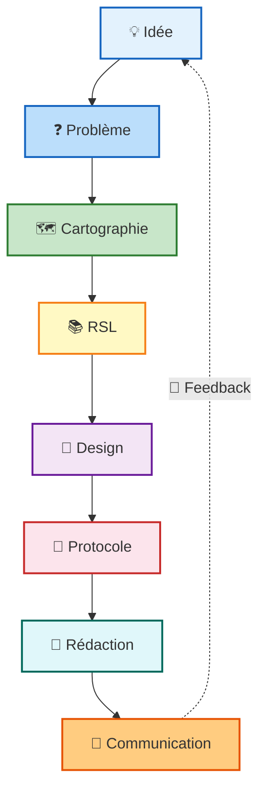
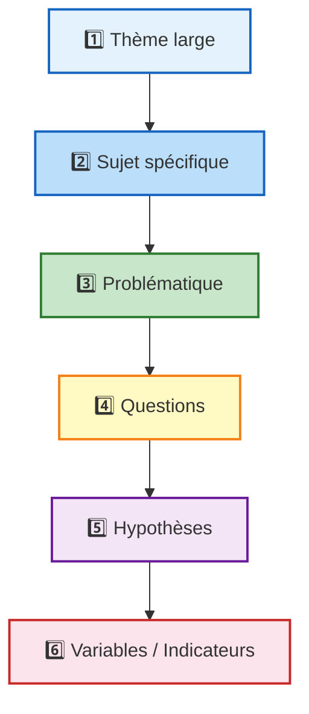

# La vue d'ensemble (le "fil rouge")

# SÉANCE 1 : La recherche en IA et les types de contributions

## La recherche

>Est la production d'un nouvelle connaissance en repondant a une question precise avec une methode rigoureuse

💡 **Idée clé** : En IA, **coder ne suffit pas**. Il faut justifier, comparer, et apprendre quelque chose de nouveau.

## Les 4 types de contributions en IA

| Type                                   | Description                                    | Exemple                                    |
| -------------------------------------- | ---------------------------------------------- | ------------------------------------------ |
| **1. Nouvelle architecture**           | Nouvelle organisation des couches              | CNN, ResNet, Transformer                   |
| **2. Nouvelle méthode d'optimisation** | Nouvelle façon de mettre à jour les paramètres | SGD, Adam                                  |
| **3. Données / benchmark**             | Créer un dataset plus réaliste                 | Ajouter brouillard/pluie/nuit              |
| **4. Étude d'usage / d'impact**        | Observer comment un système est utilisé        | Impact d'un assistant IA sur des étudiants |

#  SÉANCE 2 : De l'idée au problème de recherche

# SÉANCE 3 : Étude cartographique & RSL

## 1. Pourquoi lire la littérature ?

1. **Comprendre**
	- concepts clés
	- approches
	- méthodes
	- datasets
	- métriques
2. **Positionner**
	- ce qui est déjà fait
	- lacunes
	- valeur de la contribution
3. **Justifier**
	-  choix méthodologique
	- problématique
	- hypothèses
	- protocole
## 2. Étude cartographique vs RSL

### Étude cartographique: 
>Étude qui recense et classe les travaux existants sur un thème large pour en dresser une vue d'ensemble (tendances, méthodes, lacunes).
- **But** : Explorer, délimiter, trouver une lacune.
### RSL
>C'est une enquête exhaustive qui répond à une question ciblée. 
- **But** : Prouver, comparer, trancher.

# SÉANCE 4 : De la cartographie/RSL à la rédaction scientifique

## Les 6 sections d'un article scientifique

1. **Titre et résumé**
2. **Introduction**
3. **Méthodologie**
4. **Résultats**
5. **Discussion**
6. **Conclusion + bibliographie**

# SÉANCE 5 — De la recherche à la communication scientifique

# Vocabulaire
- Impact : تاثير
- Contributions : مساهمة
- lacunes : فجوات
- transformation : 
- 