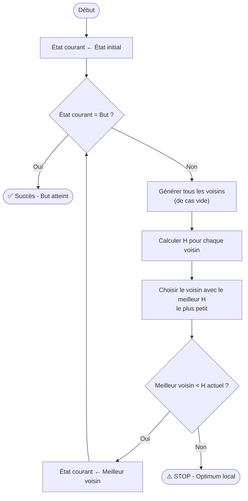

Cours d'Optimisation

# Fonction d'une variable

## 1. Limite et continuité

Une fonction $f$ est continue en $a$ si :

$$\lim_{x \to a} f(x) = f(a)$$

---

## 2. Convexité et concavité

Si $f$ est deux fois dérivable :

- $f''(x) \geq 0 \Rightarrow f$ est convexe.
- $f''(x) \leq 0 \Rightarrow f$ est concave.
- $f''(x) > 0 \Rightarrow f$ est strictement convexe.
- $f''(x) < 0 \Rightarrow f$ est strictement concave.

---

## 3. Points critiques

Un point $c$ est un point critique si :

$f'(c) = 0$

Plus généralement, un point peut être critique lorsque $f'(c)$ n'existe pas.

---

## 4. Extrema locaux

Si $f'(c)=0$, on peut utiliser le test de la dérivée seconde :

- $f''(c)>0 \Rightarrow c$ est un minimum local.
- $f''(c)<0 \Rightarrow c$ est un maximum local.
- $f''(c)=0 \Rightarrow$ test non concluant.

Lorsque le test est non concluant, il faut utiliser une autre méthode.

---

## 5. Points d'inflexion

Un point $c$ est un point d'inflexion lorsque la convexité change autour de $c$.

La condition :

$f''(c)=0$

est une condition possible, mais elle ne suffit pas à elle seule.

Il faut vérifier le changement de signe de $f''$ autour de $c$.

---

# Fonction de plusieurs variables

Soit une fonction :

$f:\mathbb{R}^n \rightarrow \mathbb{R}$

---

## 1. Gradient

Le gradient regroupe les dérivées partielles premières :

$$\nabla f(x)=\begin{pmatrix}\frac{\partial f}{\partial x_1}\frac{\partial f}{\partial x_2}...\frac{\partial f}{\partial x_n}\end{pmatrix}$$

Pour deux variables :

$$\nabla f(x,y)=\begin{pmatrix}\frac{\partial f}{\partial x}\frac{\partial f}{\partial y}\end{pmatrix}$$

---

## 2. Points critiques

Pour une fonction différentiable, un point $x^*$ est stationnaire si :

$$\nabla f(x^*)=0$$

Attention : $\nabla f(x^*)=0$ ne signifie pas automatiquement que $x^*$ est un minimum.

---

## 3. Hessienne

La Hessienne est la matrice des dérivées secondes :

$$H_f(x)=\nabla^2 f(x)$$

Pour deux variables :

$$H_f(x,y)=\begin{pmatrix}f_{xx}&f_{xy}\\f_{yx}&f_{yy}\end{pmatrix}$$

---

## 4. Classification d'un point critique

Pour un point $x^*$ vérifiant :

$\nabla f(x^*)=0$

on étudie la Hessienne :

$H=H_f(x^*)$

- H : définie positive $H\succ0 \Rightarrow x^*$ est un minimum local strict.
- H : définie négative $H\prec0 \Rightarrow x^*$ est un maximum local strict.
- H : indéfinie $H$ indéfinie $\Rightarrow x^*$ est un point selle.
- H : semi-définie $H\succeq0$ ou $H\preceq0 \Rightarrow$ test de la Hessienne généralement non concluant.

---

## 5. Convexité

Pour une fonction deux fois dérivable :

- $H_f(x)\succeq0$ pour tout $x \Rightarrow f$ est convexe.
- $H_f(x)\succ0$ pour tout $x \Rightarrow f$ est strictement convexe.
- $H_f(x)\preceq0$ pour tout $x \Rightarrow f$ est concave.
- $H_f(x)\prec0$ pour tout $x \Rightarrow f$ est strictement concave.

---

## 6. Signe d'une matrice

### Methode 1 (Valeurs propres)

- $\lambda_i>0 \quad \forall i$ $\Rightarrow$ $H\succ0$
- $\lambda_i\geq0 \quad \forall i$ $\Rightarrow$ $H\succeq0$
- $\lambda_i<0 \quad \forall i$ $\Rightarrow$ $H\prec0$
- $\lambda_i\leq0 \quad \forall i$ $\Rightarrow$ $H\preceq0$
- $\exists\lambda_i>0$ et $\exists\lambda_j<0$ $\Rightarrow$ $H$ est indéfinie.
### Methode 2 (determinant)

$H=\begin{pmatrix}a&b&c \\ d&e&f \\ g&h&i \end{pmatrix}$

$D_1 = a$
$D_2 = \det\begin{pmatrix}a & b \\d & e\end{pmatrix}$
$D_3 = det(H)$

On a :
- $D_1 > 0,\ D_2 > 0,\ D_3 > 0 \Rightarrow H > 0$
- $D_1 < 0,\ D_2 > 0,\ D_3 < 0 \Rightarrow H < 0$ 

---

# Décomposition de Cholesky

> **Objective** est de trouver les points critiques

## 1. Principe

Si $A$ est une matrice symétrique définie positive : ($A=A^T$ et $A>0$)

$A=LL^T$

$$L= \begin{pmatrix} l_{11}&0&0\\ l_{21}&l_{22}&0\\ l_{31}&l_{32}&l_{33} \end{pmatrix}$$

où $L$ est une matrice triangulaire inférieure dont les éléments diagonaux sont strictement positifs $L_{ii} > 0$.

## 2. Résolution de $Ax=b$

Comme :
$$A=LL^T$$
on obtient :
$$LL^Tx=b$$
On résout en deux étapes.

Étape 1 :
$$Ly=b$$
Étape 2 :
$$L^Tx=y$$
La solution finale est $x$.

## 3. Formules de calcul

Pour les éléments diagonaux :

$L_{ii}=\sqrt{a_{ii}-\sum_{k=1}^{i-1}L_{ik}^2}$

Pour les éléments sous la diagonale :

$L_{ji}=\frac{a_{ji}-\sum_{k=1}^{i-1}L_{jk}L_{ik}}{L_{ii}}$

avec $j>i$.

## Exemple complet

Prenons :

$$A= \begin{pmatrix} 4&2&2\\ 2&5&1\\ 2&1&5 \end{pmatrix}$$

On cherche :

$$A=LL^T$$

avec :

$$L= \begin{pmatrix} l_{11}&0&0\\ l_{21}&l_{22}&0\\ l_{31}&l_{32}&l_{33} \end{pmatrix}$$

### Étape 1 : calcul de $l_{11}$

$$l_{11}=\sqrt{a_{11}}$$

donc :

$$l_{11}=\sqrt4=2$$

---

### Étape 2 : calcul de $l_{21}$

Ta deuxième formule donne :

$$l_{21}=\frac{a_{21}}{l_{11}}$$

donc :

$$l_{21}=\frac{2}{2}=1$$

---

### Étape 3 : calcul de $l_{31}$

$$l_{31}=\frac{a_{31}}{l_{11}}$$

donc :

$$l_{31}=\frac22=1$$

On a maintenant :

$$L= \begin{pmatrix} 2&0&0\\ 1&l_{22}&0\\ 1&l_{32}&l_{33} \end{pmatrix}$$

---

### Étape 4 : calcul de $l_{22}$

$$l_{22} = \sqrt{a_{22}-l_{21}^2} =5−12=\sqrt{5-1^2} =4=2=\sqrt4=2$$

Donc :

$$L= \begin{pmatrix} 2&0&0\\ 1&2&0\\ 1&l_{32}&l_{33} \end{pmatrix}$$

---

### Étape 5 : calcul de $l_{32}$

$$l_{32} = \frac{a_{32}-l_{31}l_{21}}{l_{22}} =1−(1)(1)2= \frac{1-(1)(1)}{2} =0=0$$

---

### Étape 6 : calcul de $l_{33}$

$$l_{33} = \sqrt{a_{33}-l_{31}^2-l_{32}^2} =5−12−02= \sqrt{5-1^2-0^2} =2=2$$

Donc finalement :

$$L= \begin{pmatrix} 2&0&0\\ 1&2&0\\ 1&0&2 \end{pmatrix}$$

---

# Fonction quadratique

## 1. Forme générale

Une fonction quadratique s'écrit :

$\boxed{f(x)=\frac{1}{2}x^TAx+b^Tx+c}$

avec :

- $A\in\mathbb{R}^{n\times n}$ : matrice symétrique.
- $b\in\mathbb{R}^n$ : vecteur colonne.
- $c\in\mathbb{R}$ : constante.

---

## 1. Fonction quadratique en deux dimensions

Soit :

$q(x,y)=ax^2+bxy+cy^2+dx+ey+f$

- $\frac{1}{2}x^TAx = ax^2+bxy+cy^2$
-  $b^Tx = dx+ey+f$
- $c = f$

La matrice associée à la partie quadratique est :

$A=\begin{pmatrix}a&\frac{b}{2} \\\frac{b}{2}&c\end{pmatrix}$

car le terme croisé devient $bxy$.

$$\boxed{A^{-1}= \frac{1}{\det(A)} com^T(A)}$$
1. $f(x)=\frac{1}{2}x^TAx+b^Tx+c$
2. $\nabla f(x) = Ax+b$
3. $H = A$

>Les points critique est 

$$\boxed{x^* = -A^{-1}b}$$

---

# Recherche linéaire : dichotomie et nombre d'or

## 1. Méthode de dichotomie

La dichotomie classique permet de rechercher un zéro d'une fonction :

$f(x)=0$

On suppose que $f$ est continue sur $[a,b]$ et :

$f(a)f(b)<0$

Le point central est :

$m=\frac{a+b}{2}$

Règle :

- Si $f(a)f(m)<0 \Rightarrow b=m$.
- Si $f(m)f(b)<0 \Rightarrow a=m$.

Condition d'arrêt :

$b-a<\varepsilon$

La solution approchée peut alors être prise comme :

$x^*\approx m$

---

## 2. Méthode du nombre d'or

Le nombre d'or est :

$\varphi=\frac{1+\sqrt5}{2}\approx1.618$

Le rapport utilisé dans la méthode est :

$\rho=\frac{\sqrt5-1}{2}\approx0.618$

On définit :

$x_1=b-\rho(b-a)$

$x_2=a+\rho(b-a)$

Pour une minimisation :

- Si $f(x_1)<f(x_2) \Rightarrow$ conserver $[a,x_2]$.
- Si $f(x_1)>f(x_2) \Rightarrow$ conserver $[x_1,b]$.

Condition d'arrêt :

$b-a<\varepsilon$

---

# Méthodes du gradient

## 1. Gradient à pas fixe

La direction de descente est :

$d_k=-\nabla f(x_k)$

La mise à jour est :

$\boxed{x_{k+1}=x_k-\alpha\nabla f(x_k)}$

où $\alpha>0$ est le pas.

## 2. Gradient à pas optimal

La mise à jour est :

$x_{k+1}=x_k-\alpha_k^*\nabla f(x_k)$

On cherche le pas optimal en minimisant :

$\Phi(\alpha)=f(x_k-\alpha\nabla f(x_k))$

Le pas optimal vérifie :

$\frac{d\Phi}{d\alpha}=0$

## 3. Cas d'une fonction quadratique

Pour :

$f(x)=\frac12x^TAx-b^Tx+c$

on a :

$g_k=\nabla f(x_k)=Ax_k-b$

Si $A\succ0$ :

$\alpha_k^*=\frac{g_k^Tg_k}{g_k^TAg_k}$

---

# Gradient conjugué

La méthode du gradient conjugué est particulièrement adaptée aux fonctions quadratiques dont la matrice $A$ est symétrique définie positive.

## 1. Directions conjuguées

Deux directions $d_i$ et $d_j$ sont $A$-conjuguées si :

$d_i^TAd_j=0$

pour $i\neq j$.

---

## 2. Algorithme

Initialisation :

$g_0=\nabla f(x_0)$

$d_0=-g_0$

À chaque itération :

1. Calcul du pas : $\alpha_k=-\frac{g_k^Td_k}{d_k^TAd_k}$
2. Mise à jour de $x$ : $x_{k+1}=x_k+\alpha_kd_k$
3. Calcul du nouveau gradient : $g_{k+1}=\nabla f(x_{k+1})$
4. Calcul de $\beta_k$ : $\beta_k=\frac{g_{k+1}^Tg_{k+1}}{g_k^Tg_k}$
5. Nouvelle direction : $d_{k+1}=-g_{k+1}+\beta_kd_k$

---

# Méthodes de Newton et Quasi-Newton

## 1. Méthode de Newton

La méthode de Newton utilise le gradient et la Hessienne :

$$\boxed{x_{k+1}=x_k-H_f(x_k)^{-1}\nabla f(x_k)}$$

où :

$$\boxed{H_f(x_k)=\nabla^2f(x_k)}$$
$$\boxed{H^{-1} = \frac{1}{\det(H)}\ com^T(H)}$$
---

## 2. Méthodes Quasi-Newton

Les méthodes Quasi-Newton construisent une approximation de la Hessienne :

$B_k\approx H_f(x_k)$

La mise à jour peut s'écrire :

$$\boxed{x_{k+1}=x_k-B_k^{-1}\nabla f(x_k)}$$

Exemples :

- BFGS
- DFP
- L-BFGS

---

# Optimisation sous contraintes

## 1. Forme générale

Un problème d'optimisation sous contraintes s'écrit :

$$\boxed{\min_x f(x)}$$

sous :

$g_i(x)\leq0$

et :

$h_j(x)=0$

où :

- $g_i(x)$ représente les contraintes d'inégalité.
- $h_j(x)$ représente les contraintes d'égalité.

---

## 2. Contraintes d'égalité : Lagrangien

Pour :

$\min f(x)$

sous :

$h(x)=0$

on définit le Lagrangien :

$$\boxed{L(x,\lambda)=f(x)+\lambda h(x)}$$
$$\boxed{L(x,y,\lambda)=f(x,y)+\lambda h(x,y)}$$

Pour plusieurs contraintes :

$$\boxed{L(x,\lambda)=f(x)+\sum_j\lambda_jh_j(x)}$$
$$\boxed{L(x,y,\lambda)=f(x,y)+\sum_j\lambda_jh_j(x,y)}$$

Les conditions nécessaires sont :

- $\nabla_xL(x^*,\lambda^*)=0$
- $h(x^*)=0$

### Etapes
1. $L(x,y,\lambda)$
2. $\nabla L(x,y,\lambda) = 0$
3. $(x,y)$

---
## 3. Contraintes d'inégalité 

Pour :

$$\min f(x)$$

sous :

$$g(x) \le 0$$

on définit le **Lagrangien** :

$$\boxed{L(x,\mu)=f(x)+\mu\, g(x)}$$

Pour plusieurs contraintes d'inégalité :

$$\boxed{L(x,\mu)=f(x)+\sum_j \mu_j\, g_j(x)}$$

### Conditions de Karush-Kuhn-Tucker (KKT)

- **Stationnarité** : $\nabla_x L(x^*,\mu^*)=0$
- **Faisabilité** : $g_j(x^*) \le 0 \quad \forall j$
- **Complémentarité** : $\mu_j^*\, g_j(x^*) = 0 \quad \forall j$
- **Dualité (signe)** : $\mu_j^* \ge 0 \quad \forall j$

>Le signe de $\mu$ dépend de la convention d'écriture ($g \le 0$ ou $g \ge 0$).

---

## 4. Mélange : égalités + inégalités

Pour :

$$\min f(x)$$

sous :

$$h_i(x)=0 \quad (i=1,\dots,p)$$
$$g_j(x)\le 0 \quad (j=1,\dots,q)$$

on définit le **Lagrangien** :

$$\boxed{L(x,\lambda,\mu)=f(x)+\sum_{i=1}^{p}\lambda_i\, h_i(x)+\sum_{j=1}^{q}\mu_j\, g_j(x)}$$

En deux variables :

$$\boxed{L(x,y,\lambda,\mu)=f(x,y)+\sum_i \lambda_i\, h_i(x,y)+\sum_j \mu_j\, g_j(x,y)}$$

### Conditions KKT

- **Stationnarité** : $\nabla_x L(x^*,\lambda^*,\mu^*)=0$
- **Faisabilité égalités** : $h_i(x^*)=0$
- **Faisabilité inégalités** : $g_j(x^*)\le 0$
- **Complémentarité** : $\mu_j^*\, g_j(x^*)=0$
- **Signe** : $\mu_j^*\ge 0$ (pour $g_j\le 0$), $\lambda_i$ libre

---

## 5. Étapes de résolution

1. Écrire $L(x,\lambda,\mu)=f(x)+\sum_i\lambda_i h_i(x)+\sum_j\mu_j g_j(x)$
2. Calculer $\nabla_x L=0$ (et $\nabla_\lambda L=0$, $\nabla_\mu L=0$)
3. Discuter les cas de **complémentarité** :
   - $\mu_j=0$ et $g_j(x)\le 0$ (contrainte inactive)
   - $\mu_j>0$ et $g_j(x)=0$ (contrainte active)
4. Résoudre chaque système et vérifier les conditions KKT
5. Comparer les candidats et garder le minimum

---

# Jacobienne des contraintes

La Jacobienne regroupe les dérivées premières des fonctions de contraintes.

## 1. Une contrainte

Pour $g(x,y)$ :

$J_g=\begin{pmatrix}\frac{\partial g}{\partial x}&\frac{\partial g}{\partial y}\end{pmatrix}$

## 2. Deux contraintes

Pour $g_1(x,y)$ et $g_2(x,y)$ :

$J_g=\begin{pmatrix}\frac{\partial g_1}{\partial x}&\frac{\partial g_1}{\partial y}\\ \frac{\partial g_2}{\partial x}&\frac{\partial g_2}{\partial y}\end{pmatrix}$

---

# Hessienne bordée

Pour un problème avec une contrainte d'égalité :

$g(x,y)=0$

on définit le Lagrangien :

$$L(x,y,\lambda)=f(x,y)+\lambda g(x,y)$$

La Hessienne bordée est :

$$H_B=\begin{pmatrix}0&g_x&g_y \\ g_x&L_{xx}&L_{xy} \\ g_y&L_{yx}&L_{yy} \end{pmatrix}$$

Elle permet d'étudier les conditions du second ordre sous contrainte.

Attention : on ne peut pas simplement conclure :

$H_B>0\Rightarrow$ minimum

ou :

$H_B<0\Rightarrow$ maximum.

La classification utilise des conditions spécifiques sur les mineurs déterminants de la Hessienne bordée ou, de manière plus générale, la Hessienne du Lagrangien sur l'espace tangent aux contraintes.

---

# Pénalisation

## 1. Principe

La pénalisation transforme un problème contraint en problème non contraint :

$$\boxed{F(x)=f(x)+rP(x)}$$

avec :

$r>0$

où :

- $f(x)$ : fonction objectif.
- $P(x)$ : fonction de pénalité.
- $r$ : coefficient de pénalité.

## 2.Pénalité extérieure

Pour une contrainte :

$g_i(x)\leq0$

une pénalité quadratique classique est :

$$\boxed{P(x)=\sum_i[\max(0,g_i(x))]^2}$$

La pénalité est nulle lorsque les contraintes sont respectées.

## 3. Pénalité intérieure

Pour une contrainte :

$g_i(x)<0$

une pénalité inverse classique est :

$$\boxed{P(x)=-\sum_i\frac{1}{g_i(x)}}$$

Elle tend vers $+\infty$ lorsque $g_i(x)\rightarrow0^-$.

## 4. Barrière logarithmique

Pour :

$g_i(x)<0$

on peut utiliser :

$$\boxed{P(x)=-\sum_i\ln(-g_i(x))}$$

La fonction devient très grande lorsque :

$g_i(x)\rightarrow0^-$

$$\boxed{\text{En augment le coefficient de penalite a chaque iteration }r_1 = r_0\beta} $$
$$\text{Fonction d'areet}\ \boxed{|F(x_{k+1})-F(x_k))|<\epsilon} $$
---

# SQP — Sequential Quadratic Programming

La programmation quadratique séquentielle est une méthode d'optimisation pour les problèmes non linéaires sous contraintes.

À chaque itération, on approxime :

- la fonction objectif par une fonction quadratique ;
- les contraintes par des fonctions linéaires.

On résout alors un sous-problème quadratique :

$$\boxed{\min_d\frac12d^TB_kd+\nabla f(x_k)^Td}$$

sous les contraintes linéarisées.

Après résolution :

$$\boxed{x_{k+1}=x_k+d_k}$$

Le processus est répété jusqu'à convergence.

---

# Programmation linéaire

## 1. Forme générale

Un problème de programmation linéaire peut s'écrire :

$$\boxed{\min/\max\quad c^Tx}$$
sous : $Ax\leq b$

et : $x\geq0$

## 2.Fonction objectif

Exemple :

$\max Z=3x+5y$

## 3. Contraintes

Exemple :

- $2x+y\leq10$
- $x+3y\leq12$
- $x,y\geq0$

## 4. Variables de décision

Les variables :

$x_1,x_2,\ldots,x_n$

sont les variables de décision.

Elles représentent les inconnues que l'on cherche à déterminer afin d'optimiser la fonction objectif tout en respectant les contraintes.

---

# Méthode du Simplexe

## 1. Mise sous forme standard

Pour une contrainte :

$$\boxed{x+y\leq4 \ \rightarrow \ x+y+s=4}$$

avec :

$s\geq0$

## 2. Tableau initial

|     | $x$ | $y$ | $s_1$ | $s_2$ | $b$ |
| --- | --- | --- | ----- | ----- | --- |
| $x$ |     |     |       |       |     |
| $y$ |     |     |       |       |     |
| $z$ |     |     |       |       |     |

## 3. Variable entrante

- Regarder la ligne Z.
- **Maximisation** : choisir le coefficient **le plus négatif** → colonne pivot (variable entrante).
- **Minimisation** : choisir le coefficient **le plus positif** → colonne pivot (variable entrante).

## 4. Variable sortante

On applique le test du rapport :

$\frac{b_i}{v_s}$
- $v_s$ : Valeur de variable entrante
uniquement lorsque :

$$v_s>0$$

On choisit le plus petit rapport positif.

La variable correspondante devient la variable sortante.

## 5. Pivot

Le pivot est l'intersection :

- de la colonne de la variable entrante ;
- de la ligne de la variable sortante.

## 6. Mise a jour des ligne

### Ligne de pivot
$$\boxed{\text{Nouvelle ligne pivot}=\frac{\text{Ancienne ligne pivot}}{\text{Pivot}}​}$$
### Autre ligne​
$$\boxed{\text{Nouvelle lignei}​=\text{Ancienne lignei​}−a_{ip}​×\text{Nouvelle ligne pivot}​}$$
- $a_{ip}$ : coefficient de la ligne i dans la **colonne pivot** (valeur AVANT modification)
## 7. Condition d'arrêt

Avec la convention classique utilisée ci-dessus, lorsque tous les coefficients de la ligne objectif sont :

$$\boxed{L_z \geq0}$$

la solution courante est optimale, sous les hypothèses usuelles de la méthode du simplexe.

---

## Exemple simple — Méthode du Simplexe

## 1. Problème

$$\max Z=3x+2y$$

sous :

$$x+y\le 4$$
$$x+3y\le 6$$
$$x,y\ge 0$$

---

## 2. Forme standard

On ajoute les variables d'écart $s_1,s_2\ge0$ :

$$x+y+s_1=4$$
$$x+3y+s_2=6$$
$$Z-3x-2y=0$$

**Variables de base initiales :** $s_1=4,\;s_2=6,\;Z=0$

---

## 3. Tableau initial

| Base  | $x$  | $y$  | $s_1$ | $s_2$ | b   |
| ----- | ---- | ---- | ----- | ----- | --- |
| $s_1$ | 1    | 1    | 1     | 0     | 4   |
| $s_2$ | 1    | 3    | 0     | 1     | 6   |
| $Z$   | $-3$ | $-2$ | 0     | 0     | 0   |

---

## 4. Itération 1

**Variable entrante :** coefficient le plus négatif dans $Z$ → $-3$ ⇒ **$x$ entre**.

**Variable sortante :** test du rapport $\dfrac{b_i}{a_{ij}}$ avec $a_{ij}>0$ :

- Ligne $s_1$ : $\dfrac{4}{1}=4$
- Ligne $s_2$ : $\dfrac{6}{1}=6$

Plus petit rapport : $4$ ⇒ **$s_1$ sort**.

**Pivot :** ligne $s_1$, colonne $x$, coefficient $=1$.

**Normalisation de la ligne pivot** (déjà 1) :

$$L_1 \leftarrow L_1 : \quad x+y+s_1=4$$

**Élimination de $x$ dans les autres lignes :**

- $L_2 \leftarrow L_2-L_1$ : $\;(1-1)x+(3-1)y+(0-1)s_1+s_2=6-4$
$$\Rightarrow 2y-s_1+s_2=2$$
- $L_Z \leftarrow L_Z-Z_{pivot}L_1$ : $\;(-3+3)x+(-2+3)y+(0+3)s_1+0=0+12$
$$\Rightarrow y+3s_1=12$$

**Nouveau tableau :**

| Base  | $x$ | $y$ | $s_1$ | $s_2$ | b   |
| ----- | --- | --- | ----- | ----- | --- |
| $x$   | 1   | 1   | 1     | 0     | 4   |
| $s_2$ | 0   | 2   | $-1$  | 1     | 2   |
| $Z$   | 0   | 1   | 3     | 0     | 12  |

---

## 5. Itération 2

**Variable entrante :** coefficients dans $Z$ : $0,1,3,0$ → aucun négatif.

**Condition d'arrêt atteinte** : tous les coefficients de la ligne $Z$ sont $\ge0$.

---

## 6. Solution optimale

Lecture du tableau :

- $x=4$ (ligne $x$)
- $s_2=2$ (ligne $s_2$) ⇒ $y=0$
- $Z=12$

$$\boxed{x^*=4,\quad y^*=0,\quad Z_{\max}=12}$$

**Vérification :**

$$x+y=4\le4 \;\text{✓ (saturée)}$$
$$x+3y=4\le6 \;\text{✓ (non saturée)}$$
$$Z=3(4)+2(0)=12 \;\text{✓}$$
---
# Methode de graphe
## Methode
1. Convert les contraints au equations (ex : $x+2y \geq 12 \Rightarrow x+2y=12$)
2. Représenter graphiquement
3. La région admissible (demi plan qui valide les contraints)
4. Les "coins" (corners) de la région admissible sont les sommets
5. Calculer les coordonnées de chaque sommet en résolvant les systèmes d'équations des droites qui s'intersectent
6. Évaluer la fonction objectif $Z$ en chacun des sommets
7. Comparer les valeurs de $Z$ :
    - Pour une **maximisation** : choisir le sommet donnant la plus grande valeur de $Z$
    - Pour une **minimisation** : choisir le sommet donnant la plus petite valeur de $Z$
8. Conclure : le sommet optimal donne les valeurs de ($x^∗$,$y^∗$) et la valeur optimale $Z^*$

---
# Hill Climbing (Escalade)

>**Hill Climbing** = algorithme de **recherche locale** en IA.

> Principe : partir d'un état, choisir toujours le **meilleur voisin**, s'arrêter quand aucun ne fait mieux.

## Heuristique H

**H = nombre de tuiles mal placées** (hors case vide 0).

- Plus **H est petit** → plus on est proche du but.
- **H(but) = 0**
- Objectif : **minimiser H**

## Voisins

Déplacements possibles de la case vide :

| Symbole | Direction |
|---------|-----------|
| ↑ | Haut |
| ↓ | Bas |
| ← | Gauche |
| → | Droite |
## Algorithme

## Tableau type à utiliser en exercice

| Étape | État courant | H | Voisins (H) | Meilleur | Décision |
|-------|-------------|---|-------------|----------|----------|
| 0 | … | … | … | … | Avancer / STOP |

---

# Taylor

## Order 1

$$\boxed{f(x) ≈ f(a) + f'(a)(x-a)}$$
## Order 2

$$\boxed{f(x) ≈ f(a) + f'(a)(x-a) + \frac{f''(a)}{2}(x-a)^2}$$
