# Types of Charts in Markdown

Markdown supports various chart types through different syntaxes and extensions. Here are the main types with examples:

## 1. **Flowchart** (Mermaid)
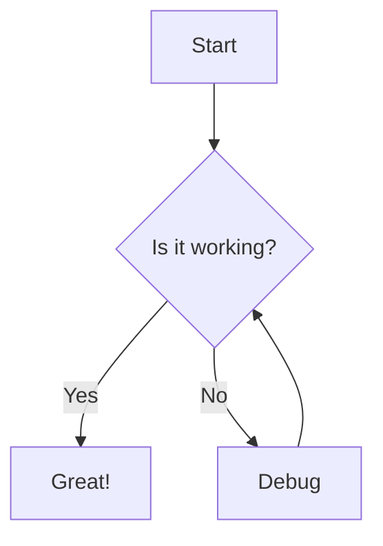

---

## 2. **Sequence Diagram** (Mermaid)
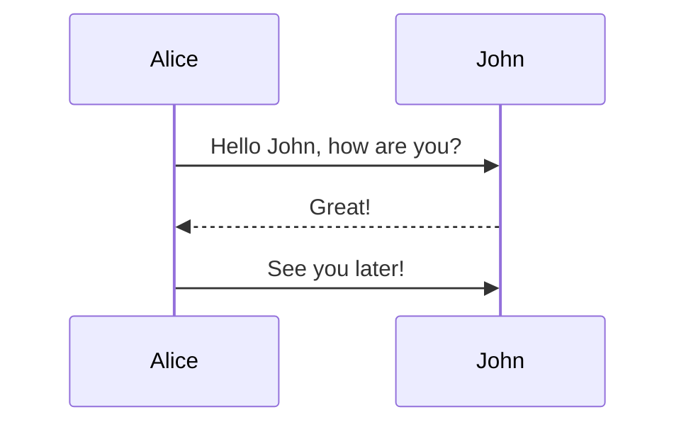

---

## 3. **Class Diagram** (Mermaid)
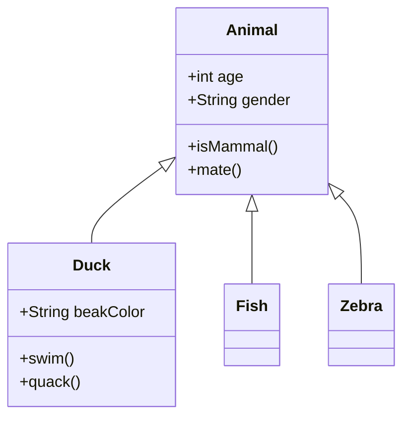

---

## 4. **State Diagram** (Mermaid)
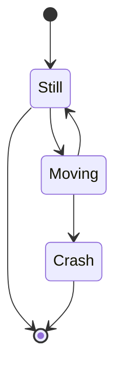

---

## 5. **ER Diagram** (Mermaid)
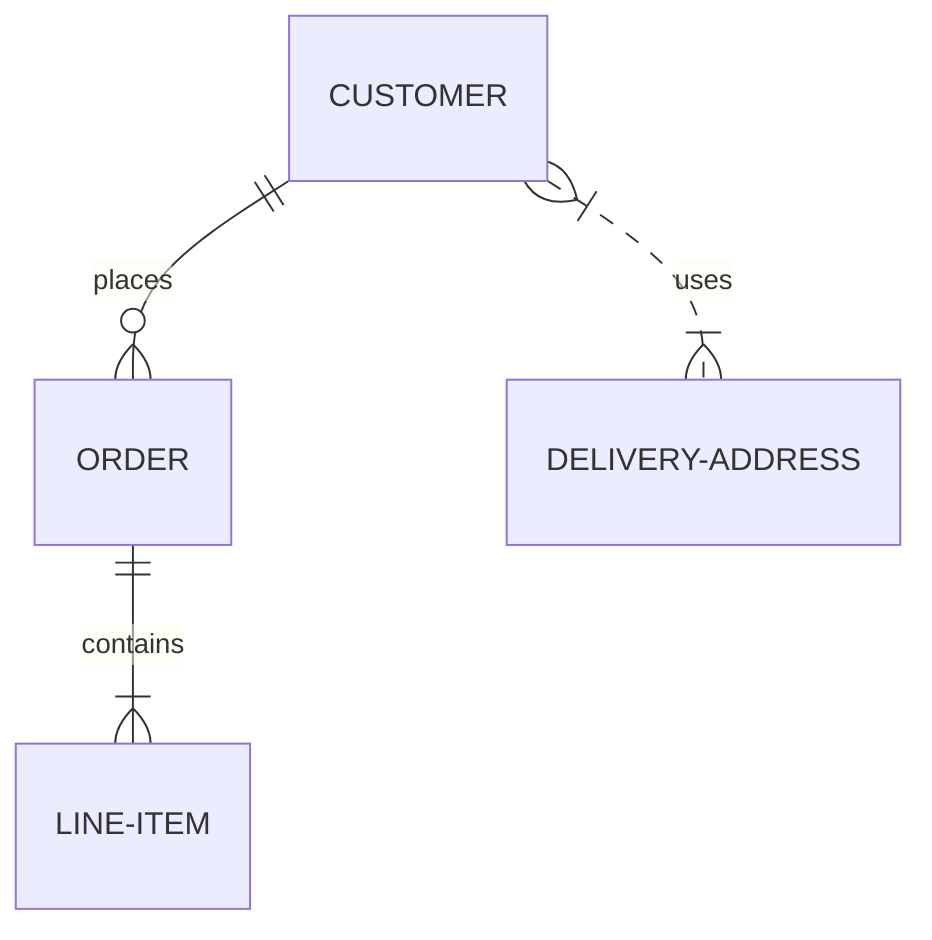

---

## 6. **Gantt Chart** (Mermaid)
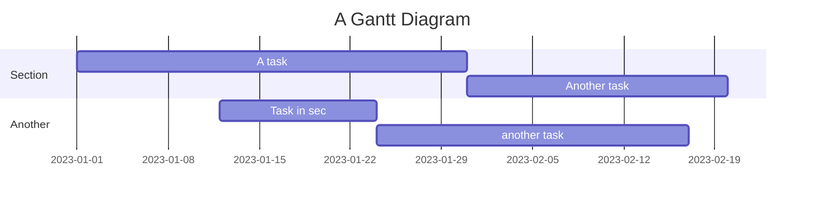

---

## 7. **Pie Chart** (Mermaid)
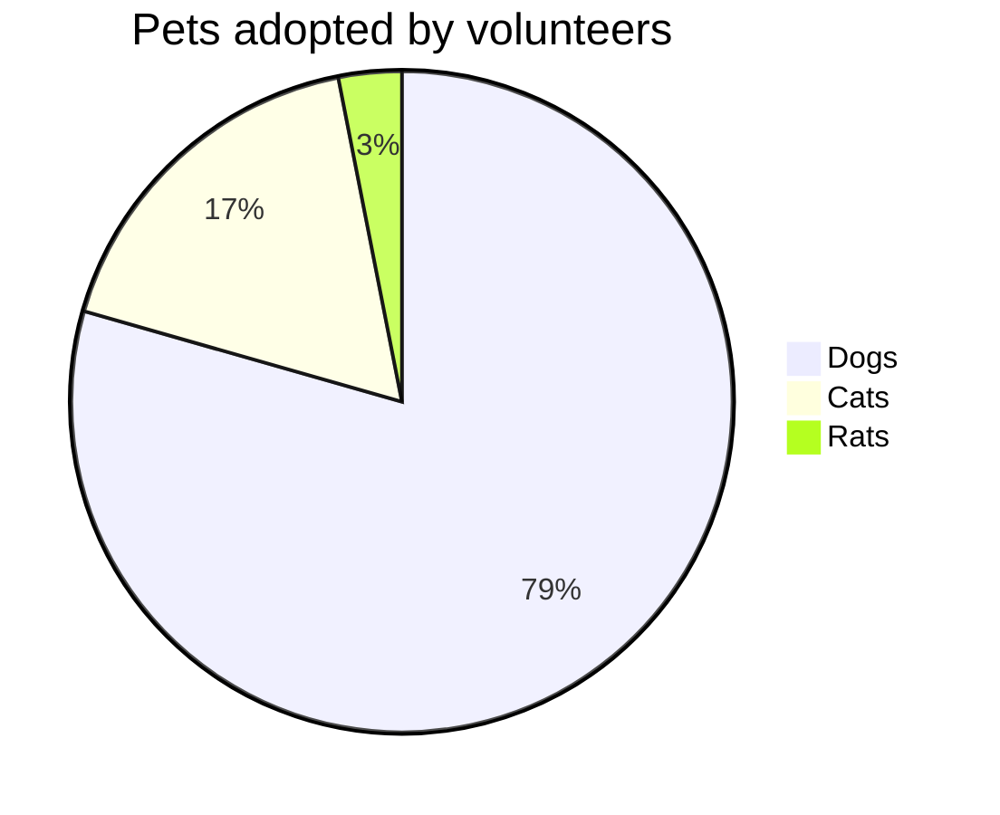

---

## 8. **Timeline** (Mermaid)
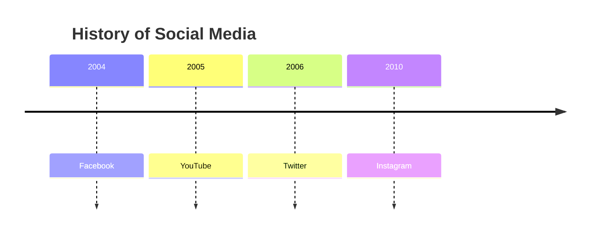

---

## 9. **Git Graph** (Mermaid)
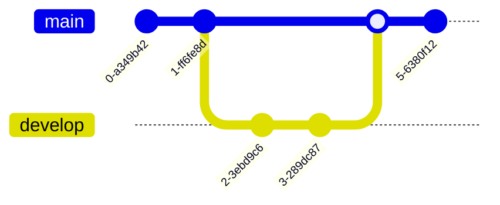

---

## 10. **Mindmap** (Mermaid)
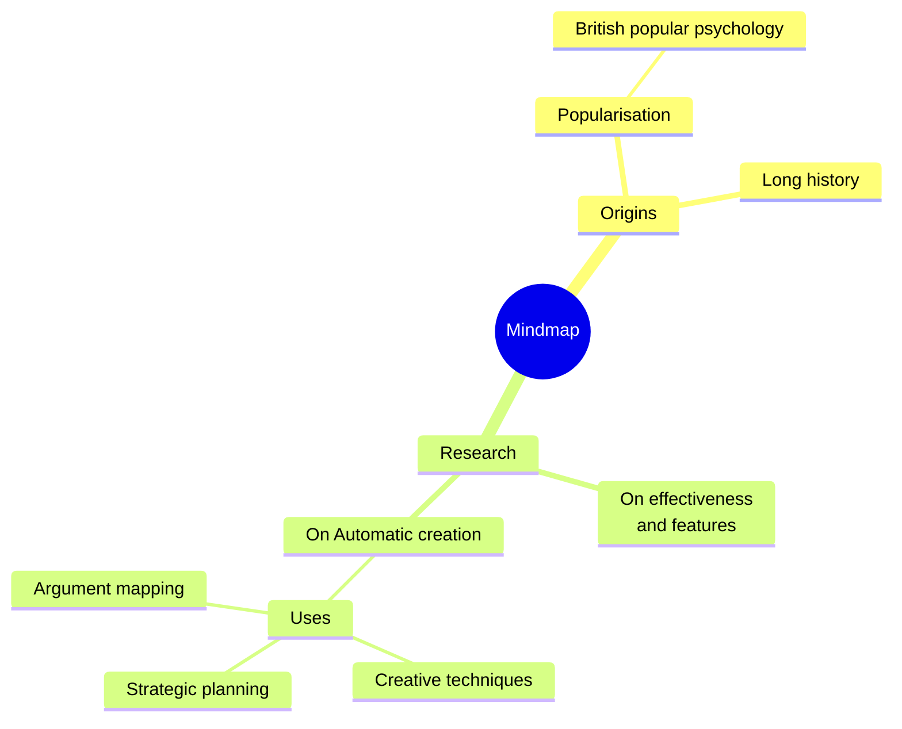

---

## 11. **Quadrant Chart** (Mermaid)
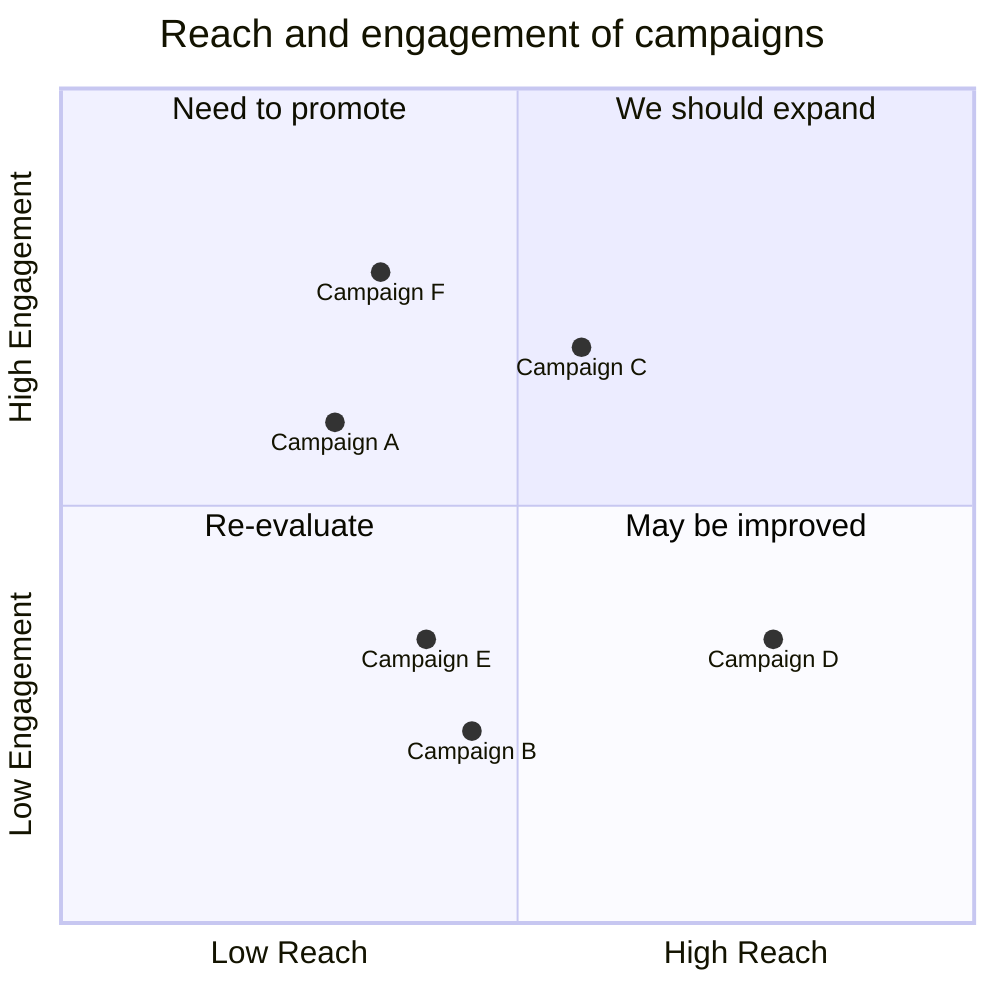

---

## 12. **Requirement Diagram** (Mermaid)
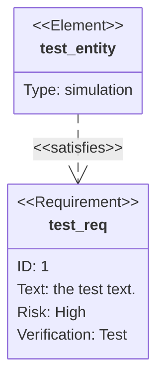

---

## 13. **User Journey** (Mermaid)
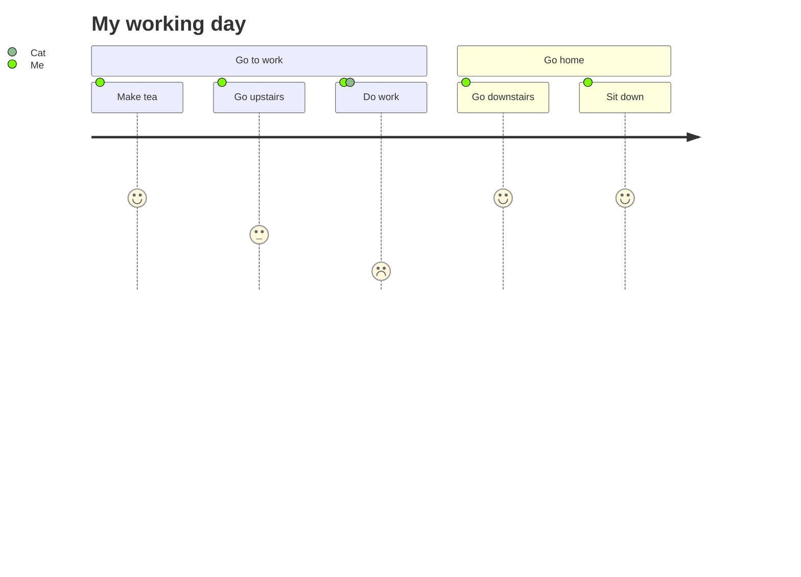

---

## 14. **XY Chart** (Mermaid)
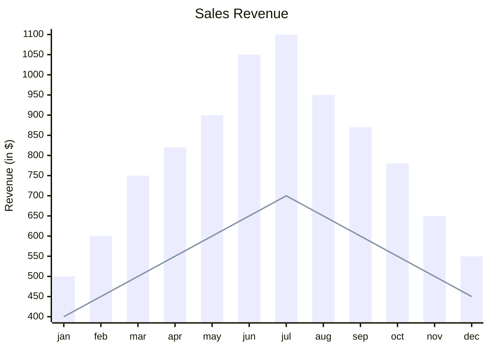

---

## 15. **Table** (Standard Markdown)
```markdown
| Feature   | Status | Priority |
|-----------|--------|----------|
| Login     | ✅     | High     |
| Dashboard | 🚧     | Medium   |
| Reports   | ❌     | Low      |
```

---

## 16. **Code Block with Syntax Highlighting**
```json
{
  "name": "Markdown Charts",
  "version": "1.0",
  "types": ["flowchart", "sequence", "class", "state", "er", "gantt", "pie"]
}
```

---

## 17. **ASCII Art Charts**
```
        ▲
        │
   High │    ╔═══════╗
        │    ║  Core  ║
  Cost │    ║Features║
        │    ╚═══╤═══╝
        │        │
   Low  │────────┼────────►
        │   Low  │  High
        │  Value │  Value
        ▼
```

---

## 18. **Admonitions/Callouts** (with emojis)
> [!NOTE]
> This is a note about Markdown charts

> [!TIP]
> Use Mermaid for advanced diagrams

> [!IMPORTANT]
> Not all Markdown renderers support Mermaid

> [!WARNING]
> Some charts may not render in all platforms

> [!CAUTION]
> Check compatibility before using

---

**Note:** Mermaid charts (1-14) require a Markdown renderer that supports Mermaid.js (like GitHub, GitLab, or Obsidian). Standard Markdown tables and code blocks work everywhere.